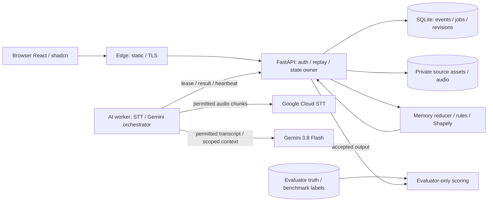

# Product Requirements Document (PRD): ATC FlowLens

| Atribut | Nilai |
| --- | --- |
| Status dokumen | **Draft product contract v1.0 untuk review**; keputusan stack pengguna dikunci, asumsi produk dan keputusan terbuka ditandai |
| Status implementasi | Requirement target. Phase 0–1 foundation/contracts/fixtures/MOCK harness/tests tersedia (8 Oktober 2026); business pipeline A/B, provider adapters nyata, UI dan deployment belum diimplementasikan |
| Versi dokumen | 1.0 |
| Tanggal | 7 Oktober 2026 |
| Product owner | Tim ATC FlowLens; individu pemilik keputusan produk/domain belum ditetapkan |
| Pengguna yang dituju | Controller Tower/Ground; pengguna MVP adalah evaluator/instruktur dan peserta review dalam lingkungan riset |
| Platform | Web desktop, local deployment dan single VM melalui Docker Compose, dengan Google cloud AI |
| Frontend | React, TypeScript, Vite, shadcn/ui |
| Backend | Python, FastAPI, Pydantic |
| Transkripsi | Google Cloud Speech-to-Text |
| LLM | Gemini 3.8 Flash, model ID `gemini-3.8-flash` |

Dokumen ini menyatukan usulan solusi dari dasar menjadi requirement yang dapat diimplementasikan dan diuji. Kata **MUST/wajib**, **MUST NOT/dilarang**, **SHOULD/sebaiknya**, dan **MAY/dapat** bersifat normatif untuk rancangan v1 ini. Status target tidak boleh diubah menjadi klaim implementasi, hasil benchmark, review ATCO, atau validasi operasional tanpa evidence tersendiri.

**Batas yang berlaku:** v1 menganalisis replay offline. Target sumber adalah simulator mitra yang berizin; selama mitra belum tersedia gunakan baseline sintetik berlabel. Corpus publik dapat menjadi eksperimen tambahan setelah hak penggunaan dan transfer cloud diperiksa. Tidak ada mitra/data simulator yang dikonfirmasi pada baseline 3 Oktober 2026; dokumen ini tidak mengklaim konfirmasi baru. Controller tetap memegang keputusan dan kewenangan clearance. Penggunaan pada posisi ATC aktif tidak termasuk v1.

**Makna offline:** replay memproses rekaman dari sesi yang sudah berlangsung, bukan feed operasi aktif. Dengan stack cloud yang dipilih, analisis baru memerlukan internet. Replay hasil yang sudah tersimpan dapat berjalan tanpa akses provider; local deployment tidak berarti inferensi sepenuhnya lokal.

**Peta baca:** [arah dan scope](#3-visi-tujuan-dan-non-tujuan), [fitur dan prioritas](#5-scope-kapasitas-dan-batas-sistem), [data](#9-source-data-import-dan-remediation), [Google STT](#13-google-speech-to-text-dan-transcript-review), [Gemini](#14-gemini-intent-parser-orchestration-dan-output), [API](#22-internal-api-contract-dan-websocket), [arsitektur](#25-arsitektur-teknis-dan-sequencing), [deployment](#31-deployment-topology-local-dan-single-vm), [acceptance](#35-acceptance-criteria-v1), dan [pertanyaan terbuka](#39-external-dependencies-pertanyaan-dan-launch-blockers).

---

## 1. Ringkasan Eksekutif

ATC FlowLens membantu pengguna mempertahankan konteks komunikasi dan keadaan operasi runway. Ia mengubah audio menjadi transcript bertimestamp, memakai Gemini untuk memahami intent, menghubungkan pesan dengan objek dan instruksi, lalu menyusun memori operasi yang dapat ditelusuri ke bukti. Track, catatan instruksi, koordinasi, dan alert dari sumber lain ditambahkan hanya jika tersedia dan kualitasnya memadai.

Tiga keluaran utama adalah **memori per objek/runway**, **temuan yang perlu diperiksa**, dan **kandidat opsi untuk review evaluator**. Pengguna dapat membuka bukti, mendengar audio, mengoreksi interpretasi, dan melihat perubahan konteks pada replay. Brief serta jawaban bahasa alami memakai memori sesi yang sama, bukan membuat cerita baru dari keseluruhan transcript.

Gagasan produk mengikuti hubungan **Said–Heard–Observed**: apa yang diucapkan, apa yang dibaca kembali, dan apa yang teramati. Ketiganya disimpan terpisah. Readback yang cocok tidak membuktikan gerakan sudah sesuai; ucapan yang berhasil ditranskripsi tidak otomatis merupakan clearance yang sah; track yang hilang tidak berarti runway kosong.

Gemini menjadi inti pemahaman bahasa dan orkestrasi analisis. Ia memilih konteks, mengusulkan pengaitan, menyusun kandidat memori, menjelaskan temuan, serta menghasilkan brief dan opsi. Backend memegang autentikasi, clock, penyimpanan, validasi, lifecycle, dan pemeriksaan geometri/aturan. Semua hasil AI melewati Pydantic dan pemeriksaan evidence sebelum ditampilkan sebagai hasil yang diterima aplikasi.

V1 adalah langkah pembuktian menuju copilot Tower/Ground. Manfaat yang ingin diuji adalah kecepatan menemukan konteks, ketepatan hubungan komunikasi, kualitas temuan, dan kegunaan opsi. Penurunan insiden, workload, atau penggunaan operasional belum merupakan hasil produk.

## 2. Latar Belakang dan Prinsip Produk

### 2.1 Masalah yang diselesaikan

Dalam konteks yang dituju, pengguna perlu menggabungkan instruksi, readback, permintaan, laporan, koordinasi, dan posisi yang muncul pada waktu berbeda. Informasi yang belum selesai mudah kehilangan konteks ketika percakapan berpindah antarobjek. Masalah produk adalah **kesulitan mempertahankan dan memeriksa hubungan informasi tersebut**, bukan klaim bahwa industri ATC belum memiliki sistem monitoring.

Sistem surveillance, safety net, strip, dan voice recording yang ada tetap mempunyai fungsi masing-masing. FlowLens meneliti lapisan konteks komunikasi yang terhubung ke keadaan, dengan evidence dan uncertainty yang terlihat. Orisinalitas dan manfaatnya adalah hipotesis riset, bukan klaim pertama di dunia.

### 2.2 Prinsip solusi

FlowLens menyatukan komunikasi dan keadaan yang teramati melalui memori sesi. Setiap interpretasi harus dapat ditelusuri ke audio, transcript, atau event yang mendukungnya. Informasi yang ambigu, hilang, atau bertentangan tetap terlihat; aplikasi tidak melengkapinya dengan dugaan yang ditampilkan sebagai fakta.

| Prinsip | Konsekuensi pada produk |
| --- | --- |
| Controller memegang kewenangan | Output aplikasi berupa temuan dan kandidat opsi untuk review; tidak menerbitkan clearance |
| Said–Heard–Observed dipisahkan | Instruksi, readback, dan gerakan mempunyai catatan serta tingkat kepastian masing-masing |
| Bukti dapat diperiksa | Pengguna dapat membuka rentang audio, teks, dan event dari memori, temuan, brief, serta opsi |
| Waktu dan kualitas data menentukan kelayakan | Pemeriksaan hanya berjalan ketika identity, timing, geometry, dan coverage mencukupi |
| Review manusia berversi | Koreksi dan keputusan reviewer ditambahkan tanpa menimpa data asli |
| Truth evaluator terisolasi | Label evaluasi tidak masuk konteks AI atau detector |
| Scope bertahap | V1 berupa replay offline; penggunaan pada simulasi berjalan atau operasi aktif membutuhkan keputusan tahap tersendiri |

### 2.3 Keputusan target dan asumsi

Stack target memakai React, TypeScript, Vite, shadcn/ui, FastAPI, Pydantic, Google Speech-to-Text, Gemini 3.8 Flash, serta Docker Compose untuk lokal dan satu VM. Keputusan ini menjadi batas implementasi v1. Pilihan engineering lain, seperti ukuran VM, concurrency worker, retention, dan budget provider, merupakan baseline usulan yang harus diuji sebelum dibekukan.

Akses simulator mitra, hak pengolahan corpus nyata, akun provider, konfigurasi region, serta reviewer domain belum dianggap tersedia. Baseline sintetik memungkinkan pembangunan dan evaluasi teknis awal, dengan label belum tervalidasi terhadap operasi. Requirement target, hasil implementasi, benchmark, review domain, dan validasi operasional harus dilaporkan sebagai status yang terpisah.

### 2.4 Cara membuktikan kelayakan

| Area | Pembuktian yang dibutuhkan |
| --- | --- |
| Audio dan transkripsi | Uji audio ATC yang hak penggunaannya mencukupi; ukur critical-slot accuracy, timestamp alignment, dan kualitas pada noise/code-switching |
| Intent dan association | Uji speech acts, callsign, instruksi–readback, negation, correction, serta ambiguity dengan label evaluator yang terisolasi |
| Memori dan temuan | Uji perubahan konteks, penutupan open loops, dukungan bukti, dan perilaku ketika data tidak cukup |
| Kandidat opsi | Review applicability, preconditions, unknowns, rationale, dan kegunaan bagi evaluator |
| Provider cloud | Verifikasi akses akun, model/API, locale/region, quota, terms, biaya, serta perilaku failure pada konfigurasi release |
| Deployment | Build, startup, migration, reconnect, backup/restore, dan resource profiling pada lokal serta satu VM |
| Pengalaman pengguna | Uji tugas menemukan konteks, memeriksa bukti, dan mengoreksi interpretasi bersama pengguna yang sesuai |

Dukungan fitur provider tidak membuktikan kualitas pada audio ATC. Build atau automated test yang berhasil juga tidak membuktikan manfaat bagi controller maupun kesiapan operasional.

## 3. Visi, Tujuan, dan Non-Tujuan

### 3.1 Visi

Membantu controller memahami apa yang sedang berlaku, apa yang masih ditunggu, dan apa yang perlu diperiksa melalui memori operasi yang terhubung ke bukti.

### 3.2 Tujuan v1

1. Mengimpor sesi yang diizinkan dan mereplay audio/event pada clock yang jelas.
2. Menghasilkan transcript, intent, dan hubungan percakapan yang dapat diperiksa.
3. Menyusun memori pesawat, kendaraan jika tercakup, serta runway.
4. Menampilkan kandidat perbedaan readback dan open loops tanpa menutup gap data secara otomatis.
5. Memeriksa instruksi–gerakan hanya ketika identity, timing, geometry, dan coverage mencukupi.
6. Menghasilkan kandidat opsi untuk evaluator offline, dengan evidence, assumptions, preconditions, dan unknowns.
7. Mendukung correction, confirmation, dismissal, brief, dan export yang berversi.
8. Menjalankan aplikasi dengan Compose lokal dan pada satu VM menggunakan konfigurasi terpisah.

### 3.3 Non-tujuan v1

Tidak menghubungkan radio/feed produksi, menerbitkan clearance, mengendalikan simulator melalui LLM, mengganti sistem ATC berwenang, atau menjadikan transcript sebagai catatan resmi. Tidak menargetkan simulasi seluruh bandara, sertifikasi, model fuel, diagnosis workload mental, dan jaminan keselamatan. Microphone pada sesi simulasi berjalan adalah keputusan tahap terpisah sampai scope tersebut disepakati.

## 4. Terminologi

| Istilah | Makna |
| --- | --- |
| Source asset | Audio/file/event asli, beserta metadata dan hak penggunaan |
| Replay session | Unit review satu sumber/skenario dengan clock dan akses yang ditentukan |
| Analysis run | Satu eksekusi analisis dengan model, prompt, aturan, dan input revision yang dibekukan |
| Observation | Data yang dapat diketahui aplikasi pada waktu tersebut; bukan truth simulator |
| Ground truth | Label untuk evaluator; tidak boleh menjadi konteks tersembunyi AI/detector |
| Transcript hypothesis | Interpretasi STT yang belum menjadi fakta resmi |
| Speech act | Fungsi pesan: request, instruction, readback, report, correction, dan lainnya |
| Intent candidate | Hasil ekstraksi makna yang masih dapat salah atau ambigu |
| Association | Hubungan pesan dengan objek, instruksi, jawaban, atau event |
| Operational memory | Proyeksi event yang menyimpan konteks aktif dan histori perubahan |
| Open loop | Permintaan, laporan, atau koordinasi yang belum memiliki evidence penutupan |
| Finding | Temuan deskriptif untuk review; bukan verdict keselamatan dari LLM |
| Candidate option | Alternatif hipotetis untuk evaluator, bukan perintah/clearance |
| Evidence link | ID serta rentang audio/teks/event yang mendukung sebuah klaim |
| Event time | Waktu kejadian pada clock sumber |
| Available time | Waktu hasil/informasi mulai tersedia bagi sistem |
| As-known replay | Tampilan yang hanya memakai informasi yang sudah tersedia pada waktu replay |
| Debrief analysis | Analisis sesudah sesi; boleh memakai koreksi belakangan dan harus diberi label |

## 5. Scope, Kapasitas, dan Batas Sistem

### 5.1 Capability v1 dan prioritas

P0 adalah acceptance wajib v1. P1 dapat menyusul tanpa membuat release P0 tampak lengkap untuk fitur tersebut. Future bukan permission integrasi.

| ID | Capability | Prioritas | Batas |
| --- | --- | --- | --- |
| FR-01 | Setup sesi, import audio/event, provenance dan permission profile | P0 | Sintetik dahulu; import mitra/corpus setelah haknya cukup |
| FR-02 | Replay audio/timeline, seek, pause, speed, as-known/debrief | P0 | Tidak memproses feed operasi aktif |
| FR-03 | Google STT dan transcript review | P0 | Cloud permission wajib; hasil adalah hypothesis |
| FR-04 | Intent understanding dan parsing dengan Gemini | P0 | Schema, quote spans, unknown dan alternatives |
| FR-05 | Association callsign–instruction–readback | P0 | Ambiguity dipertahankan |
| FR-06 | Memori per objek dan runway | P0 | Derived state, bukan e-strip resmi |
| FR-07 | Readback discrepancy dan critical-slot uncertainty | P0 | Fokus slots yang masuk benchmark |
| FR-08 | Open loops untuk request/report/coordination | P0 | Timer lab berversi, bukan batas universal ATC |
| FR-09 | Observed-movement conformance | P0 bersyarat data | Kasus sintetik lengkap wajib; sumber tanpa track mendapat NOT_EVALUABLE |
| FR-10 | Evidence drawer dan source-quality states | P0 | Setiap temuan memiliki ID bukti yang valid |
| FR-11 | Opsi offline untuk evaluator | P0 | Tidak ada jalur execute/send clearance |
| FR-12 | Review/correction append-only | P0 | Sumber asli tidak ditimpa |
| FR-13 | Journal, brief, export JSON/CSV/HTML | P0 | Fakta, dugaan, unknown, review dibedakan |
| FR-14 | AI-assisted contextual question answering | P1 | Read-only, scoped ke satu sesi/as-of |
| FR-15 | Komunikasi: occupied audio time dan open-loop count | P1 | Tidak disebut diagnosis workload |
| FR-16 | Auth, scoped permissions, audit, provider config | P0 | Sama pada deployment lokal dan VM |
| FR-17 | Recovery job, reconnect/resync, cached replay | P0 | Cloud outage tidak memalsukan hasil baru |
| FR-18 | Containerization, backup/restore, release manifest | P0 | Single VM tidak memiliki HA |
| FR-19 | Copilot pada simulasi berjalan dan microphone lab | Future/pending scope | Memerlukan keputusan produk dan perubahan scope yang disetujui |
| FR-20 | Operational shadow/live advisory | Future | Proyek intended-use/assurance/izin tersendiri |

### 5.2 Baseline kapasitas untuk diuji

Angka berikut adalah target engineering usulan, bukan hasil pengukuran atau batas domain.

| Dimensi | Baseline v1 |
| --- | --- |
| Sesi aktif diputar | 1 replay, maksimal 5 browser berizin |
| Kanal audio | Maksimal 2 kanal berlabel; campuran tetap didukung dengan attribution unknown |
| Sesi benchmark | Sampai 60 menit, maksimal 2 jam total audio lintas kanal |
| Objek pada UI | 20 objek aktif; fixture demo dapat memakai 3 pesawat dan 1 kendaraan |
| Layout | 1 layout/runway untuk acceptance awal; crossing geometry pada fixture khusus |
| Concurrency provider | 2 request STT dan 1 request Gemini per worker secara default, sesuai quota project |
| File audio | Maksimal 512 MiB per file; total import 2 GiB per sesi; server memeriksa decoded duration |
| Arsip yang diuji | 100 sesi metadata; audio volume mengikuti disk quota dan retention profile |
| VM awal | Estimasi 4 vCPU, 8 GiB RAM, storage SSD yang dihitung dari corpus; wajib benchmark, GPU tidak menjadi syarat inference cloud |

### 5.3 Bahasa, layout, dan coverage

English aviation menjadi baseline audio v1. UI memakai Bahasa Indonesia untuk navigasi/penjelasan dan mempertahankan istilah, callsign, serta quote audio asli. Dukungan code-switching Indonesia–English harus diuji sebagai cohort terpisah, bukan diiklankan hanya karena provider mendukung kedua bahasa.

Fixture menggunakan layout fiktif berunit meter dan koordinat yang diketahui. Layout nyata opsional untuk eksperimen; asal, versi, lisensi, dan keterbatasannya wajib tercatat. Tidak menganggap peta umum setara chart operasional.

Audio-only tetap berguna untuk transcript, memory, dan readback. Conformance fisik dinonaktifkan ketika track/geometry tidak tersedia; fitur tersebut tetap diuji pada paket sintetik yang lengkap.

### 5.4 Kapabilitas Core dan Batas Perubahan

Kapabilitas berikut wajib tetap tercakup dalam rancangan dan acceptance v1 sesuai kelayakan data serta prioritasnya. Desain interaksi dapat berkembang, tetapi batas kewenangan, kualitas informasi, dan keterlacakan bukti tetap dipenuhi.

| Kapabilitas | Requirement dalam rancangan ini | FR/AC terkait |
| --- | --- | --- |
| Truth, observation, timing, units, dan quality | Pisahkan truth evaluator dari observed state; payload Gemini dan tools hanya menerima informasi yang eligible pada waktu analisis | FR-01/02/09; AC-20 |
| Footprint, occupancy interval, observed separation, dan geometric detector | Pada replay dengan data eligible, gunakan footprint objek serta geometri runway untuk menghitung interval occupancy dan separation yang teramati; simpan waktu, unit, kualitas, dan bukti input. Data tidak cukup menghasilkan NOT_EVALUABLE | FR-09/10; AC-20 |
| Alert lifecycle dan authority source | Pertahankan alert asal, severity, status, evidence, serta acknowledgment; AI findings tidak menimpa alert atau mengubah kewenangan sumber | FR-10/12; AC-20 |
| Request dan instruction lifecycle | Bedakan request, issued instruction, cancellation, superseding, dan completion; transcript-derived candidates terpisah dari catatan sumber | FR-04–08; AC-20 |
| Session roles dan authorization | Terapkan account, scoped grants, command authorization, idempotency, serta isolasi posisi/peran pada training harness yang digunakan | FR-16; AC-20 |
| Shared clock dan state sync | Browser mengikuti clock replay yang sama; koneksi kembali memakai snapshot dan urutan event agar state konsisten | FR-02/17; AC-20 |
| Archive, checkpoints, dan reports | Pertahankan sumber immutable, analysis revisions, checkpoint, replay, audio evidence, serta hasil export yang berversi | FR-02/12/13/18; AC-20 |
| Branch/what-if | Workflow opsional bagi evaluator; branch terpisah dari sesi asli dan tidak menjadi tool Gemini | FR-11; AC-20 |
| Complexity dan communication indicators | Indicator eksperimental harus memiliki definisi, input, versi, dan batas interpretasi; occupied audio time serta open-loop count adalah P1 dan tidak diperlakukan sebagai diagnosis workload mental | FR-15; AC-20 |
| Evaluasi domain dan label release | Automated pass tidak dianggap review manusia atau validasi operasional; status release mengikuti evidence yang benar-benar tersedia | AC-18/19/20 |
| Provider transkripsi dan LLM | Gunakan Google STT dan Gemini sesuai konfigurasi release yang tercatat; kegagalan provider tidak memicu pergantian diam-diam | FR-03/04/17; AC-20 |
| Interaksi pengguna | Tata letak mendukung replay, konteks, bukti, dan review; desain wajib mempertahankan informasi penting serta batas kewenangan | FR-02/06/10/12; AC-20 |

Implementation plan wajib memasukkan pemeriksaan kapabilitas core dan regression checks yang relevan. Pengurangan requirement wajib atau perluasan scope membutuhkan keputusan product owner, perubahan requirement yang eksplisit, serta penyesuaian acceptance criteria sebelum diaktifkan.

## 6. Persona, Posisi, dan Capability

### 6.1 Controller Tower/Ground dalam research review

Membutuhkan konteks ringkas, hubungan instruksi–readback, hal yang menunggu, dan akses bukti. Dapat mengikuti replay yang dibagikan serta memberi catatan sesuai grant. Tidak memperoleh kewenangan operasional baru dari aplikasi. Mode v1 tidak ditempatkan pada posisi kontrol aktif.

### 6.2 Evaluator/instruktur

Mengelola sesi, meninjau interpretasi dan opsi, mengakses label evaluasi jika diberikan, serta menyusun debrief. Menjadi pemilik review domain, tetapi label “reviewed by ATCO” hanya boleh dipakai jika reviewer dan cakupannya tercatat.

### 6.3 Observer/research participant

Membaca proyeksi yang diizinkan dan menjalankan task study. Tidak dapat mengubah sumber, aturan, atau hasil peserta lain. Future schedule dan truth tersembunyi tidak masuk tampilan selama task berlangsung.

### 6.4 Administrator/operator

Mengelola akses, import, quota, konfigurasi provider, disk, release, dan recovery. Tidak otomatis berwenang mengonfirmasi substansi aviasi. Satu orang dapat mempunyai beberapa grants, tetapi tindakan dicatat dengan capability efektifnya.

### 6.5 Worker AI

Service principal internal. Hanya dapat mengambil job yang di-lease, memperoleh payload minimum, dan mengirim hasil. Tidak dapat membuka semua arsip, menjalankan command simulator, mengubah source, atau mengelola akun.

## 7. Matriks Permission

Hak evaluator, controller-review, dan observer selalu dibatasi pada sesi yang dibagikan. Grant akses metadata tidak otomatis memberikan akses audio mentah atau export.

| Capability | Admin | Evaluator | Controller-review | Observer | Worker |
| --- | --- | --- | --- | --- | --- |
| Mengelola akun/provider/release | Ya | Tidak | Tidak | Tidak | Tidak |
| Import dan permission profile | Ya | Jika granted | Tidak | Tidak | Tidak |
| Membuat analysis run | Ya, sumber berizin | Ya | Tidak | Tidak | Tidak |
| Membaca replay/memory/findings | Jika granted | Ya | Ya | Ya, filtered | Payload job saja |
| Memutar audio/raw evidence | Jika granted | Jika granted | Jika granted | Jika granted | Asset job saja |
| Koreksi transcript/association | Tidak tanpa review grant | Ya | Jika review grant | Tidak | Tidak |
| Menilai findings/options | Tidak tanpa review grant | Ya | Jika review grant | Tidak | Tidak |
| Membaca evaluation truth | Tidak tanpa truth grant | Jika truth grant | Tidak saat task | Tidak saat task | Tidak |
| Export hasil/audio | Jika granted | Jika granted | Tidak default | Tidak | Tidak |
| Hapus/purge sesuai retention | Ya, audited | Ajukan | Tidak | Tidak | Tidak |
| Mengirim clearance/operational command | Tidak | Tidak | Tidak | Tidak | Tidak |

**FR-16:** server wajib memeriksa object permission pada REST, WebSocket, file range, evidence lookup, tool invocation, dan export. Menyembunyikan tombol di UI tidak dianggap authorization.

## 8. Authentication dan Account Lifecycle

V1 menggunakan akun operator individual dan opaque server session. Akun tidak disamakan dengan seat Tower/Ground. Session grants menetapkan posisi/capability yang digunakan pada satu replay.

- Bootstrap admin dilakukan sekali melalui CLI/secret deployment; tidak ada default password publik.
- Password disimpan sebagai hash Argon2id; baseline minimum 12 karakter. Reset dilakukan admin dengan credential sementara dan wajib ganti.
- VM memakai TLS. Cookie `HttpOnly`, `Secure` pada HTTPS, `SameSite=Lax`, dan CSRF untuk mutation. Local HTTP hanya bind loopback; jangan melemahkan auth ketika deploy VM.
- Idle expiry usulan 60 menit dan absolute expiry 8 jam; expiry menghentikan akses audio/stream dan mempertahankan pekerjaan yang sudah committed.
- Login rate limiting, logout/revoke, akun nonaktif, dan perubahan grants diuji. Session cookie/token tidak disimpan di URL atau log.
- WebSocket memeriksa origin dan session saat handshake; perubahan/revocation grant memutus stream terkait.
- SSO/MFA tidak menjadi feature P0; internet-exposed shared research deployment memerlukan penilaian akses tersendiri pada gate §39.

Kontrak ini target baru; source saat inspeksi memakai operator key dan seat token. Migrasi auth harus explicit, tanpa menyebut source sekarang sudah memenuhi kontrak cookie/account ini.

## 9. Source Data, Import, dan Remediation

### 9.1 Strategi data

| Sumber | Peran | Label yang wajib | Hal yang tidak boleh diasumsikan |
| --- | --- | --- | --- |
| Sintetik terkendali | Acceptance, error injection, timing, coverage, benchmark | SYNTHETIC; DOMAIN_REVIEW_NOT_DONE bila belum direview | Keberhasilan sama dengan operasi nyata |
| Role-play berizin | Variasi pengucapan dan percakapan | CONSENTED_ROLEPLAY | Pembicara/rekaman otomatis mewakili controller nyata |
| TartanAviation KAGC | Eksperimen replay audio dan observation | PUBLIC_CORPUS; source/license/cloud rights | Transcript manual lengkap, coverage kendaraan, atau surface track lengkap |
| ATCO2 | Benchmark ASR/critical slots tambahan | PUBLIC_CORPUS; subset/license ID | Rekamannya sama dengan Tartan atau paired track Tartan |
| Simulator mitra | Target evaluasi fidelity workflow | AUTHORIZED_PARTNER_REPLAY | Akses/izin tersedia sebelum dikonfirmasi |

TartanAviation audio asli memiliki metadata waktu, bukan transcript gold menyeluruh. Anotasi turunan boleh membantu preprocessing, tetapi automated label tidak menjadi evaluator truth tanpa audit manual. ATCO2 1 jam adalah subset test ATCO2 sendiri; tidak ada evidence bahwa ia merupakan subset TartanAviation. Penggabungan transcript dan track memerlukan source/time/identity yang sama, bukan kesamaan topik.

### 9.2 Import manifest

**FR-01:** satu import memiliki `source_kind`, source owner/identifier, dataset/version/subset, checksum, source permissions, cloud-processing permission, retention policy, channel labels, source clock, timezone asal, audio offset, uncertainty timing, sistem koordinat, units, layout version, object mapping, dan coverage per jenis objek.

Permission status adalah `ALLOWED`, `DENIED`, atau `UNDETERMINED`, terpisah untuk local read, cloud audio, cloud transcript/context, reviewer access, dan export. `UNDETERMINED` tidak diperlakukan sebagai persetujuan. Admin mencatat dasar hak/consent; aplikasi tidak menyimpulkan legalitas dari keberadaan URL publik.

### 9.3 Alur import

1. Pengguna memilih file dan jenis sumber; server validasi ukuran, isi, schema, dan hash.
2. Preview memperlihatkan channels, durasi, kelengkapan clock/track/layout, serta permission yang kurang.
3. Kesalahan blocking harus diperbaiki; nonblocking gaps dapat diterima dengan fungsi yang dinonaktifkan.
4. Commit membuat source records immutable dan sesi yang belum dianalisis. Tidak ada provider call pada preview tanpa perintah analisis eksplisit.
5. Pengguna memilih profil analisis dan mengonfirmasi estimasi volume request; server membuat analysis run/jobs.

Audio yang hak cloud-nya belum cukup dapat diarsip/read lokal jika hak lokal mencukupi, tetapi tombol cloud analysis menjelaskan blocker. Dataset restricted tidak didownload otomatis oleh aplikasi.

### 9.4 Format dan remediation

V1 mendukung WAV/FLAC untuk audio; JSON/JSONL untuk events dan CSV/JSON untuk track melalui adapter berversi. ZIP bundle hanya jika extraction aman, dengan batas total, jumlah file, rasio kompresi, serta penolakan path traversal/symlink. CSV tidak ditebak field/satuannya secara diam-diam.

Remediation menghasilkan import revision, bukan perubahan source lama. Errors mempunyai file/field/row dan kode stabil. Data malformed, duplicate source, impossible timestamp, dan unknown units dibedakan. Audio tidak boleh diubah diam-diam untuk “membuat cocok” dengan transcript.

## 10. Clock Alignment, Identity, dan Geometry

**FR-02/05/09:** adapter menormalisasi source time ke `session_time_ms` sambil mempertahankan raw timestamp. Clock mapping memiliki offset, drift jika diketahui, metode estimasi, reviewer, dan uncertainty. Source tanpa wall-clock masih dapat direplay memakai offset relatif; cross-source conformance diblokir jika alignment belum memadai.

Tidak menggunakan processing time sebagai event time. Simpan event time, received time, dan available time untuk setiap hasil turunan. Debrief revision yang dibuat kemudian tidak muncul pada as-known replay sebelumnya.

Identity mapping menyimpan source entity ID, callsign penuh, alias verbal/shortened, rentang waktu efektif, dan evidence. Callsign yang sama pada hari berbeda tidak menjadi satu pesawat global. Diarization label atau kanal radio bukan otomatis identitas pilot; pembicara dan entity addressee adalah dua field berbeda.

Geometry menyimpan CRS, unit, runway polygon, hold-line definition, uncertainty, serta valid period. Konversi lat/lon ke local metric frame hanya melalui adapter yang diuji. Track centre point saja tidak membuktikan footprint clearance. Stale/missing track menghasilkan `NOT_EVALUABLE`, bukan status runway clear.

## 11. Information Architecture dan Navigation

Satu aplikasi mempunyai lima area:

| Area | Tujuan | Informasi utama |
| --- | --- | --- |
| Sessions | Memilih dan memahami kesiapan sesi | Source, permission, coverage, analysis status |
| Workspace | Memahami konteks pada satu waktu | Situation, memory, attention, replay controls |
| Review | Memeriksa transcript/association/finding/option | Evidence, revision, keputusan reviewer |
| Debrief | Meninjau hasil dan membagikan laporan | Journal, brief, metrics, export |
| Settings | Mengelola akses dan konfigurasi | Users/grants, provider profile, disk/job health |

Workspace mempunyai area **situasi**, **memori**, dan **perhatian**. Timeline dan audio player berada dalam konteks yang sama. Evidence dibuka sebagai drawer/panel tanpa kehilangan posisi replay. Pada audio-only, area situasi menampilkan object/runway context dan coverage; peta kosong tidak disajikan sebagai monitoring lengkap.

## 12. Setup Sesi, Preview, dan Replay

### 12.1 Setup dan readiness

Setup menampilkan label penggunaan, sumber, channels, permission cloud, track/layout availability, provider profile, dan mode replay. UI memisahkan `SOURCE_READY`, `ANALYSIS_READY`, dan `DOMAIN_REVIEWED`; ketiganya bukan satu indikator hijau.

**FR-01/02:** pengguna dapat menyimpan sesi valid meskipun provider sedang unavailable. Analisis memerlukan source permission, provider readiness, dan budget yang memadai. Tidak ada pilihan connect live airport/VHF dalam v1.

### 12.2 Kontrol replay

Play/pause, seek, step event, kecepatan 0.5×/1×/2×, dan lompat ke evidence tersedia. Satu pengguna menjadi playback leader untuk shared replay; viewer dapat memilih follow atau local view. Review yang membuat revision tidak otomatis memindahkan posisi viewer lain.

State disusun dari checkpoint dan events sampai waktu yang diminta. Replay tidak menjalankan ulang provider call pada setiap seek. Perubahan analysis run harus explicit dan ditampilkan pada header.

### 12.3 Dua sudut pandang waktu

`AS_KNOWN` menampilkan informasi yang available pada waktu sesi. `DEBRIEF` menampilkan hasil analisis/review sesudahnya dengan label yang jelas. Pada import historis tanpa log availability asli, aplikasi boleh memperlihatkan debrief, tetapi tidak boleh mengklaim merekonstruksi pengalaman real-time yang sebenarnya. Benchmark causal memakai availability yang dicatat harness.

## 13. Google Speech-to-Text dan Transcript Review

### 13.1 Provider contract

**FR-03:** Google Cloud STT adalah provider transkripsi v1. Backend memakai SDK Python resmi `google-cloud-speech`, API V2. `chirp_3` menjadi kandidat konfigurasi awal untuk benchmark English; model STT final, locale, region, recognizer, word timestamp capability, dan adaptation disimpan dalam provider profile. Jangan memakai nama default provider tanpa merekam setting efektifnya.

Akun GCP/billing, API enablement, project quota, dan identity worker merupakan dependency eksternal. Ketersediaan model/fitur harus diperiksa pada project dan region yang benar. Dukungan Bahasa Indonesia tidak membuktikan akurasi pada phraseology atau code-switching.

### 13.2 Pipeline offline

Raw audio disimpan immutable. Worker membuat derivative PCM/FLAC yang sesuai input model, mempertahankan channel dan time mapping. Segment/chunk memakai batas ujaran bila tersedia; initial fallback maksimal 50 detik dan di bawah 10 MB untuk synchronous `Recognize`. Batas resmi request adalah 1 menit atau 10 MB, mana yang lebih dahulu.

Chunk yang perlu overlap memiliki overlap metadata, deduplication rules, dan boundary quality flags. Kata yang terpotong atau overlap tidak dihapus diam-diam. Gap audio dipertahankan sebagai gap waktu, bukan dirapatkan. V1 memakai inline chunk agar tidak menjadikan GCS syarat storage; `BatchRecognize` dengan GCS adalah optimasi terpisah yang memerlukan keputusan retention/storage.

### 13.3 Transcript dan attribution

Output menyimpan text, source offset, word offsets jika didukung, ID segmen asli dan hasil normalisasi, language, provider configuration, dan quality flags. Speaker roles adalah kandidat kecuali source metadata memang authoritative. Timestamp word tidak boleh diberi presisi palsu; rentang chunk tetap tersedia jika word alignment tidak cukup.

Provider confidence boleh null. Untuk Chirp 3, nilai word confidence tidak diperlakukan sebagai probabilitas benar; quality decision menggabungkan evidence dan hasil benchmark, bukan threshold angka mentah. Diarization tidak otomatis menyelesaikan callsign association.

### 13.4 Adaptation dan correction

Hints dapat berisi runway/taxiway vocabulary dan callsign yang **sudah diketahui dari observation pada waktu tersebut**. Hints tidak boleh mengambil callsign masa depan atau evaluator truth. Nilai awal transcript tetap terlihat ketika normalization/association memakai observation context; proses ini bukan human correction.

Reviewer dapat memperbaiki text atau attribution dengan alasan dan evidence. Raw STT immutable, correction menjadi revision. Analysis turunan yang bergantung padanya ditandai stale dan dapat direcompute sebagai run/revision baru. Transcript final provider berarti request selesai, bukan meaning sudah benar.

## 14. Gemini: Intent, Parser, Orchestration, dan Output

### 14.1 Peran inti Gemini

**FR-04/05/11/13/14:** Gemini menangani intent understanding, semantic parsing, kandidat association, perencanaan pengambilan konteks, interpretasi open loops, penjelasan evidence, candidate options, brief, dan jawaban berbasis sesi. Dengan demikian LLM menjadi bagian inti pengalaman produk, bukan hanya generator ringkasan.

Core orchestration berarti Gemini mengusulkan langkah analisis dan tool lookup dalam sebuah workflow yang dibatasi. Backend menjalankan scheduler, auth, timeout, validasi, transaksi, clock, dan lifecycle. Model tidak mendapat akses SQL, filesystem, HTTP arbitrary, command simulator, atau clearance tool.

### 14.2 Provider dan request contract

Model target adalah **`gemini-3.8-flash`**. Gunakan SDK Python resmi `google-genai` dengan adapter versioned; transport awal adalah Gemini Developer API Interactions, kecuali keputusan provider pada §39 diubah menjadi Vertex AI. Integrasi tidak mengasumsikan API OpenAI-compatible.

Intent extraction menggunakan JSON Schema dari model Pydantic. Tool orchestration dan final structured output dipisahkan menjadi tahap/request yang eksplisit apabila kombinasi schema/tools tidak didukung pada konfigurasi provider. Backend melakukan JSON/schema validation, entity/evidence-ID checks, evidence-span checks, dan domain checks.

Setiap request memiliki model ID efektif, adapter/API version, prompt version, schema version, input revision hash, as-of time, tools allowlist, timeout, dan token limits. Setting API yang tidak didukung ditolak sebelum job berjalan. Tidak menyalin parameter sampling/model lain ke model ini; compatibility smoke adalah gate implementasi.

Provider adapter mempertahankan call IDs serta opaque tool/continuation metadata yang diwajibkan SDK pada round yang sama. Metadata tersebut bukan explanatory rationale dan tidak ditampilkan atau dicetak sebagai chain-of-thought. Memory sesi tetap tersimpan pada aplikasi, bukan pada continuation metadata.

### 14.3 Tahap orkestrasi

1. Server menyediakan segment baru dan bounded memory snapshot yang sudah diketahui.
2. Gemini menghasilkan speech-act/intent candidates serta informasi yang perlu dibaca lagi.
3. Server memvalidasi dan mengeksekusi tool lookup dalam scope sesi/as-of yang sama.
4. Gemini mengusulkan association/memory update atau menyatakan ambiguity.
5. Server menerima candidate events yang valid dan menjalankan reducer serta pemeriksaan deterministic.
6. Gemini dapat menjelaskan temuan dan menyusun opsi/brief berdasarkan bukti yang diterima.
7. Hasil yang gagal validasi disimpan sebagai rejected attempt dengan kode aman; tidak menjadi state accepted.

Tool minimum: `get_entity_memory`, `get_transcript_window`, `get_session_events`, `get_observed_tracks`, `get_active_rule_context`, dan `get_evidence`. Semua read-only dan server-scoped. Model tidak dapat mengubah `session_id`, role, permission, analysis run, atau as-of melalui arguments. Per-call max 4 tool rounds dan total 8 invocations menjadi guard awal yang configurable.

### 14.4 Speech-act output

Schema extraction mewajibkan `segment_ids`, `speech_act`, role candidate, addressee candidates, action, runway/taxiway slots, condition, negation, evidence spans, alternatives, serta `unknowns`. Semua fields yang belum diketahui memakai null/UNKNOWN sesuai schema; tidak mengisi ID berdasarkan tebakan agar JSON terlihat lengkap.

Speech acts minimum: `REQUEST`, `INSTRUCTION`, `READBACK`, `REPORT`, `CORRECTION`, `CANCELLATION`, `COORDINATION`, `HANDOFF`, `INFORMATION`, `UNKNOWN`. Initial action vocabulary: `HOLD_SHORT`, `CROSS_RUNWAY`, `LINE_UP_WAIT`, `TAKEOFF`, `LAND`, `TAXI`, `VACATE`, `CONTACT`, `REPORT`, `UNKNOWN`. Compound instruction boleh memuat beberapa action berurutan; conditional instruction menyimpan kondisi dan applicability terpisah.

Callsign normalization harus menyimpan quote asli, kandidat identifier, metode, dan supporting evidence. Contextual hint yang membuat model memilih callsign tertentu tidak menjadi alasan untuk menyembunyikan alternatif yang masih masuk akal.

### 14.5 Quality, failure, dan fallback

Self-reported confidence tidak dianggap calibrated probability. Semua critical slots memiliki status `SUPPORTED`, `AMBIGUOUS`, `MISSING`, atau `CONFLICTING`, diturunkan dari evidence serta evaluasi. Schema-valid response masih bisa salah secara semantik.

Timeout, refusal, malformed schema, unknown tool, invalid evidence ID, quota/budget exhaustion, dan source revision conflict menghasilkan typed failure/degraded state. Retry transient maksimal 2 tambahan dengan backoff/jitter; semantic validation dapat memakai 1 repair attempt terkontrol tanpa menambah fakta input. Tidak mengganti model/provider secara diam-diam.

Jika Gemini unavailable, replay/evidence tersimpan tetap terbaca. Hasil intent/option baru berstatus unavailable; reviewer dapat menambahkan annotation manual. Template deterministik boleh merender state yang sudah ada, tetapi tidak diberi label “hasil Gemini baru”.

### 14.6 Memory dan data provider

Session memory disimpan aplikasi. Developer API Interactions memakai `store=false` dan tidak memakai provider background execution atau `previous_interaction_id` sebagai sumber kebenaran memory; transcript/history yang diperlukan dikirim secara terbatas. Setting tersebut mengurangi penyimpanan interaction, tetapi tidak merupakan jaminan zero retention untuk seluruh pemrosesan provider.

Free/unpaid endpoint hanya untuk data sintetik non-sensitif yang haknya mencukupi. Sumber nyata membutuhkan project/tier, terms, transfer, dan retention yang disetujui pada permission profile; penggunaan paid service tidak otomatis memenuhi persyaratan residency.

## 15. Association dan Evidence Reconciliation

### 15.1 Menghubungkan pesan

**FR-05:** association memakai entity candidates, channel/role jika didukung, contents, sequence, dan waktu. Pesan pilot setelah instruksi tidak otomatis readback instruksi tersebut. Sistem mendukung interleaving beberapa callsign, shortened callsign, correction yang datang belakangan, dan beberapa instruksi untuk objek yang sama.

Output association memiliki source/target IDs, relationship type, evidence, status, alternatives, dan revision. Status minimum `PROPOSED`, `ACCEPTED_BY_VALIDATION`, `CONFIRMED_BY_REVIEW`, `AMBIGUOUS`, `REJECTED`, `SUPERSEDED`. Accepted by validation tidak berarti dibuktikan benar secara domain.

Ambiguous relationship tidak memindahkan instruksi ke objek yang salah. UI dapat menampilkan pending candidate di transcript tanpa mengubah memori aktif sampai bukti cukup. Reviewer yang memilih pasangan wajib melihat alternatives dan audio asalnya.

### 15.2 Perbedaan sumber

Transcript, record instruksi simulator, observasi track, dan source alert adalah evidence berbeda dengan provenance masing-masing. Jika speech interpretation bertentangan dengan record instruksi, simpan keduanya dan tampilkan perbedaan; jangan mengubah record agar cocok dengan ucapan atau sebaliknya.

Report pilot “runway vacated” adalah report, bukan physical observation bahwa seluruh runway kosong. AI inference bahwa crossing mungkin dilakukan bukan issued clearance. Relationship `possible_link` tidak boleh otomatis merge dua findings/alerts hanya karena timestamp berdekatan.

### 15.3 Acceptance minimum

Paket uji wajib mencakup dua pesawat yang bergantian berbicara, readback terlambat, callsign serupa, correction salah target, conditional instruction, dan cancellation. Wrong-pair rate dilaporkan terpisah dari ASR error: transkripsi benar masih dapat mempunyai association salah.

## 16. Operational Memory dan Open Loops

### 16.1 Event dan proyeksi

**FR-06:** memory dibangun dari candidate/accepted/reviewed events yang menyimpan provenance. Rebuild dengan input revision dan reducer version yang sama menghasilkan proyeksi yang sama. LLM tidak menjadi satu-satunya penyimpan state tersembunyi.

Memory card per objek menampilkan identity candidates, instruksi terkait, pembatasan/kondisi aktif, readback status, laporan yang ditunggu, posisi terakhir jika tersedia, serta source age. Runway view mengelompokkan object memory terkait tanpa menyatakan runway aman/clear dari ketiadaan data.

Setiap item memisahkan dimensi berikut:

| Dimensi | State minimum | Arti |
| --- | --- | --- |
| Interpretation | CANDIDATE / SUPPORTED / AMBIGUOUS / REVIEWED / REJECTED | Status interpretasi makna |
| Instruction lifecycle | ACTIVE / SUPERSEDED / CANCELLED / COMPLETED_REPORTED / UNKNOWN | Keadaan instruksi menurut evidence yang tersedia |
| Readback | NOT_OBSERVED / MATCHED / PARTIAL / MISMATCH / AMBIGUOUS / CORRECTED | Hubungan jawaban dengan instruksi |
| Movement | NOT_EVALUABLE / CONSISTENT / DIVERGENCE_CANDIDATE / UNKNOWN | Penilaian observation dalam cakupan aturan |
| Reviewer | UNREVIEWED / CONFIRMED / DISMISSED / UNRESOLVED | Keputusan manusia pada revision tertentu |

Satu enum linear `SAID→HEARD→DONE` tidak digunakan sebagai seluruh state. Instruction dapat dibatalkan sebelum readback, gerakan dapat terjadi sebelum respons, dan report selesai tidak membuktikan seluruh physical footprint clear.

### 16.2 Open-loop contract

**FR-08:** open loop merekam originating request/instruction, expected response/report/coordination, related entities, started time, optional expected window, status, serta opening/closing evidence. Jenis minimum `REQUEST_RESPONSE`, `REPORT_EXPECTED`, `COORDINATION_PENDING`, dan `READBACK_EXPECTED`.

Status `OPEN`, `PARTIAL`, `CLOSED_WITH_EVIDENCE`, `CANCELLED`, `SUPERSEDED`, atau `UNKNOWN`. Closure membutuhkan evidence yang cocok secara identity dan contents. “Tidak terlihat respons” berbeda dari “respons tidak terjadi”; coverage kanalnya wajib terlihat.

Aging timer berasal dari rule profile sintetik/site yang berversi. Tidak mengadopsi angka 10 detik sebagai ketentuan universal ATC. Loop yang lama dapat menjadi notice, tetapi tidak otomatis severity keselamatan tinggi.

### 16.3 Corrections dan invalidation

Correction/cancellation/superseding adalah event baru dengan relationship ke item sebelumnya. Dependents mempunyai dependency hashes; correction menandai hasil turunan stale. User memilih recompute; server membuat revision baru, menyimpan sebelumnya, dan tidak mengubah historis silently.

## 17. Findings: Said–Heard–Observed

### 17.1 Kategori dan syarat

| ID | Kategori | Input minimum | Output jika input kurang |
| --- | --- | --- | --- |
| FND-01 | Critical slot uncertain | Segment dan quote kandidat | Slot unknown; tidak membentuk mismatch pasti |
| FND-02 | Readback discrepancy | Instruction/readback association yang cukup dan slot pembanding | Association/slot ambiguous |
| FND-03 | Open loop membutuhkan review | Opening event dan coverage window yang diketahui | Coverage gap notice |
| FND-04 | Speech–record discrepancy | Speech candidate dan source instruction record | Record unavailable |
| FND-05 | Instruction–movement divergence | Identity, instruction applicability, aligned fresh track, geometry | NOT_EVALUABLE dengan alasan |
| FND-06 | Source alignment/quality gap | Manifest, timing atau observation health | Data-quality notice |

**FR-07/09/10:** hasil mempunyai category, descriptive statement, evidence IDs/spans, entities, event/available time, rule/model versions, data quality, applicability, dan review status. Tidak ada temuan accepted tanpa evidence yang dapat diakses oleh role penerimanya.

### 17.2 Siapa menentukan apa

Gemini mengusulkan semantic interpretation dan candidate explanation. Aturan deterministic membandingkan slots yang diterima, timer applicability, footprint, dan geometri. Finding priority adalah `INFO`, `NOTICE`, atau `ATTENTION` dengan alasan; ini terpisah dari severity alert sumber/simulator. LLM tidak menghapus, menurunkan severity, atau mengganti alert deterministic/external.

Source alert dan AI annotation tampil bersama ketika shared event/entity evidence membuktikan hubungan. Jika belum cukup, dua items dapat diberi possible link. Deduplikasi harus mempertahankan seluruh evidence dan origin, bukan hanya satu kartu dengan narasi AI.

### 17.3 Lifecycle dan interaction

Finding state: `OPEN`, `UNDER_REVIEW`, `CONFIRMED`, `DISMISSED`, `UNRESOLVED`, `SUPERSEDED`. “Sudah dilihat” adalah acknowledgment, bukan konfirmasi bahwa finding benar atau masalah selesai. Reviewer menuliskan alasan dismissal/correction; bukti koreksi berikutnya memperbarui state melalui revision.

Attention rail mengutamakan perbedaan yang didukung evidence, kemudian items meragukan dan notices. Pengguna dapat filter entity/runway/category/status. Tidak ada sirene atau auto-focus yang merebut kontrol pada v1. Warna selalu disertai label teks dan alasan.

## 18. Kandidat Opsi dan Review Keputusan

### 18.1 Option contract

**FR-11:** setiap kandidat opsi memuat:

- masalah/pertanyaan evaluasi dan as-of time;
- statement berupa alternatif hipotetis;
- alasan singkat yang menunjuk supporting evidence;
- preconditions, missing information, dan uncertainty;
- applicability pada sumber/rule profile tertentu;
- consequences/tradeoffs sebagai hipotesis, bukan prediksi pasti;
- model/prompt/input revisions dan reviewer status.

Opsi tidak mempunyai command payload, frequency transmission, target simulator instruction, atau tombol “execute”. V1 tidak memberi daftar clearance untuk langsung dikirim. User boleh menilai `RELEVANT`, `NOT_RELEVANT`, `UNSUPPORTED`, atau `UNRESOLVED` dengan alasan.

### 18.2 Evidence dan eligibility

Gemini menerima accepted memory, findings, aturan yang tersedia, dan source-quality profile. Future schedule/truth tidak masuk input. Jika context tidak memadai, output adalah `INSUFFICIENT_CONTEXT` dengan informasi yang dibutuhkan; jumlah opsi nol merupakan hasil valid.

Validasi schema dan ID bukti wajib, tetapi semantic quality dinilai dengan reviewer. Rationale tidak boleh mengklaim sebuah SOP membenarkan opsi tanpa policy evidence yang benar-benar tersedia. Aturan lab diberi label LAB_RULE; bukan instruksi fasilitas nyata.

### 18.3 Hubungan dengan eksperimen alternatif

Branch/what-if simulator yang sudah direncanakan dapat dipakai evaluator melalui control UI tersendiri dan explicit human action. AI option tidak dipetakan otomatis ke command branch. Perbandingan alternatif memerlukan scenario assumptions dan hasil simulator yang diketahui; tidak mengklaim “opsi terbaik” hanya dari reasoning LLM.

## 19. Journal, Brief, Query, dan Export

### 19.1 Journal dan brief

**FR-13:** journal merekam urutan perubahan konteks dan review. Brief mempunyai bagian situasi yang diketahui, instruksi/pembatasan yang masih berlaku, open loops, findings, serta unknown/coverage gaps. Setiap factual bullet mempunyai evidence IDs. Urutan, labels, dan unresolved items memakai template aplikasi; Gemini menyusun bahasa yang mudah dibaca dalam kontrak tersebut.

Brief yang dibuat sebelum correction tetap tersimpan sebagai revision lama. Generate ulang menghasilkan revision baru. AI tidak menghapus unresolved item agar ringkasan terlihat bersih. Brief bukan log investigasi resmi atau handover operasional yang disahkan.

### 19.2 Contextual query P1

**FR-14:** pengguna dapat bertanya “apa yang masih ditunggu untuk FLN214?” atau “instruksi terakhir yang terkait runway 27?”. Jawaban dibatasi sesi, analysis run, permission, dan as-of. UI menyebut rentang context yang dibaca dan evidence. Jawaban tentang objek/sumber yang tidak tercakup adalah unknown, bukan general aviation advice.

Chat history lokal adalah user/session scoped. Questions tidak menjadi instruction baru pada memory. User meminta model mengubah state tidak dieksekusi melalui query tools; perubahan tetap lewat review endpoint eksplisit.

### 19.3 Export

Export JSON untuk provenance/reproducibility, CSV untuk tabular evaluation, dan HTML untuk laporan terbaca. Include source/data label, timebase, model/prompt/rule/schema versions, chosen run, corrections, evidence inventory, review status, dan limitations. Export audio terpisah dan mengikuti izin khusus; laporan tidak mengandung public asset URL.

Role yang tidak memiliki akses audio tetap dapat menerima report redacted jika grant memungkinkan. File export memiliki scope dan expiry. CSV cells dinetralisasi terhadap formula injection. Audio/transcript dari corpus berlisensi tidak direpackage sebagai fixture Git publik.

### 19.4 Communication metrics P1

**FR-15:** metrik dapat meliputi durasi audio aktif yang terukur, jumlah open loops, antrean jobs, dan frekuensi pergantian objek. Jika VAD atau channel overlap belum divalidasi, jangan menyebut durasi sebagai frequency occupancy yang pasti. Metrik bukan score kondisi mental/fitness-for-duty atau bukti workload berkurang.

## 20. Session, Job, Review, dan Data Lifecycle

### 20.1 State terpisah

| Aggregate | State | Transition owner |
| --- | --- | --- |
| Import | DRAFT → VALIDATING → NEEDS_REMEDIATION / READY → COMMITTED; FAILED | Import service + authorized user |
| Session asset readiness | PREPARING → READY → ARCHIVED → PURGED | Server, admin sesuai retention |
| Analysis run | CREATED → QUEUED → RUNNING → COMPLETED / PARTIAL / FAILED / CANCELLED | Job coordinator |
| Job | QUEUED → LEASED → RUNNING → SUCCEEDED / FAILED / CANCELLED; RETRY_WAIT | Server mengatur lease dan commit |
| Replay view | PAUSED ↔ PLAYING; SEEKING sementara; ENDED | Playback leader atau local viewer |
| Review annotation | Immutable record; diganti annotation revision baru | Reviewer berizin |

Session READY berarti source dapat dibuka, bukan seluruh AI sudah selesai. Analysis PARTIAL memperlihatkan coverage hasil dan gaps. Replay tetap boleh berjalan dengan cached hasil saat provider unavailable.

### 20.2 Transition invariants

- Mutation memerlukan idempotency key dan expected version untuk aggregate yang berubah.
- Cancel tidak menghapus accepted results; hasil late dari cancelled attempt tidak committed.
- Reanalysis selalu mempunyai run ID/config/input revision baru; review tidak berpindah otomatis antarhasil berbeda.
- Archive bersifat read-only dan tidak menghapus evidence.
- Purge adalah tindakan retention yang audited, menghapus assets dan derived sensitive contents sesuai scope; tombstone audit minimal tetap dipertahankan jika diizinkan.
- Export dan analysis yang sudah tidak eligible setelah permission change ditahan; assets lokal hanya dapat dibaca jika hak lokal masih ada.

### 20.3 Job leases dan restart

**FR-17:** API membuat durable job record dengan attempt ID, input hash, lease owner/expiry, deadline, dan budget reservation. Worker mengirim heartbeat dan result melalui internal endpoint. Result hanya committed jika lease, source revision, model config, dan job status cocok. Duplicate result mengembalikan commit sebelumnya.

Jika API/worker restart, lease kedaluwarsa dapat diantre ulang setelah coordinator memastikan eligibility. Request provider yang berhasil tetapi respons hilang mungkin dikenai biaya ulang; aplikasi menjamin idempotensi commit lokal, bukan exactly-once billing provider. Side effect dan token/audio usage tetap dicatat per attempt.

## 21. Data Model Konseptual dan Public Types

### 21.1 Core entities

| Entity | Tanggung jawab |
| --- | --- |
| UserAccount / AuthSession | Identitas individual, login, expiry, revocation |
| SessionGrant | Scope sesi, capability, posisi, akses audio/export/truth |
| SourcePermissionProfile | Local/cloud/export rights, dasar izin, retention dan owner |
| SourceAsset / AudioDerivative | Immutable raw file hash, metadata, transform/time mapping |
| ImportBatch / ImportIssue | Preview, version, validation dan remediation |
| ReplaySession / SourceClockMapping | Source label, clocks, readiness dan coverage |
| LayoutRevision / EntityIdentity / ObservedTrack | Geometry/units, aliases efektif, observation quality |
| SourceEvent / SourceAlert | Event dan alert asal, tidak ditimpa AI |
| AnalysisRun / ProviderProfile | Input/config versions, status dan model settings |
| AnalysisJob / JobAttempt | Lease, retry, usage, bounded failure dan result commit |
| TranscriptSegment / TranscriptRevision | Raw STT, word/chunk offsets, correction |
| IntentCandidate / AssociationRevision | Parsed speech acts/slots, identity/relationship alternatives |
| MemoryEvent / MemoryProjection | Append-only context changes dan checkpoint |
| OpenLoop / FindingRevision | Unfinished obligations, discrepancy, applicability |
| OptionCandidate / BriefRevision / QueryAnswer | Output Gemini yang evidence-linked dan berversi |
| ReviewAnnotation | Reviewer decision/reason terhadap revision tertentu |
| EvidenceLink | Link ke source range/event dengan scope dan hash |
| EvaluationLabel / BenchmarkResult | Truth terpisah serta metrics dengan cohort/split |
| AuditEvent / ExportArtifact / ReleaseManifest | Administrative trace, export scope dan deployment version |

### 21.2 Common fields dan invariants

Stable IDs menggunakan UUID; source IDs dipertahankan dalam namespace terpisah. Semua event mempunyai session/run scope, schema version, event time, available/recorded time, origin, dan dependency IDs sesuai jenisnya. UTC pada wire, relative milliseconds pada clock sesi; timezone asal disimpan pada manifest.

Tables mempunyai foreign key/unique constraints. Cross-session links ditolak. Immutable source/event/annotation tidak mempunyai generic update endpoint. Mutable projections mempunyai optimistic version; full rebuild tidak menghapus histori. Raw data tidak ditulis menjadi SQL melalui teks LLM.

EvaluationLabel dan private scenario schedule berada dalam evaluator-only boundary. Serializer/filter server harus menjamin keduanya tidak masuk provider payload, observer DTO, checkpoint public, atau tools.

### 21.3 Public wire contract contoh

Contoh berikut adalah kontrak target, bukan klaim file type tersebut sudah tersedia di source. Backend Pydantic dan OpenAPI menjadi sumber generated TypeScript; model contoh menggunakan UTC strings dan relative ms dengan arti yang explicit.

```ts
type Quality = 'SUPPORTED' | 'AMBIGUOUS' | 'MISSING' | 'CONFLICTING';
type SourceKind = 'SYNTHETIC' | 'ROLEPLAY' | 'PUBLIC_CORPUS' | 'PARTNER_REPLAY';

interface EvidenceLink {
  id: string;
  kind: 'AUDIO' | 'TRANSCRIPT' | 'EVENT' | 'TRACK' | 'POLICY';
  sourceId: string;
  segmentId: string | null;
  startMs: number | null;
  endMs: number | null;
  quote: string | null;
  sourceHash: string;
}

interface IntentCandidateView {
  id: string;
  sessionId: string;
  analysisRunId: string;
  revision: number;
  segmentIds: string[];
  speechAct: 'REQUEST' | 'INSTRUCTION' | 'READBACK' | 'REPORT' |
    'CORRECTION' | 'CANCELLATION' | 'COORDINATION' | 'HANDOFF' |
    'INFORMATION' | 'UNKNOWN';
  entityCandidates: string[];
  action: string | null;
  runway: string | null;
  condition: string | null;
  negation: boolean | null;
  quality: Quality;
  unknowns: string[];
  evidence: EvidenceLink[];
  eventTimeMs: number;
  availableTimeMs: number | null;
  recordedAt: string;
}

interface OptionCandidateView {
  id: string;
  sessionId: string;
  analysisRunId: string;
  revision: number;
  asOfMs: number;
  statement: string;
  rationale: string;
  evidenceIds: string[];
  preconditions: string[];
  unknowns: string[];
  applicability: 'LAB_ONLY' | 'PARTNER_REPLAY_REVIEW';
  reviewStatus: 'UNREVIEWED' | 'RELEVANT' | 'NOT_RELEVANT' |
    'UNSUPPORTED' | 'UNRESOLVED';
}
```

Extraction schema internal memuat per-slot quality dan multi-action values lebih rinci daripada summary view di atas. Nullable field harus disertai quality/unknowns bila kritis; empty string tidak menjadi unknown yang sah. Evidence text spans wajib berada dalam source segment; arbitrary UUID dari model tidak diterima.

## 22. Internal API Contract dan WebSocket

### 22.1 Standards

Base `/api/v1`, JSON dengan Pydantic strict contracts; multipart hanya untuk upload dan authenticated range responses untuk audio. OpenAPI menghasilkan shared TS client/types. Pagination berbasis cursor, filters server-side, UTC RFC 3339, dan stable error codes wajib.

Mutations memakai `Idempotency-Key`; review/config memakai `expectedVersion`. Same key + same normalized payload mengembalikan hasil pertama, different payload menghasilkan conflict. Request ID dibuat/validated server dan tidak membawa secrets. Async jobs membalas `202` dengan job/run ID; provider request tidak membuat HTTP import/review menunggu tanpa batas.

### 22.2 Endpoint minimum target

| Area | Endpoint | Capability |
| --- | --- | --- |
| Auth | `POST /auth/login`, `/auth/logout`; `GET /auth/session` | Login/session/revoke |
| Accounts | `GET/POST /admin/users`; `PATCH /admin/users/{id}` | Admin access lifecycle |
| Grants | `GET/POST /sessions/{id}/grants`; `DELETE /sessions/{id}/grants/{grantId}` | Scoped access |
| Import | `POST /imports`; `GET /imports/{id}`; `POST /imports/{id}/commit` | Upload/preview/commit |
| Sessions | `GET/POST /sessions`; `GET /sessions/{id}` | Catalogue dan setup |
| Source | `GET /sessions/{id}/sources`; `GET /assets/{id}/audio` | Source manifest dan authorized audio range |
| Analysis | `POST /sessions/{id}/analysis-runs`; `GET /sessions/{id}/analysis-runs/{runId}` | Start/progress/read |
| Jobs | `GET /sessions/{id}/jobs`; `POST /sessions/{id}/analysis-runs/{runId}/cancel` | Job state/cancel |
| Replay | `GET /sessions/{id}/snapshot`; `POST /sessions/{id}/playback` | Snapshot as-of dan shared controls |
| Transcript | `GET /sessions/{id}/transcripts`; `POST /sessions/{id}/transcripts/{segmentId}/corrections` | Read dan revision |
| Memory | `GET /sessions/{id}/memory`; `GET /sessions/{id}/entities/{entityId}/memory` | Runway/object context |
| Association | `GET /sessions/{id}/associations`; `POST /sessions/{id}/associations/{associationId}/reviews` | Relation review |
| Findings | `GET /sessions/{id}/findings`; `POST /sessions/{id}/findings/{findingId}/reviews` | Evidence-linked findings |
| Options | `GET /sessions/{id}/options`; `POST /sessions/{id}/options/{optionId}/reviews` | Offline option review |
| Brief | `POST /sessions/{id}/briefs`; `GET /sessions/{id}/briefs/{briefId}` | Generate/read versioned brief |
| Query P1 | `POST /sessions/{id}/queries`; `GET /sessions/{id}/queries/{queryId}` | Scoped contextual answers |
| Evidence | `GET /sessions/{id}/evidence/{evidenceId}` | Authorized resolution |
| Export | `POST /sessions/{id}/exports`; `GET /exports/{exportId}` | Scoped report download |
| Archive | `POST /sessions/{id}/archive`; `POST /sessions/{id}/purge-requests` | Lifecycle retention |
| Provider | `GET/POST /admin/provider-profiles`; `POST /admin/provider-profiles/{id}/checks` | Metadata/config readiness tanpa secrets |
| Audit | `GET /admin/audit` | Filtered audit |
| Stream | `WS /sessions/{id}/stream` | Typed authorized state/progress stream |
| Internal | `POST /internal/jobs/lease`, `/{jobId}/heartbeat`, `/{jobId}/results` | Worker-only; tidak diproxy ke publik |
| Health | `GET /health`, `/ready`, `/release.json` | Liveness, local readiness dan safe release ID |

Existing session/command routes tidak otomatis sesuai kontrak baru. Compatibility adapter dan deprecation mapping wajib ditulis sebelum perubahan source. Simulator commands yang dipertahankan berada di boundary latihan tersendiri dan tidak menjadi tools AI atau operational API.

### 22.3 Snapshot, stream, dan errors

Stream envelope memuat `schemaVersion`, `sessionId`, `analysisRunId`, `sequence`, `type`, `recordedAt`, dan typed payload. Minimum types: `SNAPSHOT`, `PLAYBACK_CHANGED`, `JOB_PROGRESS`, `TRANSCRIPT_REVISION`, `MEMORY_CHANGED`, `FINDING_CHANGED`, `OPTION_READY`, `REVIEW_ADDED`, `SOURCE_QUALITY_CHANGED`, `RESYNC_REQUIRED`.

On reconnect, client meminta snapshot dan cursor, kemudian melanjutkan events setelah cursor tersebut. Gap/duplicate tidak membentuk state ganda. Snapshot yang lebih lama tidak menimpa revision baru. Connection lost memperlihatkan last-known time dan membatasi mutation sampai resync.

Errors minimum: `AUTH_REQUIRED`, `ACCESS_DENIED`, `INVALID_IMPORT`, `SOURCE_PERMISSION_REQUIRED`, `CLOUD_TRANSFER_BLOCKED`, `ALIGNMENT_REQUIRED`, `NOT_EVALUABLE`, `VERSION_CONFLICT`, `IDEMPOTENCY_CONFLICT`, `PROVIDER_UNAVAILABLE`, `PROVIDER_QUOTA_EXCEEDED`, `BUDGET_EXCEEDED`, `INVALID_AI_OUTPUT`, `SOURCE_REVISION_CHANGED`, `EVIDENCE_UNAVAILABLE`. Response memuat code, safe message, field issues jika relevan, request ID, dan recovery hint; tanpa raw prompt/SQL/credential.

## 23. UX, Visual, dan Accessibility Requirements

### 23.1 Arah desain

UI memprioritaskan konteks yang dapat dibaca sekilas, lalu bukti yang dapat dibuka. shadcn/ui menjadi fondasi components; susunan screen tidak harus mengikuti prototype saat ini. Tidak membuat dashboard penuh chart yang mengalihkan perhatian dari objek, pembatasan, dan hal terbuka.

Komponen awal: Button, Card, Badge, Tabs, Table, Sheet/Drawer, Dialog, Tooltip, Command/Search, Form, Select, Progress, dan Toast. Timeline, memory strip, audio evidence player, dan situation view adalah komponen domain khusus. Pemakaian library tidak otomatis membuktikan accessibility.

### 23.2 Workspace contract

- Header: sesi, mode AS_KNOWN/DEBRIEF, source label, as-of, analysis run, connection/AI state.
- Situation: object/runway context dan track jika tersedia; observed/predicted/source uncertainty dibedakan.
- Memory: instruksi/pembatasan, readback, open loops, corrections, source age untuk objek terpilih.
- Attention: findings yang terkelompok dan options evaluator pada tab/panel jelas.
- Timeline/player: audio/event tracks, playback controls, gaps dan selected evidence range.
- Evidence drawer: quotes berdampingan, play range, source event/track, alternatives, quality, dan review actions.

Example synthetic copy: “FLN214 · runway pada instruksi: 27 · pada readback kandidat: 09.” Unknown copy: “Posisi tidak tersedia; kesesuaian gerakan belum dapat dinilai.” Action copy: “Dengar bukti”, “Koreksi”, “Konfirmasi temuan”, “Belum dapat dipastikan”. Tidak menampilkan “runway aman” dari absence of findings.

### 23.3 Common states

Empty import, processing, partial result, source gap, audio clipped, ambiguous callsign, missing track, AI unavailable, expired session, permission denied, stale revision, replay ended, disk limit, dan export unavailable mempunyai penjelasan/action spesifik. Skeleton tidak menyamarkan kegagalan. Status informasi berbeda dari status keselamatan.

### 23.4 Responsive dan accessibility

Desktop baseline 1440×900; 1280×720 tetap dapat menyelesaikan core tasks. Tablet mendukung review dengan panel bertab. Mobile mendukung catalogue/detail/brief read-only; bukan target workspace penuh.

Keyboard navigation, visible focus, screen-reader labels, contrast yang memenuhi WCAG 2.2 AA untuk applicable components, reduced motion, tidak bergantung pada warna, serta zoom 200% wajib diuji. Quotes critical memakai font mudah dibaca dan angka tidak terpotong. Autoplay audio tidak dilakukan; user mengendalikan playback. Timeline updates tidak membuat screen reader membacakan setiap tick.

## 24. Offline, Connectivity, dan Browser Policy

Web app bukan offline-first PWA. Local server/VM tetap diperlukan untuk auth, archive, audio, dan state. V1 tidak mempunyai service worker yang menyimpan raw audio/transcript sensitif di browser. Browser caching untuk media/DTO private memakai policy yang sesuai scope; public frontend assets boleh cache dengan versioned filenames.

**FR-17:** internet provider hilang tidak membuat server restart loop. Cached analysis/replay tetap tersedia melalui server. Job baru berstatus waiting/retry/unavailable; tidak menghasilkan intent palsu. Browser yang tidak tersambung ke server tidak dapat membuat review mutation offline; perubahan tidak diantre diam-diam.

Target browser adalah Chrome/Edge modern dan Safari desktop modern pada versi yang dibekukan saat release. Support diuji untuk audio seek/range, WebSocket reconnect, layout, dan keyboard. Browser compatibility adalah deployment acceptance, bukan asumsi dari React.

## 25. Arsitektur Teknis dan Sequencing

### 25.1 Stack yang dikunci dan pilihan engineering

| Bagian | Pilihan | Status keputusan | Alasan/batas |
| --- | --- | --- | --- |
| Frontend | React + TypeScript + Vite + shadcn/ui | Ditentukan pengguna | Satu web workspace dengan domain components |
| Backend | Python + FastAPI + Pydantic | Ditentukan pengguna | Typed API/domain contracts; server validation tetap wajib |
| STT | Google Cloud Speech-to-Text V2 | Provider ditentukan pengguna; model/region perlu benchmark | Cloud audio processing sesuai permission |
| LLM | Gemini 3.8 Flash | Ditentukan pengguna | Intent, parser, bounded orchestration, opsi dan output |
| SDK AI | `google-cloud-speech`, `google-genai` | Pilihan engineering | Adapter resmi, versions dikunci saat implementasi |
| Database | SQLite lokal, satu writer API | Pilihan penyimpanan v1 | Worker tidak membuka DB; bukan share file antarserver |
| Geometri | Shapely | Mempertahankan baseline | Deterministic observation checks |
| Transport | REST + WebSocket | Mempertahankan baseline | Same origin, snapshot/resync |
| Audio preparation | FFmpeg/ffprobe melalui wrapper terkontrol | Pilihan engineering | Decode/resample, duration dan derivative time mapping |
| Frontend data layer | Generated OpenAPI types/client; TanStack Query untuk server cache | Pilihan engineering | Cache key mencakup session/run/revision/as-of; WS invalidation terkontrol |
| UI styling | Tailwind CSS sesuai setup shadcn/ui | Pilihan engineering | Token terpusat; hindari style ad hoc pada state kualitas |
| Deployment | Docker Compose | Ditentukan pengguna | Satu stack lokal dan satu VM per environment |
| Edge | Caddy reverse proxy dan static frontend | Pilihan engineering | Same-origin TLS/API/WS; bukan Vite dev server pada VM |
| Testing | pytest + native Python Playwright; typecheck/build FE | Mempertahankan baseline + coverage baru | Domain/numerical/contract/browser tests sesuai risiko |

Package version final mengikuti kompatibilitas terverifikasi dan lockfile; PRD tidak mengarang nomor versi package yang belum dipasang. Tidak ada model lokal/fine-tuning sebagai jalur produksi v1. Redis/vector database tidak menjadi syarat: v1 membaca event/memory terstruktur dengan bounded lookup.

### 25.2 Diagram boundary



Truth tidak mempunyai edge ke worker, tools, atau detector. Semua request worker melewati scope API. Provider results tidak mencapai browser sebelum validation/commit. Diagram adalah target, bukan status container yang sudah berjalan.

### 25.3 Modul backend target

| Modul | Responsibility |
| --- | --- |
| `auth` / `permissions` | Accounts, sessions, grants, DTO filtering |
| `imports` / `sources` | File/manifest validation dan rights profile |
| `assets` / `audio` | Private media, hashes, derivative ranges |
| `replay` / `clocks` | Source-time mapping, as-known views, checkpoints |
| `jobs` | Durable jobs/leases, budget, retry, idempotent commit |
| `providers/stt` / `providers/gemini` | Cloud SDK adapters, schema/feature compatibility |
| `intent` / `association` | Candidate schema dan relation acceptance |
| `memory` / `loops` | Event reducer, applicability, projection |
| `rules` / `geometry` | Readback/time/geometric checks dengan versions |
| `evidence` / `review` | Evidence lookup dan append-only human decisions |
| `advisory` / `briefs` | Structured options/brief/query outputs |
| `evaluation` | Truth-only labels dan metrics; dependency terpisah |
| `exports` / `audit` / `ops` | Report, audit, release, health dan backups |

Modul dapat diimplementasikan sebagai packages dalam satu backend; ini bukan requirement microservices. Existing simulator/detection/session/storage dipetakan ke boundaries tersebut setelah inspeksi, bukan dihapus otomatis.

### 25.4 SQLite dan pemilik state

Satu API process menjadi pemilik SQLite dan session state. WAL dan backup dilakukan pada local filesystem. `uvicorn --workers 1` adalah deployment contract awal; menambah workers akan membagi in-memory ownership dan membutuhkan perubahan arsitektur, bukan sekadar flag scaling.

Worker berkomunikasi melalui internal API, tidak mount SQLite volume. Job queue tersimpan oleh API; commit accepted result, memory events, finding revisions, dan stream sequence dilakukan dalam transaksi konsisten. Geometric replay loop tidak menunggu STT/LLM. File writes derivative melalui controlled artifact submission, lalu server memverifikasi hash dan atomic promotion.

PostgreSQL dapat dipertimbangkan jika multiwriter/multisession scale terbukti dibutuhkan, tetapi bukan dependency draft ini. Perubahan DB memerlukan migration/data-integrity plan dan benchmark.

### 25.5 Urutan implementasi dan exit evidence

Urutan wajib adalah **backend lengkap → frontend lengkap → containerization → deployment lokal dan satu VM**. Backend domain/geometri, worker, Google STT, Gemini, memori, findings/options, review, brief/export, dan operability diselesaikan serta diverifikasi sebelum implementasi frontend. Frontend selesai dan lulus full-stack checks sebelum packaging aplikasi dimulai.

| Tahap | Deliverable | Exit evidence |
| --- | --- | --- |
| Baseline | Audit gap, scope, schema, fixture/data permissions, dependency register | Target/current dipisahkan; coverage dan acceptance terpetakan |
| Backend lengkap | Auth/persistence/import/replay, rules/geometri, audio/jobs/STT/Gemini, association/memory/findings/options, review/brief/export dan ops | G-BE passed: API/worker nyata, real synthetic provider smoke, benchmark, negative/recovery checks, OpenAPI/client freeze |
| Frontend lengkap | React/shadcn Sessions, Workspace, Review, Debrief, Settings dengan API nyata | G-FE passed: typecheck/build, full-stack browser journeys, accessibility dan state/failure checks |
| Containerization | Images, Caddy, base/local/vm Compose, private volumes/networks dan validated secrets/config | Reproducible image/config/startup serta isolation checks lulus |
| Local dan VM delivery | Migration, packaged smoke, restart, backup/restore, controlled VM promotion dan runbooks | G-DELIVERY passed dengan exact artifact versions dan recovery evidence |
| Evaluasi domain terpisah | Partner replay, reviewer protocol dan usability comparison ketika akses tersedia | Hasil/limitations nyata; tidak dianggap selesai oleh technical delivery |

Mocks digunakan untuk contract/component/failure tests di dalam fase yang diizinkan dan tidak menggantikan real-provider smoke atau full-stack integration. Backend gap yang ditemukan sesudah freeze diperbaiki dan gate terdampak direvalidasi sebelum pekerjaan dependent dilanjutkan. Tidak ada deadline/jumlah anggota yang diasumsikan. Technical delivery tidak membuktikan domain review atau operational validation.

## 26. File, Media Storage, dan Retention

### 26.1 Penyimpanan

Raw assets, derivatives, exports, SQLite, dan scratch mempunyai direktori/volume terpisah. Names memakai opaque storage keys; filename pengguna hanya metadata yang disanitasi. Audio tidak masuk frontend bundle/public static path. Provider key, service account, dan consent evidence yang restricted tidak masuk Git.

Suggested runtime layout: `data/db/`, `data/assets/raw/`, `data/assets/derived/`, `data/exports/`, dan `data/scratch/`. Ini relative runtime paths pada mount privat, bukan path yang dikirim ke client. Disk accounting menghitung raw + derivative + temporary + backup, bukan hanya compressed download size.

### 26.2 Processing pipeline

Validate magic bytes, decoded format/duration/channels, scan path/container, hash raw, write private asset, create derivative with transform manifest, run STT/LLM sesuai rights, commit results, lalu cleanup scratch. Process FFmpeg menggunakan argument list tetap dan resource/time limits; text filename atau transcript tidak menjadi shell command.

Temporary files dipurge setelah attempt committed/failed atau TTL usulan 24 jam. Worker yang crash tidak menghalangi cleanup berdasarkan lease. Disk high-water 80% adalah warning usulan; 90% menahan import/derivative baru sambil tetap melayani read jika storage sehat. Threshold diuji pada volume yang benar dan tidak dianggap sudah tersedia.

### 26.3 Media response

Audio range mendukung `206`, type/length/range yang benar, authorization pada setiap request, dan private cache policy. Evidence seek dipetakan ke raw/derivative ranges tanpa URL yang membocorkan filesystem. Export download memakai authenticated resource, expiry, scope, dan audit. File upload malformed tidak dieksekusi/dipreview oleh browser sebagai HTML.

### 26.4 Retention

Synthetic benchmark fixtures boleh disimpan sampai dihapus owner; raw corpus/roleplay/partner data wajib mempunyai retention policy sumber. Jika required retention belum ditentukan, import restricted data belum eligible untuk commit/cloud analysis.

Application log retention awal 30 hari, job diagnostic metadata 90 hari, dan export download TTL 7 hari adalah **default engineering usulan** yang harus tunduk pada source policy. Data/review yang diperlukan reproducibility tidak dihapus otomatis oleh TTL export. Retention source lebih pendek berlaku pada seluruh derivatives, prompts/results yang disimpan aplikasi, export, dan backup inventory.

Purge memerlukan preview inventory dan alasan, membatalkan jobs, menghapus assets/derived contents sesuai policy, serta mencatat minimal tombstone jika diizinkan. Append-only berarti tidak boleh mengedit histori normal; bukan alasan untuk menolak kewajiban penghapusan. Penghapusan lokal tidak diklaim menghapus semua provider processing logs; batas provider tercatat pada permission profile.

## 27. Security, Privacy, dan AI Boundaries

### 27.1 Boundary aplikasi

Semua input upload, transcript, source note, rule document, dan user query adalah untrusted data. Server auth/object scope, typed validation, MIME/content inspection, output escaping, safe media headers, CSRF, rate limits, dan secret hygiene wajib. Evidence IDs yang valid tetapi berasal dari sesi lain tetap ditolak.

Admin tooling tidak mengekspos prompt/secret/raw source kepada role lain. UI Gemini output dirender sebagai safe text/allowed Markdown tanpa executable HTML. Tidak ada URL arbitrary dari model yang di-fetch server atau menjadi source evidence baru.

### 27.2 Prompt injection dan agent tools

Core prompts bersifat code-owned/versioned. Radio yang mengatakan “ignore previous instructions” tetap transcript content. Gemini tidak bisa mengubah tools, permissions, as-of, source owner, retention, instruction record, atau severity source.

Tools hanya lookup terdaftar, argument limits dan scope dipasang server-side. Native code execution, web search, computer use, file search atas corpus luar, Google Maps grounding, dan unrestricted external tools tidak diaktifkan pada v1. Policy context berasal dari registry dokumen yang sudah diimpor/review, bukan browsing agent tanpa kontrol.

Test harus mencakup injection pada transcript, model hallucinating an evidence ID, SQL-like input, escaped HTML, dan tool call yang melampaui session/as-of. Model refusal atau tool-loop exhaustion menjadi degraded result yang terlihat.

### 27.3 Data minimization dan cloud

STT menerima audio chunk yang eligible; Gemini secara default menerima transcript/event/memory minimum, bukan raw audio/gambar. Callsign operational identity dapat diperlukan untuk association; pemrosesan tersebut harus tercakup hak sumber, tidak disamarkan dengan klaim semua payload anonim.

Gemini paid/unpaid terms berbeda. Source nyata tidak dialihkan ke free tier untuk menghindari biaya. Residency tidak disimpulkan dari lokasi VM atau region STT: STT dan Gemini adalah dua layanan dengan konfigurasi/terms masing-masing.

STT data logging opt-in tidak diaktifkan untuk memperoleh diskon tanpa izin data owner. Deployment checklist memeriksa setting project, bukan menganggap default selalu benar.

### 27.4 Secrets dan identities

Secrets server-only melalui Compose secret files atau identity GCP yang disediakan operator. Environment mempunyai nama metadata/path, bukan actual key dalam committed file. Secret file mode restrictive, ignored Git, tidak dicetak pada errors/diagnostics. Local ADC dapat dipakai saat setup; VM GCP sebaiknya memakai attached least-privilege service identity jika tersedia. VM di provider lain memerlukan provisioning credential yang sesuai.

Gemini key dan Google STT identity tidak masuk `VITE_*`, frontend bundle, OpenAPI examples, audit atau health. Internal worker credential terpisah dari user session. Rotation membatalkan credential lama dan provider profile version berubah tanpa membuat run historis kehilangan config hash.

## 28. Audit Trail dan Review Provenance

Audit minimum mencakup login/revoke, grants, import/permission changes, analysis creation/cancel/retry, provider configuration, rejected result, correction, association review, finding/option review, export/download, archive/purge, migration, backup/restore, dan release promotion.

Audit record memiliki event ID, actor/capability snapshot, session/object ID, action, expected/result version, UTC time, safe reason code, correlation ID, config/source hash jika relevan. Review contents sendiri disimpan pada restricted review entity, bukan digandakan ke public log.

Raw STT, normalized intent, model association, deterministic finding, dan human decision memiliki asal berbeda dalam timeline. User dapat melihat perubahan revision dan alasan tanpa harus membuka internal reasoning. Chain-of-thought tidak diminta, tidak disimpan, dan tidak menjadi evidence; explanatory rationale adalah output produk yang bounded.

Audit tidak boleh diekspos sebagai salinan seluruh transcript melalui centralized operational logs. Access audit scope mengikuti hak sumber dan privacy participants.

## 29. Observability dan Operability

### 29.1 Structured logs dan metrics

Logs memuat request/job/run IDs, stage, sanitized outcome/error, latency, attempt, source/config hash, queue depth, dan resource counters. Tidak memuat raw audio, full transcript/prompt, secrets, atau source credential URL.

Metrics minimum: STT audio minutes per channel/attempt, Gemini token usage jika tersedia, request count, retry/refusal/validation failure, queue/lease age, end-to-end availability lag, critical-slot unknown rate, stale track/alignment gaps, false finding labels dari evaluator, SQLite commit latency, disk occupancy, and WS reconnect count. Evaluator labels tidak diekspos melalui endpoint metrics publik.

### 29.2 Health/readiness

`/health` menguji proses hidup. `/ready` menguji local schema version, writable DB/assets, dan coordinator readiness. Provider state dilaporkan sebagai dependency status pada admin diagnostics; cloud outage tidak membuat local archive service unready atau restart terus-menerus.

Provider smoke adalah action khusus dengan non-sensitive fixture dan cost kecil, bukan side effect setiap health probe. `/release.json` hanya memuat safe release/config/schema identifiers, bukan secrets/path internal.

### 29.3 Cost dan quota control

Sebelum analysis, server menghitung durasi/channel, jumlah chunks, approximate tokens, serta retry allowance. Estimasi berbeda dari tagihan aktual. Budget per run dan per environment ditetapkan operator; jika belum dikonfigurasi, shared VM tidak membuka analisis tanpa batas.

Server mencatat reserved/used estimates dan menghentikan job baru ketika quota/budget habis; existing results tetap terbaca. Tidak mengirim keseluruhan transcript di setiap inference: gunakan segment window + bounded memory + requested evidence. Pricing tidak dibekukan dalam PRD; manifest benchmark mencatat tanggal/tier dan satuan cost yang dipakai.

## 30. Performance dan Reliability

### 30.1 Target engineering usulan

Target berikut menjadi baseline untuk diuji pada §5.2, bukan SLA provider atau hasil FlowLens.

| NFR | Target awal | Cara mengukur |
| --- | --- | --- |
| NFR-01 API read | p95 ≤500 ms untuk snapshot/list lokal, di luar media/provider | 5 clients pada arsip baseline; hardware tercatat |
| NFR-02 UI evidence | Evidence drawer metadata siap ≤1 detik setelah klik pada LAN | Browser trace; audio readiness dilaporkan terpisah |
| NFR-03 Replay seek | Snapshot state p95 ≤1 detik pada sesi 60 menit | Checkpoint/event reconstruction test |
| NFR-04 Resync | State authorized kembali ≤3 detik setelah koneksi sehat | WS reconnect dengan injected gaps |
| NFR-05 State commit | Tidak ada duplicate accepted event/result dari repeated mutation | Idempotency + restart fault tests |
| NFR-06 AI processing | STT/intent/end-to-end p50/p95 dan throughput wajib diukur | Task benchmark per model/region, burst dan retries |
| NFR-07 Durability | Committed review tetap ada setelah restart normal | API/worker/container restart test |
| NFR-08 Recovery | RPO usulan 24 jam; RTO usulan 4 jam untuk arsip research | Off-host backup/restore rehearsal; bukan HA |
| NFR-09 Budget | Provider work berhenti ketika configured budget/rights tidak eligible | Quota/cancel/permission-change tests |
| NFR-10 Isolation | Nol access berhasil pada cross-session/truth/worker negative fixtures | API/WS/media/tool boundary tests |

Tidak menetapkan p95 1,5 detik untuk seluruh cloud pipeline tanpa pengukuran. Offline analysis boleh memproses lebih lambat daripada audio selama status/progress jelas; kesiapan ambient simulator perlu budget dan benchmark berbeda jika kelak dipilih.

### 30.2 Availability boundary

Single VM adalah satu titik kegagalan. Compose restart/health bukan high availability. STT dan Gemini availability berada di luar kendali aplikasi. Archive/evidence service harus tetap berfungsi ketika salah satu provider gagal; mixed success menghasilkan analysis PARTIAL, bukan completed kosong.

Performance regression dievaluasi terhadap benchmark final yang versioned. Target yang gagal tidak diganti diam-diam; laporan membedakan blocker teknis, tradeoff, dan belum diuji.

## 31. Deployment Topology: Local dan Single VM

### 31.1 Compose services

**FR-18:** satu repository menyediakan base Compose dan overrides `local`/`vm` dengan layanan berikut. Nama file final ditentukan saat implementasi; tidak ada deployment yang dijalankan oleh penulisan PRD ini.

| Service | Tanggung jawab | Mount/network |
| --- | --- | --- |
| `edge` | Static Vite build, TLS VM, `/api` dan WS proxy | Frontend assets read-only; hanya service yang expose VM ports |
| `api` | FastAPI, auth, replay, state, SQLite, coordinator | Private DB/assets volumes; internal app network |
| `worker` | Audio preparation, Google STT, Gemini orchestration | Scratch + credential minimum; lease/result API; tanpa DB mount |
| `maintenance` | One-shot migration/backup/check commands | Authorized server command; tidak menjadi provider/AI tool |

Worker mengambil audio yang eligible melalui authenticated internal asset API dan mengirim derivative/result melalui API; raw volume tidak dibagikan unrestricted. Network isolation tidak menghilangkan worker kebutuhan egress HTTPS ke provider. Proxy menolak `/internal/*`, uploads dibatasi, dan WS/audio range diuji.

### 31.2 Local development dan packaged local

Developer dapat memakai Vite dev server melalui Compose local override dan source bind mounts, tetapi auth/API contracts sama. Packaged local memakai built frontend dan production images dengan loopback binding. Initial install/image acquisition tetap dapat membutuhkan internet; replay cached berbeda dari fresh install offline.

Mock provider profile untuk CI/demo diberi `MOCK` dan tidak mengklaim Google/Gemini output. Tidak ada silent fallback ke fixture ketika real provider gagal. Non-sensitive recorded-analysis demo tetap tersedia sebagai sesi archived, dengan manifest model/run yang sebenarnya.

### 31.3 VM research deployment

Satu VM per environment; staging/shared research dan environment lain memiliki volume, credential, domain/config, dan billing budget terpisah. Domain/IP belum ditetapkan. TLS VM wajib untuk remote users. Hanya port edge 80/443 yang dipublikasi sesuai konfigurasi; API/worker/DB tidak expose langsung.

Images menggunakan release SHA/digest, user non-root, minimum capabilities, runtime read-only jika dapat, health checks, resource limits, restart policy, dan graceful shutdown. Build multi-stage menghasilkan frontend static bundle serta Python runtime; dependency/runtime versions masuk release manifest.

### 31.4 Config minimum

Config names target: `FLOWLENS_ENV`, `FLOWLENS_PUBLIC_ORIGIN`, `FLOWLENS_DB_PATH`, `FLOWLENS_ASSET_ROOT`, `FLOWLENS_SESSION_SECRET_FILE`, `FLOWLENS_WORKER_SECRET_FILE`, `GOOGLE_CLOUD_PROJECT`, `GOOGLE_CLOUD_LOCATION`, `GOOGLE_APPLICATION_CREDENTIALS` bila credential file digunakan, `STT_MODEL`, `STT_LANGUAGE_CODES`, `STT_RECOGNIZER`, `GEMINI_MODEL`, `GEMINI_PROVIDER_MODE`, `GEMINI_API_KEY_FILE`, `AI_REQUEST_TIMEOUT_SECONDS`, `AI_RUN_BUDGET`, dan `RELEASE_SHA`.

Environment schema memvalidasi missing/invalid config sebelum menerima jobs. Secrets dibaca dari file/identity, bukan UI editable plaintext. Admin hanya melihat provider metadata/readiness dan versi. Tidak ada fallback credential atau key contoh yang valid di repo.

## 32. CI/CD, Migration, dan Release

### 32.1 Required checks target

CI harus menjalankan Python lint/type/domain/contract tests yang dipilih, frontend TypeScript/build, generated OpenAPI drift check, API/SQLite integration, browser flows, provider schema mocks, migration fresh/upgrade, Compose config/image checks, secret/dependency scanning, serta security negative cases. Native provider smoke dengan sintetik non-sensitive adalah release check terpisah karena credential/cost/availability.

Git branch/domain/deploy automation belum dikunci. V1 cukup reproducible build + controlled manual VM promotion; tidak membuat auto-deploy production atau push/commit sebagai requirement implicit.

### 32.2 Release manifest dan promotion

Manifest memuat source SHA, image digests, dependency locks, schema/reducer/rule/layout versions, supported browser baseline, provider adapter/prompt/model profiles, fixture/benchmark IDs, performed checks, dan known limitations. Secrets tidak dimasukkan.

Promotion menghentikan intake job baru, drain/lease handling, mengambil consistent backup, menjalankan migration satu kali, menyalakan candidate stack, memeriksa local readiness dan authorized smoke, lalu membuka intake. Failure mempertahankan prior working stack/data snapshot sesuai recovery plan.

### 32.3 Migration dan rollback

SQLite migration transactionally versioned dan diuji terhadap fresh serta prior release DB. Source/evidence IDs tidak berubah hanya karena schema upgrade. Expand/contract lebih disukai untuk readable prior data.

Code rollback tidak otomatis membalik migration. Restore backup hanya melalui prosedur yang memahami kehilangan data setelah snapshot dan source permission. Worker results dari release/run/schema lama ditolak atau diadaptasi secara explicit; tidak committed ke schema baru tanpa validation.

## 33. Backup, Recovery, dan Retention Enforcement

Backup konsisten mencakup SQLite snapshot melalui backup mechanism, raw/derived assets yang terhubung ke catatan sesi, permission/retention manifest, dan release/config metadata tanpa secret plaintext. Menyalin hanya file `.sqlite3` ketika WAL aktif bukan prosedur backup yang diterima.

Shared VM research release membutuhkan backup terenkripsi di luar VM dan restore rehearsal dengan manifest/hash check. Jadwal awal harian dan RPO/RTO §30 adalah usulan; storage target dan operator merupakan external dependency. Copy pada disk VM yang sama tidak dianggap perlindungan dari kehilangan VM.

Retention source mengikuti backup inventory: expiry/purge mempunyai removal schedule untuk salinan backup dan tidak menjanjikan penghapusan instan yang belum dibuktikan. Restore harus menerapkan tombstone/expired-source policy sebelum akses dibuka agar data yang sudah dihapus tidak hidup kembali.

Recovery test memeriksa session grants, source hashes, transcript/review revisions, evidence links, job state, replay checkpoint, dan export inventory. Provider tidak dipanggil ulang hanya untuk membuka recovered archive. Single VM tetap tidak mempunyai failover/HA.

## 34. Testing Strategy dan Evidence Levels

### 34.1 Static, unit, dan property tests

Pydantic schema/null/enum/ref validation; reducer reconstruction; instruction cancellation/superseding; open-loop closure; idempotency; job lease expiry; timing/availability; geometry unit/footprint boundaries; stale track; confidence/unknown handling; and output escaping. Numerical tests menggunakan expected geometry/time yang independently defined, bukan menyalin implementation calculation.

### 34.2 Integration

API dengan SQLite nyata pada disposable local volume; import/preview/commit, source cloud permission, worker lease/result, revision conflict, cancel/late result, consistent event/projection transactions, unauthorized file range, grant revocation, and restart recovery. Provider mocks mencakup schema-valid semantic error, malformed output, 429, timeout, refusal, and partial STT response.

### 34.3 Provider verification

Real Google STT/Gemini smoke memakai synthetic non-sensitive assets setelah credential dan budget disediakan. Record model/region/API/SDK/schema/prompt versions, latency dan usage. Tidak mengirim real corpus lewat CI credential tanpa source-specific rights. Mock smoke pass tidak disebut provider pass.

### 34.4 Task benchmark dan dataset split

Benchmark English memisahkan train/tuning/development dari held-out test berdasarkan source session/date, speaker jika diketahui, dan airport bila memungkinkan. Short clips yang berasal dari sesi sama tidak dibagi acak lintas train/test. ATCO2 test subset tidak dipakai untuk tuning lalu diklaim independent validation.

Gold labels mencakup actual words, critical slots, speech acts, correct/ambiguous associations, corrections, open-loop closures, source availability, and finding eligibility. Synthetic script intention tidak otomatis menjadi label waveform yang benar jika TTS/role-play mengucapkan hal lain. Reviewed subset corpus turunan harus memiliki audit actual audio.

Report WER sebagai metric tambahan; critical-slot errors dan wrong-pair rate adalah metric inti. Cohorts dibedakan untuk noise, overlap, shortened callsign, correction, missing/stale track, dan unaligned clocks. Threshold research awal ditetapkan setelah baseline, bukan dipilih agar sebuah model terlihat lulus.

### 34.5 Browser task flows

Native Python Playwright menguji setup/import, replay seek, transcript correction, memory/filter, finding evidence, option review, brief/export, access denied, source gaps, connection lost/resync, provider outage, and desktop/tablet layouts. Screenshot inspection membantu visual review, tetapi tidak menggantikan assertions tentang state/authority/evidence.

### 34.6 Human/domain evaluation

Evaluator menilai semantic associations, findings, and option relevance/support dengan rubrik yang dibekukan. Catat pengalaman reviewer, source cohort, disagreement, unresolved labels, dan inter-rater agreement bila lebih dari satu reviewer. Tidak membuat review pakar fiktif untuk memenuhi gate.

Usability study membandingkan task yang setara dengan/ tanpa memory/evidence assist: waktu menemukan instruksi terakhir, missed open loops, interpretation errors, dan perceived usefulness. Urutan task/case diseimbangkan untuk mengurangi learning effect. Studi formatif kecil tidak menjadi bukti penurunan insiden.

### 34.7 Status evidence

Setiap release membedakan **ada di source**, **build berhasil**, **runtime berhasil**, **automated tests lulus**, **provider benchmark dilakukan**, **direview pakar**, dan **tervalidasi operasional**. PRD ini hanya menetapkan requirement dan verifikasi yang harus dilakukan; tidak menjalankan aplikasi/test/model benchmark.

## 35. Acceptance Criteria v1

Checklist berikut belum ditandai selesai. P0 teknis lengkap tidak sama dengan partner/domain validation selesai.

### 35.1 Core contract acceptance

| AC | Requirement | Kriteria yang harus terbukti |
| --- | --- | --- |
| AC-01 | FR-01/16 | Import valid mempunyai manifest/hash/permission; forbidden cloud transfer ditolak sebelum provider call |
| AC-02 | FR-02/17 | Audio/event seek konsisten, gaps terlihat, reconnect tidak menggandakan state, mode debrief/as-known berbeda |
| AC-03 | FR-03 | Google STT real smoke lulus; hypothesis dan word/chunk ranges tersimpan; correction tidak menimpa raw STT |
| AC-04 | FR-04 | Gemini real smoke untuk structured intent lulus; invalid schema/evidence/tool/as-of ditolak; unknown valid |
| AC-05 | FR-05 | Interleaved callsign/correction/cancellation fixtures tidak membentuk wrong accepted pairing; ambiguity terlihat |
| AC-06 | FR-06 | Memory rebuild reproducible pada same accepted events; instruction/readback/movement/review status terpisah |
| AC-07 | FR-07/10 | Critical-slot mismatch menunjukkan kedua quotes/audio dan association; unclear slot tidak diberi certainty palsu |
| AC-08 | FR-08 | Open loop hanya closed oleh evidence matching; timer versi lab dan channel coverage tercatat |
| AC-09 | FR-09 | Sintetik hold-line/footprint case lulus; missing identity/clock/track/layout mengembalikan NOT_EVALUABLE |
| AC-10 | FR-10 | Seluruh accepted finding mempunyai resolvable scoped evidence; source alert tidak dihapus/regraded AI |
| AC-11 | FR-11 | Opsi memiliki evidence/preconditions/unknowns/review; insufficient context dapat menghasilkan nol opsi; tidak ada execute command path |
| AC-12 | FR-12 | Review append-only mempunyai actor/reason/revision; stale dependents terdeteksi dan reanalysis tidak overwrite run |
| AC-13 | FR-13 | Brief/export mempertahankan source labels/versions/unknowns dan permission; setiap factual item mempunyai ID bukti |
| AC-14 | FR-16 | Cross-session/API/WS/audio/truth/tool negative cases seluruhnya menolak akses; secrets tidak masuk client/log |
| AC-15 | FR-17 | STT/Gemini outage tetap memungkinkan cached replay; retries/cancel/late result/budget tidak duplicate commit |
| AC-16 | FR-18 | Compose local dan VM smoke lulus, images/version config tercatat, migration/restart/restore teruji |
| AC-17 | NFR-01–10 | Baseline performance/isolation/durability measurements dilaporkan; gagal target diberi status jelas |
| AC-18 | §34.4 | Held-out benchmark mempunyai source split, manual/synthetic label provenance, critical-slot/wrong-pair/finding metrics |
| AC-19 | §34.6 | Review domain diberi DONE hanya jika reviewer nyata dan hasil ada; jika belum, research release berlabel NOT_DOMAIN_VALIDATED |
| AC-20 | §5.4 | Kapabilitas core pada §5.4 tercakup dan pemeriksaan relevan lulus; perubahan requirement wajib memiliki keputusan scope dan acceptance yang diperbarui |

### 35.2 End-to-end stories wajib

**E2E-01 — Salah runway lalu diperbaiki.** Synthetic instruction menyebut runway 27; readback menyebut 09. Sistem menyimpan quotes dan candidate pairing, menampilkan discrepancy, lalu menerima correction berikutnya yang terkait. Finding lama tetap dapat direview; memory menunjukkan revised state. Jika ASR salah, reviewer correction membuat run turunan baru, bukan memperbaiki source audio.

**E2E-02 — Report yang masih ditunggu.** Instruksi meminta report clear. Percakapan berpindah ke objek lain. Loop tetap terbuka sampai report yang matching tersedia; ucapan objek lain tidak menutupnya. Audio gap menghasilkan uncertainty coverage, bukan claim pilot mengabaikan instruksi.

**E2E-03 — Readback cocok tetapi gerakan berbeda.** Fixture synthetic mempunyai instruction hold short, readback matching, fresh aligned vehicle/pesawat track, serta footprint/layout. Rule menghasilkan divergence candidate dengan evidence geometri. Ketika track stale atau source clock tidak selaras, hasil berubah NOT_EVALUABLE dan tidak menyatakan crossing fisik pasti.

**E2E-04 — Data dan provider terbatas.** Corpus audio-only membuka transcript/memory tanpa conformance fisik. Gemini unavailable setelah STT sukses menghasilkan analysis PARTIAL; source audio dan accepted transcript tetap terbaca. Export menyebut gap dan tidak menghasilkan placeholder options seolah dianalisis.

**E2E-05 — Review opsi.** Evaluator membuka candidate option, membaca preconditions/unknowns dan evidence, memberi rating/reason. Observer tanpa grant tidak dapat membaca restricted evidence atau trigger review. Tidak ada mutation terhadap source instruction atau simulator command.

### 35.3 Release checklist

- [ ] Semua P0 dan AC teknis relevan lulus dengan evidence command/artifact yang nyata.
- [ ] Target stack pengguna tersedia dan source compatibility plan diterapkan.
- [ ] Real provider access/schema/locale/model checks lulus dengan data non-sensitive.
- [ ] Corpus/source rights dan cloud-transfer profile sesuai intended use.
- [ ] Held-out benchmark dan limitations dilaporkan tanpa mencampur pseudo/gold labels.
- [ ] Auth/object/truth isolation dan secret/dependency checks lulus.
- [ ] Browser flows dan accessibility review pada target devices lulus.
- [ ] Compose/migration/restart/backup/restore dan budget controls teruji.
- [ ] Domain review status, partner availability, dan operational validation tidak dilebihkan.
- [ ] Product owner meninjau open decisions §39 sebelum scope yang bergantung padanya diaktifkan.

## 36. Success Metrics dan Innovation Hypotheses

| Area | Metric | Arti dan batas |
| --- | --- | --- |
| Transcription/intent | Callsign/runway/action/negation error; speech-act accuracy; unsupported normalization rate | WER saja tidak cukup |
| Association | Wrong-pair rate, supported pair precision/recall, ambiguity/abstention rate | Tidak “meningkatkan accuracy” dengan menyembunyikan abstention |
| Memory | Correct active context, cancellation/correction handling, open-loop closure precision | Menilai temporal meaning, bukan hanya transcript extraction |
| Findings | Precision/recall per eligible category, false findings per eligible hour, unknown coverage | Missing data hours dilaporkan terpisah |
| Options | Reviewer relevance, evidence support, unsupported claims, preconditions completeness | Tidak memakai LLM self-grade sebagai satu-satunya evaluator |
| UX | Waktu menemukan konteks, task errors, missed loops, correction burden | Dibandingkan baseline task yang setara |
| Engineering | Processing latency, queue age, API/seek/resync timing, cost/audio hour | Hardware/region/quota/settings tercatat |

**Hipotesis inovasi:** menghubungkan percakapan, hubungan antarobjek, unfinished obligations, dan observation pada satu memory yang explainable dapat membantu review konteks lebih baik daripada hanya membaca transcript atau melihat posisi. Hipotesis tersebut perlu diuji terhadap workflow dan pembanding yang relevan; keberadaan prior art voice-to-strip/readback/surface monitoring diakui.

Hard invariants sebelum release: 100% accepted findings/options mempunyai ID bukti yang valid; 0 unauthorized access pada negative test suite; 0 duplicate local commit pada retry fixtures; 100% real-source runs mencatat rights/config/source versions. Invariants ini berlaku untuk suite/records yang diuji, bukan klaim nol kegagalan operasional di seluruh dunia.

Target improvement bisnis/usability tidak dipilih tanpa baseline. Benchmark melaporkan sample count, eligible coverage, cohort dan uncertainty; cohort English luar Indonesia tidak menjadi bukti radio/prosedur Indonesia.

## 37. Explicit Out-of-Scope v1

- Production VHF/microphone/feed integration dan rekomendasi pada controller yang sedang bertugas.
- Autonomous clearance, pilot/vehicle transmissions, atau AI control terhadap simulator.
- Safety assurance/certification, pengganti radar/A-SMGCS/SMAS/strip/voice recorder.
- Full airport/weather/wake/braking/fuel simulation atau model optimasi universal.
- Operasi real-time ambient di simulasi tanpa keputusan scope FR-19.
- Raw AI transcript sebagai official record, investigations evidence authority, atau final SOP verdict.
- Biometric speaker identity dan asumsi bahwa diarization cluster sama dengan pilot tertentu.
- Fine-tuning model foundation, unrestricted agent tools, general aviation chatbot, atau vector-search platform.
- PWA offline mutations, native mobile, SSO suite, multi-tenant SaaS, multi-VM/HA/Kubernetes.
- Klaim menjamin keselamatan, menurunkan workload/incidents/fuel, atau siap deployment bandara.

Fitur yang out-of-scope tidak disisipkan melalui “generic tool” atau hidden config. Scope future dapat dibahas dengan evidence/gate tersendiri tanpa menghambat core v1.

## 38. Risiko, Feasibility, dan Mitigasi

| Risiko | Dampak | Mitigasi/keputusan | Status evidence |
| --- | --- | --- | --- |
| STT salah angka/negasi/callsign | Salah memory, pairing, dan finding | Critical-slot labels, quote/evidence, abstention dan correction | Kualitas Google STT pada corpus belum diukur |
| Gemini schema valid tetapi meaning salah | Output tampak meyakinkan tanpa dukungan | Identity/evidence + semantic checks, fixtures, human review | Benchmark belum dilakukan |
| Interleaving/short callsign salah pasangan | Salah konteks objek | Identity alternatives dan association review | Core engineering risk |
| Missing/stale/unaligned track | False physical interpretation | Eligibility gate dan NOT_EVALUABLE | Source coverage perlu audit |
| Corpus tanpa gold readback/loop labels | Tidak dapat mengukur fitur hanya dari transcript | Annotation protocol dan sintetik terkendali | External label gaps diketahui |
| Bias synthetic/pseudo labels | Demo terlihat baik tetapi tidak generalize | Holdout cohort, actual waveform audit, partner evaluation | Fidelity belum tervalidasi |
| Alert fatigue/automation bias | Pengguna percaya findings/options berlebihan | Descriptive UI, uncertainty, deduplication dan comparative task study | Manfaat UX belum dibuktikan |
| Cloud rights/retention/residency kurang | Data diproses di luar izin | Per-source transfer gate dan provider terms profile | Agreement sumber belum dikonfirmasi |
| Cloud latency/429/outage | Analisis lambat/parsial | Durable jobs, budget/retry, cached replay | Performance belum diukur |
| Agent prompt injection/tool misuse | Cross-scope access atau perubahan tak sah | Read-only allowlist, server scope, negative tests | Tests belum dijalankan |
| Single VM/SQLite ownership salah | State divergence atau kehilangan arsip | One writer, consistent backups, leases, restore test | Runtime/deployment belum diuji |
| Scope melebar menjadi live ATC | Intended-use/assurance tidak terpenuhi | Phase boundaries dan explicit product decisions | Live authorization tidak tersedia |

**Kesimpulan feasibility rancangan:** core replay/transcript/memory/review dapat dibangun dengan stack yang ditetapkan dan data sintetik. Corpus publik dapat memperluas realism eksperimen setelah eligibility. Kualitas association, manfaat bagi controller, dan validitas opsi adalah ketidakpastian utama yang harus dibuktikan. Jumlah jam audio besar tidak menyelesaikan label, coverage, dan evaluasi domain.

## 39. External Dependencies, Pertanyaan, dan Launch Blockers

### 39.1 Pertanyaan produk yang diajukan

| ID | Pertanyaan | Default draft jika belum dijawab | Dampak |
| --- | --- | --- | --- |
| Q-01 | Apakah v1 hanya replay offline, atau sekaligus copilot pada simulasi berjalan? | **Replay offline lengkap**; FR-19 future | Mode simulasi berjalan membutuhkan microphone/radio bus, streaming STT, latency benchmark, dan perubahan scope yang disetujui |
| Q-02 | Gemini Developer API atau Vertex AI? | **Gemini Developer API** untuk prototipe | Auth, transport, model availability, residency/terms dan release checks |

Pertanyaan ini diajukan untuk memperjelas draft. Belum ada jawaban tidak dianggap persetujuan atas scope baru. Defaults di atas memungkinkan PRD lengkap disusun dalam batas yang sudah berlaku; dependent feature di luar batas belum boleh diimplementasikan sebagai accepted scope.

### 39.2 Keputusan engineering usulan yang dapat direview

SQLite single writer, Caddy, TanStack Query, initial VM sizing, session expiry, chunk limit 50 detik, budget/worker concurrency, log/export TTL, dan backup RPO/RTO adalah pilihan awal yang diberi alasan di bagian terkait. Tidak perlu menunda penulisan dokumen untuk semuanya. Nilai final dibekukan bersama profiling/operational readiness, bukan dianggap benchmark hasil.

### 39.3 Dependency dan blockers menurut tahap

| Tahap | Dependency/blocker | Owner yang dibutuhkan |
| --- | --- | --- |
| Implementasi baseline | Product scope, schema, sintetik fixture, layout/rules version | Product/engineering lead |
| Provider smoke | GCP project/billing/API/region/recognizer, Gemini account/key/tier/quota | Cloud/operator owner |
| Corpus real processing | Dataset access, license, local/cloud/export rights, retention | Data owner/legal governance |
| Partner replay | Mitra, export interface/timebase, permission dan fidelity labels | Partner/domain lead |
| Shared VM research | Host/domain/TLS, individual users, budget, off-host backup, recovery owner | Deployment/operator owner |
| Domain validation | Reviewer ATCO yang bersedia, rubric/task protocol, consent jika peserta | Domain/research owner |
| Operational shadow/live | Intended use, ANSP/data-owner authorization, safety/human factors, cybersecurity dan regulator process | Organisasi berwenang; fase tersendiri |

Mitra/domain validation yang belum ada tidak menghentikan pembangunan baseline sintetik; label release harus sesuai evidence. Real corpus yang hak cloud-nya belum clear tidak “diganti status allowed” agar demo berjalan.

## 40. Keputusan Produk yang Dikunci dan Handoff

### 40.1 Locked oleh instruksi pengguna

1. Frontend memakai React, TypeScript, Vite, dan shadcn/ui.
2. Backend memakai FastAPI dan Pydantic pada Python.
3. Transkripsi memakai Google Speech-to-Text.
4. LLM memakai Gemini 3.8 Flash untuk intent understanding, parsing, core analysis orchestration, dan output.
5. Aplikasi mendukung local deployment serta single VM dengan Docker Compose.
6. Desain fitur/interaksi dapat dibangun dari dasar; tidak wajib menyalin prototype lama.
7. Scope/arah inovasi lebih penting daripada deadline/jumlah anggota/batas perangkat yang belum ditentukan.

### 40.2 Batas produk yang tetap berlaku

Target pengguna jangka panjang adalah controller Tower/Ground. Baseline v1 replay offline dan kandidat opsi evaluator; synthetic baseline dipakai selama mitra belum tersedia. Controller memegang keputusan/clearance. Truth evaluator tidak masuk input AI/detector. Candidate output/evidence/review dipisahkan dari authoritative source dan command path. Live integration memerlukan tahap formal terpisah.

### 40.3 Handoff implementasi

Phase 0–1 selesai pada 8 Oktober 2026 dengan scope/FR–AC packets, fixture/evaluation protocol, shared contracts 1.0.0 dan MOCK harness. Langkah berikutnya mengikuti implementationPhases: paket A (Platform & Replay) dan B (Analysis & AI) dikerjakan independen sampai acceptance masing-masing terpenuhi, lalu diintegrasikan pada Phase 10 untuk memverifikasi alur **import → replay → STT → Gemini intent → association → memory → finding → option/review → brief/export**. Frontend menunggu G-BE; containerization dan deployment menunggu gate berikutnya. Source historis tidak direstore sebagai default.

Versi PRD, requirement, dan acceptance criteria harus diperbarui ketika keputusan target berubah. Setiap perubahan mencatat alasan, dampak, pemilik keputusan, serta pemeriksaan yang diperlukan. Status implementasi dilaporkan berdasarkan evidence terbaru; perubahan desain tidak otomatis membuktikan fitur sudah berjalan.

### 40.4 Status pembuktian produk

PRD menetapkan requirement target. Kesiapan pipeline audio–intent–memory–advisory, UI lengkap, integrasi provider, dan deployment belum dibuktikan oleh dokumen ini. Keberadaan modul pada source harus dibedakan dari build yang berhasil, aplikasi yang berjalan, test yang lulus, review pakar domain, dan validasi operasional.

Setiap release mencatat pemeriksaan yang benar-benar dijalankan beserta hasilnya. Cloud inference, benchmark audio, deployment VM, review ATCO, dan studi pengguna hanya diberi status selesai setelah tersedia hasil pemeriksaan yang sesuai. Sampai pembuktian tersebut tersedia, kemampuan dan angka performa dalam PRD merupakan target atau baseline usulan.
