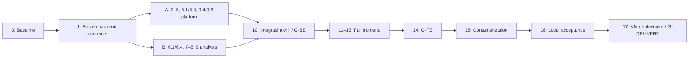

# Implementation Phases — ATC FlowLens v1

| Atribut | Nilai |
| --- | --- |
| Status dokumen | Roadmap dan progress; Phase0–1 done, A Phase2 in_progress (A01/A02 done), B6.2 real acceptance/6.4 standalone MOCK done, Phase7 foundation saja |
| Tanggal | 9 Oktober 2026 |
| Urutan delivery | **Backend lengkap → frontend lengkap → containerization → deployment lokal dan satu VM** |
| Kontrak produk | `.agent/PRD.md`; batas proyek dan aturan kerja tetap berlaku |
| Current implementation phase | B02.2/Phase6.4 standalone acceptance done; real API integration pending; A Phase2 tetap independen |
| Next recommended phase | B03 closure: approved GCP profile/real smoke, audited benchmark, worker/artifact reconciliation; A tetap A03.1 grants/RequestContext/worker principal |
| Deadline dan staffing | Deadline belum ditetapkan; pengguna adalah pihak A (Platform & Replay); individu pihak B (Analysis & AI) belum ditetapkan |
| Baseline data | Sintetik berlabel; replay simulator mitra berizin jika tersedia |

Dokumen ini menetapkan pekerjaan, dependency, deliverable, acceptance, dan gate. Semua fase/subfase awalnya `planned`; Phase0–1 kini `done` berdasarkan [baseline evidence](../docs/testing/phase01-evidence.md). Phase2 `in_progress`, Phase2.1/2.2 done; B6.2 real acceptance dan6.4 standalone MOCK acceptance `done`, Phase7 hanya foundation B01. Fase lain mengikuti tabel di bawah. Dokumen atau source yang sudah ada adalah input audit, bukan alasan untuk menandai fase selesai. Pembuatan roadmap sendiri tidak membuktikan runtime atau gate.

## 1. Sequencing Gates

Tiga gate berikut wajib dipenuhi secara berurutan:

1. **G-BE — Backend Complete Gate:** seluruh backend scope v1 yang disepakati, persistence, auth, import/replay, detector, audio/jobs, Google STT, Gemini, association/memory, findings/options, review/export, observability, serta verifikasi kontrak selesai sebelum implementasi frontend dimulai.
2. **G-FE — Frontend Complete Gate:** seluruh frontend scope v1 yang disepakati, integrasi API nyata, browser journeys, accessibility, dan full-stack checks selesai sebelum Dockerfiles aplikasi, Caddy/Compose, serta deployment mulai dibuat.
3. **G-DELIVERY — Delivery Complete Gate:** images, Compose lokal, VM research deployment, konfigurasi provider nyata, migration, restart, backup/restore, dan release rehearsal terbukti sebelum menyatakan delivery v1 selesai.

Backend memakai baseline kontrak bersama pada Phase 0–1, lalu dua jalur independen: pihak A dan B menyelesaikan seluruh task paket masing-masing tanpa integrasi bertahap atau menunggu implementasi pihak lain. Integrasi kedua paket hanya dilakukan pada Phase 10 setelah acceptance paket A dan B terpenuhi. Nomor Phase 2–9 mengelompokkan scope; dependency berlaku di dalam jalur masing-masing, bukan sebagai rantai serial lintas pihak.

Urutan ini mencakup backend domain/geometri dan AI worker; keduanya bukan pekerjaan yang boleh ditinggalkan sampai tahap frontend. QA dilakukan dalam setiap fase, lalu diperiksa sebagai gate gabungan. Container dan deployment memiliki fase tersendiri setelah frontend.

Selama backend, gunakan Python virtual environment, SQLite disposable, API test client, worker process lokal, fixture, dan provider mocks. Docker tidak diperlukan untuk database v1. Penggunaan tool container sekali jalan untuk scanner/test dependency dapat dilakukan jika diperlukan, tetapi bukan awal packaging aplikasi dan tidak mengubah sequencing.

Generated OpenAPI dan TypeScript client adalah output kontrak backend; generasinya diperbolehkan sebelum frontend. Pembangunan React screens, frontend data hooks, komponen, dan journeys menunggu G-BE. Pembacaan requirement UX serta penyusunan kontrak yang dibutuhkan UI tetap bagian analisis backend.

Jika perubahan frontend menemukan gap backend, hentikan pekerjaan frontend yang bergantung pada gap tersebut, perbaiki backend, regenerate client, jalankan affected checks, lalu catat revalidation G-BE. Jangan mengimplementasikan business rule pengganti di browser atau melompati gate.

## 2. Status dan Definition of Done

| Status | Makna |
| --- | --- |
| `planned` | Scope dan dependency diketahui; eksekusi belum dimulai |
| `in_progress` | Eksekusi aktif dengan satu fase/subfase utama sebagai current focus; backend A dan B masing-masing dapat memiliki focus independen |
| `blocked` | Pekerjaan tidak dapat dilanjutkan karena dependency atau keputusan spesifik yang dicatat |
| `deferred` | Ditunda secara eksplisit dengan alasan, dampak, dan keputusan owner |
| `done` | Deliverable tersedia dan seluruh acceptance relevan mempunyai evidence yang nyata |

Gate memakai `not_started`, `in_progress`, `blocked`, atau `passed`. Pada awal roadmap, ketiga gate bernilai `not_started`. Tidak ada gate `passed_with_mocks` untuk menggantikan provider smoke nyata atau full-stack integration.

Setiap subfase selesai harus mempunyai:

- Source/config/data/test output yang tercatat, beserta schema atau artifact version yang relevan.
- Checks pada input final, command/cakupan/hasil, dan evidence artifact yang dapat diperiksa.
- Requirement serta edge cases yang dipenuhi, termasuk negative/failure behavior.
- Limitations dan external dependency yang belum selesai, tanpa mengubahnya menjadi PASS.
- Dokumentasi dan handoff yang diperbarui sesuai perubahan; ADR untuk keputusan arsitektur material.

Untuk backend, catat status per owner/subfase. Paket A atau B dapat selesai secara mandiri setelah acceptance paket dan contract tests lulus; acceptance lintas paket serta G-BE tetap menunggu Phase 10. Parent phase menjadi `done` hanya setelah seluruh subfase wajib selesai. Scope P1 dapat ditunda secara eksplisit tanpa disebut tersedia; scope P0 tidak boleh dihilangkan tanpa keputusan produk dan perubahan acceptance. Tidak ada deadline buatan atau persentase progress berdasarkan jumlah file.

## 3. Baseline Setelah Reset dan Inventaris Historis

**Baseline reset, 7 Oktober 2026:** source dan dokumentasi lama telah dihapus pada commit reset `6e7bd3f`. Kontrak `.agent/` dipertahankan; struktur folder baru disiapkan dengan `.gitkeep` dan panduan ownership. Source aplikasi, dependency manifests, suites, Dockerfiles, Compose, dan workflow CI executable belum tersedia. Instruksi AGENTS.md sebelumnya tidak berlaku. Scaffold tidak menutup Phase 0 maupun Phase 1 dan tidak memberi izin implementasi frontend/container melampaui gate.

**Keadaan terkini, 8 Oktober 2026:** Phase 0–1 menyediakan pyproject/uv.lock, Python package, strict Pydantic schemas/ports, module registration, generated contract artifacts, synthetic inputs dan standalone MOCK harness/tests. Aplikasi bisnis A/B, real provider adapters, frontend/container/deployment belum diimplementasikan. Evidence foundation: `docs/testing/phase01-evidence.md`; contract freeze 1.0.0.

Tabel berikut adalah **inventaris historis sebelum reset**, bukan source yang masih tersedia. Informasi ini dapat membantu disposition compatibility bila dibutuhkan; pemulihan source historis bukan tindakan default. Tidak ada build/runtime/test aplikasi yang dibuktikan oleh inventaris tersebut.

| Area | Terlihat pada source/config | Implikasi roadmap |
| --- | --- | --- |
| Backend | `app.py`, `models.py`, `session.py`, `simulator.py`, `detection.py`, `storage.py`, `review.py`, `reporting.py`, dan `scenarios.py` | Audit reuse/modify/replace per requirement; jangan otomatis menulis ulang seluruh fondasi |
| Auth | Operator key, token role/seat, dan auth WebSocket pada source | Kontrak akun individual, cookie/CSRF, grants, serta service principal worker memerlukan pekerjaan eksplisit |
| SQLite | Archive dengan WAL, sessions/events/frames/commands | Migration, revision store, jobs, transaction ownership, retention, dan recovery target perlu ditambahkan/dibuktikan |
| Frontend | React/Vite entry point dan helper/type; `main.tsx` mengimpor `App` dan `styles.css` yang belum tersedia | Fondasi tidak membuktikan workspace dapat dibuild atau digunakan |
| Tooling | `pyproject.toml` dengan Python ≥3.11 dan dev dependencies; `frontend/package-lock.json` serta scripts `dev/build/typecheck/preview` | Gunakan manifest aktual; kunci compatibility/runtime saat foundation, jangan mengarang pin |
| Tests | pytest dikonfigurasi ke `tests`, tetapi direktori suite belum ditemukan | Buat suites dan oracle nyata; jangan menandai baseline tests PASS |
| Audio/AI | Worker, Google STT/Gemini adapters, transcript/memory/options pipeline belum ditemukan | Termasuk backend wajib, bukan dependency yang sudah siap |
| Packaging | Compose, Dockerfiles aplikasi, Caddy, dan CI workflow belum ditemukan | Semua merupakan deliverable tahap akhir |
| Data/domain | Tidak ada akses mitra atau validasi operasional yang dikonfirmasi | Sintetik tetap memungkinkan implementasi teknis; partner/domain status terpisah |

Audit awal memeriksa kontrak dan scaffold yang benar-benar tersedia, lalu menetapkan apa yang dibangun baru atau dipakai ulang secara eksplisit. Perilaku source historis, target requirement, serta hasil verifikasi tidak boleh dicampur. Target sekarang Google STT/Gemini dan sequencing backend-first. Modul yang independen secara desain tidak berarti boleh dikerjakan melampaui gate. Lokasi package dan boundary tercatat di `docs/architecture/repository-structure.md`.

## 4. Ringkasan Fase dan Dependency

| Phase | Track | Deliverable utama | Dependency wajib | Status |
| --- | --- | --- | --- | --- |
| 0 | Baseline | Audit gap, scope freeze, fixture/evaluation plan, dependency register | PRD dan rules | `done` |
| 1 | Baseline kontrak backend bersama | Runtime/harness, shared contracts dan module registration dibekukan | Phase 0 | `done` |
| 2 | Backend A | Platform persistence, accounts/grants/auth, audit, transaction infrastructure | Phase 1; tanpa dependency implementasi B | `in_progress` |
| 3 | Backend A | Import atomik, provenance, clocks, quality dan source reader | Phase 2 (A) | `planned` |
| 4 | Backend A | Replay/checkpoints, REST/WS, archive dan compatibility | Phase 3 (A) | `planned` |
| 5 | Backend A | Footprint, occupancy, prediction, observed rules/alerts | Phase 4 (A) | `planned` |
| 6 | Backend A / B | A: assets/jobs/internal API; B: audio processing/worker | A: Phase2; B: Phase1; keduanya memakai frozen contracts | `in_progress` (B6.2/6.4 standalone done; A6.1/6.3 planned) |
| 7 | Backend B | Google STT, transcript/corrections, analysis persistence dan benchmark | Phase 6.2/6.4 (B); GCP readiness untuk smoke | `in_progress` (fondasi B01 saja) |
| 8 | Backend B | Gemini intent, scoped tools, association, memory/open loops | Phase 7 (B); Gemini readiness untuk smoke | `planned` |
| 9 | Backend A / B | A: artifact lifecycle/ops; B: findings/review/brief/report/query/provider diagnostics | A: Phase 2–6 bagian A; B: Phase 8; tanpa dependency lintas implementasi | `planned` |
| 10 | Integrasi backend akhir | Composition/migrations nyata, integrated verification, contract freeze, G-BE | Seluruh task dan acceptance paket A serta B selesai | `planned` |
| 11 | Frontend | React/Vite/shadcn foundation, auth/router, API data layer | G-BE `passed` | `planned` |
| 12 | Frontend | Sessions/import, workspace, replay/audio, memory/situation | Phase 11 | `planned` |
| 13 | Frontend | Evidence/review, options, debrief/export, settings | Phase 12 | `planned` |
| 14 | Frontend | Full-stack/browser/accessibility/performance, G-FE | Phase 11–13 | `planned` |
| 15 | Container | Reproducible images, Caddy, base/local/vm Compose | G-FE `passed` | `planned` |
| 16 | Local delivery | Local full-stack acceptance, migration/restart/restore | Phase 15 | `planned` |
| 17 | VM delivery | VM research deployment, rehearsal, G-DELIVERY | Phase 16 dan VM readiness | `planned` |



## 5. Phase 0 — Product, Contract, dan Execution Baseline

**Status:** `done` · **Owner-function:** product/engineering lead · **Dependency:** PRD dan rules.

**Tujuan:** memastikan implementasi dimulai dari scope yang jelas tanpa menganggap fondasi lama sudah memenuhi kontrak baru.

| Subfase | Pekerjaan | Output | Status |
| --- | --- | --- | --- |
| 0.1 | Audit source, route, wire schema, auth/storage, test/tooling, serta compatibility gaps | Matriks reuse/modify/replace dengan file dan evidence statis | `done` |
| 0.2 | Bekukan replay offline; konfirmasi provider transport, P0/P1, permissions, readiness, dan batas authority | Keputusan scope serta daftar open decisions/impact | `done` |
| 0.3 | Rancang fixture audio/event, layout, clocks, labels terisolasi, dan expected outcomes independen | Fixture manifest/schema dan evaluation protocol | `done` |
| 0.4 | Petakan FR/AC, external dependencies, ownership paket backend A/B, shared contract baseline dan acceptance integrasi akhir | Backlog dua jalur independen dan dependency register | `done` |

**Deliverables:** baseline source map; schema/lifecycle inventory; fixture/data-rights plan; compatibility/deprecation plan; documented provider-access path; handoff implementasi pertama.

**Acceptance:**

- Semua FR-01–20 dan AC-01–20 mempunyai disposition; future tidak diselipkan ke v1.
- Q-01 default adalah replay offline; simulasi berjalan tidak termasuk accepted scope tanpa keputusan baru. Q-02 default adalah Gemini Developer API; jika berubah, kontrak adapter dan checks disesuaikan.
- P1 query/communication metrics dipetakan pada Phase 9/13; bila ditunda, keputusan dan label availability dicatat sebelum gate.
- Partner permission, corpus cloud rights, GCP/Gemini account/quota, VM/domain, dan reviewer domain dicatat sebagai dependency yang belum otomatis tersedia.
- Kode lama, blueprint lama, dan target baru dipisahkan; tidak ada status runtime/test yang disimpulkan dari inspeksi.

**Exit:** Phase 0 selesai setelah kontrak dan disposition dapat dipakai sebagai dasar eksekusi. Credential yang belum tersedia tidak menghalangi foundation, tetapi tetap menjadi blocker untuk provider smoke/gate terkait.

## 6. Backend Track

Seluruh Phase 1–10 dilaksanakan sebelum implementasi frontend. Backend selesai berarti API/workers/domain nyata tersedia dan terverifikasi; bukan sekadar endpoint yang mengembalikan fixture.

Paket A memiliki [rincian eksekusi A01–A10](../docs/development/package-a-execution.md) dalam 26 unit sesi untuk mengendalikan scope dan handoff. A01/A02 `done`; A03–A10 `planned`; nomor ini merinci fase yang sudah ada dan tidak mengubah gate/ownership.

### 6.1 Model Eksekusi — Dua Paket Independen, Integrasi di Akhir

Phase 0–1 menyediakan baseline kontrak bersama sebelum penugasan implementasi paket. Setelah baseline dibekukan, A dan B mengerjakan seluruh task masing-masing secara independen. Tidak ada kewajiban merge/integrasi bertahap, milestone lintas pihak, atau menunggu source pihak lain pada Phase 2–9. Dependency lokal tetap berlaku; credential, quota, hak sumber dan keputusan provider tetap merupakan external dependencies.

| Paket | Owner dan scope | Fase/subfase |
| --- | --- | --- |
| A — Platform & Replay | FastAPI host, auth/grants, database runtime/transactions, import/source/clock, private assets, replay/WS, geometry/observed rules, evidence registry, job coordinator, artifact lifecycle, audit dan operability | 2–5; 6.1/6.3; bagian platform 9.4/9.6 |
| B — Analysis & AI | Analysis module/config, analysis repositories/migrations, audio processing/worker, STT/transcript, Gemini/intent, association/memory/loops, semantic findings, review/reanalysis/journal, advisory/brief/query/metrics, report generation dan provider diagnostics | 6.2/6.4; 7–8; 9.1–9.3/9.5; bagian analisis 9.4/9.6 |
| Baseline bersama | Runtime/dependency strategy, Pydantic contracts, ports, module registration, fake adapters dan contract harness yang siap dipakai kedua paket | 0–1 |
| Integrasi akhir | Memasang implementasi A dan B nyata, memverifikasi seluruh alur serta memperbaiki incompatibility sebelum G-BE | 10; hanya setelah kedua paket selesai |

**Boundary package:** gunakan modular packages dalam satu backend, bukan menambah microservices. Paket A menjadi host dan pemilik satu proses API writer. Paket B menyediakan registration entrypoint untuk routes/services/repositories/migrations/job handlers. Common contracts berada pada boundary bersama; A tidak mengimpor internal B dan B tidak mengimpor internal A. Composition root menghubungkan implementations melalui ports saat Phase 10.

**Ownership persistence:** A memiliki transaction/unit-of-work infrastructure, migration runner dan tabel platform (accounts/grants, sources/assets, replay, runs/jobs/attempts, audit, artifact inventory dan receipts). B memiliki migrations/repositories tabel analisis (transcripts/revisions, intent/association, memory/loops, findings/options/briefs/queries, reviews/journal). Namespaces dan migration registration/order dibekukan pada Phase 1; setiap paket dapat menjalankan fresh/upgrade tests dengan SQLite disposable secara mandiri. Foreign key/unique constraints dan scoped reference validation lintas paket ditetapkan pada baseline. Standalone harness memasang minimal reference schemas/fixtures yang mengikuti kontrak bila diperlukan; jangan menonaktifkan constraints agar tests mandiri lulus. Aplikasi gabungan tetap memverifikasi seluruh referensi dalam transaksi.

B menulis accepted state hanya sebagai service dalam proses API melalui unit-of-work yang sama. Worker B tidak mengakses SQLite, database writer, atau raw inventory unrestricted. B memvalidasi kandidat secara domain; A memvalidasi lease/status/input/config/rights lalu mengoordinasikan atomic accepted-result commit melalui handler B. Domain writes, evidence registration, audit/receipts dan stream events harus berbagi transaksi; event dipublikasikan setelah commit. Rollback tidak boleh meninggalkan projection/event setengah tersimpan.

**Boundary yang rawan overlap:**

| Area | Pihak A | Pihak B |
| --- | --- | --- |
| Media | Raw storage, access/range, controlled derivative promotion | Decode/resample/chunk, time mapping dan artifact submission |
| Jobs | Lease/heartbeat/budget/cancel/retry coordinator dan internal endpoints | Executor, stage handlers, heartbeat/result client |
| Evidence | Registry, resolution, scope/permission/hash/range validation | Evidence references dan pemeriksaan dukungan semantik |
| Movement findings | Numeric geometry/eligibility/observed evidence | Instruction applicability, association dan finding assembly memakai geometry reader |
| Review | Auth policy, atomic transaction, audit infrastructure | Domain decisions/corrections, stale dependencies, reanalysis dan revision routes |
| Export | File submission/storage/download, expiry, permissions dan purge infrastructure | JSON/CSV/HTML rendering, factual references, capability-based redaction dan injection escaping |
| Retention | Inventory, purge coordination, job cancellation dan minimal tombstones | Inventory/purge handler untuk seluruh sensitive analysis tables/artifacts |
| Provider/ops | Admin profile storage/routes, budget/usage aggregation, health/backup | Provider validation/check handlers, sanitized diagnostics/usage, analysis readiness |
| Stream | Envelope/sequence, snapshot/resync dan authorized transport | Typed domain events dan scoped analysis snapshot reader |

### 6.2 Frozen Contracts dan Pengembangan Mandiri

Kontrak adalah input awal kedua paket, bukan deliverable implementasi A yang ditunggu B. Phase 1 harus menyediakan signatures, versioned DTOs, error semantics, valid/invalid examples dan executable contract tests untuk:

| Kontrak | Isi minimum |
| --- | --- |
| Request context/authorization | Actor, capabilities, server-bound session/run scope, input revision/hash, as-of dan request ID; permission tidak ditentukan model |
| Source/context reader | Manifest/rights/quality, clock mapping, source events/tracks, active rules dan bounded as-known views; truth/future schedule terisolasi |
| Asset access/artifact submission | Scoped audio range/checksum, limited input download, derivative hash/transform/time mapping dan atomic promotion |
| Geometry reader | Numeric observations/results, eligibility, uncertainty, evidence, rule/layout version dan NOT_EVALUABLE reason |
| Job protocol | Stage/job type, input/result envelope, attempt/lease/heartbeat/cancel/deadline, usage/budget, retries dan commit receipt |
| Evidence service | Register/resolve scoped IDs, quote/span/audio/event ranges, source hash, access checks dan transaction participation |
| Persistence/unit-of-work | Repository/transaction ports, migration registration/order, optimistic versions, idempotency, commit/rollback dan after-commit publication |
| Module registration | Routes/services/repositories/migrations/job handlers, config, readiness, snapshot reader dan retention callbacks tanpa import internal lintas paket |
| Event publication | Typed payload, schema/session/run/revision/time fields; sequence diberikan host di dalam transaction boundary |
| Artifact lifecycle | Report submission/download/expiry, capability-based redaction, inventory dan purge contract |

Perilaku atomic commit, duplicate/late/cancelled result, revoked permissions, stale revision, clock unknown, as-of filtering dan errors ikut dibekukan; schema-valid output saja tidak cukup. Perubahan breaking setelah freeze memerlukan versi baru dan compatibility adapter serta contract tests pada paket pengusul; jangan menjadikan perubahan tersebut kewajiban menunggu pihak lain. Jika perubahan tidak kompatibel tidak dapat dihindari, catat dampak/keputusan dan pekerjaan reconciliation pada Phase 10; jangan mengklaim kontrak tetap compatible.

**Harness mandiri:** A memakai fake analysis module/handlers/snapshot/export/purge callbacks yang mengikuti kontrak. B memakai fake platform ports untuk source/geometry/assets/authorization/jobs/evidence/unit-of-work; repositories B juga diuji dengan SQLite disposable dan test transaction adapter yang memenuhi kontrak. Kedua paket menjalankan suite kontrak yang sama. Fake adapters berlabel MOCK, dibatasi ke tests/development harness, dan tidak dipilih diam-diam oleh composition production.

Real STT/Gemini smoke dapat dijalankan oleh B dengan synthetic non-sensitive inputs pada standalone harness setelah akses/budget tersedia. Mock platform tidak menggantikan provider nyata; provider mocks tidak menutup smoke. Tidak ada status G-BE passed sebelum integrasi akhir.

### 6.3 Urutan Lokal dan Acceptance Paket

| Urutan | Jalur A | Jalur B |
| --- | --- | --- |
| 1 | Phase 2: host/config, transaction infrastructure, platform migrations/auth | Sesudah Phase 1: analysis module/config, analysis migrations/repositories dan registration |
| 2 | Phase 3 dan 6.1: imports/source/clock/private assets; 6.3 jobs dapat dimulai sesudah Phase 2 | Phase 6.2/6.4: audio processing dan isolated worker memakai fake platform |
| 3 | Phase 4: replay/REST/WS/checkpoints | Phase 7: STT/transcript/corrections dan provider verification |
| 4 | Phase 5: geometry/observed rules/alerts | Phase 8: Gemini/association/memory/open loops |
| 5 | Bagian A pada 9.4/9.6: artifact lifecycle/retention/audit/operability | Phase 9 bagian B: findings/review/options/brief/report/query/provider diagnostics |
| 6 | Acceptance seluruh paket A, contract/security/recovery/performance tests dengan fake analysis | Acceptance seluruh paket B, contract/semantic/repository/failure tests dan real provider smoke dengan fake platform |
| Akhir | Kedua paket selesai → Phase 10: merge/composition nyata dan integrated verification | Kedua paket selesai → Phase 10: merge/composition nyata dan integrated verification |

Urutan lokal dapat disesuaikan selama dependency dalam paket dan acceptance tetap dipenuhi. Fixture waveform, observed inputs dan evaluator-only labels disediakan pada baseline; kedua pihak tidak menunggu generator/data pipeline milik pihak lain. Setiap paket mengirim manifest entrypoints/migrations/config/dependencies, contract version, candidate SHA, checks dan limitations pada handoff akhir.

Status selesai paket berarti seluruh task wajib milik pihak tersebut dan acceptance mandirinya selesai; bukan parent phase bersama atau G-BE. Phase 6/9 yang dimiliki dua pihak mencatat status per subfase/owner. External blocker pada B tidak menahan implementasi A, tetapi Phase 10 menunggu keduanya siap dan G-BE tetap membutuhkan seluruh acceptance nyata.

### Phase 1 — Backend Foundation dan Shared Contracts

**Status:** `done` · **Owner:** baseline bersama A/B · **Dependency:** Phase 0; selesai sebelum implementasi dua paket dimulai.

| Subfase | Pekerjaan | Output | Status |
| --- | --- | --- | --- |
| 1.1 | Rapikan package boundaries, runtime/dependency lock strategy, virtual environment, lint/type/test entrypoints | Setup backend reproducible | `done` |
| 1.2 | Definisikan Pydantic source/time/quality/evidence, run/job, transcript, intent/memory/finding/option/review DTOs | Versioned domain/wire schemas | `done` |
| 1.3 | Bekukan config/error/context/provider ports, transaction/migration ports dan module registration; sediakan bootstrap composition untuk standalone harness | Frozen interfaces dan injectable boundaries | `done` |
| 1.4 | Bangun shared contract suite, fake platform/analysis adapters, fixture inputs, OpenAPI/client generation strategy dan standalone test entrypoints | Harness mandiri A/B dan contract freeze record | `done` |

**Scope:** pisahkan domain dari FastAPI/storage/provider SDK; model SDK tidak menjadi public wire shape. Rancang clocks UTC/relative ms, null/unknown semantics, schema version, source/run scope, idempotency, serta optimistic version. Tidak membuat React workflow atau Dockerfiles.

**Acceptance:** install backend reproducible; import/config/unit smoke lulus; invalid enums/nonfinite/time/range/scope ditolak; structured errors aman; generated contract tidak mempunyai hand-written duplicate wire definitions. Build/format/lint/type/test commands dipilih dari tooling yang benar-benar tersedia dan dicatat.

### Phase 2 — Paket A: Platform Persistence, Identity, Authorization, dan Audit

**Status:** `in_progress` · **Owner:** pihak A · **Dependency:** Phase 1; tidak membutuhkan implementasi B. A01/A02 done, next A03.1; [host evidence](../docs/testing/a011-evidence.md) dan [persistence evidence](../docs/testing/a012-evidence.md) dan [compatibility evidence](../docs/testing/a013-evidence.md).

| Subfase | Pekerjaan | Output | Status |
| --- | --- | --- | --- |
| 2.1 | Bangun host/config, unit-of-work, migration runner dan stores platform untuk accounts/grants/sources/assets/replay/runs/jobs/attempts/audit/artifacts/receipts; analysis tables dimiliki B | Host/platform schema/UOW dan audited historical archive conversion tersedia | `done` |
| 2.2 | Bootstrap admin, Argon2id, login/logout/reset/deactivation, cookie sessions, expiry dan rate limits | Account/Argon2/bootstrap/reset serta HTTP login/cookie/expiry/rate limit tersedia | `done` |
| 2.3 | Session/raw-audio/export/truth grants, CSRF, WS origin/session checks, internal worker principal | Server-side policy dan serializers | `planned` |
| 2.4 | Audit changes, optimistic concurrency, idempotency, atomic transaction/fault handling | Durable receipts dan audit events | `planned` |

**Scope:** satu API writer; foreign key/unique constraints; evaluator truth terpisah dari public DTO; migration dari archive lama yang mempertahankan IDs/events/frames/commands. Account berbeda dari seat/position. Admin tanpa domain grant tidak otomatis dapat mengonfirmasi substansi atau membaca truth.

**Acceptance:** fresh dan prior-schema upgrade lulus; bootstrap tidak memiliki public default password; login/logout/expiry/revoke/reset/CSRF lulus; cross-session/truth/media/export access ditolak; same-key retry satu efek dan different-payload conflict; failure commit tidak mengembalikan saved/success palsu. Auth operator-key lama mempunyai migration/deprecation disposition yang diuji.

### Phase 3 — Atomic Import, Provenance, Clock, dan Quality

**Status:** `planned` · **Owner:** pihak A · **Dependency:** Phase 2 (A); tidak membutuhkan implementasi B.

| Subfase | Pekerjaan | Output | Status |
| --- | --- | --- | --- |
| 3.1 | Upload staging, content/duration/size/path/hash checks, preview/remediation | Private validated import pipeline | `planned` |
| 3.2 | Source manifest, local/cloud/export rights, retention dan coverage profiles | Source permission/quality registry | `planned` |
| 3.3 | Normalize timebase, timezone, IDs, units/layout/coordinates dan source-sidecar metadata | Source clock/identity mapping | `planned` |
| 3.4 | Commit metadata/assets/events atomik; handle duplicate/conflict/partial import | Immutable replay package | `planned` |

**Scope:** audio-only dan paired audio/event didukung; missing tracks, speaker, clock alignment, atau vehicle coverage tetap unknown. Synthetic generator menyediakan observations terpisah dari truth. Buat fixture audio waveform non-sensitif yang benar-benar dapat diproses STT, dengan percakapan/runway/callsign, noise/gaps, serta time mapping yang diketahui. Pengucapan aktual diaudit terhadap label; script intention tidak otomatis menjadi gold transcript waveform. Role-play hanya dipakai dengan consent dan hak transfer yang mencukupi. Public corpus adapters opsional dan tidak mensyaratkan download corpus penuh untuk acceptance.

**Acceptance:** manifest/hash round-trip; valid debrief audio-only dapat committed tanpa cloud; forbidden transfer diblok sebelum provider call; unsupported/invalid/nonfinite input ditolak; incomplete data tidak diisi zero/fresh; duplicate-identical import dedup dan conflicting hash/ID ditolak; failed import tidak meninggalkan sesi half-readable. Truth/private schedule tidak masuk worker-ready input.

### Phase 4 — Replay Engine, Archive, API, dan WebSocket

**Status:** `planned` · **Owner:** pihak A · **Dependency:** Phase 3 (A); analysis snapshot/events memakai fake module sampai Phase 10.

| Subfase | Pekerjaan | Output | Status |
| --- | --- | --- | --- |
| 4.1 | Event source/reducer, checkpoints, as-of snapshots, AS_KNOWN/DEBRIEF filtering | Deterministic historical read service | `planned` |
| 4.2 | Play/pause/seek/step/speed dan leader/follow/local-view contract | Shared replay controls | `planned` |
| 4.3 | Catalogue/source/history REST, typed stream sequence, snapshot/resync, pagination | Authorized replay transport | `planned` |
| 4.4 | Archive/checkpoint/restart behavior dan training-route compatibility | Durable replay/compatibility tests | `planned` |

**Acceptance:** same events/config menghasilkan same snapshot; same-time ordering dan pagination tidak bocor future events; seek tidak memanggil provider; imported availability unknown tidak dipresentasikan sebagai historical real-time truth; reconnect/gaps/retries tidak duplicate state; grant expiry/revocation memutus akses stream. Training commands yang dipertahankan tetap pada boundary latihan dan tidak menjadi AI tools. Source replay tidak berubah oleh controls/review.

### Phase 5 — Geometry, Occupancy, Prediction, Rules, dan Alert Lifecycle

**Status:** `planned` · **Owner:** pihak A · **Dependency:** Phase 4 (A); tidak membutuhkan STT/Gemini atau memory B.

| Subfase | Pekerjaan | Output | Status |
| --- | --- | --- | --- |
| 5.1 | Footprint transforms, runway/hold-line/protection geometry, swept movement checks | Explicit geometry contract | `planned` |
| 5.2 | Observed/predicted occupancy intervals, exit/ETA estimates, uncertainty/margins dan separation | Deterministic numeric outputs | `planned` |
| 5.3 | Observed-only rule library, applicability, no-data/stale behavior, evidence/severity | Versioned detector results | `planned` |
| 5.4 | Alert lifecycle, acknowledgment, source authority dan task-complexity indicators | Durable alert/indicator events | `planned` |

**Scope:** center distance bukan pengganti footprint; vehicle stopped/track stale tidak dianggap clear; cancelled instruction tidak menghapus occupancy fisik; go-around issued tidak otomatis resolved. Crossing dan arrival/departure memakai shared runway resource. Indicator experimental mempunyai definisi/input/version dan tidak disebut diagnosis.

**Acceptance:** independent geometry/time oracles lulus untuk canonical hazard cases; speed nol dan dropout mempertahankan uncertainty; no truth dependency; permission tidak menciptakan physical occupancy; source alert tidak diregraded AI; alert transitions/evidence reproducible. Clock/layout/identity/coverage yang tidak eligible menghasilkan `NOT_EVALUABLE` pada checks yang memerlukannya.

### Phase 6 — Private Audio, Durable Jobs, dan Worker Boundary

**Status:** `in_progress` (B6.2/6.4 standalone done; A6.1/6.3 planned) · **Owner:** A untuk 6.1/6.3; B untuk 6.2/6.4 · **Dependency:** A memakai Phase2 dan source/asset contracts; B memakai Phase1 dan baseline fixtures. Tidak bergantung pada penyelesaian Phase5 atau implementasi pihak lain.

| Subfase | Pekerjaan | Output | Status |
| --- | --- | --- | --- |
| 6.1 | Private assets, authorized range serving, hashes dan storage keys | Scoped audio service | `planned` |
| 6.2 | Controlled FFmpeg/ffprobe decode/resample/chunk, channel/time mapping, overlap/gaps | Versioned derivatives/chunks | `done`: 57 PASS termasuk real FFmpeg9.0.2, mapping/accounting/hash/cleanup |
| 6.3 | Durable jobs/attempts/leases/heartbeats, deadlines, concurrency/budget reservations | Job coordinator dan internal API | `planned` |
| 6.4 | Separate worker process, authenticated minimal input/result, cancel/retry/restart | Isolated worker executable | `done` untuk standalone MOCK acceptance74 PASS; actual authenticated transport/integration belum tersedia |

**Acceptance:** worker tidak membuka SQLite atau seluruh raw asset inventory; unauthorized range/internal routes ditolak; decode limits dan sanitization diuji; raw hashes tetap sama; chunks mempertahankan audio clock; worker/provider tidak menahan replay lock. Timeout, expired lease, duplicate/late/cancelled result, crash, permission change dan stale input version tidak membentuk duplicate accepted commit. Local exactly-once commit tidak diklaim sebagai exactly-once provider billing.

B02.1 menyediakan `audio/{models,planning,process,tools,preparation}.py` dengan
context-managed scratch, immutable raw hash checks, structured commands, time/output
limits, mono channel chunks, source/session mapping, overlap/gap provenance.
[Evidence](../docs/testing/b021-evidence.md), [ADR](../docs/adr/0003-controlled-local-audio.md).
Real FFmpeg9.0.2 acceptance57 PASS/no skip. Worker isolated executable melalui
frozen JobClient/AssetAccess/internal authorized binding tersedia, heartbeat saat
processing, cancellation/deadline/lost lease/tool kill/reap, scoped artifact provenance,
typed results/receipts dan local cleanup. [B02.2 evidence](../docs/testing/b022-evidence.md):
worker74 PASS, combined B218 PASS. MOCK bukan real API/auth/durable platform integration;
bounded adapters/staged TTL/coordinator promotion tetap platform. No DB/A/evaluator imports.
Readiness false, handlers kosong. Next B03; parent6/9 dan gates tidak ditutup.

### Phase 7 — Google STT dan Transcript Lifecycle

**Status:** `in_progress` (B01 + B03 standalone adapter/lifecycle) · **Owner:** pihak B · **Dependency:** 6.2/6.4 (B), frozen platform ports dan standalone analysis persistence; GCP access untuk real smoke. Tidak menunggu 6.1/6.3 (A).

Fondasi sesudah Phase 1: B01 `done` untuk registration/config/analysis.0001/
scoped configuration repository/transaction ports dan disposable MOCK harness.
[Rencana Paket B](../docs/development/package-b-execution.md),
[evidence B01](../docs/testing/b01-evidence.md): 21 unit tests, 66 contracts masing-masing
A/B; native Windows B mypy dan full POSIX-target mypy PASS. Native whole-backend
Windows mypy memiliki 7 error API POSIX A. B03 adapter, raw hypotheses/timing,
conservative canonical-word dedup, analysis.0002 dan correction/evidence/stale lifecycle
tersedia dengan standalone MOCK acceptance; real smoke/benchmark dan worker/artifact
reconciliation belum selesai; readiness false. B02.1/6.2 real acceptance dan B02.2/6.4
standalone MOCK acceptance done; B03 closure berikutnya. Tidak ada
integrasi nyata A/B atau penutupan parent Phase 6/9 maupun gate.

| Subfase | Pekerjaan | Output | Status |
| --- | --- | --- | --- |
| 7.1 | Implement SDK adapter, provider profile, locale/region/model/recognizer checks | Google STT V2 adapter | `in_progress`: SDK2.41.0/strict routing/approval/MOCK acceptance; real profile unverified |
| 7.2 | Transcribe chunks, preserve offsets/confidence/quality, overlap dedup dan partial results | Transcript hypotheses | `in_progress`: internal provenance/timing/canonical words accepted in MOCK; real worker/artifact reconciliation open |
| 7.3 | Analysis module registration, repositories/migrations dan append-only transcript corrections/attribution dengan reason/evidence/stale dependencies melalui transaction ports | Analysis persistence dan transcript revision API | `in_progress`: B01 + standalone lifecycle/analysis.0002 accepted; platform run/revision API/integration open |
| 7.4 | Mock failures, real synthetic smoke, critical-slot/alignment baseline | STT verification/benchmark record | `in_progress`: deterministic acceptance PASS; real smoke/labels/benchmark blocked |

**Scope:** initial chunk baseline ≤50 detik dan di bawah 10 MB untuk inline recognize; batas efektif diverifikasi pada API release. GCS/BatchRecognize bukan dependency default. Word timing dapat unavailable; chunk ranges tetap tersedia. Diarization tidak menjadi identity ground truth dan null confidence tidak dibuat menjadi angka.

**Acceptance:** real Google STT request dengan synthetic non-sensitive audio berhasil dan profile/version/usage tercatat; mock 429/timeout/no-speech/partial/invalid response cases lulus; source/time mapping serta clipped negation/runway/callsign cases diuji; no future/truth hints; correction tidak menimpa raw STT. Laporkan WER tambahan serta critical-slot dan timestamp errors; benchmark belum membuktikan kualitas operational audio.

**Blocker policy:** tanpa credential/region/quota, adapter/mock work dapat berlangsung, tetapi 7.4 belum selesai dan G-BE belum dapat passed.

B03 [evidence](../docs/testing/b03-evidence.md) dan
[ADR0004](../docs/adr/0004-private-transcript-provenance.md): frozen1.0.0 tetap;
internal records tidak dimasukkan ke field wire yang salah. Permission/profile
preflight, bounded async RPC, caller budget/lease callbacks, immutable raw alternatives,
unknown clock/null confidence, exact overlap trace, append-only revisions dan caller
UOW evidence/audit/events tersedia. Separate register_transcripts tidak memasang
STT accepted-result handler/API atau real A/B composition. B04 tetap planned sampai
prasyarat B03 terpenuhi. Paket B, parent phases dan seluruh gates tetap terbuka.

### Phase 8 — Gemini Intent, Orchestration, Association, dan Memory

**Status:** `planned` · **Owner:** pihak B · **Dependency:** Phase 7 (B), frozen context/evidence/geometry ports; Gemini access untuk real smoke. Platform ports memakai fake adapters sampai Phase 10.

| Subfase | Pekerjaan | Output | Status |
| --- | --- | --- | --- |
| 8.1 | Implement provider adapter, request/version policy, structured intent schemas dan feature checks | Gemini intent parser | `planned` |
| 8.2 | Bounded read-only tools dengan session/run/as-of/permission scope | Core analysis orchestration | `planned` |
| 8.3 | Callsign/entity alternatives, instruction/readback/report relationships, correction/cancellation | Association candidates dan acceptance validator | `planned` |
| 8.4 | Accepted memory events, reducer/projections, instruction/readback/movement/reviewer dimensions | Object/runway memory dan open loops | `planned` |
| 8.5 | Real synthetic smoke dan semantic/error/injection/reconstruction benchmarks | Gemini/memory verification record | `planned` |

**Scope:** target `gemini-3.8-flash`; transport awal Developer API Interactions, diverifikasi sebelum pemakaian. Session memory dimiliki aplikasi; `store=false` dan bounded request context dipakai sesuai compatibility. Tools minimum membaca entity memory, transcript window, session events, observed tracks, active rules, dan evidence. Tidak ada clearance, arbitrary HTTP, SQL, filesystem, atau command tools.

**Acceptance:** real provider menghasilkan structured intent yang diterima validator; malformed/schema-valid unsupported output, invalid evidence, extra action payload, prompt injection, tool-limit, refusal dan budget cases ditolak/degraded. Dua pesawat interleaving, late readback, callsign serupa, conditional instruction, cancellation, wrong-target correction, serta negation mempertahankan ambiguity. Same accepted events/reducer version menghasilkan memory yang sama; report clear tidak membuktikan runway physical clear. Open loop hanya closed oleh matching evidence dengan coverage yang diketahui.

**Blocker policy:** jika target model/API tidak dapat dipakai, dokumentasikan hasil check dan minta keputusan provider yang diperlukan; jangan fallback diam-diam atau menganggap mock pass sebagai real-provider acceptance.

### Phase 9 — Findings, Options, Review, Debrief, dan Operability

**Status:** `planned` · **Owner:** B untuk 9.1–9.3/9.5 dan analysis parts 9.4/9.6; A untuk platform parts 9.4/9.6 · **Dependency:** B memakai Phase 8; A memakai Phase 2–6 bagian A. Tidak ada dependency implementasi lintas pihak.

| Subfase | Pekerjaan | Output | Status |
| --- | --- | --- | --- |
| 9.1 | Readback discrepancy, critical-slot uncertainty, open-loop dan movement conformance findings | Evidence-linked finding lifecycle | `planned` |
| 9.2 | Gemini options/brief dengan preconditions, unknowns, applicability dan bounded evidence | Versioned advisory outputs | `planned` |
| 9.3 | Human confirm/dismiss/unresolved/relevance, append-only review, invalidation dan reanalysis | Durable review/journal APIs | `planned` |
| 9.4 | B: JSON/CSV/HTML rendering, evidence/versions, capability redaction dan injection escaping; A: artifact submission/storage/download/expiry, retention/purge/tombstones/audit queries; B mendaftarkan sensitive-data inventory/purge handler | Report renderer B dan artifact lifecycle A yang independently tested | `planned` |
| 9.5 | P1 contextual query dan communication metrics sesuai disposition | Scoped read-only query/metric APIs | `planned` |
| 9.6 | A: health/ready/release, log/audit/usage/budget infrastructure, disk/backup/restore dan provider admin profiles; B: provider check handlers, sanitized diagnostics/usage/latency dan analysis readiness | Platform ops A dan provider diagnostics B | `planned` |

**Scope:** backend menyediakan semua fungsi Sessions/Workspace/Review/Debrief/Settings yang dijanjikan. Opsi tidak dapat dieksekusi; nol opsi dengan `INSUFFICIENT_CONTEXT` valid. Factual brief/query items mempunyai evidence IDs; query tidak mengubah operational memory. Metrik komunikasi tidak menjadi diagnosis. Branch/what-if tetap workflow evaluator opsional, tidak ditambahkan sebagai tool AI atau fitur wajib tanpa disposition.

**Acceptance:** quote/audio/event dapat resolved sesuai grants; source alerts tetap utuh; stale review/version conflict ditolak; restart mempertahankan review, revisions dan receipts; findings/options/brief tidak menjadi data training atau truth tersembunyi. Export menjaga labels/versions/unknowns dan mencegah formula/HTML injection; audio export mempunyai izin terpisah. Provider failure menghasilkan `PARTIAL`/unavailable tanpa menghalangi cached replay. Backup konsisten dan recovery CLI dapat diuji pada disposable state sebelum containerization.

### Phase 10 — Integrasi Akhir, Integrated Backend Verification dan Contract Freeze

**Status:** `planned` · **Owner:** A/B bersama; A lead composition/platform checks, B lead analysis/provider benchmarks · **Dependency:** seluruh task dan acceptance mandiri paket A/B selesai pada frozen contract version yang compatible. Tidak ada integrasi kedua implementasi sebelum fase ini.

| Subfase | Pekerjaan | Output | Status |
| --- | --- | --- | --- |
| 10.1 | Merge paket A/B; pasang module registration/routes/services/migrations/job handlers/snapshot/purge callbacks pada composition root; ganti fake adapters dengan implementations nyata, perbaiki incompatibility dan jalankan API/SQLite/worker/domain flows/failure injections | Backend nyata terintegrasi dan evidence gabungan | `planned` |
| 10.2 | Jalankan canonical synthetic scenarios, audio/association cases dan held-out benchmark | Cohort/versioned benchmark report | `planned` |
| 10.3 | Auth/media/truth/tool negative tests, migration/recovery, performance/usage profiling | Security/durability/performance evidence | `planned` |
| 10.4 | Freeze OpenAPI/generated client, publish run/env/error/integration guide dan gate record | Backend handoff dan G-BE decision | `planned` |

**Entry acceptance integrasi akhir:** kedua paket menyerahkan seluruh task/acceptance mandiri, passing shared contract tests, fresh/upgrade repository checks, manifest/config/migration versions dan real-provider smoke B. Mocks tidak membuktikan compatibility runtime gabungan. Sediakan pekerjaan reconciliation/fix/retest dalam Phase 10; merge yang berhasil belum berarti G-BE passed.

**G-BE acceptance wajib:**

- [ ] Composition nyata memakai implementations A/B dan seluruh module/migration/transaction/snapshot/purge registrations terpasang; fake adapters tidak aktif pada production profile.
- [ ] Semua backend P0 tersedia tanpa placeholder business behavior; P1 disposition eksplisit.
- [ ] Import → replay → STT → intent → association → memory → finding → option/review → brief/export dapat dijalankan melalui API dengan implementation nyata.
- [ ] Fresh/upgrade SQLite migration mempertahankan historical IDs/events/evidence; restart dan storage-failure behavior terbukti.
- [ ] Google STT serta Gemini real synthetic smoke lulus pada profile efektif; mock tests melengkapi, bukan menggantikan smoke.
- [ ] Readback/loop/geometry/quality cases serta canonical S01–S12 lulus dengan independent oracle dan denominator yang benar.
- [ ] Critical-slot/wrong-pair/finding/ambiguity metrics tersedia untuk held-out baseline; unresolved semantic failures pada P0 acceptance tidak ditutup dengan schema pass.
- [ ] API/WS/audio/export/internal worker/truth negative cases menolak access; idempotency/lease/cancel/revision consistency terbukti.
- [ ] Schema/client drift, backend lint/type/tests, dependency/secret checks yang relevan lulus; security defect yang menghalangi release telah ditangani.
- [ ] Baseline kapasitas diuji: replay 60 menit, sampai 2 jam audio dua kanal, 20 objek dan 100 sesi metadata sesuai PRD; API clients dapat dipakai sebelum browser tersedia.
- [ ] Backend target timing/durability dan cloud p50/p95/usage diukur; target gagal ditangani atau diubah dengan keputusan tercatat, bukan disembunyikan.
- [ ] OpenAPI/client/error/stream/config/permission contracts versioned dan siap dikonsumsi frontend.
- [ ] Handoff mencatat **G-BE: passed**, commit/input versions, checks dan limitations.

G-BE tidak mencakup UI/browser rendering, images, TLS VM, atau VM performance final; itu diverifikasi pada tahap berikutnya. Tidak ada partner atau reviewer domain tidak menghalangi gate teknis sintetik, tetapi label domain/operational validation tetap belum selesai.

## 7. Frontend Track

Phase 11–14 baru dimulai setelah G-BE `passed`. Gunakan backend/client yang sudah dibekukan. Mocks untuk component/failure tests tetap diberi label; release journeys memakai backend nyata.

### Phase 11 — React/Vite/shadcn Foundation, Auth, dan Data Layer

**Status:** `planned` · **Owner-function:** frontend lead · **Dependency:** G-BE `passed`.

| Subfase | Pekerjaan | Output | Status |
| --- | --- | --- | --- |
| 11.1 | Lengkapi scaffold, runtime/dependency compatibility, Tailwind/shadcn dan design tokens | Buildable frontend foundation | `planned` |
| 11.2 | Router/shell Sessions–Workspace–Review–Debrief–Settings, auth/account state dan protected routes | Capability-aware application shell | `planned` |
| 11.3 | Generated client, TanStack Query keys, CSRF/idempotency/version helpers dan typed errors | Session/run/as-of scoped data layer | `planned` |
| 11.4 | WebSocket lifecycle/snapshot/resync, cache invalidation dan common quality/failure states | Consistent frontend state foundation | `planned` |

**Acceptance:** typecheck/build lulus; account/session switching membersihkan scoped cache; cookies/secrets tidak disimpan di URL/localStorage; permission denial tidak diubah menjadi empty success. Protected routes, keyboard/focus, error boundaries dan resync behaviors diuji. Client tidak menggandakan domain rules atau provider calls.

### Phase 12 — Sessions, Import, Replay Workspace, dan Operational Memory

**Status:** `planned` · **Owner-function:** frontend/replay · **Dependency:** Phase 11.

| Subfase | Pekerjaan | Output | Status |
| --- | --- | --- | --- |
| 12.1 | Catalogue/setup/import preview/remediation/commit, permission dan provider readiness | Source/session management journey | `planned` |
| 12.2 | Audio/timeline, seek/step/speed/leader/follow, run selector dan AS_KNOWN/DEBRIEF | Replay controls | `planned` |
| 12.3 | Situation/runway/objects, footprint/track/source age, coverage dan audio-only layout | Situation context view | `planned` |
| 12.4 | Object/runway memory, instruction/readback/movement states, open loops dan attention list | Operational memory workspace | `planned` |

**Acceptance:** source ready, analysis ready, dan reviewed states tidak digabung; audio/event/evidence navigation memakai clock mapping; seek tidak membuat cloud job baru; future info tidak bocor pada AS_KNOWN. Audio-only dan stale/missing tracks tidak terlihat sebagai monitoring lengkap. Leader/local viewer controls serta reconnect tidak memindahkan review pengguna lain secara tidak sengaja. Synthetic/data-quality labels tetap terlihat.

### Phase 13 — Evidence, Review, Options, Debrief, dan Settings

**Status:** `planned` · **Owner-function:** frontend/review · **Dependency:** Phase 12.

| Subfase | Pekerjaan | Output | Status |
| --- | --- | --- | --- |
| 13.1 | Evidence drawer, quote/audio ranges, transcript/association correction dan revision history | Evidence inspection/correction journey | `planned` |
| 13.2 | Finding/option review, preconditions/unknowns, relevance/reason dan conflicts | Evaluator advisory review journey | `planned` |
| 13.3 | Journal, versioned brief, export/redaction, P1 query/metrics sesuai disposition | Debrief journey | `planned` |
| 13.4 | Users/grants, provider metadata/readiness, job/budget/disk/audit/retention interfaces | Admin/operator settings journey | `planned` |

**Acceptance:** semua factual outputs dapat membuka evidence berizin; correction tidak menimpa raw transcript; stale dependent outputs dan version conflict mempunyai recovery jelas. Observer/admin tanpa review grant tidak dapat melakukan review. Opsi mempunyai nol jalur execute/send clearance. Provider outage dan insufficient context tidak menghasilkan fake content. Settings hanya menampilkan metadata aman; key/private filesystem paths tidak keluar ke browser. Export/audio rights serta expiry dihormati.

### Phase 14 — Frontend dan Full-Stack Complete Gate

**Status:** `planned` · **Owner-function:** frontend/QA lead · **Dependency:** Phase 11–13.

| Subfase | Pekerjaan | Output | Status |
| --- | --- | --- | --- |
| 14.1 | Python Playwright journeys dengan backend nyata, authorized fixture dan worker profiles | Full-stack browser evidence | `planned` |
| 14.2 | Keyboard/focus/contrast/reduced-motion, desktop/tablet layout, browser audio/WS behavior | Accessibility/compatibility evidence | `planned` |
| 14.3 | Performance, cached replay, outage/reconnect/permission/revision cases dan visual inspection | Frontend reliability evidence | `planned` |
| 14.4 | Tutup contract gaps, affected backend revalidation, FE freeze dan handoff | G-FE decision | `planned` |

**G-FE acceptance wajib:**

- [ ] Sessions, Workspace, Review, Debrief, dan Settings sesuai selected scope berjalan tanpa placeholder.
- [ ] E2E-01–05 PRD berjalan melalui UI/backend nyata; archived real-provider analysis mempunyai manifest asalnya, bukan label mock yang disembunyikan.
- [ ] FE typecheck/build dan generated-client drift checks lulus.
- [ ] Import/remediation, replay seek, transcript correction, evidence lookup, finding/option review, brief/export, auth denial dan grant revocation teruji.
- [ ] Loading/empty/partial/stale/unknown/conflict/provider-outage/connection-lost/resync states teruji.
- [ ] Modern desktop Chrome/Edge/Safari support matrix dibekukan; browser audio range/seek dan WebSocket behavior diperiksa pada coverage yang dilaporkan.
- [ ] Keyboard/focus/labels/contrast/overflow/reduced-motion diperiksa pada desktop/tablet; visual inspection dilaporkan terpisah dari functional assertions.
- [ ] UI evidence, replay seek, resync dan five-browser shared replay memenuhi target yang relevan pada test environment; VM behavior tetap diverifikasi kemudian.
- [ ] Tidak ada client-side credential/truth leak, cache silang sesi, atau execute clearance path.
- [ ] Setiap backend gap setelah freeze sudah diperbaiki dan checks terdampak lulus; gate record mencatat versi backend/frontend yang cocok.
- [ ] Handoff mencatat **G-FE: passed** sebelum Phase 15.

G-FE tidak memerlukan production container atau VM. Jalankan stack lokal non-container untuk membuktikan aplikasi; packaging mulai setelah gate ini.

## 8. Containerization dan Deployment Track

Phase 15–17 dilaksanakan terakhir. Target delivery adalah aplikasi research replay offline pada lokal dan satu VM, bukan integrasi operasional bandara.

### Phase 15 — Reproducible Images, Caddy, dan Compose

**Status:** `planned` · **Owner-function:** deployment/engineering · **Dependency:** G-FE `passed`.

| Subfase | Pekerjaan | Output | Status |
| --- | --- | --- | --- |
| 15.1 | Multi-stage frontend/Python builds, worker runtime/FFmpeg, pinned release identity | Production-style image artifacts | `planned` |
| 15.2 | Base Compose dan local/vm overrides untuk edge/api/worker/maintenance | Container topology/config validation | `planned` |
| 15.3 | Same-origin static/API/WS/audio routing, private volumes/networks dan internal route denial | Caddy/volume/network contract | `planned` |
| 15.4 | Env/secret validation, migration/bootstrap/backup profiles, health/drain/resource controls | Reproducible packaged runtime | `planned` |

**Scope:** satu API process/SQLite writer; worker hanya scratch dan credential minimum tanpa DB mount; authenticated asset/result API. Local packaged access bind loopback, VM hanya edge ports; worker egress HTTPS ke provider tetap dibutuhkan. Images tidak membawa source data, real keys, developer `.env`, atau database.

**Acceptance:** clean image builds dari locked inputs; release SHA/digests tercatat; non-root/minimum capabilities sesuai runtime; secret/dependency/image checks lulus pada policy yang ditetapkan. SPA deep links, API/WS/audio range, upload limits dan internal-route block berfungsi. Missing/invalid config ditolak sebelum jobs; `/health`, `/ready`, `/release.json` sesuai keadaan dan artifact version. Tidak ada SQLite network drive, second writer atau public worker API.

### Phase 16 — Local Compose Acceptance dan Recovery Rehearsal

**Status:** `planned` · **Owner-function:** deployment/QA · **Dependency:** Phase 15.

| Subfase | Pekerjaan | Output | Status |
| --- | --- | --- | --- |
| 16.1 | Clean local install/config/bootstrap/up/status/logs/down procedures | Local operator/developer runbook | `planned` |
| 16.2 | Packaged full-stack smoke, isolated real-provider smoke dan cached replay | Local packaged acceptance record | `planned` |
| 16.3 | Fresh/upgrade migration, API/worker restart, leases/retry/cancel/disk failure | Container durability/recovery evidence | `planned` |
| 16.4 | Consistent DB/assets backup, isolated restore, retention/tombstones dan rollback rehearsal | Verified local recovery procedure | `planned` |

**Acceptance:** new machine/runtime prerequisites tercatat; frontend/API/worker SHA/version cocok; local smoke real implementation lulus dan mock profile jelas; down/up mempertahankan data serta reviews. Provider outage masih membuka archive/evidence; restart/late responses tidak duplicate commit. Restore memeriksa hashes, grants, revisions, evidence, jobs/checkpoints dan expired-source policy. Backup WAL konsisten; restore memakai volume terpisah. Shutdown tidak menghapus persistent volume dan cleanup tidak menyentuh stack pengguna lain.

RPO usulan 24 jam dan RTO usulan 4 jam diukur/ditinjau; daily backup atau restart policy tidak dianggap bukti target tercapai. Operator commands final dibuat pada fase ini dan tidak dinyatakan tersedia sebelumnya.

### Phase 17 — Single VM Research Deployment dan Delivery Complete Gate

**Status:** `planned` · **Owner-function:** operator/deployment lead · **Dependency:** Phase 16; VM readiness.

| Subfase | Pekerjaan | Output | Status |
| --- | --- | --- | --- |
| 17.1 | Siapkan host/domain/TLS, environment permissions, credentials, budget dan off-host backup | VM preflight/readiness record | `planned` |
| 17.2 | Promote exact candidate images, backup/migration/drain/start/health dan smoke | Controlled VM deployment | `planned` |
| 17.3 | Multi-browser full-stack, provider/error/load, restart/restore/rollback rehearsal | VM acceptance evidence | `planned` |
| 17.4 | Runbook/on-call ownership, release manifest, limitations dan final handoff | G-DELIVERY decision | `planned` |

**Scope:** satu VM per environment; initial sizing 4 vCPU/8 GiB adalah asumsi untuk diuji. Domain/IP, VM owner, secret provisioning, cloud quota dan budget harus nyata sebelum deployment. Deployment manual terkontrol cukup untuk v1; auto-deploy/branch promotion tidak diasumsikan. Request membuat roadmap tidak mengizinkan tindakan deploy atau provisioning saat ini.

**G-DELIVERY acceptance wajib:**

- [ ] G-BE dan G-FE evidence tersedia untuk candidate yang kompatibel; Phase 15–16 selesai.
- [ ] Exact SHA/digests/schema/config/prompt/model profiles cocok pada manifest dan runtime.
- [ ] VM TLS/origin/auth/CSRF/WS/media/internal-route isolation lulus; hanya edge dipublikasi.
- [ ] Selected P0 journeys dan provider smoke lulus dengan synthetic non-sensitive source; corpus nyata hanya jika izin local/cloud/export sesuai.
- [ ] Sizing/disk/budget/performance diukur pada VM untuk baseline kapasitas PRD; unknown tidak diganti klaim SLA.
- [ ] Migration/restart/lease recovery/provider outage serta rollback rehearsal lulus tanpa kerusakan committed state.
- [ ] Backup off-host terenkripsi dan isolated restore terbukti; retention/revocation tetap diterapkan setelah restore.
- [ ] Logs/audit/usage/readiness cukup untuk diagnosis tanpa secret/audio/transcript leakage.
- [ ] Operator, backup target/schedule, recovery procedure dan limitation single-VM/cloud availability tercatat.
- [ ] Research release mempunyai data/domain labels sesuai evidence; tidak mengklaim operational validation.
- [ ] Release checklist/handoff mencatat **G-DELIVERY: passed** dengan hasil nyata, bukan rencana deployment.

Jika VM/domain/credential belum tersedia, packaging/local acceptance dapat selesai; Phase 17 tetap `blocked` atau `planned` sesuai eksekusi dan G-DELIVERY belum passed. Domain review yang belum tersedia dicatat terpisah, bukan dipalsukan sebagai runtime failure maupun human sign-off.

## 9. Requirement Coverage dan Acceptance Ownership

### 9.1 Functional Requirements

| FR | Kapabilitas | Backend | Frontend | Delivery/batas |
| --- | --- | --- | --- | --- |
| FR-01 | Import/provenance/permissions | 2–3 | 12.1 | 16–17; real sources menunggu hak |
| FR-02 | Replay/timeline/as-known/debrief | 4 | 12.2 | 16–17 |
| FR-03 | Google STT/transcript review | 6–7 | 13.1 | Real smoke 7/10/16/17 |
| FR-04 | Gemini intent/parser | 8 | 12–13 | Provider checks 8/10/16/17 |
| FR-05 | Association | 8.3 | 13.1 | Failure/regression fixtures |
| FR-06 | Object/runway memory | 8.4 | 12.4 | Reconstruction/restart checks |
| FR-07 | Readback/critical-slot findings | 9.1 | 12.4/13.1 | Audio benchmark/E2E |
| FR-08 | Open loops | 8.4/9.1 | 12.4 | Coverage/timer version checks |
| FR-09 | Movement conformance | 5/9.1 | 12.3/13.1 | Eligible synthetic paired data; audio-only NOT_EVALUABLE |
| FR-10 | Evidence/quality | 3–9 | 12–13 | Scope/range/quality checks |
| FR-11 | Evaluator options | 9.2–9.3 | 13.2 | Nol execute/clearance path |
| FR-12 | Append-only correction/review | 7.3/9.3 | 13.1–13.2 | Recovery/revision conflict checks |
| FR-13 | Journal/brief/export | 9.2–9.4 | 13.3 | Redaction/rights/expiry checks |
| FR-14 | Contextual query P1 | 9.5 | 13.3 | Explicit P1 disposition |
| FR-15 | Communication metrics P1 | 9.5 | 13.3 | Explicit P1 disposition; bukan diagnosis |
| FR-16 | Auth/grants/audit/provider config | 2/9.6 | 11/13.4 | VM security/readiness |
| FR-17 | Job/reconnect/cached replay recovery | 4/6–9 | 11.4/14 | Restart/outage/restore 16–17 |
| FR-18 | Compose/backup/release | 9.6/10 | 14 | 15–17 |
| FR-19 | Simulasi berjalan/microphone lab | Tidak masuk v1 | Tidak masuk v1 | Future; keputusan scope tersendiri |
| FR-20 | Operational shadow/live advisory | Tidak masuk v1 | Tidak masuk v1 | Future; intended-use/assurance/izin tersendiri |

### 9.2 Acceptance Criteria

| AC | Evidence owner utama | Gate/tahap penyelesaian |
| --- | --- | --- |
| AC-01 | Import/permission/hash | Backend 3/10; UI 12/14 |
| AC-02 | Replay/seek/gaps/resync | Backend 4/10; UI 12/14; packaged 16–17 |
| AC-03 | Real STT + transcript/correction | Backend 7/10; UI 13/14 |
| AC-04 | Real Gemini + schema/tool/evidence isolation | Backend 8/10 |
| AC-05 | Interleaving/association/ambiguity | Backend 8/10; UI 13/14 |
| AC-06 | Deterministic memory/rebuild | Backend 8/10; recovery 16–17 |
| AC-07 | Critical-slot mismatch/quotes/audio | Backend 7/9/10; UI 13/14 |
| AC-08 | Matching loop closure/coverage/timers | Backend 8/9/10; UI 12/14 |
| AC-09 | Geometry/hold-line/NOT_EVALUABLE | Backend 5/9/10; UI 12/14 |
| AC-10 | Evidence resolution/source alerts | Backend 5/9/10; UI 13/14 |
| AC-11 | Options/preconditions/unknowns/no execution | Backend 9/10; UI 13/14 |
| AC-12 | Append-only/version conflict/stale reanalysis | Backend 7/9/10; UI 13/14; recovery 16–17 |
| AC-13 | Brief/export labels/versions/rights | Backend 9/10; UI 13/14 |
| AC-14 | Cross-boundary negative tests/secrets | Backend 2–10; UI 11–14; container/VM 15–17 |
| AC-15 | Provider outage/retry/cancel/budget | Backend 6–10; UI 14; packaged 16–17 |
| AC-16 | Compose/migration/restart/restore | Delivery 15–17 |
| AC-17 | NFR measurements | Backend 10, frontend 14, final VM 17 |
| AC-18 | Held-out benchmark/provenance/cohorts | Backend 7/8/10; hasil tidak dianggap domain validation |
| AC-19 | Real domain review atau label NOT_DOMAIN_VALIDATED | Label pada 10/14/17; review eksternal terpisah |
| AC-20 | Core geometry/authority/compatibility coverage | Baseline 0, backend 4–10, frontend 14, delivery 17 |

### 9.3 Canonical Scenario dan Cross-Cutting Suites

| Kelompok | Kasus minimum | Owner phase |
| --- | --- | --- |
| S01–S03 | Crossing clear sebelum arrival; interval overlap; vehicle berhenti dalam protection | 5/10 |
| S04–S06 | Hold line tanpa movement; crossing tanpa clearance; HOLD_SHORT violation | 5/10 |
| S07–S10 | Cancel saat masih occupied; go-around delayed response; runway dua arah; active-threat dropout | 5/10 |
| S11–S12 | Duplicate/concurrent commands; seek/multi-client reconnect | 2/4/10; browser 14 |
| Audio/intent | Noise/overlap, negation terpotong, wrong runway/callsign, correction, compound/conditional instruction | 7/8/10 |
| Association/memory | Dua pesawat interleaving, late readback, alias berubah, cancellation, wrong-target correction, open loop gap | 8/9/10 |
| Failure/isolation | 429/timeout/refusal/malformed output, prompt injection, cross-session/truth/media/tool access | 2–10/14/16–17 |
| Recovery/storage | Atomic import failure, WAL backup, migration upgrade, expired lease/late duplicate, disk full, purge/restore | 2–10/16–17 |
| E2E-01–05 | Salah runway diperbaiki; report ditunggu; readback cocok/gerakan berbeda; data/provider terbatas; review opsi | API 10; UI 14; packaged 16–17 |

Untuk benchmark tambahan, gunakan variasi deterministik yang berseed dan rencana 100 run sesuai aturan evaluasi; jangan menghitung S11/S12 sebagai jenis hazard fisik. Pisahkan case tuning dan held-out; source-session/date/speaker/airport split dipakai jika metadata tersedia. Pseudo labels tidak disebut gold tanpa audit audio. Threshold kualitas dibekukan secara transparan sebelum final held-out evaluation, bukan disetel pada hasil test agar model tampak lulus.

## 10. External Dependencies dan Blocker Policy

| Dependency | Dibutuhkan sebelum | Pekerjaan yang tetap dapat berlangsung | Evidence untuk menutup blocker |
| --- | --- | --- | --- |
| Keputusan scope/provider transport | Kontrak terkait dibekukan | Audit/foundation dalam batas offline/Developer API draft | Keputusan dan kontrak yang konsisten |
| GCP billing/API/identity/locale/region/quota | Real STT smoke 7.4 dan G-BE | Adapter/mocks/private audio/jobs | Synthetic request nyata, config/version/usage record |
| Gemini model/API access/key/tier/quota | Real Gemini smoke 8.5 dan G-BE | Schema/tools/reducer/provider mocks | Real structured intent/tool/output checks |
| Real-source license/local/cloud/export/retention | Pemrosesan corpus/partner yang bersangkutan | Synthetic fixtures dan approved role-play | Permission profile dan evidence hak penggunaan |
| Simulator partner/export clock/layout/coverage | Partner fidelity validation | Synthetic backend/full-stack delivery | Authorized package dan fidelity/timebase report |
| VM/operator/domain/TLS/network/budget | Phase 17 deployment | Phase 15–16 local packaging | Preflight nyata dan owner/config readiness |
| Off-host encrypted backup target/operator | G-DELIVERY | Local isolated backup/restore | Off-host backup serta measured restore rehearsal |
| ATCO/domain reviewer/study consent | Domain/usability validation | Synthetic technical release dengan label | Reviewer/protocol/results/disagreement record |
| Intended use/ANSP/data owner/assurance/regulator | Operational shadow/live tahap lain | V1 offline research | Keputusan/izin/assurance sesuai intended use |

Saat blocker muncul, catat dependency, dampak, owner-function, evidence yang dibutuhkan, dan next action. Jangan memakai mock untuk menghapus external blocker. Status milestone boleh terpisah: backend implementation sebagian selesai, gate backend blocked, frontend belum dimulai. Jangan melanjutkan track berikutnya hanya karena waktu menunggu panjang.

## 11. Deferred dan Future Work

| Area | Disposition |
| --- | --- |
| FR-14/15 P1 | Dijadwalkan 9.5/13.3; dapat deferred hanya dengan keputusan/disclosure yang eksplisit |
| Branch/what-if evaluator | Opsional; compatibility core yang dipertahankan tetap diperiksa, pengembangan workflow baru membutuhkan scope tersendiri |
| Corpus TartanAviation/ATCO2 penuh | Opsional untuk eksperimen setelah rights/clock/label audit; bukan dependency synthetic acceptance |
| Code-switching Indonesia–English | Cohort eksperimen terpisah; tidak diiklankan sebagai kualitas terjamin tanpa benchmark |
| GCS batch STT | Optimasi terpisah setelah kebutuhan throughput/storage/retention terbukti |
| PostgreSQL/Redis/vector DB/multiwriter/multisession scaling | Tidak menjadi v1 default; perubahan berdasarkan benchmark dan ADR |
| Simulasi berjalan/microphone lab | Future/pending scope; membutuhkan streaming/latency/interaction contract baru |
| Operational shadow/live advisory | Bukan tahap aktivasi dari roadmap ini; proyek intended-use/izin/assurance tersendiri |
| Partner/domain/usability evaluation | Dilakukan setelah akses tersedia; tidak diberi status done oleh synthetic technical release |

Tidak ada fase produksi ATC aktif pada roadmap ini. “Delivery complete” berarti aplikasi research sesuai selected technical scope telah diserahkan dengan evidence; tidak berarti domain reviewed atau operationally validated.

## 12. Progress Record dan End-of-Phase Handoff

Untuk setiap fase, gunakan catatan ringkas berikut ketika eksekusi berlangsung:

```text
Phase/subphase:
Status dan tanggal:
Objective / selected scope:
Input versions / candidate SHA:
Deliverables dan changed files:
Requirement/AC yang ditutup:
Checks: command, environment, cakupan, hasil, artifact:
Keputusan / ADR:
Blockers, dependency owner, evidence yang ditunggu:
Limitations / data-domain labels:
Runtime yang masih berjalan dan cleanup:
Gate impact / next action:
```

Perbarui `.agent/sessionHandoff.md` untuk pekerjaan lintas sesi yang substantif, roadmap ini saat progress/dependency berubah, serta inventory ketika ada evidence implementasi baru. Jangan menambahkan historical completion yang tidak dapat dibuktikan. Check pada final unchanged inputs tidak perlu diulang hanya untuk memenuhi dua checklist.

## 13. Next Recommended Action

**Current recommendation: A lanjut A03.1 setelah A02 done; B lanjut B03 closure: approved real GCP profile/synthetic smoke, audited benchmark dan worker/artifact reconciliation setelah standalone adapter/lifecycle acceptance. Paket A Phase2 dan Paket B in_progress; contract1.0.0/readiness false. B04 prerequisites belum tertutup.**

1. Gunakan [packet handoff](../docs/development/backend-packets.md), [shared contracts](../docs/api/shared-contracts.md), dan [foundation workflow](../docs/development/backend-foundation.md).
2. A lanjut A03.1 grants/capabilities/RequestContext/worker principal; B lanjut B03 STT V2/transcript lifecycle, credential/model/region/quota/budget/rights untuk real synthetic smoke. Real platform transport reconciliation tetap integration, tanpa mengubah frozen fields/readiness.
3. Jalankan shared contract suite sesuai track. Perubahan breaking mengikuti version policy; jangan mengimpor internals pihak lain.
4. Tutup credential/model/API/budget readiness sebelum real STT/Gemini smoke. Baseline tidak melakukan provider calls dan tidak menghapus external blocker.
5. Integrasi implementations A/B hanya Phase 10 setelah seluruh task/acceptance mandiri selesai; G-BE tetap `not_started`. Frontend/container/deployment menunggu gate masing-masing.

## 14. Phase 0–1 Completion Record — 8 Oktober 2026

- Status: Phase 0.1–0.4 dan 1.1–1.4 `done`; shared contract 1.0.0. Evidence: [checks dan limits](../docs/testing/phase01-evidence.md).
- Input parent: fb1e1f7; changed files/candidate berupa working tree tugas ini, belum commit/push.
- Deliverables: FR/AC audit, scope/dependencies, evaluation protocol/oracles/fixtures, A/B packets, ADR 0002, pyproject/lock/tooling, schema/ports/registration, MOCK reference repositories/SQLite/harness, generation/drift tests.
- Limitations: provider model/API/access unverified; TTS script NOT_GOLD (pronunciation audit pending), NOT_DOMAIN_VALIDATED; reference migration bukan historical archive migration; business APIs/domain detectors/AI worker belum ada.
- Runtime: tests memakai temp SQLite; tidak ada server/worker/container persisten dimulai. Tidak ada cloud inference/provisioning/deployment.
- Gate impact: baseline memungkinkan A/B mulai independen; tidak memberi G-BE passed.
