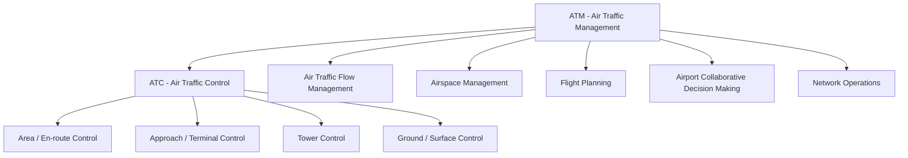
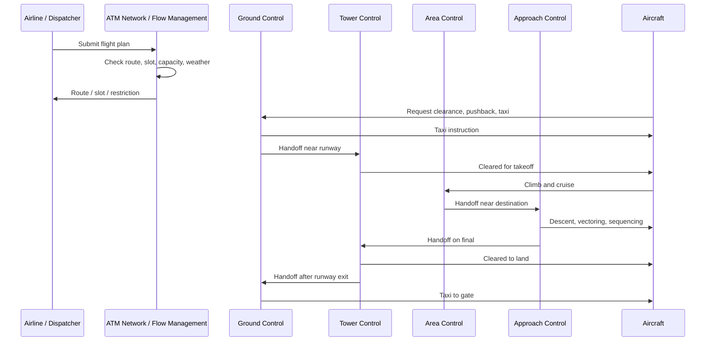
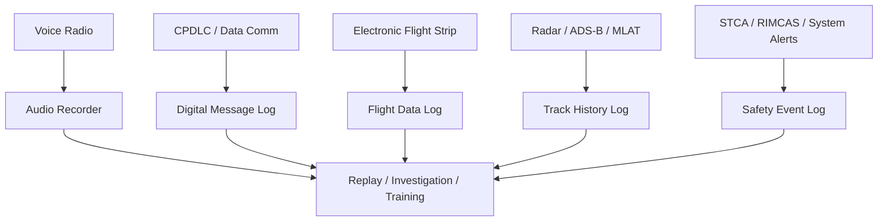
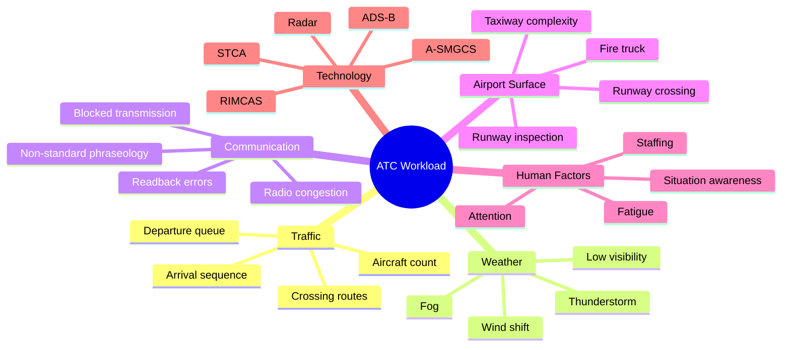
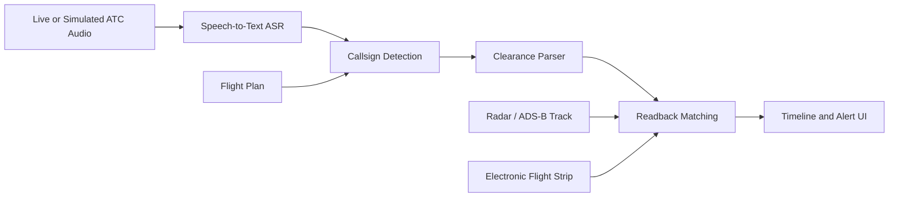
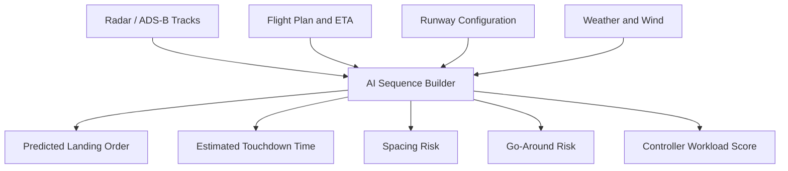
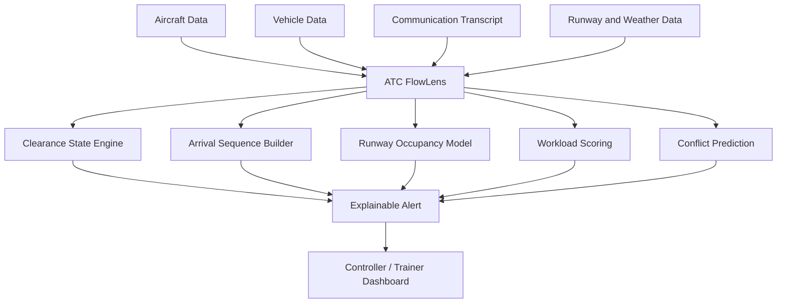

# Master Research ATC/ATM Workload dan Solusi Hackathon

Tanggal penyusunan: 31 Mei 2026  
Konteks: BOEING BUILD Hackathon - Aerospace & Defense  
Fokus utama: Air Traffic Control (ATC), Air Traffic Management (ATM), controller workload, komunikasi ATC, runway safety, teknologi yang sudah ada, dan peluang solusi digital aviation.

## 1. Executive Summary

Air Traffic Control (ATC) adalah salah satu sistem paling kritis dalam dunia aerospace. Tugas utamanya adalah menjaga agar pesawat dan kendaraan bandara bergerak secara aman, teratur, dan efisien. Dalam konteks lebih luas, ATC merupakan bagian dari **Air Traffic Management (ATM)**, yaitu ekosistem yang mencakup flight planning, traffic flow management, airspace management, runway operation, komunikasi, surveillance, dan koordinasi lintas unit.

Masalah yang paling relevan untuk hackathon adalah **controller workload**. Controller harus menjaga separation, memberi clearance, memantau runway, mengatur landing/takeoff, menangani cuaca, memproses komunikasi radio, dan merespons situasi darurat dalam waktu sangat singkat. Ketika workload terlalu tinggi, risiko kehilangan situational awareness, salah clearance, readback error, runway incursion, atau konflik pesawat-kendaraan meningkat.

Teknologi modern seperti radar, ADS-B, MLAT, surface surveillance, STCA, MTCD, A-SMGCS, RIMCAS, CPDLC/Data Comm, electronic flight strip, SWIM, arrival manager, dan departure manager sudah membantu ATC. Namun, sistem ATC masih sangat bergantung pada manusia, voice communication, koordinasi cepat, dan interpretasi informasi dari banyak layar/sumber data.

Peluang hackathon yang paling kuat adalah membangun **decision-support system** yang menggabungkan data simulasi pesawat, kendaraan, runway, clearance, komunikasi, dan cuaca untuk mendeteksi konflik, menghitung time-to-conflict, memvisualisasikan urutan landing, mendeteksi readback mismatch, dan menampilkan alert yang explainable.

Nama solusi yang direkomendasikan:

> **ATC FlowLens: Explainable Runway and Communication Safety Assistant**

## 2. Kesesuaian dengan Tema BOEING BUILD

Topik ATC/ATM sangat cocok dengan tema **Aerospace & Defense**, khususnya:

| Subtopik Hackathon | Kesesuaian |
|---|---|
| Digital Aviation Solution | Sangat kuat. ATC/ATM adalah bagian inti digital aviation dan airport operation. |
| Advanced Technology and Innovation | Relevan dengan AI, decision support, sensor fusion, prediction, dan digital twin bandara. |
| IoT and Connectivity | Relevan dengan ADS-B, vehicle transponder, surface tracking, SWIM, dan data link. |
| Social Impact | Langsung berhubungan dengan keselamatan penumpang, kru, firefighter, dan publik. |
| Sustainability | Mengurangi go-around, holding, delay, dan fuel burn melalui flow dan runway efficiency. |
| Education and Skill Development | Dapat dijadikan simulator/training system untuk ATC dan ground crew. |

## 3. Kondisi Industri ATC/ATM Saat Ini

### 3.1 ATC Masih Human-Centered

Walaupun teknologi ATC sudah maju, pengambilan keputusan kritis masih berpusat pada manusia. Controller tetap menjadi aktor utama yang:

- memberi clearance takeoff dan landing
- menjaga separation antar pesawat
- mengatur taxi dan runway crossing
- memantau pesawat inbound/outbound
- berkoordinasi dengan ground, tower, approach, area control, airport operation, dan emergency unit
- mengambil keputusan cepat saat terjadi konflik atau emergency

Teknologi saat ini berperan sebagai **safety net** dan **decision support**, bukan pengganti controller.

### 3.2 Voice Communication Masih Dominan

Komunikasi ATC-pilot dan ATC-ground vehicle masih banyak menggunakan voice radio. Sistem digital seperti CPDLC/Data Comm sudah digunakan untuk sebagian komunikasi, tetapi voice tetap penting terutama untuk instruksi cepat, emergency, dan operasi terminal/tower.

Masalah dari voice communication:

- radio congestion
- blocked transmission
- salah dengar
- readback salah
- aksen dan noise
- frekuensi padat saat traffic tinggi
- sulit langsung divisualisasikan sebagai timeline operasional

### 3.3 Data Operasional Tersebar

Informasi penting ATC biasanya berasal dari banyak sistem:

- radar display
- ADS-B/MLAT track
- surface movement display
- electronic flight strip
- weather display
- flight plan system
- voice radio
- CPDLC/Data Comm log
- runway status
- airport operation data
- alert system seperti STCA atau RIMCAS

Controller harus membangun situational awareness dari seluruh informasi tersebut. Inilah salah satu sumber workload besar.

## 4. Bagaimana ATC/ATM Bekerja

### 4.1 Perbedaan ATC dan ATM

**ATC (Air Traffic Control)** adalah layanan operasional yang memberi instruksi langsung kepada pesawat dan kendaraan.

**ATM (Air Traffic Management)** lebih luas. ATM mencakup ATC, traffic flow management, airspace management, flight planning, network operation, dan airport collaborative decision making.



### 4.2 Alur dari Flight Plan sampai Landing



### 4.3 Level Operasional ATC/ATM

| Level | Aktor/Unit | Fungsi |
|---|---|---|
| Global | ICAO | Standar internasional, safety framework, phraseology, air navigation plan |
| Nasional | Regulator penerbangan | Regulasi, lisensi, sertifikasi, oversight |
| Provider | ANSP | Menjalankan layanan navigasi udara |
| En-route | Area Control Center | Mengatur pesawat saat cruise antar wilayah |
| Terminal | Approach/Departure Control | Mengatur arrival/departure dekat bandara |
| Airport | Tower Control | Mengatur takeoff, landing, runway aktif |
| Surface | Ground/Apron/Ramp | Mengatur taxiway, pushback, kendaraan, apron |
| Emerging | UTM | Mengatur drone, eVTOL, dan low-altitude traffic |

Contoh ANSP:

- AirNav Indonesia
- FAA Air Traffic Organization
- NATS, Inggris
- DFS, Jerman
- ENAIRE, Spanyol
- NAV CANADA
- Airservices Australia

## 5. Teknologi ATC/ATM yang Ada Saat Ini

### 5.1 Layer Teknologi

```mermaid
flowchart LR
    subgraph L1["Layer 1 - Data Capture"]
        A1["Primary Radar"]
        A2["Secondary Radar / Mode S"]
        A3["ADS-B"]
        A4["MLAT"]
        A5["Surface Radar"]
        A6["Vehicle Transponder"]
        A7["Weather Data"]
    end

    subgraph L2["Layer 2 - Data Integration"]
        B1["Flight Data Processing"]
        B2["Surveillance Data Fusion"]
        B3["SWIM / Data Sharing"]
        B4["Electronic Flight Strips"]
        B5["Airport Surface Map"]
    end

    subgraph L3["Layer 3 - Safety Nets"]
        C1["STCA"]
        C2["MTCD"]
        C3["MSAW"]
        C4["A-SMGCS"]
        C5["RIMCAS / RMCA"]
        C6["Runway Status Lights"]
    end

    subgraph L4["Layer 4 - Flow and Decision Support"]
        D1["AMAN"]
        D2["DMAN"]
        D3["TBFM"]
        D4["TFDM"]
        D5["Trajectory-Based Operations"]
    end

    subgraph L5["Layer 5 - Human Decision"]
        E1["Controller Working Position"]
        E2["Voice / CPDLC"]
        E3["Clearance"]
        E4["Monitoring"]
    end

    L1 --> L2 --> L3 --> L4 --> L5
```



### 5.2 Surveillance dan Tracking

| Teknologi | Fungsi |
|---|---|
| Primary Radar | Mendeteksi objek tanpa transponder |
| Secondary Radar / Mode S | Mendapat identitas, altitude, dan data transponder pesawat |
| ADS-B | Pesawat memancarkan posisi GPS, speed, altitude, dan identitas |
| MLAT | Menghitung posisi dari sinyal transponder yang diterima beberapa receiver |
| Surface Radar | Memantau pesawat/kendaraan di runway dan taxiway |
| Vehicle Transponder | Membuat kendaraan bandara terlihat di sistem surface surveillance |

### 5.3 Safety Net dan Conflict Detection

| Sistem | Fungsi |
|---|---|
| STCA | Short-Term Conflict Alert untuk potensi kehilangan separation antar pesawat |
| MTCD | Medium-Term Conflict Detection untuk prediksi konflik beberapa menit ke depan |
| MSAW | Minimum Safe Altitude Warning |
| A-SMGCS | Surface movement guidance and control di bandara |
| RIMCAS/RMCA | Runway incursion/conflict alert |
| Runway Status Lights | Lampu otomatis untuk memberi tanda runway tidak aman |
| ASDE-X/ASSC | Surface surveillance untuk mendeteksi konflik di runway/taxiway |

### 5.4 Digital Modernization

| Teknologi | Fungsi |
|---|---|
| CPDLC/Data Comm | Komunikasi teks digital controller-pilot |
| SWIM | Backbone data sharing ATM |
| Electronic Flight Strip | Strip digital untuk status flight dan clearance |
| TFDM | Terminal Flight Data Manager untuk surface management dan tower efficiency |
| AMAN | Arrival Manager untuk sequencing kedatangan |
| DMAN | Departure Manager untuk sequencing keberangkatan |
| TBFM | Time-Based Flow Management |
| PBN/RNAV/RNP | Navigasi presisi berbasis performa |
| Remote/Digital Tower | Tower berbasis kamera/sensor dari lokasi remote |

## 6. Bagaimana Komunikasi ATC Dicatat

Komunikasi ATC tidak hanya berupa percakapan langsung. Ada beberapa jenis catatan:



### 6.1 Voice Recording

Voice radio biasanya direkam untuk audit, investigasi, dan replay. Namun audio tidak otomatis mudah dianalisis karena:

- bentuknya audio, bukan teks terstruktur
- ada noise, aksen, dan phraseology cepat
- blocked transmission bisa terjadi
- perlu sinkronisasi dengan radar track dan clearance state

### 6.2 CPDLC/Data Comm Log

CPDLC menghasilkan catatan digital karena pesan dikirim sebagai data. Ini mengurangi beban radio, tetapi belum menggantikan voice sepenuhnya, terutama pada situasi urgent dan operasi tower yang dinamis.

### 6.3 Electronic Flight Strip

Electronic flight strip mencatat informasi seperti:

- callsign
- aircraft type
- route
- assigned altitude
- runway
- clearance status
- estimated time
- handoff status
- coordination status

### 6.4 Track dan Alert Log

Surveillance system menyimpan track history. Alert system menyimpan event seperti STCA, RIMCAS, runway incursion warning, atau safety alert lain. Data ini penting untuk investigasi dan training.

## 7. Issue Utama: Controller Workload

### 7.1 Definisi

**Controller workload** adalah beban mental, visual, komunikasi, koordinasi, dan pengambilan keputusan yang dialami controller saat mengelola traffic.

Workload tinggi tidak selalu berarti banyak pesawat. Satu situasi dengan traffic sedikit bisa menjadi berat jika ada:

- cuaca buruk
- emergency
- runway crossing
- radio congestion
- sistem tidak lengkap
- low visibility
- kendaraan ground masuk runway

### 7.2 Jenis Workload

| Jenis | Penjelasan |
|---|---|
| Cognitive Workload | Memahami situasi dan memprediksi pergerakan |
| Communication Workload | Radio calls, readback, koordinasi |
| Visual Workload | Memantau layar, radar, runway, weather, strip |
| Coordination Workload | Koordinasi tower-ground-approach-apron-emergency |
| Decision Workload | Memilih instruksi tepat dalam waktu singkat |

### 7.3 Faktor Penyebab Workload Tinggi



### 7.4 Mengapa Workload Berbahaya

Workload tinggi dapat menyebabkan:

- kehilangan situational awareness
- clearance diberikan pada waktu yang tidak tepat
- controller lupa status runway
- readback error tidak terdeteksi
- delayed response terhadap konflik
- salah prioritas saat banyak event terjadi
- task saturation
- alert fatigue jika terlalu banyak alarm

## 8. Kasus Nyata yang Relevan

### 8.1 LATAM Perú Flight 2213 - Lima, 18 November 2022

Airbus A320neo sedang takeoff roll di Jorge Chávez International Airport dan bertabrakan dengan fire truck yang masuk runway saat latihan emergency response. Dua firefighter meninggal saat kejadian dan satu lainnya meninggal kemudian akibat luka.

Relevansi:

- runway conflict antara aircraft dan kendaraan
- koordinasi emergency drill dan ATC tidak cukup kuat
- clearance runway menjadi isu kritis
- surface movement dan vehicle tracking sangat penting

### 8.2 LaGuardia Fire Truck Collision - New York, 22 Maret 2026

Menurut laporan awal yang diberitakan AP, fire truck diberi clearance untuk crossing runway ketika pesawat Air Canada Express/Jazz sudah mendekati landing. Investigasi masih berjalan, tetapi NTSB menyebut situasinya sebagai heavy workload environment.

Relevansi:

- contoh langsung controller workload
- runway crossing clearance sangat sensitif terhadap waktu
- time-to-conflict kecil
- butuh alert cepat dan explainable

### 8.3 Austin-Bergstrom Runway Incursion - 4 Februari 2023

Southwest 737 mendapat clearance takeoff saat FedEx 767 sedang final approach pada runway yang sama dalam kondisi dense fog. FedEx melakukan go-around dan konflik berhasil dihindari.

Relevansi:

- low visibility menurunkan visual awareness tower
- tidak adanya surface detection equipment meningkatkan risiko
- go-around menjadi safety action terakhir

### 8.4 Überlingen Mid-Air Collision - 1 Juli 2002

Bashkirian Airlines Tu-154 dan DHL Boeing 757 bertabrakan di udara. Faktor sistemik termasuk controller yang menangani dua workstation, sistem maintenance, dan conflict alert yang tidak efektif.

Relevansi:

- workload dan staffing kritis
- safety net harus tetap bekerja saat kondisi sistem tidak ideal
- human-machine interface sangat penting

### 8.5 Linate Airport Disaster - Milan, 8 Oktober 2001

Dalam kabut tebal, Cessna masuk runway aktif dan bertabrakan dengan SAS MD-87 yang takeoff. Bandara tidak memiliki ground radar yang berfungsi.

Relevansi:

- runway incursion
- low visibility
- signage/procedure/surface surveillance
- accident chain bersifat sistemik, bukan hanya kesalahan individu

## 9. Gap Teknologi dan Peluang Inovasi

Walaupun teknologi ATC sudah matang, masih ada gap yang bisa diangkat untuk hackathon.

| Area | Teknologi Saat Ini | Gap/Peluang |
|---|---|---|
| Voice communication | Radio recorder, CPDLC | Voice belum selalu ditranskripsi dan dipahami real-time |
| Readback safety | Controller mendengar manual | AI dapat mendeteksi mismatch instruksi vs readback |
| Runway conflict | RIMCAS, ASDE-X, A-SMGCS | Tidak semua bandara punya sistem lengkap; explainability masih peluang |
| Arrival sequence | AMAN, radar, controller judgment | Visualisasi sequence dan spacing risk bisa dibuat lebih intuitif |
| Workload | Staffing rules, fatigue model | Real-time workload score masih area riset/inovasi |
| Training | Simulator ATC | Replay berbasis komunikasi + track + alert bisa lebih explainable |
| Data integration | SWIM, flight strips | Informasi masih tersebar di banyak sistem |

## 10. AI dalam ATC/ATM

AI sudah banyak diteliti untuk:

- speech-to-text komunikasi ATC
- callsign detection
- clearance parsing
- readback mismatch detection
- conflict prediction
- runway incursion prediction
- landing sequence visualization
- workload estimation
- anomaly detection
- traffic flow optimization

Namun penerapan AI operasional di ATC harus sangat hati-hati karena domain ini safety-critical. Untuk hackathon, posisi terbaik adalah **AI-assisted decision support**, bukan autonomous ATC.

### 10.1 AI Communication Layer



### 10.2 AI Arrival Sequence Layer



## 11. Rangkuman Solusi yang Bisa Diberikan

### 11.1 Solusi Utama: ATC FlowLens

**ATC FlowLens** adalah decision-support dashboard untuk membantu controller, trainer, atau airport safety team melihat hubungan antara komunikasi, runway occupancy, arrival sequence, vehicle movement, dan workload.

One-liner:

> An explainable decision-support dashboard that helps air traffic controllers detect runway conflicts, monitor communication accuracy, and visualize landing sequence before workload becomes unsafe.

### 11.2 Target Pengguna

- tower controller
- ground controller
- approach controller
- airport operation center
- airport rescue and firefighting unit
- ATC training center
- aviation safety investigator

### 11.3 Fitur Utama

| Fitur | Fungsi |
|---|---|
| Live/Simulated ATC Transcript | Menampilkan komunikasi ATC-pilot-vehicle sebagai timeline |
| Callsign Detection | Mengidentifikasi callsign pesawat/kendaraan |
| Clearance Parser | Mendeteksi cleared to land, takeoff, cross, hold short, go-around |
| Readback Mismatch Detection | Mendeteksi perbedaan antara instruksi dan readback |
| Arrival Sequence Board | Menampilkan urutan landing dan ETA touchdown |
| Runway Occupancy Timeline | Menunjukkan kapan runway dipakai landing/takeoff/crossing |
| Vehicle Movement Tracking | Melacak fire truck/ground vehicle di area runway |
| Time-to-Conflict Calculator | Menghitung potensi konflik aircraft vs vehicle |
| Explainable Alert | Menjelaskan kenapa alert muncul |
| Workload Score | Mengestimasi workload dari traffic, komunikasi, cuaca, dan alert |
| Replay Mode | Memutar ulang skenario untuk training/investigasi |

### 11.4 Flow Solusi



### 11.5 Contoh Alert

```text
CRITICAL RUNWAY CONFLICT

Aircraft: BAW123
Status: Cleared to land RWY 27
Distance: 1.8 NM final
Estimated touchdown: 42 seconds

Vehicle: ARFF2
Status: Requested / crossing RWY 27
Estimated runway clear time: 58 seconds

Reason:
Vehicle clear time is later than aircraft touchdown time.
Predicted runway occupancy overlap: 16 seconds.

Recommendation:
Hold vehicle immediately or issue go-around advisory if crossing already started.
```

### 11.6 MVP yang Realistis untuk Hackathon

MVP tidak perlu terhubung ke ATC asli. Cukup gunakan data simulasi:

- satu peta runway/taxiway sederhana
- 3-5 pesawat inbound/departure
- 1-2 kendaraan airport/fire truck
- log komunikasi dummy
- status clearance dummy
- cuaca/visibility dummy
- alert engine rule-based
- dashboard visual

Stack yang cocok:

- Frontend: React/Next.js
- Map/runway visualization: SVG/Canvas/Mapbox/Leaflet sederhana
- Backend: Node.js/FastAPI
- AI optional: speech-to-text demo atau parser rule-based untuk transcript
- Data: JSON simulation

## 12. Prioritas Ide Solusi

| Ide | Dampak | Feasibility | Kekuatan Pitch | Catatan |
|---|---:|---:|---:|---|
| ATC FlowLens | Tinggi | Tinggi | Sangat tinggi | Solusi paling seimbang untuk demo |
| Runway Conflict Assistant | Tinggi | Tinggi | Sangat tinggi | Fokus kuat ke kasus fire truck vs aircraft |
| ATC Communication Transcript AI | Sedang-Tinggi | Sedang | Tinggi | Butuh ASR/parser, bisa disimulasikan |
| Arrival Sequence Visualizer | Sedang | Tinggi | Sedang-Tinggi | Visual demo bagus dan mudah dipahami |
| Workload Score Dashboard | Sedang-Tinggi | Tinggi | Tinggi | Cocok sebagai fitur tambahan |
| Training Replay Simulator | Tinggi | Sedang | Tinggi | Kuat untuk education/safety training |

## 13. Rekomendasi Narasi Pitch

### Opening Problem

ATC adalah sistem safety-critical yang masih sangat bergantung pada komunikasi voice, koordinasi manusia, dan pemantauan banyak sumber data. Saat workload meningkat, controller dapat kehilangan situational awareness, terutama pada operasi runway yang melibatkan landing aircraft dan ground vehicle.

### Evidence

Kasus seperti LATAM Perú Flight 2213, LaGuardia fire truck collision, Austin-Bergstrom runway incursion, Linate disaster, dan Überlingen menunjukkan bahwa accident chain sering muncul dari kombinasi workload, komunikasi, visibility, sistem pendukung, dan koordinasi lintas unit.

### Solution

ATC FlowLens menyatukan transcript komunikasi, status clearance, arrival sequence, runway occupancy, vehicle movement, dan workload score ke satu dashboard explainable.

### Impact

Solusi ini membantu:

- meningkatkan situational awareness
- mengurangi risiko runway incursion
- mendeteksi readback mismatch
- mempercepat identifikasi konflik
- mendukung training ATC dan ground crew
- mengurangi delay, go-around, dan fuel burn

### Safety Positioning

ATC FlowLens bukan pengganti controller. Sistem ini adalah **human-in-the-loop decision-support and training tool**.

## 14. Sumber Rujukan Utama

- FAA, NextGen: https://www.faa.gov/nextgen/
- FAA, Data Communication Program: https://www.faa.gov/air_traffic/technology/DataComm
- FAA, Terminal Flight Data Manager: https://www.faa.gov/air_traffic/technology/tfdm/whatistfdm
- FAA, SWIM Program Overview: https://www.faa.gov/air_traffic/technology/swim/overview
- FAA, Operational Communications Recorders: https://www.faa.gov/air_traffic/publications/atpubs/foa_html/chap3_section_4.html
- FAA, Vehicle Movement Area Transponders: https://www.faa.gov/airports/runway_safety/airfield_drivers/enhancing-surface-safety-guide-vehicle-movement-area
- FAA, Assessing Fatigue Risk in FAA Air Traffic Operations: https://www.faa.gov/newsroom/media/Fatigue_Report.pdf
- EUROCONTROL, A-SMGCS: https://www.eurocontrol.int/service/advanced-surface-movement-guidance-and-control-system
- EUROCONTROL, CPDLC at Maastricht UAC: https://www.eurocontrol.int/service/controller-pilot-datalink-communications-our-maastricht-uac
- EUROCONTROL, Datalink: https://www.eurocontrol.int/function/datalink
- ICAO, Human Performance: https://www.icao.int/operational-safety/hp
- ICAO, Global Air Navigation Plan: https://www.icao.int/airnavigation/Pages/GANP-Resources.aspx
- SKYbrary, ASDE-X: https://skybrary.aero/index.php/articles/airport-surface-detection-equipment-model-x-asde-x
- SKYbrary, A-SMGCS: https://skybrary.aero/index.php/articles/advanced-surface-movement-guidance-control-system-smgcs
- SKYbrary, RIMCAS: https://skybrary.aero/index.php/articles/runway-incursion-monitoring-and-conflict-alert-system-rimcas
- NTSB, Austin-Bergstrom Runway Incursion DCA23FA149: https://www.ntsb.gov/investigations/pages/DCA23FA149.aspx
- AP News, LaGuardia Fire Truck Collision Preliminary Information: https://apnews.com/article/33073747e410c8d7bceab0ebc347d35f
- Aviation Safety Network, LATAM Perú Flight 2213: https://asn.flightsafety.org/database/record.php?id=20221118-1
- Aviation Accidents, LATAM Peru Airbus A320N Flight LPE2213: https://www.aviation-accidents.net/latam-peru-airbus-a320n-cc-bhb-flight-lpe2213/
- ScienceDirect, The Überlingen Accident: https://www.sciencedirect.com/science/article/pii/S0925753507001567
- University of Glasgow, Modeling the Linate Runway Incursion: https://www.dcs.gla.ac.uk/~johnson/papers/HCIAero2006/Linate.pdf
- NASA, Air Traffic Control Lab: https://www.nasa.gov/ames/aviationsystems/air-traffic-control-lab/
- arXiv, ATCO2 Corpus for ATC Speech Recognition and NLU: https://arxiv.org/abs/2211.04054
- arXiv, Adapting ASR for Accented ATC Communications: https://arxiv.org/abs/2502.20311
