# Visualisasi Cara Kerja ATC/ATM, Komunikasi, dan Teknologi Pendukung

Tanggal penyusunan: 31 Mei 2026  
Konteks: BOEING BUILD Hackathon - ATC Workload, Runway Safety, dan Decision Support

Dokumen ini menjelaskan bagaimana ATC/ATM bekerja secara operasional, teknologi apa saja yang sudah ada, bagaimana komunikasi dicatat, serta bagaimana AI dapat membantu transkripsi, visualisasi urutan landing, dan pengurangan workload.

## 1. Gambaran Besar: ATC vs ATM

**ATC (Air Traffic Control)** adalah layanan operasional yang memberi instruksi langsung kepada pesawat dan kendaraan agar pergerakan tetap aman.

**ATM (Air Traffic Management)** lebih luas. ATM mencakup ATC, traffic flow management, airspace management, flight planning, sequencing, capacity management, dan koordinasi antar unit.

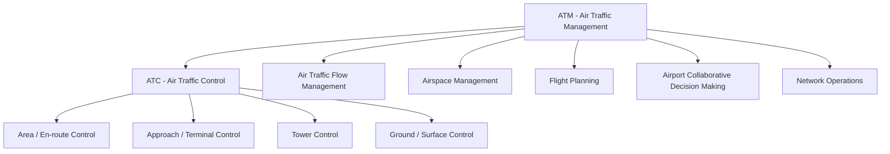

## 2. Alur Operasional dari Flight Plan sampai Landing

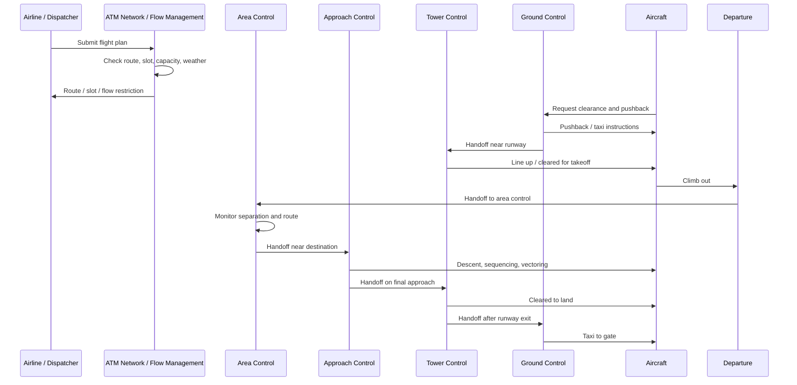

Catatan:

- Alur ini bisa berbeda antar negara dan bandara.
- Pada bandara besar, ada posisi khusus seperti clearance delivery, ramp/apron control, departure, arrival, final director, dan supervisor.
- Untuk operasi modern, sebagian data dikirim digital, tetapi voice radio masih sangat dominan.

## 3. Siapa Mengatur Apa?

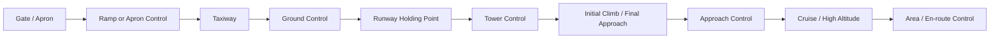

| Unit | Area Tanggung Jawab | Contoh Instruksi |
|---|---|---|
| Clearance Delivery | izin rute awal sebelum taxi | route clearance, squawk code |
| Ramp/Apron | pushback, gate, apron movement | pushback approved |
| Ground Control | taxiway dan runway crossing tertentu | taxi via A, hold short runway |
| Tower Control | takeoff, landing, runway aktif | cleared for takeoff, cleared to land |
| Approach Control | sequencing arrival/departure | descend, turn heading, maintain speed |
| Area Control | en-route/cruise | climb, descend, direct waypoint |
| Flow Management | kapasitas jaringan | slot, delay program, reroute |

## 4. Teknologi yang Ada Saat Ini

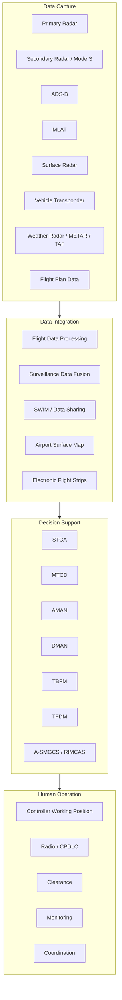

### Istilah Penting

- **ADS-B**: pesawat memancarkan posisi, altitude, speed, dan identitas.
- **MLAT**: menghitung posisi dari sinyal transponder yang diterima beberapa receiver.
- **SWIM**: data-sharing backbone untuk ATM modern.
- **Electronic Flight Strip**: versi digital dari strip penerbangan yang mencatat informasi flight dan status operasional.
- **STCA**: Short-Term Conflict Alert.
- **MTCD**: Medium-Term Conflict Detection.
- **AMAN**: Arrival Manager.
- **DMAN**: Departure Manager.
- **TBFM**: Time-Based Flow Management.
- **TFDM**: Terminal Flight Data Manager.
- **A-SMGCS/RIMCAS**: sistem surface movement dan runway incursion alert.

## 5. Bagaimana Komunikasi ATC Dicatat?

Komunikasi ATC dicatat melalui beberapa jalur. Tidak semuanya otomatis menjadi transkrip teks; banyak sistem masih menyimpan audio, log digital, dan flight data secara terpisah.

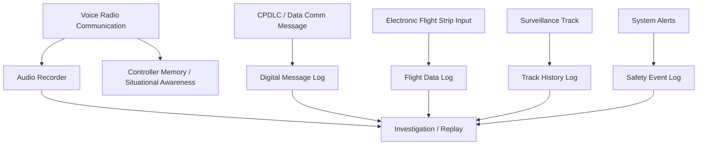

### 5.1 Voice Radio Recording

ATC masih banyak menggunakan voice radio. Di fasilitas ATC, komunikasi operasional umumnya direkam untuk audit, investigasi, dan rekonstruksi insiden. FAA menyebut air traffic facilities harus merekam komunikasi operasional sejauh dapat dilakukan.

Namun voice recording biasanya:

- berbentuk audio, bukan selalu transkrip teks
- perlu sinkronisasi dengan radar track dan flight data untuk analisis
- bisa sulit dipahami karena radio noise, aksen, blocked transmission, dan phraseology cepat

### 5.2 CPDLC / Data Comm

**CPDLC (Controller-Pilot Data Link Communications)** adalah komunikasi teks digital antara controller dan pilot untuk pesan ATC tertentu. Di FAA, Data Comm adalah bagian dari modernisasi NextGen. EUROCONTROL Maastricht UAC sudah memakai CPDLC sejak 2003 untuk membantu mengurangi keterbatasan voice communication.

Keunggulan CPDLC:

- mengurangi radio congestion
- mengurangi risiko salah dengar
- menghasilkan log digital
- cocok untuk clearance non-urgent
- mendukung trajectory-based operations

Keterbatasan:

- tidak menggantikan voice untuk semua situasi
- tidak ideal untuk instruksi sangat urgent
- performa bergantung avionics dan jaringan data link
- jika message gagal, workload bisa bertambah

### 5.3 Electronic Flight Strips

Electronic flight strips menggantikan strip kertas tradisional. Strip ini mencatat flight information dan status operasional seperti:

- callsign
- aircraft type
- route
- assigned altitude
- runway
- estimated time
- clearance status
- coordination status
- handoff status

FAA TFDM menggunakan electronic flight data untuk meningkatkan surface management dan efisiensi tower.

### 5.4 Surveillance dan Alert Log

Radar, ADS-B, MLAT, surface surveillance, STCA, RIMCAS, dan sistem lain dapat menyimpan track history dan alert log. Data ini berguna untuk:

- replay insiden
- safety investigation
- training
- workload analysis
- improvement of procedures

## 6. Apakah Sudah Ada AI yang Mencatat Komunikasi ATC?

Secara riset, **ada banyak pengembangan AI untuk Automatic Speech Recognition (ASR) pada komunikasi ATC**. Namun implementasi operasional penuh dalam sistem safety-critical masih sangat hati-hati karena tuntutan akurasi, latency, reliability, certification, dan human factors.

Contoh area riset:

- transkripsi komunikasi controller-pilot
- deteksi callsign
- deteksi clearance seperti climb, descend, heading, speed
- readback error detection
- multilingual/accented English recognition
- visualisasi timeline komunikasi
- workload estimation berdasarkan jumlah radio call

Dataset seperti **ATCO2 corpus** dibuat untuk riset ASR dan natural language understanding pada komunikasi ATC. Ada juga riset ASR untuk ATC dengan fokus pada accented English.

## 7. Visualisasi AI Transcription Layer untuk ATC

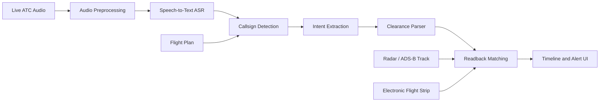

Contoh hasil AI transcription:

```text
18:42:11  TWR -> BAW123  Cleared to land runway 27
18:42:15  BAW123 -> TWR  Cleared to land runway 27
18:42:22  TWR -> ARFF2   Hold short runway 27
18:42:26  ARFF2 -> TWR   Holding short runway 27
```

Jika AI mendeteksi mismatch:

```text
WARNING:
Controller: "Hold short runway 27"
Vehicle readback: "Cross runway 27"
Potential readback error detected.
```

## 8. Visualisasi Urutan Landing / Arrival Sequencing

Urutan landing biasanya dibantu oleh approach control, arrival manager, radar display, speed control, vectoring, altitude assignment, dan runway capacity planning.

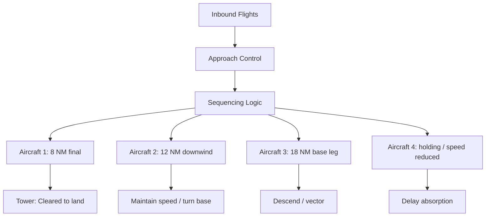

### Contoh Timeline Arrival

```mermaid
gantt
    title Arrival Sequence Example
    dateFormat  HH:mm
    axisFormat  %H:%M

    section Runway 27
    BAW123 final approach       :a1, 18:40, 5m
    BAW123 runway occupancy     :a2, after a1, 1m
    SIA456 final approach       :b1, 18:47, 5m
    SIA456 runway occupancy     :b2, after b1, 1m
    QFA789 final approach       :c1, 18:54, 5m
    QFA789 runway occupancy     :c2, after c1, 1m
```

ATC/ATM perlu menjaga agar spacing cukup. Jika pesawat pertama belum keluar runway, pesawat berikutnya mungkin harus:

- reduce speed
- extend downwind
- make S-turn
- enter holding
- go around

## 9. Bagaimana AI Bisa Membantu Visualisasi Urutan Landing

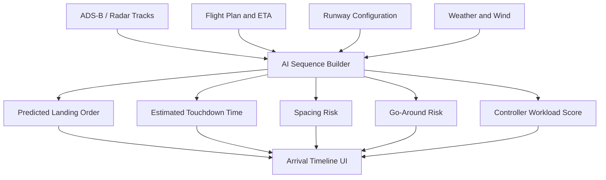

Output yang bisa divisualisasikan:

- urutan aircraft yang akan mendarat
- estimated touchdown time
- runway occupancy time
- spacing antar aircraft
- pesawat yang butuh speed reduction
- risiko go-around
- efek cuaca terhadap kapasitas runway
- controller workload score

## 10. Bagaimana ATC Mengambil Keputusan Secara Sederhana

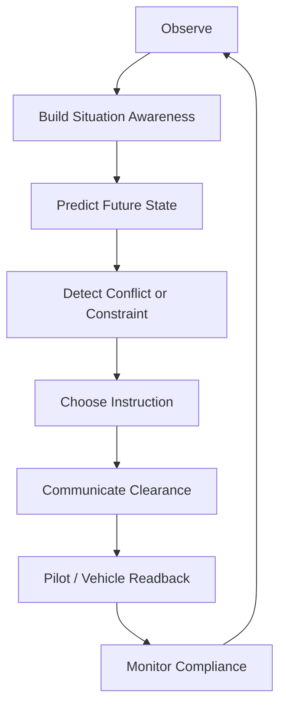

Ini adalah loop utama ATC. Masalah workload muncul ketika loop ini berjalan terlalu cepat, terlalu banyak objek, atau terlalu banyak gangguan.

## 11. Contoh Operasi Landing dengan Komunikasi dan Logging

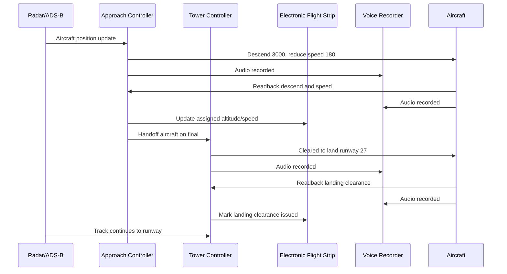

## 12. Contoh Operasi Runway Crossing dengan Kendaraan

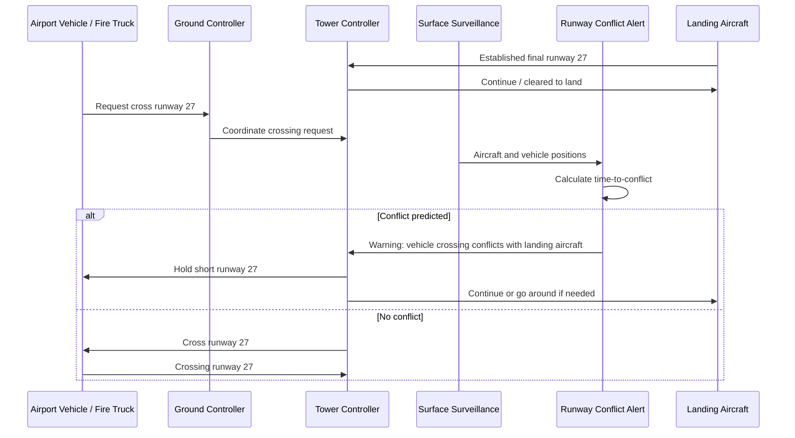

## 13. Peluang Hackathon: AI Communication and Sequence Assistant

### Nama Konsep

**ATC FlowLens**  
atau  
**RunwayComms AI**

### Problem

Komunikasi ATC masih banyak berbasis voice radio dan informasi operasional tersebar di beberapa sistem: radar, flight strip, weather, clearance, dan surface surveillance. Controller harus membangun situational awareness secara manual dan cepat.

### Solusi

Sistem yang menggabungkan:

- transkripsi komunikasi ATC
- parsing callsign dan clearance
- matching readback
- visualisasi urutan landing
- runway occupancy prediction
- workload score
- explainable alert

### Fitur MVP

1. **Live/Simulated ATC Transcript**
   - menampilkan komunikasi tower-pilot-vehicle dalam bentuk timeline

2. **Callsign and Clearance Parser**
   - mendeteksi callsign, runway, altitude, heading, speed, dan clearance type

3. **Readback Mismatch Detection**
   - memberi alert jika pilot/vehicle membaca instruksi berbeda

4. **Arrival Sequence Board**
   - menampilkan urutan pesawat landing dan estimasi waktu touchdown

5. **Runway Occupancy Timeline**
   - menunjukkan kapan runway dipakai untuk landing, takeoff, atau crossing

6. **Conflict Alert**
   - mendeteksi konflik aircraft vs vehicle atau aircraft vs aircraft

7. **Workload Indicator**
   - menilai workload berdasarkan jumlah call, traffic, crossing request, cuaca, dan alert

## 14. Wireframe Dashboard

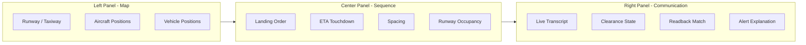

## 15. Contoh Data Simulasi untuk Demo

```json
{
  "aircraft": [
    {
      "callsign": "BAW123",
      "phase": "final",
      "runway": "27",
      "distance_nm": 4.2,
      "speed_kt": 145,
      "clearance": "cleared_to_land"
    },
    {
      "callsign": "SIA456",
      "phase": "downwind",
      "runway": "27",
      "distance_nm": 9.8,
      "speed_kt": 180,
      "clearance": "continue_approach"
    }
  ],
  "vehicles": [
    {
      "id": "ARFF2",
      "type": "fire_truck",
      "status": "request_crossing",
      "runway": "27",
      "estimated_clear_time_sec": 42
    }
  ],
  "communications": [
    {
      "time": "18:42:11",
      "speaker": "Tower",
      "target": "BAW123",
      "message": "Cleared to land runway 27"
    },
    {
      "time": "18:42:18",
      "speaker": "ARFF2",
      "target": "Tower",
      "message": "Request cross runway 27"
    }
  ]
}
```

## 16. Kesimpulan

Teknologi ATC/ATM saat ini sudah memiliki banyak komponen modern: radar, ADS-B, MLAT, CPDLC/Data Comm, SWIM, electronic flight strips, TFDM, AMAN/DMAN, STCA, MTCD, A-SMGCS, dan RIMCAS. Namun komunikasi voice masih dominan dan informasi operasional sering tersebar di banyak sistem.

AI dapat berperan sebagai lapisan tambahan untuk:

- mentranskripsi komunikasi
- mendeteksi callsign dan clearance
- mencocokkan readback
- membuat timeline kejadian
- memvisualisasikan urutan landing
- memprediksi runway occupancy
- memberi alert yang explainable

Untuk hackathon, solusi paling realistis adalah **simulator + dashboard decision support**, bukan sistem ATC operasional sungguhan.

## 17. Sumber Rujukan

- FAA, **Data Communication Program (Data Comm)**: https://www.faa.gov/air_traffic/technology/DataComm
- FAA, **Terminal Flight Data Manager (TFDM)**: https://www.faa.gov/air_traffic/technology/tfdm/whatistfdm
- FAA, **TFDM Capabilities**: https://www.faa.gov/air_traffic/technology/tfdm/capabilities
- FAA, **Operational Communications Recorders**: https://www.faa.gov/air_traffic/publications/atpubs/foa_html/chap3_section_4.html
- FAA, **SWIM Program Overview**: https://www.faa.gov/air_traffic/technology/swim/overview
- EUROCONTROL, **CPDLC at Maastricht UAC**: https://www.eurocontrol.int/service/controller-pilot-datalink-communications-our-maastricht-uac
- EUROCONTROL, **Datalink**: https://www.eurocontrol.int/function/datalink
- SKYbrary, **CPDLC**: https://skybrary.aero/index.php/articles/controller-pilot-data-link-communications-cpdlc
- NASA, **Air Traffic Control Lab**: https://www.nasa.gov/ames/aviationsystems/air-traffic-control-lab/
- arXiv, **ATCO2 Corpus for ATC Speech Recognition and NLU**: https://arxiv.org/abs/2211.04054
- arXiv, **Adapting ASR for Accented ATC Communications**: https://arxiv.org/abs/2502.20311
