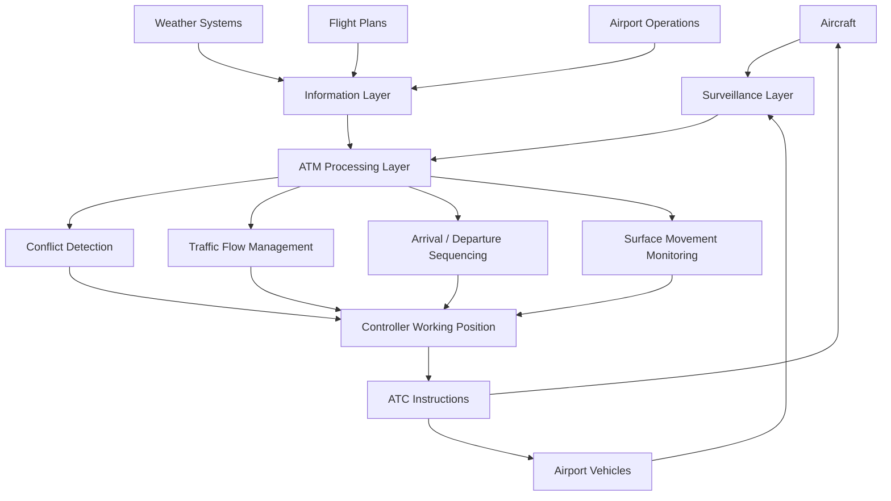
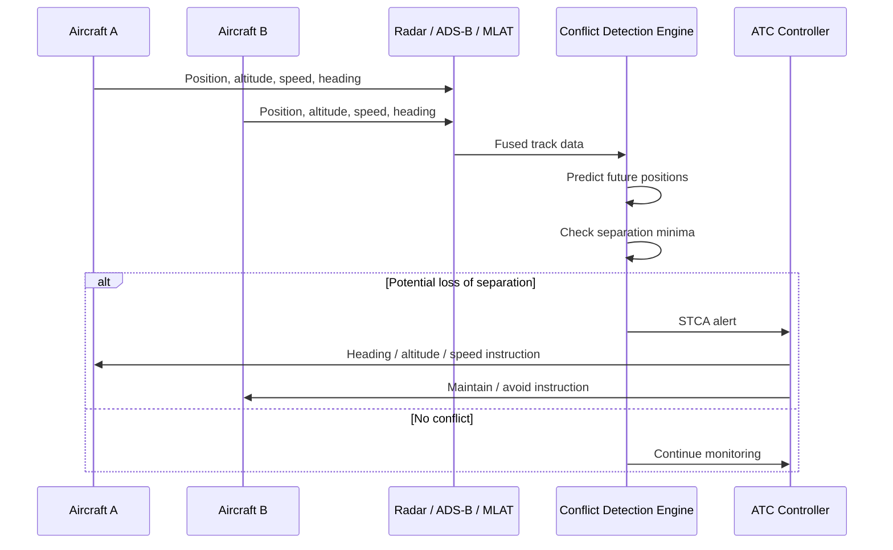
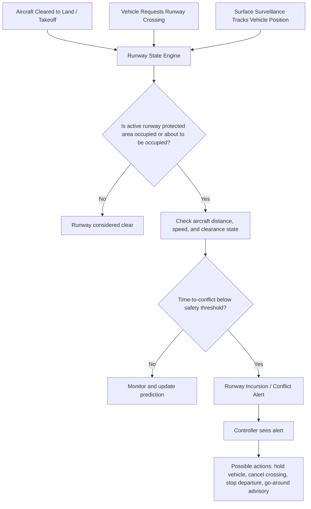
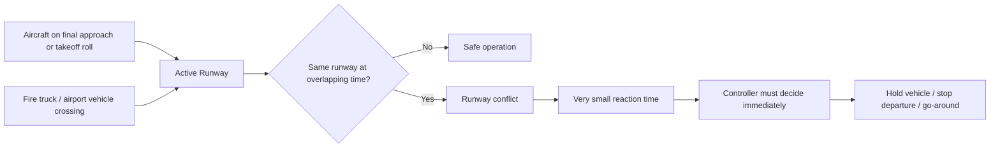
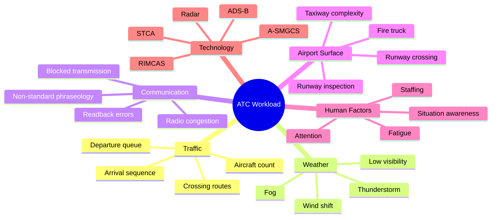
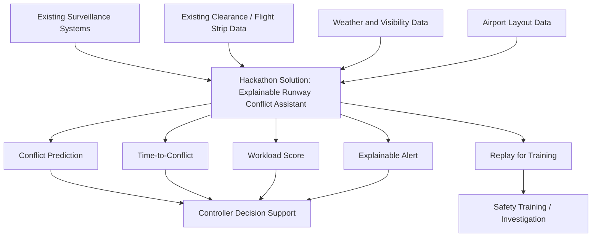
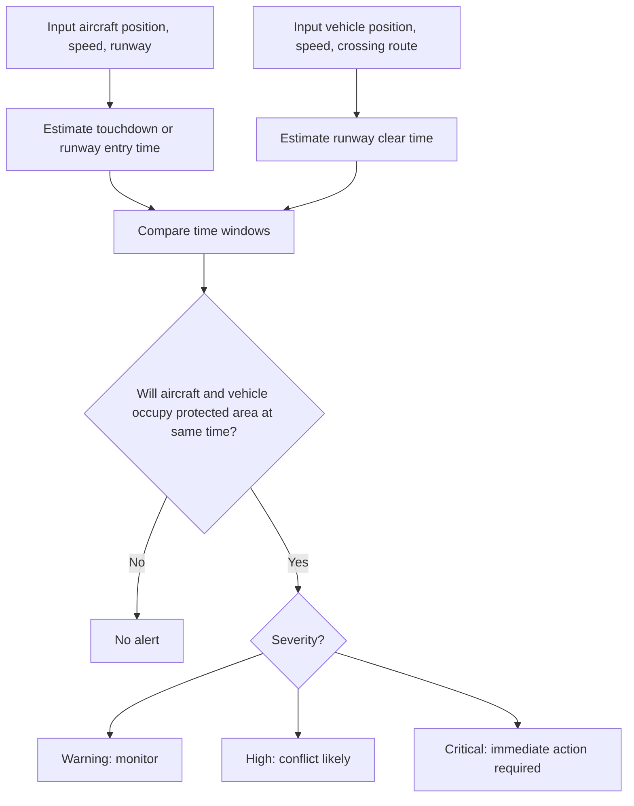
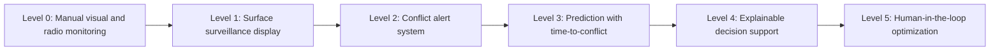

# Visualisasi Teknologi ATC Saat Ini

Tanggal penyusunan: 31 Mei 2026  
Konteks: BOEING BUILD Hackathon - ATC Workload dan Runway Conflict Assistant

Dokumen ini memvisualisasikan teknologi ATC/ATM yang sudah ada saat ini, termasuk short-term prediction, runway incursion alert, surface surveillance, dan bagaimana peluang solusi hackathon dapat ditempatkan sebagai lapisan decision-support.

## 1. Gambaran Besar Sistem ATC Modern



Penjelasan:

- **Aircraft** mengirim data posisi melalui radar, Mode S, ADS-B, atau flight data.
- **Airport vehicles** dapat dipantau jika memakai transponder, ADS-B-like equipment, MLAT, atau surface surveillance.
- **Weather systems** dan **flight plans** memberi konteks operasional.
- **ATM processing layer** mengolah data menjadi alert, sequence, flow management, dan rekomendasi.
- **Controller** tetap menjadi pengambil keputusan utama.

## 2. Layer Teknologi yang Sudah Ada Saat Ini

```mermaid
flowchart LR
    subgraph L1["Layer 1 - Data Capture"]
        A1["Primary Radar"]
        A2["Secondary Radar / Mode S"]
        A3["ADS-B"]
        A4["MLAT"]
        A5["Surface Radar"]
        A6["Vehicle Transponder"]
        A7["Weather Radar / MET Data"]
    end

    subgraph L2["Layer 2 - Data Integration"]
        B1["Flight Data Processing"]
        B2["Surveillance Data Fusion"]
        B3["SWIM / Data Sharing"]
        B4["Airport Surface Map"]
    end

    subgraph L3["Layer 3 - Safety Nets"]
        C1["STCA"]
        C2["MTCD"]
        C3["MSAW"]
        C4["RIMCAS / RMCA"]
        C5["A-SMGCS Alerts"]
        C6["Runway Status Lights"]
    end

    subgraph L4["Layer 4 - Decision Support"]
        D1["Arrival Manager"]
        D2["Departure Manager"]
        D3["Traffic Flow Management"]
        D4["Time-Based Flow Management"]
        D5["Trajectory-Based Operations"]
    end

    subgraph L5["Layer 5 - Human Decision"]
        E1["Tower Controller"]
        E2["Ground Controller"]
        E3["Approach Controller"]
        E4["Area Controller"]
    end

    L1 --> L2 --> L3 --> L4 --> L5
```



Catatan istilah:

- **STCA**: Short-Term Conflict Alert, peringatan konflik antar pesawat dalam waktu dekat.
- **MTCD**: Medium-Term Conflict Detection, prediksi konflik beberapa menit ke depan.
- **MSAW**: Minimum Safe Altitude Warning.
- **RIMCAS/RMCA**: Runway Incursion Monitoring and Conflict Alert / Runway Monitoring and Conflict Alert.
- **A-SMGCS**: Advanced Surface Movement Guidance and Control System.
- **SWIM**: System Wide Information Management.

## 3. Short-Term Conflict Alert untuk Pesawat di Udara



Intinya, STCA bekerja dengan memproyeksikan posisi pesawat dalam waktu dekat. Jika jarak horizontal atau vertikal diprediksi melanggar separation minima, sistem memberi alert ke controller.

Keterbatasan:

- Alert harus cepat, tetapi tidak boleh terlalu banyak false alarm.
- Alert biasanya memberi tahu adanya konflik, tetapi tidak selalu memberi rekomendasi yang benar-benar explainable.
- Controller masih harus menilai konteks operasional dan memberi instruksi.

## 4. Runway Incursion Alert untuk Pesawat dan Kendaraan



Sistem seperti A-SMGCS/RIMCAS/ASDE-X membantu controller melihat pergerakan di runway dan taxiway. Jika ada kendaraan atau pesawat yang masuk area runway aktif ketika pesawat lain akan landing/takeoff, sistem dapat memunculkan alert.

## 5. Visualisasi Masalah yang Terjadi pada Kasus Fire Truck vs Aircraft



Kasus seperti LATAM Perú Flight 2213 atau insiden LaGuardia menunjukkan bahwa runway conflict dapat terjadi bukan karena tidak ada prosedur, tetapi karena kombinasi:

- clearance state tidak dipahami sama oleh semua pihak
- kendaraan ground masuk area kritis
- controller harus memantau banyak hal sekaligus
- alert atau surveillance tidak cukup cepat/efektif
- time-to-conflict terlalu kecil

## 6. Workload ATC sebagai Sistem Multi-Faktor



Workload bukan hanya jumlah pesawat. Workload adalah kombinasi traffic, cuaca, komunikasi, surface movement, kondisi manusia, dan kualitas sistem pendukung.

## 7. Perbandingan Teknologi Saat Ini dan Celah Hackathon

| Area | Teknologi yang Sudah Ada | Fungsi | Celah yang Masih Bisa Diangkat |
|---|---|---|---|
| Airborne conflict | STCA, MTCD | Mendeteksi potensi kehilangan separation antar pesawat | Alert sering teknis, belum selalu explainable untuk training/pitch |
| Runway conflict | ASDE-X, ASSC, A-SMGCS, RIMCAS/RMCA | Mendeteksi konflik runway dan surface movement | Tidak semua bandara punya sistem lengkap; alert fatigue dan human workload tetap ada |
| Surface tracking | Surface radar, MLAT, vehicle transponder | Melacak pesawat/kendaraan di darat | Kendaraan tertentu bisa belum terintegrasi; data clearance belum selalu digabung secara cerdas |
| Communication | Voice radio, CPDLC/Data Comm | Instruksi pilot-controller | Voice masih dominan; radio congestion dan readback error tetap jadi risiko |
| Flow management | TFM, TBFM, AMAN, DMAN | Mengatur flow traffic | Fokus sering pada efisiensi flow, bukan workload explanation per controller |
| Digital data sharing | SWIM | Membagikan data operasional lintas sistem | Integrasi data masih kompleks dan berbeda antar negara/provider |
| Human performance | Fatigue management, staffing model | Mengelola risiko manusia | Workload real-time estimation masih area riset dan peluang inovasi |

## 8. Posisi Solusi Hackathon di Atas Teknologi yang Ada



Solusi hackathon tidak menggantikan STCA, A-SMGCS, atau RIMCAS. Solusinya lebih realistis jika diposisikan sebagai:

- simulator
- decision-support layer
- training tool
- explainability layer
- airport safety dashboard
- workload awareness system

## 9. Contoh Dashboard yang Bisa Dibuat

```mermaid
flowchart LR
    subgraph Left["Map Panel"]
        A["Runway"]
        B["Taxiway"]
        C["Aircraft icon"]
        D["Vehicle icon"]
    end

    subgraph Center["Alert Panel"]
        E["CRITICAL: Runway conflict predicted"]
        F["Time-to-conflict: 18 seconds"]
        G["Aircraft: AC8646 cleared to land"]
        H["Vehicle: ARFF-2 crossing RWY 04"]
    end

    subgraph Right["Decision Support"]
        I["Recommended action: Hold vehicle"]
        J["Alternative: Go-around advisory"]
        K["Reason: vehicle clear time > aircraft touchdown time"]
        L["Workload score: High"]
    end

    Left --> Center --> Right
```



## 10. Contoh Logic Time-to-Conflict



Contoh sederhana:

```text
aircraft_touchdown_time = 25 seconds
vehicle_clear_runway_time = 38 seconds

if vehicle_clear_runway_time > aircraft_touchdown_time:
    conflict = true
```

## 11. Visualisasi Level Kematangan Solusi



Untuk hackathon, target realistis adalah **Level 3-4**:

- mendeteksi potensi konflik
- menghitung time-to-conflict
- menjelaskan penyebab alert
- memberi rekomendasi aksi
- tetap human-in-the-loop

## 12. Kesimpulan

Teknologi ATC saat ini sudah memiliki banyak safety net seperti STCA, MTCD, ASDE-X, A-SMGCS, RIMCAS, ADS-B, MLAT, dan SWIM. Namun, masalah workload tetap ada karena sistem ATC adalah domain dengan kompleksitas tinggi, banyak komunikasi, perubahan situasi cepat, dan keputusan manusia yang harus dibuat dalam hitungan detik.

Peluang hackathon yang kuat bukan membuat pengganti ATC, tetapi membuat **lapisan visual, prediktif, dan explainable** yang membantu:

- memahami konflik lebih cepat
- mengurangi beban kognitif controller
- memberi training scenario yang realistis
- menjelaskan accident chain
- meningkatkan runway safety awareness

## 13. Sumber Rujukan

- FAA, NextGen: https://www.faa.gov/nextgen/
- FAA, SWIM Program Overview: https://www.faa.gov/air_traffic/technology/swim/overview
- FAA, Vehicle Movement Area Transponders: https://www.faa.gov/airports/runway_safety/airfield_drivers/enhancing-surface-safety-guide-vehicle-movement-area
- EUROCONTROL, A-SMGCS: https://www.eurocontrol.int/service/advanced-surface-movement-guidance-and-control-system
- SKYbrary, ASDE-X: https://skybrary.aero/index.php/articles/airport-surface-detection-equipment-model-x-asde-x
- SKYbrary, RIMCAS: https://skybrary.aero/index.php/articles/runway-incursion-monitoring-and-conflict-alert-system-rimcas
- ICAO, Global Air Navigation Plan: https://www.icao.int/airnavigation/Pages/GANP-Resources.aspx
