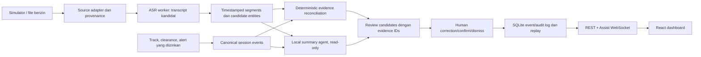

# ATC FlowLens AI Assist Buddy — Addendum Requirement dan Prompt Implementasi

- **Jenis dokumen:** addendum requirement dan prompt implementasi bagi coding agent.
- **Status:** target desain per 3 Oktober 2026; fitur AI yang disebut di sini belum dibuktikan tersedia di source, dibangun, ditinjau ATCO, atau divalidasi operasional.
- **Basis:** mempertahankan simulator, event model, role access, replay, dan storage yang sudah didefinisikan dalam [Rencana Teknis MVP](ATC_FlowLens_Rencana_Teknis_MVP.md).
- **Tujuan:** merancang jalur dari synthetic baseline berbasis bukti, ke replay offline simulator mitra dengan kandidat opsi AI, menuju advisory berbukti untuk controller Tower/Ground runway pada masa depan.

> **Batas penting:** tujuan live advisory adalah arah jangka panjang, bukan kesiapan atau izin penggunaan saat ini. MVP hanya menganalisis replay offline; kandidat opsi ditampilkan untuk evaluasi, tidak dikirim ke posisi kontrol atau menjadi command. Controller tetap memegang keputusan dan clearance. Per 3 Oktober 2026 belum ada mitra/replay simulator yang dikonfirmasi. Synthetic baseline harus ditandai belum tervalidasi terhadap workflow operasi.

## 1. Perubahan requirement produk

### 1.1 Definisi produk yang dituju

ATC FlowLens ditujukan menjadi **advisory berbukti bagi controller Tower/Ground runway**. Dalam MVP, ia menghubungkan replay simulator training yang diizinkan dengan event sesi, lalu menyajikan temuan dan opsi tindak lanjut hipotetis untuk ditinjau evaluator ATCO secara offline. Tujuan ini tidak berarti model memegang kewenangan ATC atau MVP dapat digunakan saat operasi nyata.

Keluaran assistant adalah:

1. transcript bertimestamp yang mempertahankan hubungan ke sumber audio;
2. speaker/channel attribution hanya jika didukung metadata atau hasil diarization yang ditandai tidak pasti;
3. ekstraksi kandidat callsign, runway, angka, permintaan, instruksi, readback, negasi, dan waktu;
4. catatan ringkas yang menunjuk ke segmen transcript dan event sumber;
5. highlight kandidat, misalnya transcript berkeyakinan rendah pada callsign/runway penting, kandidat mismatch readback, request yang belum memiliki event koordinasi padanan, atau perbedaan antara ucapan, clearance tercatat, dan pergerakan teramati;
6. opsi tindak lanjut hipotetis yang hanya tampil dalam replay, masing-masing dengan rationale, evidence IDs, preconditions/unknowns, dan batas applicability; opsi bukan clearance, instruksi untuk pilot/kendaraan, atau command simulator;
7. tindakan reviewer untuk mengoreksi transcript, mengonfirmasi, menolak, atau menandai highlight/opsi sebagai belum dapat dipastikan.

### 1.2 Prinsip anti-duplikasi

- Gunakan track, clearance, dan alert dari simulator atau sistem yang sudah berwenang menyediakan feed; jangan membuat pengganti radar, A-SMGCS/SMAS, safety net, voice recorder, atau sistem clearance.
- Jika sumber permukaan yang ada menyediakan alert, tampilkan alert itu sebagai evidence eksternal dengan provenance dan waktu sumbernya. Jangan mengklaim bahwa salinan FlowLens memiliki validasi/authority yang sama.
- Jalur deterministic conflict detector yang sudah direncanakan tetap menangani geometri dan interval occupancy pada simulator. AI menambahkan evidence/annotation dan candidate options untuk replay; ia tidak menulis ulang severity atau menghapus alert deterministic.
- Jika highlight berkaitan dengan alert/session event yang sudah ada, tampilkan sebagai evidence/annotation pada alert tersebut. Jangan membuat kartu alert kedua untuk hazard yang sama. Jika link hanya berdasar timestamp yang dekat (tanpa shared entity/event ID), tandai sebagai `possible_link` untuk reviewer, bukan merge otomatis.
- Jika environment tidak memiliki feed elektronik, gunakan data simulator, event yang diimpor, atau input latihan eksplisit. Jangan menyimpulkan bahwa track yang tidak tersedia berarti runway clear.
- MVP hanya mengimpor replay simulator mitra secara offline setelah izin, interface, provenance, retention, dan kontrol keamanan disepakati. Adapter sistem operasional read-only hanya boleh dipertimbangkan pada tahap formal berikutnya setelah intended use, pemilik layanan, regulator, safety/human factors, cybersecurity, dan izin data dikaji; tidak ada live feed/radio di MVP.

### 1.3 Di luar scope MVP

- Menyajikan kandidat opsi replay sebagai saran langsung pada controller yang sedang bertugas.
- Mengirim, menyarankan, atau menerbitkan clearance operasional kepada pilot/kendaraan.
- Menggunakan transcript AI sebagai catatan resmi, pengganti readback, atau bukti investigasi resmi.
- Mengaktifkan microphone/VHF live, melakukan surveillance fusion live, atau membuat koneksi ke jaringan operasional bandara.
- Mengganti fungsi A-SMGCS, SMAS, RMCA, CATC, RWSL, voice recording, electronic flight strips, atau produk lain.
- Menetapkan tingkat risiko keselamatan hanya dari keluaran LLM/ASR, menyatakan “aman”, atau menjanjikan penurunan insiden/workload.
- Menggunakan rekaman nyata tanpa hak akses, tujuan, retensi, dan persetujuan organisasi/pihak yang diperlukan.

## 2. Kesiapan lingkungan aviasi

Kesiapan dinilai **per fasilitas dan per sumber data**, bukan diperkirakan dari ukuran, negara, atau status internasional sebuah bandara. EUROCONTROL menyatakan penerapan layanan A-SMGCS merupakan keputusan lokal sesuai kebutuhan aerodrome dan mandat yang berlaku; SPEC-202 untuk SMAS diterbitkan pada 14 Juli 2026. Dokumen itu adalah referensi layanan/requirement, bukan bukti semua bandara memasang layanan tersebut.

| Profil | Kondisi yang tersedia | Mode FlowLens yang sesuai | Gap/gate berikutnya |
|---|---|---|---|
| A — Synthetic baseline | Layout, event, dan audio sintetis; berlandaskan sumber resmi yang relevan | Uji repeatable atas replay, transcript, evidence, dan candidate options | Tidak mewakili SOP/coverage lokasi; belum divalidasi oleh ATCO |
| B — Replay simulator mitra | Export event/audio simulator yang disetujui; target MVP offline | Replay dan evaluasi candidate options tanpa output live | Mitra belum dikonfirmasi; perlu permission, retention, timebase, data labels, dan ground truth |
| C — Simulator training terhubung | Simulator organisasi menyediakan event/clock/audio latihan | Fase training research terpisah; tidak terhubung ke operasi aktif | Interface contract, clock alignment, role/token boundary, reset dan review domain |
| D — Partner sandbox/shadow | Feed baca-saja dari sistem mitra, termasuk event/track yang disetujui | Studi paralel terisolasi; output tidak ditampilkan sebagai saran untuk controller aktif | Data agreement, safety/security assessment, intended-use/regulatory determination, owner dan site validation |
| E — Operasi live | Data/audio dari operasi ATC aktif | **Bukan target MVP dan bukan status FlowLens** | Proyek formal tersendiri: regulator/operator approval, safety case, cybersecurity, human factors, legal/data governance, validation dan deployment control |

Sebelum memilih mode, isi **Environment Readiness Profile** per sumber:

- pemilik dan fungsi sumber; apakah audio/track/alert tersedia dan siapa yang boleh mengaksesnya;
- cakupan: pesawat, kendaraan, runway, kanal komunikasi, unit kerja, kondisi operasi, dan waktu;
- interface resmi serta versinya (file export/API/message feed); format koordinat, satuan, callsign/entity IDs, dan timestamp;
- sinkronisasi jam dan perkiraan drift antara audio, simulator, track, clearance, dan event;
- kualitas data: missing/stale, dropout, delay, duplicate, confidence/provenance yang diberikan sumber;
- dasar izin penggunaan, batas pemrosesan, lokasi penyimpanan, akses per role, retensi, dan prosedur penghapusan;
- dukungan perangkat offline, CPU/GPU/RAM, model yang sudah diprovision, network/firewall, serta respons jika AI tidak tersedia.

Jika A-SMGCS/SMAS atau feed serupa tidak ada, jangan mengasumsikan bahwa fasilitas itu “belum siap” hanya dari kategori bandaranya. Catat kemampuan dan gap yang dibuktikan pada site tersebut. CAT011 dapat menjadi interface study ketika sumber mitra memang menawarkannya; spesifikasi CAT011 tidak berarti FlowLens otomatis kompatibel atau memiliki hak akses ke feed. Jika data mitra belum tersedia, lanjutkan hanya dengan synthetic baseline dan labeli fidelity site-specific sebagai NOT_VALIDATED.

## 3. Rancangan backend

### 3.1 Pertahankan core; tambahkan lapisan assist terpisah

Pertahankan Python + FastAPI + Pydantic, session manager, simulator, Shapely detector, SQLite archive, dan REST/WebSocket yang ada. Tambahkan modul terpisah:

1. **Source adapters:** synthetic baseline dan import offline audio/event export dari simulator training mitra; adapter vendor hanya setelah kontrak field dan izin ditentukan. MVP tidak menghubungkan production/live feed.
2. **Audio job service:** mencatat asset, metadata, hash, time offset, provenance, job state, dan konfigurasi model. Validasi file/metadata sebelum antrean.
3. **ASR worker terisolasi:** memproses chunk audio di luar event loop dan simulation clock FastAPI. Worker tidak membuka atau menulis database sesi; ia mengembalikan hasil bertipe kepada session server sebagai satu-satunya writer.
4. **Transcript and entity service:** menyimpan transcript bertimestamp, channel, bahasa, confidence, alternatif jika ada, serta kandidat entitas kritis.
5. **Evidence reconciliation:** fungsi deterministic yang membandingkan kandidat transcript dengan event simulator/adapter yang memang tersedia. Ketidaksesuaian menjadi review candidate, bukan clearance baru atau risk verdict dari model.
6. **Summary/highlight/option agent:** model bahasa lokal menerima transcript dan event replay secara read-only; ia hanya dapat mengusulkan candidate options untuk evaluasi offline. Hasil wajib berupa object terstruktur yang divalidasi Pydantic; setiap pernyataan faktual menunjuk evidence ID dan setiap opsi menyatakan uncertainty/preconditions. Tidak ada field command/clearance action.
7. **Review/audit service:** koreksi transcript, konfirmasi/penolakan highlight, reviewer, waktu, alasan, dan versi model dicatat sebagai event tambahan. Raw ASR tidak ditimpa.

Jangan jalankan inferensi berat dalam event loop/lock clock. Untuk baseline lab gunakan local ASR worker terpisah dan antrean pekerjaan sederhana pada host yang sama. SQLite tetap dimiliki session server; worker mengirim hasil lewat IPC/internal queue. Jangan menambahkan Redis/cloud sebagai syarat demo pertama.

### 3.2 Rekomendasi model untuk baseline demo

- **ASR:** buat interface `ASRProvider`; baseline yang disarankan adalah `faster-whisper` lokal, CPU INT8 sebagai jalur kompatibilitas dan GPU sebagai akselerasi opsional. Model harus dipasang/provision sebelum demo offline.
- Whisper mengenali kode bahasa Indonesia, tetapi hal itu tidak membuktikan akurasi pada radio ATC, callsign, angka, aksen, noise, overlap, atau code-switching Indonesia/Inggris. Uji dengan corpus demo berlabel sebelum memilih ukuran/model final.
- **Speaker:** gunakan metadata kanal/sumber simulator untuk demo multi-channel. Jika hanya ada audio campuran, diarization menjadi kandidat dengan confidence; gunakan “speaker unknown” bila ragu. Jangan menyamakan callsign dengan identitas orang.
- **Notes/summary:** interface `SummaryProvider`; baseline dapat memakai model lokal melalui Ollama dengan JSON Schema output. Pydantic memvalidasi tipe dan referential integrity setelah respons diterima. Valid JSON bukan bukti bahwa isi benar.
- Provider cloud tidak aktif secara default. Ia hanya boleh dipakai setelah organisasi mengizinkan transfer audio/transcript dan menentukan lokasi pemrosesan serta retensinya.

### 3.3 Alur pemrosesan dan bukti



Urutan kepercayaan: raw audio/event → ASR hypothesis → human-corrected transcript bila ada → candidate extraction → deterministic reconciliation → human-reviewed note. UI harus membedakan tingkat-tingkat ini. Model boleh merangkum evidence yang ada; ia tidak boleh mengarang event atau menutup gap data.

### 3.4 Data contracts yang diperlukan

| Object | Field minimum | Aturan |
|---|---|---|
| `AudioAsset` | id, session_id, source_kind, source_ref, channel_id, audio_start/timebase, duration, hash, provenance, permission_profile, retention_until | Asset asal immutable; simpan file pada direktori privat, bukan public static path |
| `TranscriptionJob` | id, asset_id, status, provider/model/version, language, started/finished, error, chunk progress | State: queued/running/needs-review/completed/failed/cancelled |
| `TranscriptSegment` | id, asset_id, start_ms, end_ms, channel_id, speaker_label/source/confidence, text, language, ASR confidence, model version, correction status | Koreksi disimpan sebagai revision/event; original ASR tetap dapat ditelusuri |
| `CandidateEntity` | segment_id, entity_type, candidate_value, normalized_value, confidence, alternatives | Tipe termasuk callsign, runway, instruction, number, negation, time, actor/channel |
| `AssistHighlight` | id, category, review_priority, statement, transcript_segment_ids, session_event_ids, uncertainty, provider/rule version, status | `review_priority` bukan severity keselamatan; tidak boleh ada highlight tanpa evidence ID |
| `AdvisoryOptionCandidate` | id, replay_analysis_id, option_statement, rationale, supporting_evidence_ids, preconditions/unknowns, source/model/rule version, review status | Hanya untuk replay evaluator; jangan memuat command/clearance payload, mengubah state, atau mengklaim opsi sebagai prosedur yang benar tanpa review ATCO |
| `ReviewAnnotation` | target_id, decision, reviewer, timestamp, correction/reason | Decision: corrected, confirmed, dismissed, unresolved; append-only |

Kandidat highlight awal: `critical_slot_uncertain`, `readback_mismatch_candidate`, `request_without_matching_clearance_event`, `speech_event_track_mismatch_candidate`, `communication_overlapping_or_clipped`, dan `source_alignment_uncertain`. Kategori bukan temuan bahaya sampai reviewer atau sistem deterministic yang berwenang mengonfirmasinya.

### 3.5 API dan sinkronisasi tambahan

Tambahkan interface bersifat additive terhadap API sesi yang sudah ada; jangan mengubah arti snapshot/command lama. Kandidat route:

- `POST /api/v1/sessions/{id}/audio-assets` — register/import file latihan yang diizinkan dan buat job.
- `GET /api/v1/sessions/{id}/transcription-jobs/{job_id}` — progress dan status.
- `GET /api/v1/sessions/{id}/transcripts` — segmen berdasarkan cursor/rentang waktu.
- `POST /api/v1/sessions/{id}/transcripts/{segment_id}/corrections` — buat revision/correction, tanpa mengubah raw ASR.
- `GET /api/v1/sessions/{id}/highlights` dan `POST /api/v1/sessions/{id}/highlights/{highlight_id}/review` — baca dan review candidate.
- `GET /api/v1/sessions/{id}/assist-stream` — channel WebSocket terpisah dengan typed messages untuk progress, segment, highlight, error, dan resync snapshot. Pertahankan stream existing agar klien lama tidak rusak.

Semua route mewarisi session token, role policy, ownership, expiry, dan filtering informasi yang sudah ada. Instruktur mengelola audio/job; akses peserta ke audio/transcript dikontrol per session; observer tidak mendapat command kontrol. Jangan membocorkan private scenario future schedule atau evaluator ground truth ke peserta.

## 4. Rancangan frontend

Pertahankan React + TypeScript + Vite. Lengkapi UI sebagai empat keadaan kerja:

1. **Setup:** pilih synthetic baseline atau authorized simulator replay; tunjukkan status sumber, izin/label data, clock mode, model provider, dan kesiapan perangkat. Tidak ada tombol untuk menyambungkan live VHF/feed.
2. **Live training/simulated stream:** peta dan runway board tetap utama; timeline event mempunyai track/lane terpisah untuk tower, ground, pilot/vehicle audio source, clearance, track, alert deterministic, transcript, dan catatan AI. Status transcript adalah `preliminary`, `final`, `corrected`, atau `unverified`.
3. **Evidence review:** klik highlight/opsi kandidat membuka segmen transcript/audio, event clearance/track, usia data, confidence, rationale, preconditions, dan unknown. Tombol: putar ulang, koreksi, confirm, dismiss, unresolved. Kandidat opsi berlabel offline/evaluation-only dan tidak pernah menjadi command ATC.
4. **Debrief/export:** summary memisahkan fakta, kemungkinan mismatch, unknown, dan catatan reviewer; setiap bullet membuka evidence. Ekspor mencantumkan source, model/rule version, koreksi, label synthetic/authorized, serta keterbatasan.

Layout layar target:

```text
┌ Session / role / TRAINING label / connection / source health ┐
├────────────────────────────┬─────────────────────────────────┤
│ Map + runway/track state   │ Existing alerts + AI review     │
│ observed ≠ predicted       │ candidates (not safety verdict) │
├────────────────────────────┴─────────────────────────────────┤
│ Shared timeline: audio | transcript | track | clearance      │
│ event | alert | reviewer annotations | playback controls     │
└───────────────────────────────────────────────────────────────┘
```

Tampilkan warna bersama label teks; tampilkan sumber, timestamp, unit, confidence/unknown, dan simulation/authorized-data badge. Jangan pakai animasi, sirene, warna merah, atau label “HIGH RISK” sebagai otoritas jika highlight AI belum ditinjau.

## 5. Paket data demo mendekati workflow nyata

Baseline tanpa mitra diberi `SYNTHETIC / NOT OPERATIONALLY VALIDATED`, memakai aerodrome/callsign fiktif. Replay simulator mitra harus diberi label `AUTHORIZED SIMULATOR REPLAY` dengan pemilik, scope izin, tanggal, timebase, serta batas penggunaan. Jangan memakai rekaman/track operasional tanpa izin khusus atau menyebut phraseology sesuai standar tanpa review.

### Scenario `SYN-COMM-01`: crossing request dan instruction-vs-movement candidate

- Satu runway fisik 09/27, satu arrival inbound, satu kendaraan ground, satu posisi tower dan satu posisi ground.
- Audio multi-channel yang sudah disegmentasi menurut sumber simulator; bahasa campuran Indonesia/Inggris dan call-sign/angka latihan. Script diberi label ilustratif, lalu direview trainer sebelum disebut phraseology yang benar.
- Observasi berisi waktu audio, receive-time, session-time offset, track freshness, rute, dan clearance/event log. Satu track sengaja delay atau drop untuk menguji unknown/degraded handling.
- Buat satu ujaran yang sengaja ambigu/terpotong dan satu ujaran latihan yang berbeda dari structured clearance/observed action. Ground truth annotation disimpan untuk evaluator, tidak dikirim pada API peserta.
- Assistant hanya mengeluarkan candidate, contohnya “segmen menyebut crossing RWY 27; belum ditemukan event clearance padanan pada log yang tersedia di waktu ini; verifikasi transcript dan sumber event.” Label `review_required`, sertakan timestamp/segment/event IDs dan kemungkinan alignment gap.
- Pada mode replay saja, assistant boleh menyajikan opsi hipotetis untuk evaluator (mis. memeriksa ulang segmen/audio dan mengonfirmasi event clearance sebelum menilai urutannya); sertakan alasan, evidence IDs, prasyarat, dan unknown. Jangan membuat string opsi menjadi command atau menyatakan bahwa opsi tersebut adalah prosedur operasi yang benar.
- Reviewer dapat memperbaiki callsign/runway atau menolak candidate; koreksi muncul di debrief dengan asal dan author.

Contoh excerpt di bawah adalah **semantic paraphrase untuk fixture fiktif**, bukan contoh phraseology yang disahkan. Waktu relatif terhadap clock sesi; semua nilai/data dibuat untuk demo.

| Session time | Sumber | Data sintetis | Kaitannya |
|---:|---|---|---|
| 01:12.400 | Audio channel `TWR` | ASR candidate: `[hold short ... runway 27]`; negasi/akhir kalimat berkeyakinan rendah | `SEG-TWR-006`, confidence 0.61 |
| 01:13.020 | Session clearance log | `ARFF-2 = HOLD_SHORT / RWY 27` | `EVT-CLR-021` |
| 01:14.180 | Surface track simulator | `ARFF-2` melintasi hold line; track diterima dengan offset +0.35 s | `EVT-TRK-088` |
| 01:14.220 | Deterministic detector | `HOLD_VIOLATION` untuk `ARFF-2`; evidence clearance + track | `ALRT-009` |
| 01:14.600 | Assist review | Tambahkan `SEG-TWR-006` ke evidence panel `ALRT-009`; minta reviewer memeriksa kalimat dan alignment | Bukan alert baru; tidak mengubah severity |

Contoh keluaran konseptual:

```json
{
  "id": "HL-004",
  "category": "speech_event_track_mismatch_candidate",
  "review_priority": "high",
  "status": "needs_review",
  "linked_alert_id": "ALRT-009",
  "statement": "Transcript candidate tidak cukup jelas untuk menentukan apakah instruksi hold short menyertakan negasi. Track melintasi hold line saat clearance log masih HOLD_SHORT.",
  "transcript_segment_ids": ["SEG-TWR-006"],
  "session_event_ids": ["EVT-CLR-021", "EVT-TRK-088"],
  "uncertainty": ["ASR confidence 0.61", "audio/session offset +0.35 s", "synthetic paraphrase"],
  "control_action": null
}
```

`ALRT-009` tetap satu-satunya alert deterministic untuk gerakan tersebut. AI hanya menambah konteks percakapan untuk debrief; reviewer dapat memperbaiki transcript atau memutuskan bahwa hubungan itu tidak valid.

### Fixture dan evaluasi minimum

Mulai dari skenario sintetik yang sudah ada (overlap, safe crossing, stopped vehicle, hold-line, unauthorized movement, cancelled crossing, dropout, replay sync); tambahkan paired audio/event fixtures. Variasikan SNR/noise, clipped/overlap speech, unknown speaker, Indonesia/English code-switching, echo, delayed tracks, dan time offset. Label transcript/entity/expected candidates dibuat sebelum pengukuran, bukan dihasilkan oleh model yang sedang dinilai.

Ukur sekurangnya WER/CER transcript, critical-slot error untuk callsign/runway/instruction/number/negation, speaker attribution error, timestamp alignment error, false-positive/false-negative candidate per sesi, latency dari audio chunk ke tampilan, referential integrity evidence, serta jumlah koreksi manusia. Untuk candidate options, catat relevance/unsupported assumption menurut reviewer ATCO dan apakah evidence yang dirujuk mendukung rationale. Laporkan per bahasa, audio profile, model/version, hardware, sumber simulator, dan skenario; jangan menyatukan semua lingkungan ke satu angka atau menganggap corpus sintetis sebagai uji operasi.

Acceptance mekanis untuk replay MVP: setiap segment/highlight/option membuka evidence IDs valid; AI outage tidak merusak source replay; low-confidence dan missing data menunjukkan unknown/review-needed; koreksi tidak menulis ulang raw result; opsi AI tidak dapat mengubah clearance/state atau masuk command path; dan data memperlihatkan label synthetic atau authorized replay. Klaim fidelity membutuhkan replay simulator mitra dan review ATCO; sampai saat itu tandai NOT_VALIDATED. Ambang kualitas ASR/advisory ditetapkan setelah dataset dan ground truth direview—jangan mengarang angka atau menyebutnya standar ICAO.

## 6. Alur demo pitching yang diusulkan

Ini adalah alur **target setelah UI dan worker dibangun**, bukan klaim demo aplikasi saat ini.

| Waktu | Aksi dan layar | Hal yang dijelaskan |
|---|---|---|
| 0:00–0:30 | Pilih `SYNTHETIC REPLAY` atau `AUTHORIZED SIMULATOR REPLAY`; tampilkan source/model readiness | Tidak ada live feed; label sumber dan izin terlihat |
| 0:30–1:00 | Buka `SYN-COMM-01` atau sesi replay yang diizinkan; set posisi tower/ground dan timebase | Baseline dan sumber mitra dapat dibedakan |
| 1:00–1:45 | Putar audio/event replay; transcript kandidat disejajarkan pada timeline | ASR adalah hipotesis; source/channel metadata membantu attribution |
| 1:45–2:30 | Participant melakukan koordinasi; dashboard memperlihatkan clearance dan track di timeline | FlowLens menghubungkan ucapan dengan event/posisi yang tersedia |
| 2:30–3:20 | Segment ambigu menghasilkan candidate dan opsi hipotetis untuk evaluator | Opsi hanya bahan evaluasi offline, bukan clearance/keputusan bahaya |
| 3:20–4:00 | Reviewer putar ulang, koreksi/confirm/dismiss; kualitas track ditampilkan | Human tetap memegang keputusan; data yang hilang tidak dianggap clear |
| 4:00–4:40 | Buka replay ter-sinkron: audio, transcript, track, clearance, alert | Event source dan model/rule version dapat diaudit |
| 4:40–5:00 | Ekspor debrief; tampilkan data label, readiness, dan metrik yang benar-benar diukur | Synthetic result bukan bukti fidelity, safety benefit, atau validasi operasional |

Highlight di demo harus berasal dari isi audio/event dan evidence fixture. Jangan memicu alert berdasarkan timer slide atau menampilkan angka konflik yang tidak keluar dari state sesi saat itu.

## 7. Readiness dan rujukan standar

Rujukan di bawah adalah dasar pemetaan kebutuhan, bukan klaim bahwa FlowLens comply/certified. Versi dan amendemen harus diperiksa ulang dengan pemilik domain/otoritas sebelum pilot atau penggunaan data nyata.

| Area | Rujukan awal | Cara dipakai dalam desain |
|---|---|---|
| ATC procedures dan phraseology | Indonesia PM 65/2017 Part 170 sebagaimana diubah PM 10/2022; PR 5 DJPU/2024 MOS CASR Part 170-01; ICAO Annex 10 Vol II, Doc 9432, PANS-ATM Doc 4444 | Jadikan aturan Indonesia sebagai acuan awal dan minta review SOP/LOA site. Cek amendemen/efektivitas dengan otoritas; jangan menggeneralisasi dari contoh negara lain atau menyebut transcript model sebagai phraseology resmi. |
| Surface awareness dan alerts | EUROCONTROL A-SMGCS Specification Ed. 2.0; SPEC-202 SMAS Ed. 1.0 (14 Jul 2026) | Inventaris fungsi existing sebelum membuat highlight. Reuse feed/alert dengan izin; local deployment dan service coverage tidak diasumsikan universal. |
| Feed format | EUROCONTROL CAT011 | Pelajari untuk adapter jika partner benar-benar menyediakan interface tersebut; tidak mengklaim support tanpa conformance test. |
| AI human factors/assurance | EASA AI Concept Paper Issue 2 (guidance konseptual Level 1/2); EASA Proposed Issue 3 (masih usulan per 3 Jun 2026); FAA Roadmap for AI Safety Assurance; ICAO CNS SG/13-WP/20 | Gunakan untuk membentuk pertanyaan assurance dan human oversight, bukan sebagai approval FlowLens. Proposed Issue 3 belum final; FAA berlaku dalam konteks AS; ICAO WP adalah working paper, bukan Standard/SARPs. |
| Data audio/transcript | UU RI 27/2022 tentang Pelindungan Data Pribadi, agreement pemilik data, kebijakan retensi operator | Tetapkan tujuan, role access, pemrosesan lokal, retensi/penghapusan, logging akses, dan review legal/security sebelum memakai rekaman nyata. |

### Peta gap berdasarkan jenis fasilitas

| Capability yang ditemukan | Manfaat untuk FlowLens | Batas jika tidak tersedia |
|---|---|---|
| Perekam/export audio terpisah per channel | Speaker/posisi lebih mudah disejajarkan | Audio campuran memerlukan diarization; tampilkan identity uncertain |
| Electronic clearance/flight strip event feed | Transcript dapat dibandingkan ke event terstruktur | Tanpa feed, hanya catatan audio/reviewer; jangan mengklaim mismatch clearance |
| Surface surveillance/A-SMGCS/SMAS | Track/alert existing dapat menjadi context dan evidence | Tanpa surface coverage, jangan menyimpulkan keadaan fisik runway dari radio/audio |
| Waktu sumber tersinkron | Korelasi audio-event-track lebih kuat | Tampilkan offset/uncertainty; jangan buat urutan sebab-akibat palsu |
| LAN isolated/offline compute | Data tidak keluar dari environment demo | Model perlu diprovision; latensi/hardware diukur di mesin target |

**Implikasi:** demonstrasi synthetic dapat dibuat lengkap tanpa menunggu airport integration. Kesiapan pilot nyata hanya dapat ditetapkan setelah profil fasilitas, data owner, interface, legal/security gate, dan domain review dipenuhi. Bukti publik menunjukkan adanya fasilitas dan standar tertentu, tetapi tidak membentuk inventaris lengkap deployment di semua airport.

### Sumber primer yang diperiksa 3 Oktober 2026

- [ICAO — Air Traffic Management resources (Annex 11, PANS-ATM Doc 4444, Doc 9432)](https://www.icao.int/air-traffic-management-atm)
- [ICAO — PANS-ATM Doc 4444 official document](https://applications.icao.int/tools/ATMiKIT/story_content/external_files/story_content/external_files/DOC%204444_PANS%20ATM_en.pdf) dan [ICAO Store — Annex 10 Vol II](https://store.icao.int/en/annex-10-aeronautical-telecommunications-volume-ii-communication-procedures-including-those-with-pans-status)
- [Kemenhub JDIH — PM 65/2017 CASR Part 170 (status amended by PM 10/2022)](https://jdih.dephub.go.id/peraturan/detail?data=6GcuOvUrW6426aSdKT754z4a8bhQfAjxb4DsAYg4Z63e8mxq8ahNg4U4EqUfeEGx7Z8LOPTqFLas48gj5jeeo7MI4uPmZ0bPm8w4ZBIeSwfUOKHLkmCCVSTPT9kH3qiFwd7H1AMrDni5eoD36bepdytQmW)
- [Kemenhub JDIH — PR 5/DJPU/2024, MOS CASR Part 170-01 ATS procedures](https://jdih.dephub.go.id/peraturan-terjemahan/detail?data=LgllyaaumOsGHjhwAeLvgs8bT9Q2T34r38n0dQ9S0cWz8m0XPG44td58LOPTuyHJH04uTQM7nEotA4Ob9ZScczUG4jn24lpG3EZ4jn1og82BO6CjJ5HjhQGjLELEFy9LlGwY84ERx3ab4tKGGpQsQB4Dhw)
- [EUROCONTROL — A-SMGCS service/specification and local implementation note](https://www.eurocontrol.int/publication/eurocontrol-specification-smgcs-services), [SPEC-202 SMAS, published 14 July 2026](https://www.eurocontrol.int/publication/eurocontrol-specification-spec-202-surface-movement-awareness-system-smas-services), [CAT011](https://www.eurocontrol.int/publication/cat011-eurocontrol-specification-surveillance-data-exchange-part-8-category-011)
- [EASA — AI Roadmap page](https://www.easa.europa.eu/en/domains/research-innovation/ai), [AI Concept Paper Issue 2](https://www.easa.europa.eu/en/document-library/general-publications/easa-artificial-intelligence-concept-paper-issue-2)
- [BPK JDIH — UU 27/2022 Pelindungan Data Pribadi](https://peraturan.bpk.go.id/Details/229798/uu-no-27-tahun-2022)
- [EASA AI Concept Paper Issue 2](https://www.easa.europa.eu/en/newsroom-and-events/news/easa-publishes-artificial-intelligence-concept-paper-issue-2-guidance), [EASA AI publication list showing Proposed Issue 3 status](https://www.easa.europa.eu/en/publication-types/artificial-intelligence), [FAA Roadmap for AI Safety Assurance](https://www.faa.gov/media/82891), [ICAO CNS SG/13-WP/20](https://www.icao.int/MID/Documents/2024/CNS%20SG13/CNS%20SG13-WP20.pdf)
- [faster-whisper project and CPU/GPU modes](https://github.com/SYSTRAN/faster-whisper), [Whisper language identifiers including Indonesian](https://github.com/openai/whisper/blob/main/whisper/tokenizer.py), [Ollama API structured outputs](https://github.com/ollama/ollama/blob/main/docs/api.md#structured-outputs)

## 8. Prompt siap pakai untuk coding agent

```text
Kamu adalah coding agent yang mengembangkan ATC FlowLens dalam repository BOEING BUILD.

TUJUAN PRODUK
Tujuan jangka panjang adalah advisory berbukti untuk controller Tower/Ground runway. MVP yang ditargetkan adalah replay offline dari simulator training mitra dengan transcript, rekonsiliasi evidence, highlight, dan candidate options yang dievaluasi oleh reviewer ATCO. Tidak ada mitra/replay yang dikonfirmasi per 3 Oktober 2026; gunakan baseline sintetis hanya untuk menguji alur teknis dan selalu tandai NOT_OPERATIONALLY_VALIDATED.

MULAI DARI KONDISI NYATA REPOSITORY
Baca AGENTS.md, docs/README.md, docs/IMPLEMENTATION_STATUS.md, dokumen ini, bagian relevan Rencana Teknis MVP, dan Operational Reality Research. Inspeksi source/config/tests yang benar-benar ada sebelum menyusun gap. Bedakan kebutuhan target, ada di source, berhasil build, berjalan, lulus test, direview ATCO, dan tervalidasi operasional.

BATAS MVP DAN KEWENANGAN
- MVP memproses replay offline simulator berizin. Jangan hubungkan live VHF/microphone, feed produksi, atau posisi kontrol aktif.
- Kandidat opsi boleh dibuat untuk replay/evaluator saja. Setiap opsi harus berlabel evaluation-only, menyebut rationale, evidence IDs, preconditions/unknowns, dan tidak memuat command/clearance payload.
- Controller tetap satu-satunya pemegang keputusan dan penerbit clearance. AI tidak mengirim clearance, mengubah simulator state/severity, menutup alert, menyatakan aman, atau menggantikan A-SMGCS/SMAS/RMCA/CATC/voice recorder.
- Tidak ada klaim phraseology correctness, safety benefit, operational readiness, compliance, atau fidelity site-specific tanpa data dan review yang mendukungnya.
- Tahap live/shadow hanya boleh menjadi proposal riset terpisah setelah sponsor ANSP, pemilik data, intended-use/regulatory determination, safety/human-factors review, cybersecurity, privacy, retention, dan approval gates ditetapkan. Jangan implementasikan live integration sebagai bagian MVP.

SUMBER, DATA, DAN EVIDENCE
- Prioritaskan aturan/prosedur Indonesia yang berlaku (termasuk Part 170 dan MOS Part 170-01), lalu SOP/LOA simulator mitra yang secara khusus diizinkan. EASA Issue 2/Proposed Issue 3, FAA roadmap, ICAO working paper, dan contoh deployment negara lain adalah konteks/guidance sesuai yurisdiksi/statusnya, bukan approval FlowLens.
- Untuk setiap import catat pemilik, permission/purpose, source kind, source/version, scope/coverage, timestamp/timebase/offset, missingness/quality, retention, dan batas redistribusi.
- Jika data partner belum ada, gunakan fixture synthetic yang seeded dan ground truth-nya dibuat sebelum evaluasi. Jangan mengarang SOP, phraseology, sensor coverage, atau incident frequency dari sumber yang tidak mendukung klaim itu.
- Raw replay/source, raw ASR, koreksi, derived evidence, candidate options, dan reviewer decisions harus dapat dibedakan dan ditelusuri; model tidak boleh menimpa sumber.

ARSITEKTUR TARGET
- Pertahankan Python/FastAPI/Pydantic, React/TypeScript/Vite, deterministic simulator/detector, SQLite session server, serta kontrak REST/WebSocket yang ada kecuali perubahan additive memang dibutuhkan dan disetujui dalam implementasi terpisah.
- Gunakan adapter synthetic dan adapter import offline simulator. Jangan membuat adapter produksi atau mengambil data internet.
- ASR/summary berjalan di worker terpisah; worker tidak menulis SQLite. Session server tetap single writer dan memvalidasi referential integrity.
- Structured output minimal mencakup transcript segments, candidate entities, evidence-linked highlights, dan `AdvisoryOptionCandidate` dengan source/model/rule version, supporting evidence IDs, rationale, uncertainty/preconditions, dan review status. Tidak ada action field.
- Semua route/stream yang kelak dibangun mewarisi session role/token policy dan source privacy; jangan membocorkan ground truth ke role peserta.
- UI membedakan synthetic vs authorized replay, observed vs predicted, source vs inference, unknown/stale, candidate vs reviewed, serta opsi hipotetis vs instruksi operasional.

VALIDASI DAN ACCEPTANCE
- Synthetic fixtures repeatable mencakup safe crossing, conflict candidate, readback/entity ambiguity, clipped/overlap speech, stale/dropout tracks, clock drift, dan missing source.
- Setiap transcript/highlight/option harus membuka evidence IDs yang valid. Jika evidence tidak lengkap, keluarkan unknown/unverified, bukan kesimpulan aman.
- Opsi AI hanya muncul di offline replay dan tidak dapat mencapai command/clearance/state path. Kegagalan AI tidak merusak archive atau replay source.
- Ukur ASR critical-slot/alignment errors, evidence-reference validity, false candidates, latency, correction rate, serta ATCO reviewer relevance dan unsupported assumptions; laporkan per source/model/language/scenario. Jangan menetapkan ambang seolah standar resmi sebelum ground truth/reviewer menyetujuinya.
- Jika reviewer/data mitra belum ada, laporkan fidelity review dan domain validation sebagai NOT_DONE; hasil synthetic tidak dapat disebut validasi operasi.
- Jalankan build/test teknis yang relevan hanya setelah fitur benar-benar diimplementasikan dan laporkan command serta hasil yang benar. Perbarui docs/IMPLEMENTATION_STATUS.md sesuai bukti; jangan menaikkan status hanya karena requirement tertulis.

URUTAN KERJA
1. Audit source dan gap; periksa juga konsistensi intended use/data contract dengan dokumen kanonis.
2. Implementasikan replay synthetic offline dan pipeline evidence/candidate options tanpa live interface.
3. Tambahkan import replay simulator mitra hanya setelah permission/interface tersedia; validasi timestamp, provenance, missingness, retention, dan ground truth.
4. Minta ATCO meninjau scenario/workflow/options; ukur hasil dan keterbatasan sebelum klaim fidelity.
5. Catat shadow/live advisory sebagai tahap riset berikutnya, bukan memperluas scope diam-diam.

Jangan mengarang file/module yang belum ada, menganggap approval sudah tersedia, melakukan live integration, atau menandai fitur/domain review selesai tanpa evidence.
```
