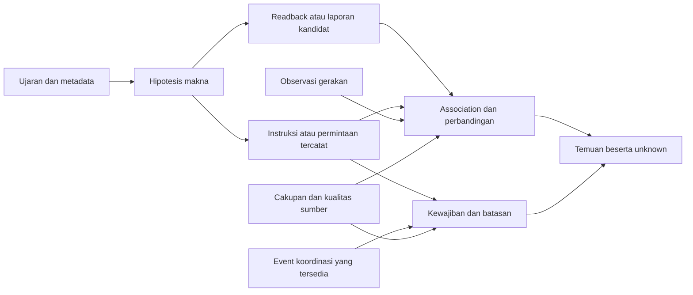

# ATC FlowLens — Review Produk dari Dasar

- **Tanggal:** 7 Oktober 2026.
- **Status:** usulan desain untuk review; bukan pengganti Rencana Teknis MVP atau AI Assist Buddy Addendum.
- **Mandat:** menilai ulang masalah, arah inovasi, fitur, interaksi, kebutuhan data, dan feasibility tanpa harus mempertahankan desain/flow saat ini. Pengguna tidak menetapkan batas deadline, jumlah developer, atau layanan cloud untuk analisis ini.
- **Metode:** inspeksi statis dokumen/source dan riset sumber primer. Tidak menjalankan build, aplikasi, automated test, eksperimen ASR, atau studi ATCO.
- **Artefak pendamping:** [Feasibility dan rancangan engineering](../Technical-Implementation/ATC_FlowLens_Ground_Up_Engineering_Review.md).
- **Label:** FAKTA = didukung sumber yang disebut; SOURCE = terlihat di kode; INFERENSI = kesimpulan analitis; USULAN = pilihan desain; UNKNOWN = belum memiliki bukti. Nilai manfaat, fidelity, dan kesiapan operasi FlowLens belum tervalidasi.

## 1. Rekomendasi utama

**USULAN:** arahkan FlowLens menjadi **memori operasional berbukti untuk Tower/Ground**, yang membantu controller memahami hubungan antara instruksi, readback, koordinasi yang masih terbuka, dan pergerakan teramati. Bentuk pengalaman utamanya dapat berupa *ambient Tower/Ground companion*: informasi diperbarui tanpa pencatatan rutin, lalu menarik perhatian secara selektif ketika ada ketidaksesuaian atau kebutuhan informasi yang relevan.

Pertanyaan produk yang ingin dijawab:

1. Apa instruksi dan batasan terakhir yang tercatat untuk objek ini?
2. Apa yang dibacakan kembali, dan bagian mana yang berbeda atau tidak dapat dikenali?
3. Apa yang masih menunggu jawaban, koordinasi, laporan, atau bukti pelaksanaan?
4. Apakah pergerakan yang teramati konsisten dengan instruksi yang tersedia?
5. Apa yang sistem belum tahu, dan mengapa kesimpulan tertentu belum dapat dibuat?

Nilai bagi keputusan berasal dari pengurangan usaha mengingat, mencari, dan menghubungkan informasi tersebut. Arah ini tetap membantu pengambilan keputusan meskipun tahap awal belum menghasilkan rekomendasi tindakan. Dukungan keputusan preskriptif dapat menjadi tahap terpisah setelah sumber, SOP, model, dan manfaatnya dapat dievaluasi.

**USULAN untuk pembuktian pertama:** satu irisan end-to-end yang menangani komunikasi runway, readback, loop laporan/koordinasi, dan evidence review pada replay. Setelah scope disepakati, gunakan mesin yang sama dalam stream simulasi terisolasi untuk menguji interaksi ambient. Simulator buatan tim adalah alat pengujian produk, bukan otomatis produk utama.

**INFERENSI:** kekuatan inovasi berada pada kualitas memori bersama, hubungan temporal yang bisa dijelaskan, serta kemampuan mempertahankan ketidakpastian. Voice transcription, voice-to-strip, peta trafik, dan conflict detection masing-masing sudah memiliki pendahulu. Keunikan global atau keunggulan terhadap produk komersial belum terbukti.

## 2. Perumusan masalah yang perlu diperbaiki

### 2.1 “Belum ada sistem yang memudahkan ATC” terlalu luas

**FAKTA:** A-SMGCS mencakup surveillance dan dapat mencakup runway conflict alerting, conflicting ATC clearances, dan conformance monitoring. Indonesia juga memiliki sistem ATM: AirNav mengumumkan radar/ADS-B, datalink, dan safety nets dalam konteks New JATSC pada 11 September 2026. Pengumuman itu tidak membuktikan kemampuan setiap tower Indonesia. [EUROCONTROL A-SMGCS](https://www.eurocontrol.int/service/advanced-surface-movement-guidance-and-control-system), [AirNav New JATSC](https://www.airnavindonesia.co.id/berita-dan-siaran-pers/kunjungi-airnav-indonesia-presiden-icao-tinjau-langsung-fasilitas-new-jatsc/).

Masalah yang lebih dapat diuji adalah:

> **HIPOTESIS MASALAH:** pada workflow Tower/Ground tertentu, controller harus menyatukan informasi percakapan, strip/status, koordinasi antarposisi, dan observasi pergerakan. Hubungan serta hal yang masih tertunda mungkin membutuhkan usaha mengingat dan mencari yang belum cukup dibantu oleh alat setempat.

Kalimat ini masih memerlukan observasi site dan wawancara ATCO. Jangan menggantinya dengan klaim bahwa semua controller hanya menyimpan intent di kepala, semua tower memakai strip kertas, atau belum ada sistem yang menghubungkan suara dengan pergerakan.

### 2.2 Bedakan tiga pekerjaan controller

| Pekerjaan | Pertanyaan pengguna | Bentuk bantuan FlowLens yang diusulkan |
|---|---|---|
| Memantau | Apa yang sedang teramati dan apa yang tidak tercakup? | Situasi, usia sumber, identitas, dan cakupan yang mudah dibaca |
| Memahami | Instruksi, readback, dan gerakan mana yang saling berkaitan? | Memori per objek, hubungan evidence, dan ketidaksesuaian |
| Memutuskan | Informasi/kewajiban apa yang perlu dipertimbangkan sebelum tindakan berikutnya? | Batasan dan loop terbuka; simulasi konsekuensi hanya pada tahap offline berikutnya |

Membuat dashboard yang lebih ramai tidak menjamin ketiga pekerjaan tersebut membaik. Produk harus membuktikan bahwa informasi tambahan mengurangi pencarian dan salah pengertian tanpa menambah gangguan atau ketergantungan yang keliru.

### 2.3 Pengguna dan konteks adopsi

**USULAN:** pengguna yang dituju tetap controller Tower/Ground. Instruktur dan evaluator menjadi pengguna pertama untuk menilai kebutuhan, kebenaran keluaran, serta cara penyajian. Fokus awal adalah hubungan komunikasi dan penggunaan runway; tidak meluas sekaligus ke seluruh en-route, arrival management, airport operations, atau optimasi kapasitas bandara.

| Konteks fasilitas | Nilai potensial | Batas desain |
|---|---|---|
| Memiliki surface safety tools dan electronic strips | Mengurangi pencarian evidence dan menjaga kontinuitas percakapan/koordinasi | Integrasi pelengkap; hindari alert ganda atau catatan clearance tandingan |
| Audio tersedia, track permukaan terbatas | Memori komunikasi, readback, request, dan laporan | Tidak mengklaim monitoring pelaksanaan atau runway kosong |
| Simulator training | Evaluasi perilaku serta interaksi dengan ground truth yang dikendalikan | Transfer manfaat ke operasi masih harus diuji |

Target fasilitas dipilih berdasarkan masalah dan data yang dapat dibuktikan, bukan asumsi bahwa bandara kecil lebih mudah atau bandara besar selalu lengkap.

## 3. Audit arahan pada lampiran

Lampiran 6 Oktober 2026 merupakan proposal arah yang berguna. Bagian berikut memisahkan ide yang layak dipertahankan dari asumsi yang perlu dikoreksi.

| Pernyataan/ide lampiran | Penilaian | Implikasi desain |
|---|---|---|
| Ambient companion dan memori kedua | Pertahankan sebagai hipotesis pengalaman pengguna | Ukur usaha pencarian, akurasi pemahaman, gangguan, dan trust |
| Intent belum dilayani industri | Klaim terlalu kuat | Sudah ada speech understanding dan clearance/conformance monitoring; novelty harus lebih spesifik |
| Produk sekarang secara de facto tool evaluator yang kuat | Belum didukung kematangan implementasi | Yang ada adalah backend simulasi/replay; pipeline AI dan dashboard belum ditemukan |
| Synthetic baseline hanya fixture statis | Bertentangan dengan source | `Simulator.step()` menjalankan gerakan; sample/delay/noise/dropout sudah ada |
| Immutable event store dan review append-only sudah kuat | Sebagian konsep ada, assurance belum ada | Event menggunakan insert-ignore, frame replace, review annotations in-memory; bukan bukti audit immutable lengkap |
| Voice-to-ledger setara e-strip | Terlalu jauh | Ledger hasil ASR adalah kandidat memori; e-strip memiliki fungsi/otoritas/workflow yang tidak otomatis digantikan |
| Said–Heard–Done sebagai lifecycle linear | Memorable tetapi menyederhanakan domain | Ucapan, readback, pelaksanaan, dan kewajiban harus menjadi dimensi terpisah |
| Setiap clearance adalah reservasi runway | Berisiko memberi presisi palsu | Tampilkan intent, batasan, occupancy teramati, dan prediksi bersyarat sebagai lapisan berbeda |
| Semua loop yang menua perlu notice | Belum tentu bernilai | `standby` atau menunggu dengan sengaja tidak otomatis menjadi masalah |
| PTT memberi identitas pembicara dari kanal | Hanya benar pada harness dengan metadata yang disediakan | Kanal radio bersama tidak mengidentifikasi pilot/driver; local transmit metadata pun punya batas |
| Tidak perlu input sama sekali | Terlalu absolut | Minimalkan input rutin; sediakan inspeksi, koreksi, disagreement, dan recovery |
| Low confidence cukup ditandai unverified | Belum cukup | Confidence belum tentu terkalibrasi; slot kritis, attribution, dan coverage harus membatasi kesimpulan |
| Deterministic detector membuat keluaran dapat dipercaya | Determinisme membantu audit, bukan menjamin benar | Salah transcript/identity/rule tetap menghasilkan kesimpulan salah secara konsisten |
| LLM pilot menghasilkan ground truth otomatis | Ground truth hanya otomatis untuk state/injeksi yang dibatasi | Ujaran aktual dapat melanggar rencana; validasi waveform/transcript aktual dan respons simulator |
| ASR sudah terpasang, p95 <1,5 detik feasible | Belum ada bukti dependency/model atau benchmark proyek | Pilihan engine dan latency adalah eksperimen terpisah |
| Scribe medis berarti jalur regulasi lebih ringan | Tidak dapat ditransfer begitu saja | Intended use dan pengaruh pada keputusan menentukan penilaian ATC; pasif tetap dapat mengubah perilaku |

**FAKTA pembanding:** DLR/EML telah mendemonstrasikan speech understanding untuk instruksi ATC, pembaruan tampilan/rute, dan pengurangan input manual. Sumber tersebut juga membahas verifikasi pemahaman/pelaksanaan. Karena itu, tidak tepat menyebut pembanding ini hanya mencatat suara tanpa kaitan ke pergerakan. [DLR, 28 Mei 2024](https://www.dlr.de/en/latest/news/2024/dlr-licenses-ai-based-speech-understanding-technology-to-eml).

**FAKTA pembanding riset:** preprint Luvini dkk., 26 Agustus 2026, menghubungkan ujaran, surveillance, dan observasi onboard dengan kewajiban temporal serta evidence. Paper melaporkan F1 0,85 pada tiga jam berlabel dengan 12 pelanggaran; cakupan schema rutin yang teruji terbatas. Batas waktu readback adalah pilihan eksperimen, bukan deadline ICAO universal. Ini pendahulu dekat sekaligus alasan untuk menjaga cakupan klaim. [Paper, §IV.C dan §VI–VII](https://arxiv.org/html/2608.25926v1).

## 4. Ruang inovasi dan alternatif produk

### 4.1 Pilihan arah

Penilaian berikut adalah pertimbangan desain kualitatif, bukan skor pasar atau hasil studi pengguna.

| Arah | Nilai utama | Feasibility dan dependency | Penilaian |
|---|---|---|---|
| Peta runway dan alert geometri | Awareness gerakan | Butuh surface coverage, geometri, identitas, dan aturan; banyak pendahulu | Reuse sebagai evidence saat data tersedia; pembeda lemah jika berdiri sendiri |
| Transkripsi dan pencarian audio | Recall komunikasi | Audio berizin dan ASR; manfaat mudah diperlihatkan | Fondasi, belum cukup sebagai keseluruhan inovasi |
| Memori instruksi, obligation, dan discrepancy | Menjaga kontinuitas konteks keputusan | Bisa berkembang dari audio-only ke multimodal; association dan kualitas sumber sulit | **Arah inti yang direkomendasikan** |
| Rekomendasi clearance/sequencing | Dukungan tindakan langsung | SOP, constraints, state lengkap, model konsekuensi, serta assurance lebih berat | Tahap riset lanjutan; jangan menjadi dependency irisan pertama |
| Autonomous controller/agent | Otomasi keputusan | Mengubah intended use dan tuntutan sistem secara mendasar | Di luar arah produk yang direkomendasikan |
| Simulator ATC generatif | Training content dan role-play | Bisa dibuat, tetapi realisme serta evaluasi merupakan produk tersendiri | Alat demonstrasi/pengujian FlowLens |

### 4.2 Pembeda yang dapat diuji

**USULAN:** tiga unsur menjadi kesatuan produk:

1. **Memori bersama per objek dan per resource.** Instruksi, pembatasan, pembatalan, laporan, dan koordinasi ditelusuri lintas waktu. Perspektif Tower/Ground menunjukkan informasi yang relevan terhadap peran dan yang memang tersedia.
2. **Kewajiban yang belum ditutup oleh bukti.** Sistem menunjukkan siapa menunggu apa, dari event mana, dan evidence apa yang dapat menutupnya. Umur item disertai konteks `standby`, supersession, dan coverage.
3. **Kesimpulan mengikuti kemampuan observasi.** Klaim mempunyai prasyarat sumber dan state `unknown`. Ketidaksesuaian terlihat bersama bukti serta batasnya, bukan sebuah skor risiko generik.

Contoh inovasi pengalaman: controller memilih ARFF-2 dan langsung melihat instruksi terakhir, readback terkait, laporan vacated yang belum tercatat, serta alasan posisi tidak dapat dievaluasi. Ia tidak perlu menyusun hubungan ini dari transcript panjang dan peta terpisah.

**UNKNOWN:** apakah kombinasi itu belum tersedia pada produk tertentu, apakah buyer akan membayar, dan apakah manfaatnya melebihi biaya integrasi. Review ini bukan pencarian paten atau audit seluruh produk komersial.

## 5. Model domain dari dasar

### 5.1 Said–Read back–Observed, ditambah obligation dan coordination

Gunakan label **“Instruksi / Readback / Teramati”** untuk pengguna. `Heard` menyiratkan pemahaman internal pilot, sedangkan `Done` menyiratkan penyelesaian penuh. Keduanya sering tidak dapat diukur dari input yang tersedia.



Diagram adalah rancangan konseptual; seluruh node belum merupakan komponen runtime proyek.

### 5.2 State tidak boleh digabung menjadi satu badge “confirmed”

| Dimensi | Contoh state yang diusulkan | Makna |
|---|---|---|
| Evidence ujaran | preliminary, finalized hypothesis, human-corrected, unavailable | Status pemrosesan, bukan otoritas clearance |
| Attribution | known-source, candidate identity, ambiguous, unknown | Identitas dan role bisa mempunyai kepastian berbeda |
| Instruksi | candidate, source-recorded, superseded, cancelled | Source-recorded hanya jika sumber berwenang memang tersedia |
| Readback | awaiting, matched slots, partial, mismatched, not-observable | `matched` bukan bukti dipahami atau diikuti |
| Pelaksanaan | compatible observation, divergent observation, indeterminate | Bergantung posisi, footprint, waktu, dan geometri |
| Obligation | pending, deferred, evidence-satisfied, cancelled, superseded, indeterminate | Tutup dengan event yang relevan, bukan sekadar item di-dismiss |
| Koordinasi | requested, acknowledged, agreed, completed, unknown | Arti tiap langkah ditentukan SOP/site atau SOP lab berlabel |

Satu instruksi dapat memiliki readback cocok namun track menyimpang. Sebaliknya, pergerakan sesuai tidak membuktikan bahwa seluruh readback benar. Corrected transcript baru juga tidak boleh diam-diam mengubah apa yang dahulu terlihat oleh pengguna.

### 5.3 Aturan makna minimum

- `request`, `expect`, `standby`, traffic information, dan conditional instruction bukan clearance unconditional.
- Pembatalan instruksi tidak otomatis menghentikan pergerakan fisik. Pembatalan mungkin juga belum dibacakan kembali.
- Satu objek bisa memiliki beberapa pembatasan/obligation serentak. Instruksi baru tidak otomatis membatalkan semuanya.
- Readback dihubungkan melalui identitas, isi, channel/role yang didukung, dan waktu; bukan selalu ujaran berikutnya.
- Similar callsigns, omitted callsign, readback parsial, retry, dan koreksi harus mempertahankan alternatif association.
- Kehilangan track atau hilangnya objek dari display tidak menutup occupancy/obligation secara otomatis.
- Laporan “runway vacated” dan bukti posisi di luar area adalah jenis evidence berbeda; tidak dipertukarkan diam-diam.
- Kewajiban koordinasi antarunit hanya dapat dimonitor bila salurannya tersedia. Audio TWR/GND belum tentu mencakup intercom atau keputusan di posisi lain.

## 6. Core features dan batasnya

### 6.1 Paket inti yang direkomendasikan

| Fitur | Kebutuhan minimum | Interaksi | Batas kesimpulan | Prioritas usulan |
|---|---|---|---|---|
| **Memori komunikasi per objek** | Audio atau transcript dengan timestamp, attribution kandidat | Pilih callsign → instruksi/pembatasan terakhir dan evidence | Identitas ambigu tetap ambigu; bukan e-strip otoritatif | Inti |
| **Readback discrepancy** | Pasangan instruksi/readback yang dapat diasosiasikan | Tampilkan slot berbeda berdampingan; buka audio | Hilang dari ASR belum tentu hilang dari ujaran | Inti |
| **Loop laporan dan request** | Speech acts dan obligation profile | Ringkasan menunggu apa, owner bila diketahui, umur, status deferred | “Tidak teramati” berbeda dari “tidak dilakukan” | Inti |
| **Evidence inspection/replay** | Referensi audio/event/time yang resolvable | Satu tindakan membuka alasan; playback tambahan eksplisit | Bukti tidak tersedia harus ditampilkan | Inti |
| **Conformance komunikasi–gerakan** | Identity binding, posisi, footprint, geometri, time alignment | Satu incident mengaitkan instruksi dan pergerakan | Kandidat dari ASR tetap kandidat; coverage gap membatasi evaluasi | Inti bersyarat data |
| **Koordinasi Tower/Ground** | Event koordinasi yang memang tersedia | Pandangan owner/request dan evidence agreement | Radio saja tidak membuktikan transfer kewenangan | Inti bersyarat data |
| **Brief konteks sesi** | Ledger dan evidence pada cutoff tertentu | Review perubahan, item terbuka, unknown | Human-reviewed; bukan serah-terima resmi otomatis | Pendukung |

Fitur inti membentuk loop nilai yang lengkap: mengingat → membandingkan → menjelaskan → menilai/correct dalam review. ASR adalah enabler, sedangkan nilai produknya adalah konteks yang dapat dipakai memahami situasi.

### 6.2 Fitur yang diubah atau ditunda

**Runway intent board:** pertahankan idenya, ubah semantiknya. Pisahkan instruksi/intent aktif, okupansi teramati, dan interval prediksi. Tampilkan rentang waktu hanya ketika input mendukungnya. Hindari kalender reservasi yang memberi kesan bahwa clearance mempunyai slot penggunaan pasti.

**FAKTA:** CATC menggunakan electronic clearance dan rules/prosedur lokal. Dalam prosedur FAA tertentu, landing clearance dapat diberikan berdasarkan anticipated separation. Ini menunjukkan bahwa “dua clearance aktif = konflik” bukan aturan universal. FAA adalah pembanding yurisdiksi AS, bukan aturan untuk Indonesia. [EUROCONTROL A-SMGCS §3.3.6](https://www.eurocontrol.int/sites/default/files/2020-04/eurocontrol-specification-a-smgcs-v-2-0.pdf), [FAA JO 7110.65 §3-10-6](https://www.faa.gov/air_traffic/publications/atpubs/atc_html/chap3_section_10.html).

**Comms pressure:** gunakan durasi kanal yang teramati aktif, jumlah loop yang dapat dihitung, dan coverage window. TTS clip duration atau jumlah transcript tidak otomatis mengukur okupansi radio. Jangan mengubahnya menjadi diagnosis workload/fatigue, ranking individu, atau skor fitness-for-duty.

**Natural-language query:** pendukung recall setelah direct selection/filter bekerja. Jawaban dibentuk dari evidence; query tidak menjadi command. Chat panel tidak perlu menjadi pusat pengalaman monitoring.

**Counterfactual dan candidate options:** fase offline berikutnya. Berguna untuk pertanyaan “informasi/constraint apa yang berubah jika opsi X dipertimbangkan?” setelah state, model konsekuensi, SOP, dan oracle cukup kuat. Bebas memilih teks tidak membuat opsi model valid. Setiap opsi memerlukan preconditions, unknown, serta review domain.

**Tunda pada irisan pertama:** prediksi rute penuh, optimasi sequencing, seluruh jenis conditional clearance, multilingual/code-switching penuh, multi-runway, airport-scale surveillance fusion, autonomous agent operasi, dan generative 3D simulator. Penundaan merupakan urutan pembuktian nilai, bukan akibat batas deadline.

### 6.3 Arah lengkap dukungan keputusan

Memori merupakan fondasi nilai pertama; arah produk yang lebih lengkap perlu menjelaskan bagaimana informasi itu membantu keputusan. **USULAN:** tiga lapis bantuan, dengan requirement serta evaluasi terpisah:

| Lapis | Pertanyaan yang dibantu | Bentuk output | Dependency tambahan |
|---|---|---|---|
| Konteks keputusan | Apa batasan, item pending, dan unknown yang terkait runway/objek ini? | Evidence-backed constraint view; dapat diakses langsung dari object/resource | Ledger, coverage, authority dan applicable profile |
| Perbandingan hipotetis offline | Apa yang berubah jika evaluator memasukkan alternatif X atau Y? | Comparison assumptions, predicted intervals, unresolved constraints, dan sensitivitas | Branch model tervalidasi untuk cakupan simulasi; scenario dynamics dan oracle independen |
| Candidate options offline | Alternatif apa yang patut ditinjau evaluator? | Opsi beserta preconditions, rationale, bukti, dan alasan belum dapat dinilai | Domain review, bounded action vocabulary, evaluasi completeness/relevance dan automation bias |

Pada lapis pertama, contoh pertanyaan adalah “evidence apa yang masih kurang untuk menilai crossing ARFF-2 dalam konteks arrival ini?”. Sistem dapat menunjukkan track kendaraan stale, readback kandidat yang berbeda, dan laporan yang belum teramati. Hal itu memberi informasi yang relevan bagi pertimbangan manusia tanpa mengarang kondisi yang lengkap.

Pada lapis kedua, **USULAN research-only:** evaluator menentukan alternatif simulator yang akan dibandingkan. Branch menghitung ulang keadaan dengan asumsi respons/pergerakan yang dinyatakan, bukan menjanjikan bahwa dunia nyata akan mengikuti hasilnya. Hasil berupa perbandingan constraint dan ketidakpastian, bukan lampu hijau “opsi aman”. Jika wake/separation/SOP tidak dimodelkan, output menyebut cakupan tersebut tidak dievaluasi dan tidak merangking keselamatan keseluruhan.

Lapis ketiga mempertahankan ruang inovasi AI advisory yang ada dalam arah kanonis, tetapi manfaatnya harus dibuktikan terhadap constraint view dan alternatif yang dipilih manusia. Jika opsi generatif tidak memberi nilai tambahan atau memperburuk trust, produk masih mempunyai nilai melalui dua lapis sebelumnya. Memindahkan prioritas opsi dari P0 kanonis tetap memerlukan keputusan scope, bukan dilakukan oleh review ini.

## 7. Interaksi yang dirancang untuk pekerjaan controller

### 7.1 Tiga permukaan kerja

**USULAN:** satu workspace monitoring dengan **situasi**, **memori**, dan **perhatian**; satu workspace review/debrief dengan kontrol waktu dan koreksi. Evaluator mempunyai alat tambahan yang tidak memenuhi display controller.

| Permukaan | Isi default | Dibuka saat |
|---|---|---|
| Situasi | Map sederhana jika posisi tersedia; keadaan runway/coverage dan intent terkait | Membutuhkan konteks posisi/resource |
| Memori | Instruksi/pembatasan terakhir dan loop terbuka yang relevan per objek | Memilih objek atau meninjau pending items |
| Perhatian | Discrepancy ringkas dengan perubahan terbaru dan alasan | Ada perbedaan yang dapat dievaluasi atau kebutuhan review |
| Evidence drawer | Instruksi vs readback, event/track terkait, timestamp, sumber, unknown | Memeriksa satu temuan |
| Review/debrief | Timeline, audio, versi analisis, koreksi, ground truth sesuai akses | Evaluasi setelah sesi/replay |

Jika track tidak tersedia, permukaan situasi menjadi resource/context board; peta tidak memunculkan posisi rekaan. Jika ASR tertinggal, tampilkan waktu data dan backlog, bukan status seolah sinkron.

### 7.2 Alur utama

1. **Persiapan oleh operator/instruktur:** sumber, izin, channel coverage, geometri/SOP profile, alignment, dan kesiapan model diperiksa. Label synthetic atau authorized replay tetap terlihat.
2. **Monitoring:** perubahan masuk otomatis. Pengguna cukup melakukan pekerjaan komunikasi dalam konteks pengujian yang disetujui; tidak wajib mengonfirmasi tiap hasil ASR.
3. **Notice:** objek mempunyai loop atau slot ambigu. Informasi tersedia tanpa pop-up wajib. Urutan baris stabil agar pencarian visual tidak terganggu.
4. **Inspection:** pilih temuan → bukti berbeda ditonjolkan → audio opsional. Tidak ada autoplay yang menutupi radio/headset.
5. **Review:** evaluator dapat confirm/dismiss/unresolved dan mengoreksi transcript. Dismiss temuan tidak menutup kewajiban domain. Acknowledgement tidak berarti kondisi terselesaikan.
6. **Debrief:** rekonstruksi apa yang tersedia saat kejadian dan apa yang diketahui setelah review; bandingkan keduanya secara eksplisit.

### 7.3 Contoh tampilan konseptual

Semua contoh berikut sintetik, bukan hasil model atau temuan operasi.

```text
SIMULASI · TWR tersedia · GND tersedia · posisi kendaraan tidak tersedia

ARFF-2
Instruksi  : HOLD SHORT RWY 27       [audio 00:41]
Readback   : HOLD SHORT RWY 09       [audio 00:45]
Temuan     : nomor runway berbeda pada pasangan kandidat
Pergerakan : tidak dapat dievaluasi

Menunggu   : laporan runway vacated · owner belum dipastikan
```

Dengan posisi yang memadai, tambahkan pernyataan “footprint teramati melintasi batas H1; terkait instruksi HOLD SHORT kandidat”. Jangan mengubahnya menjadi “pilot tidak patuh” atau memberi instruksi tindakan.

Contoh ambiguity yang sama pentingnya untuk demo:

```text
QZ804 / QZ840 · attribution belum dapat dibedakan
Slot runway kurang jelas · perbandingan readback ditahan
Audio 00:58 tersedia untuk review
```

### 7.4 Pengaturan atensi dan failure states

- Gunakan teks dan bentuk bersama warna. Tidak menjadikan warna hijau sebagai deklarasi “aman”.
- Satu situasi menghasilkan satu incident dengan evidence yang bertambah. Source alert resmi dan candidate AI tetap dibedakan di dalamnya.
- Temuan komunikasi mempunyai **prioritas perhatian eksperimen**, bukan severity keselamatan otomatis dari LLM.
- Ketidakpastian ditunjukkan pada slot/claim yang relevan. Banyak badge teknis di semua baris dapat menambah usaha membaca.
- Low-confidence critical slot menahan verdict discrepancy tertentu, tetapi tidak menyembunyikan alert resmi atau observasi independen yang valid.
- Audio hilang: pertahankan konteks terakhir dengan waktu/coverage; jangan menganggap tidak ada komunikasi baru.
- Track stale: tampilkan last-known dan conformance unavailable; jangan “clear” karena target hilang.
- Reconnect: resync state dengan cutoff; jangan replay semua notice historis sebagai kejadian baru.
- Koreksi pengguna mengubah analysis revision; tidak menghapus raw evidence.

**FAKTA:** EUROCONTROL SHAPE menekankan trust, situational awareness, teamwork, dan workload dalam evaluasi otomasi. Ini mendukung pengujian dampak interaksi, bukan anggapan bahwa alat pasif pasti tidak mengganggu. [SHAPE](https://www.eurocontrol.int/product/solutions-human-automation-partnerships-european-atm).

## 8. Data availability dan strategi pembuktian

### 8.1 Data yang tersedia tidak sama dengan data yang cocok

**UNKNOWN proyek:** mitra, data simulator berizin, audio ATC Indonesia yang dapat dipakai, SOP site, dan reviewer domain belum dikonfirmasi oleh materi yang diperiksa. Status terakhir dokumen kanonis bertanggal 3 Oktober 2026; review ini tidak mendapat konfirmasi mitra baru.

| Sumber | Yang dapat dibuktikan dari sumber publik/source | Penggunaan yang sesuai | Gap utama |
|---|---|---|---|
| Simulator proyek | Source gerakan sintetik, event terstruktur, delay/noise/dropout | Uji causal ordering, numerik, failure state, dan replay | Belum ada waveform/ASR; gerakan, route, dan komunikasi masih sederhana |
| Audio sintetik buatan tim | Dapat dibuat dengan izin voice/model yang ditentukan | Kasus terkontrol dan injeksi error | TTS tidak mewakili distribusi radio, aksen, atau perilaku ATCO |
| Rekaman role-play manusia | Belum tersedia dalam review ini | Menguji hesitation, repair, omitted callsign, dan UX simulator | Partisipan, persetujuan, annotation, serta fidelity |
| ATCO2 | Test resmi 4 jam beranotasi; subset 1 jam untuk pengembangan/evaluasi English ATC | Benchmark speech/entity lintas suara; ikuti terms tiap subset | Bukan dataset Indonesia atau bukti ground vehicle coverage |
| TartanAviation | Koleksi audio, gambar, dan ADS-B di KAGC/KBTP, AS; metadata waktu tersedia | Kandidat corpus eksternal multimodal, khususnya subset towered KAGC | Audit alignment aktual, coverage permukaan, labels, terms data, dan domain shift |
| Simulator mitra | Target akses, belum dikonfirmasi | Validasi workflow dan paired audio/event dalam lingkungan berizin | Interface, izin, retensi, clock mapping, dan oracle independen |
| OpenSky | Terms memerlukan lisensi tertulis untuk commercial dan operational API use | Riset tambahan bila penggunaan diizinkan | Bukan source clearance; kendaraan/permukaan tidak boleh diasumsikan lengkap |
| Chart/geometri site | Sumber dan hak penggunaan site belum dikonfirmasi | Profile geometri ketika disetujui | Hold positions, protected areas, versi efektif, akurasi, SOP |

Rujukan data: [ATCO2 project data](https://atco2.org/data), [TartanAviation AirLab](https://theairlab.org/tartanaviation/), [TartanAviation audio documentation](https://github.com/castacks/TartanAviation/blob/main/audio/README.md), [OpenSky terms](https://opensky-network.org/about/terms-of-use).

TartanAviation layak diperiksa sebagai jalur eksternal yang melengkapi baseline sintetik. **INFERENSI:** availability audio dan ADS-B mengurangi sebagian hambatan eksperimen multimodal; tidak menghilangkan kebutuhan paired labels, kendaraan, clearance authority, atau SOP lokal. Repo code license bukan bukti otomatis hak penggunaan setiap asset data. Sample yang tersedia juga perlu diperiksa lokasinya: contoh downloader menunjukkan KBTP yang non-towered, sehingga tidak otomatis cocok untuk pasangan instruksi controller–readback.

Untuk geometri pertama, **USULAN:** gunakan layout fiktif versioned. OSM dapat menjadi konteks visual setelah terms ditinjau, tetapi tidak cukup sebagai sumber hold position/protection geometry untuk klaim conformance. Tidak perlu real airport agar mekanisme inovasi dapat diuji.

### 8.2 Capability harus mengikuti sumber

| Profile penelitian yang diusulkan | Boleh dievaluasi | Belum dapat disimpulkan |
|---|---|---|
| Audio/transcript saja | Memory, slot discrepancy, laporan/request yang tidak teramati pada cakupan tersedia | Pelaksanaan fisik, occupancy, runway clear |
| Audio + structured instruction log | Speech–record consistency dan readback | Bahwa structured log selalu benar atau semua komunikasi tercakup |
| Audio + track + geometri | Kandidat conformance dan konteks posisi | Kewenangan clearance, kendaraan tak terpantau, seluruh SOP |
| Audio + track + instruction + coordination profile | Hubungan lintas sumber serta obligation yang didefinisikan | Kesiapan operasi atau manfaat keselamatan |

**FAKTA:** FAA SAID menampilkan aircraft/vehicles yang dilengkapi dan memancarkan ADS-B; order secara eksplisit membatasi penggunaannya untuk enhanced situational awareness dan melarang penggunaannya untuk separation. Ini contoh bahwa bahkan display operasional memiliki intended-use serta cakupan terbatas. [FAA JO 7110.665A, efektif 5 November 2025](https://www.faa.gov/documentLibrary/media/Order/JO_7110.665A_Surface_Awareness_Initiative_Display_dtd_11-5-25.pdf).

### 8.3 Desain corpus yang diusulkan

Bangun tiga lapis evaluasi yang dilaporkan terpisah:

1. **Kasus kontrak/numerik:** event terstruktur dengan oracle yang dihitung/ditulis independen dari rules. Tidak menilai ASR.
2. **Kasus end-to-end sintetik dan role-play:** waveform aktual diproses oleh ASR, association, ledger, dan findings. Variasikan speaker, fraseologi, negasi, noise, latency, overlap, correction, dan dropout.
3. **Corpus eksternal/mitra yang diizinkan:** evaluasi pada data yang tidak dibuat oleh pipeline FlowLens. Audit annotation dan coverage; simpulan berlaku pada corpus/site yang diuji.

Pisahkan train/development/test berdasarkan speaker, session, template family, atau site sebagaimana relevan. Seed berbeda dari skrip kalimat yang sama bukan independensi yang memadai. Jika entity hints digunakan, berikan hanya roster/layout yang sudah tersedia pada waktu itu; jangan memberi jawaban runway atau callsign dari oracle.

Error Director adalah label **injeksi yang direncanakan**. Ground truth end-to-end harus memeriksa apa yang benar-benar terucap pada waveform dan apa yang benar-benar dilakukan simulator. Ujaran LLM di luar schema tidak boleh mendapat label “normal” hanya karena error flag false.

## 9. Feasibility: apa yang mudah dan apa yang menentukan keberhasilan

| Komponen | Penilaian engineering | Risiko yang menentukan | Cara mengurangi uncertainty |
|---|---|---|---|
| Record/replay dan evidence UI | Layak secara teknis pada stack lokal | Audit durability, sinkronisasi, dan UI belum selesai | Thin slice tanpa ASR lebih dulu, lalu real audio |
| ASR radio | Bisa dibangun; kualitas domain belum dibuktikan | Callsign, runway, negasi, clipped audio, overlap, aksen | Benchmark critical slots; abstention; holdout speakers |
| Grammar parser | Layak untuk phrase set terbatas | Coverage rendah dan repair/conditional complexity | Profil phraseology eksplisit; unsupported tetap unknown |
| LLM fallback parser | Layak sebagai kandidat ekstraksi | Confident hallucination, latency, biaya, drift | Schema + evidence spans + eval semantik + outage isolation |
| Dialogue association | Sulit dan sering diremehkan | Salah pairing membuat discrepancy palsu | Multi-hypothesis matching, transcript history, negative fixtures |
| Obligation ledger | Layak dengan tipe sempit | Salah supersession/closure atau owner | Reducer deterministik, bukti closure, domain review |
| Conformance posisi | Layak di simulator; bersyarat di site | Coverage, identity, footprint, layout, alignment | Capability gating dan geometric uncertainty |
| Runway prediction | Layak sebagai model bersyarat | Unknown route/speed/exit; presisi semu | Rentang/skenario; jangan gunakan future plan privat |
| Brief/journal | Layak dengan template terlebih dahulu | Omission/hallucination dan status resmi | Bukti per item; human review; cutoff jelas |
| Stream ambient | Layak di lab setelah scope disetujui | Backlog, partial transcript, attention dan trust | Event-time/knowledge-time; benchmark burst; studi pengguna |
| Operasional | Tidak dapat ditetapkan dari kelayakan prototype | Intended use, SOP, safety/human factors, security, hak data | Program site-specific tersendiri dengan pihak berwenang |

Deteksi deterministik merupakan pilihan baik untuk bagian yang dapat didefinisikan eksplisit. Ia tidak menyelesaikan ketidakpastian bahasa dan tidak memvalidasi aturan domain. Keluaran ledger berbasis ASR tetap hypothesis sampai tingkat evidence yang diperlukan terpenuhi.

**FAKTA teknis:** faster-whisper menyediakan engine berbasis CTranslate2 dan quantization, tetapi benchmark upstream menggunakan konfigurasi hardware/model tertentu serta audio panjang. Angka tersebut tidak membuktikan latency klip ATC atau hardware proyek. [Dokumentasi resmi faster-whisper](https://github.com/SYSTRAN/faster-whisper).

**USULAN:** pilih provider melalui benchmark task, bukan popularitas model. Bandingkan critical-slot accuracy, association accuracy, latency end-to-end, resource contention, dan kemampuan abstain. Streaming ASR atau MLX dapat menjadi kandidat eksperimen; tidak diasumsikan terpasang atau lebih baik.

## 10. Cara membuktikan nilai inovasi

### 10.1 Hipotesis produk dan kemungkinan gugur

| Hipotesis | Eksperimen | Indikator keberhasilan | Kondisi yang menggugurkan/mengubah arah |
|---|---|---|---|
| Memori per objek mengurangi pencarian konteks | Retrieval task pada baseline vs FlowLens | Waktu menemukan evidence dan ketepatan jawab | Lebih cepat tetapi salah association, atau ATCO sudah punya alat yang sama efektif |
| Loop rail membantu mempertahankan kewajiban | Skenario pending/deferred/repair | Recall kewajiban, false reminders, correction burden | Banyak standby diberi perhatian atau owner sering salah |
| Discrepancy membantu pemahaman | Variasi mismatch dan ambiguity | Detection oleh pengguna, response time, false trust | Pengguna menerima parser salah atau mengabaikan evidence independen |
| Memori lintas posisi membantu continuity | Role-play koordinasi/handover | Ketepatan shared context dan kelengkapan pending items | Menambah komunikasi, mengaburkan authority, atau membuat catatan berbeda |
| Ambient tidak meningkatkan gangguan | Trial interface dengan traffic/task yang setara | Scan/glance burden, task performance, trust calibration | Lebih banyak heads-down time atau performa tugas primer turun |

### 10.2 Metrik harus memisahkan tahap pipeline

- **Speech:** WER/CER disertai exact accuracy callsign, runway, action, negation, conditional slots. WER rendah tidak menjamin slot kritis benar.
- **Attribution/association:** correct-pair rate, wrong-entity assignment, ambiguous/unmatched rate, dan berapa kasus model memilih abstain.
- **Ledger:** instruction/obligation state accuracy, false closure, missed supersession, salah owner, dan waktu koreksi.
- **Findings:** precision/recall per kategori dan per episode, nuisance findings per jam yang benar-benar tercakup, duplicate episode rate, serta miss pada data memadai.
- **Ketidakpastian:** coverage of supported cases versus error rate saat sistem berani menyimpulkan; FN harus memisahkan unavailable input dari missed detection.
- **Waktu:** source event → available evidence → finding visible. Report p50/p95/p99, cold/warm, backlog, hardware/model, dan umur data.
- **Manusia:** accuracy contextual questions, retrieval time, missed obligations, attention burden, trust, dan performa tugas primer. Workload questionnaire adalah pengukuran studi, bukan fitur diagnosis aplikasi.

Lead time diukur terhadap event target yang didefinisikan sebelum eksperimen. Alert yang muncul lebih awal tidak otomatis lebih berguna jika kurang akurat atau tidak menambah waktu yang dapat dipakai controller.

Contoh aritmetika, **bukan statistik ATC**: pada 10.000 kasus dengan prevalensi anomaly 1%, sensitivity 90% dan specificity 95%, ada 90 true positives serta 495 false positives. Precision hanya sekitar 15,4%. Karena itu accuracy agregat dan demo yang penuh kejadian berbahaya tidak cukup untuk menilai nuisance alerts pada sesi normal.

**FAKTA pembanding:** materi HAAWAII SESAR 2023 menunjukkan tantangan data error yang jarang; salah satu evaluasi rule-based mencatat 72 detection, 163 false alarms, dan F1 45%. Angka tersebut khusus eksperimen dalam materi itu; tidak digabung dengan hasil HAAWAII lain atau dijadikan estimasi FlowLens. Yang relevan ialah kebutuhan menguji sesi normal dan relevance temuan untuk controller. [HAAWAII showcase, slide 4 dan 9–10](https://www.sesarju.eu/sites/default/files/documents/events/asw2023/9marchscott/3%20SESAR%202020%20SHOWCASE-Haawaii-Helmke-noVideo-v2.pdf).

### 10.3 Evaluasi manusia

**USULAN:** mulai dengan walkthrough expert dan retrospective interview, lalu task study baseline vs assisted yang counterbalanced. Gunakan skenario paralel dengan tingkat kesulitan sebanding agar peserta tidak mengingat jawaban replay yang sama. Preregister endpoint primer, rubrik, exclusion rules, dan proses annotation. Jumlah partisipan ditentukan desain studi/power atau label exploratory yang jujur, bukan angka kosmetik.

Sertakan kasus tanpa hazard, kasus parser salah, kasus missing coverage, dan kasus temuan benar namun sengaja deferred. Uji apakah pengguna bisa mengenali batas sistem. Studi non-ATCO dapat menguji usability umum; tidak membuktikan kecocokan domain.

**FAKTA human factors:** studi Wilson dkk. pada simulated ATC menguji prospective memory dan menunjukkan dampak retention interval, sementara efek interruption tidak boleh digeneralisasi sebagai selalu merusak. Bukti ini mendukung penyelidikan memori tertunda, bukan janji bahwa rail FlowLens akan menurunkan kesalahan. [Wilson dkk., 2020](https://journals.sagepub.com/doi/10.1177/0018720819875888).

## 11. Scope pembuktian dan tahapan engineering

Tidak ada batas deadline yang ditetapkan pengguna. Tahapan di bawah diurutkan berdasarkan ketidakpastian yang harus dihilangkan, bukan jadwal kalender.

| Tahap usulan | Output | Exit evidence | Keputusan berikutnya |
|---|---|---|---|
| A — Problem discovery | Workflow map, task inventory, tool baseline, pain/evidence register | Ada kebutuhan spesifik yang diverifikasi ATCO/trainer | Apakah memory/obligation memang wedge yang bernilai? |
| B — Replay thin slice | Audio → memory → discrepancy/open loop → evidence review | Ground truth independen, failure cases, repeatable analysis | Komponen bahasa/association cukup untuk studi berikutnya? |
| C — Ambient simulation | Mesin yang sama mengikuti stream simulasi; Watch dan optional Play | Causal display, measured backlog, usability awal, truth isolation | Perlu perubahan scope kanonis sebelum implementasi mode baru |
| D — Authorized simulator evaluation | Corpus/export mitra dan reviewer | Data agreement, alignment, fidelity limits, domain rubric | Apakah manfaat bertahan di workflow nyata simulator? |
| E — Isolated operational research | Post-event/shadow study sesuai intended use yang disetujui | Assessment data, safety/security/human factors, akses | Tidak otomatis menuju live controller display |
| F — Proposal operational use | Requirement dan assurance site-specific | Penentuan/persetujuan pihak berwenang dan validasi yang diperlukan | Deployment formal terpisah |

Tahap B dapat memakai baseline sintetik dalam scope saat ini. Tahap C adalah **usulan perubahan scope**, bukan tindakan yang diizinkan dokumen kanonis sekarang. Evaluasi pasca-kejadian operasional di E tetap memerlukan hak data dan penilaian intended use; istilah “journal” tidak memberikan pengecualian.

### 11.1 Irisan pertama

**USULAN:** satu runway fisik (09/27 sebagai dua arah), sejumlah kecil aircraft dan satu kendaraan, geometri fiktif versioned, phrase set English terbatas, dan kanal/source coverage eksplisit. Jumlah objek adalah pembatas kompleksitas eksperimen, bukan ukuran traffic realistis.

Empat cerita pengujian:

1. **Mismatch lalu repair:** salah nomor runway pada readback; koreksi berikutnya menutup mismatch yang tepat, mempertahankan riwayat.
2. **Readback cocok, pelaksanaan berbeda:** instruksi HOLD SHORT dibacakan benar; footprint teramati melewati hold position dalam geometri lab.
3. **Loop terbuka yang sah:** permintaan mendapat STANDBY; umur bertambah tanpa diperlakukan sebagai hazard. Laporan yang diharapkan kemudian menutup obligation terkait.
4. **Data hilang/identitas ambigu:** sistem mempertahankan konteks dan menyatakan evaluasi unavailable; tidak membuat mismatch atau runway-clear verdict palsu.

Hero demo dapat menggabungkan arrival, kendaraan, dan koordinasi. Sertakan juga cerita normal serta abstention untuk menunjukkan nilai selain alarm. Kasus Adisutjipto 2013 dapat menjadi inspirasi hubungan komunikasi/koordinasi, tetapi jangan mengubahnya menjadi rekonstruksi arrival–ARFF tanpa dasar. Laporan aslinya membahas kejadian pesawat; skenario kendaraan adalah adaptasi sintetik. [KNKT final report](https://knkt.go.id/Repo/Files/Laporan/Penerbangan/2013/PK-AXG%20%26%20PK-LBH%20Final%20Report.pdf).

### 11.2 Play dan Watch

**USULAN fase C:** Watch memakai scripted controller/pilot serta rekaman waveform yang dibekukan agar repeatable. Play dapat menggunakan mikrofon peserta dalam lab, dengan controller command ke simulator sebagai jalur harness terpisah. FlowLens hanya mengobservasi audio/track; hasil parsing FlowLens tidak menjalankan simulator.

Bila simulator juga butuh mengenali perintah suara, gunakan parser/control adapter sendiri atau operator instruktur. Parser itu tidak menjadi oracle untuk produk yang sedang diuji. Cloud/LLM generatif dapat memperluas variasi setelah jalur scripted terbukti; core demo tidak memerlukan respons generatif agar bernilai.

## 12. Implikasi terhadap implementasi dan dokumen kanonis

### 12.1 Kode sekarang

**SOURCE diperiksa 7 Oktober 2026:**

| Bukti source | Kesimpulan yang sah | Batas reuse |
|---|---|---|
| [simulator.py](../../backend/simulator.py), [scenarios.py](../../backend/scenarios.py) | Gerakan fixed-step, sampling, delay/noise/dropout, serta scripted actions tersedia | Belum full pilot/radio simulator; route berasal dari world sintetik |
| [detection.py](../../backend/detection.py) | Footprint, interval prediksi, beberapa rules dan evidence tersedia | Geometri global/hardcoded dan lab SOP; bukan rule engine domain-validated |
| [session.py](../../backend/session.py), [models.py](../../backend/models.py) | Command, structured clearance/readback, session state, dan lifecycle tersedia | Single active clearance per target tidak cukup bagi beberapa simultaneous obligations |
| [storage.py](../../backend/storage.py) | SQLite event/frame/command archive dengan WAL tersedia | Frames menggunakan replace pada waktu sama; bukan proof immutable multiversion archive |
| [review.py](../../backend/review.py) | Playback dari frame dan annotations list tersedia | Review state/annotations in-memory; durable append-only review belum terbukti |
| [main.tsx](../../frontend/src/main.tsx), [types.ts](../../frontend/src/types.ts), [api.ts](../../frontend/src/api.ts) | Entry/transport/types ada | App dan styles yang diimpor tidak ditemukan; bukan dashboard selesai |
| [pyproject.toml](../../pyproject.toml) | Dependency backend dan dev extras dideklarasikan | Tidak mendeklarasikan ASR/LLM; instalasi/model tidak diperiksa |

Rencana Teknis, shared contracts, packets BE/SD/AI/FE/QA, dan task files adalah **target/usulan interface**. Memiliki dokumen rinci tidak membuktikan implementasi memenuhi kontraknya. Lampiran engineering menjabarkan reuse, perubahan model, causal time, dan kontrak yang dibutuhkan.

### 12.2 Konflik scope yang harus diputuskan setelah review

| Dokumen berlaku | Ketentuan saat ini | Usulan review | Status |
|---|---|---|---|
| Rencana Teknis / Addendum | Offline replay, evaluator-only candidate options | Memory/discrepancy sebagai wedge; options fase lanjutan | Belum diadopsi |
| Addendum §1.3 / blueprint | Live microphone/feed di luar MVP | Optional microphone hanya dalam lab simulation | Memerlukan keputusan scope eksplisit |
| AGENTS.md | Replay offline sebagai MVP; controller tetap berwenang | Ambient simulator sebagai tahap riset produk | Tidak mengubah izin integrasi operasional |
| Packets/task backlog | Frontend replay dan options merupakan target | Tambah ledger/obligation, association, attention UX, durable revisions | Re-baseline setelah arah disepakati |

Review ini hanya menambah artefak analisis dan navigasinya. AGENTS.md, requirement P0, serta blueprint implementasi yang berlaku tidak diganti. Implementation Status tetap inventaris bertanggal; tidak ada status build/runtime/test baru yang dapat dicatat dari tugas review ini.

## 13. Riset pengguna dan keputusan desain berikutnya

### 13.1 Discovery yang bisa membantah konsep

Minta ATCO/trainer menjelaskan sesi atau replay yang diizinkan, bukan sekadar menilai mockup menarik. Pertanyaan prioritas:

1. Informasi apa yang paling sering perlu diingat kembali, di mana saat ini disimpan, dan bagaimana dicari?
2. Kapan `pending` disengaja, dan kapan memang memerlukan atensi? Bagaimana controller membedakannya?
3. Instruction, restriction, coordination, ownership, dan laporan apa yang relevan terhadap runway di site ini?
4. Apa yang sudah ditampilkan oleh strip/display/safety tools, serta kapan tampilan tambahan mengganggu?
5. Kanal mana yang tersedia dan mana yang hilang? Adakah operasi di beberapa frekuensi atau koordinasi intercom?
6. Apakah object-centric memory, resource-centric board, atau integrasi ke strip lebih cocok untuk pola scan?
7. Bagaimana pengguna ingin menyatakan parser salah tanpa terbebani koreksi rutin?
8. Siapa pemilik data, sponsor penelitian, calon buyer, dan reviewer domain; apa jalur akses yang realistis?

Observasi memakai task/event inventory: trigger → sumber → informasi yang dicari → keputusan manusia → coordination → closure → failure/recovery. Hindari wawancara yang hanya menanyakan “apakah AI copilot membantu?” karena mudah menghasilkan persetujuan tanpa bukti kebutuhan.

### 13.2 Keputusan arah yang direkomendasikan

**USULAN untuk disepakati tim setelah membaca review:**

- Nama kategori: **evidence-backed operational memory and discrepancy awareness for Tower/Ground**. Istilah copilot dipakai untuk komunikasi jika makna/batasnya jelas.
- Nilai inti: menjaga konteks, obligation, dan ketidaksesuaian yang dapat dijelaskan; keberhasilan tidak bergantung pada model memberi instruksi.
- Produk pertama yang dibuktikan: irisan komunikasi runway pada replay, berkembang ke ambient lab simulation melalui keputusan scope terpisah.
- UI: context/memory/attention dengan progressive evidence; replay/debrief sebagai mode, bukan keseluruhan identitas produk.
- Data: capability profiles, corpus sintetik + role-play + external holdout + simulator mitra bila tersedia.
- AI: mengubah suara menjadi hipotesis terstruktur dan membantu recall/brief; rules/state/time/authority tetap eksplisit.
- Jalur lanjut decision support: counterfactual/evidence-linked options offline setelah baseline state dan domain constraints layak.
- Klaim inovasi: integrasi dan pengalaman yang diuji; belum mengklaim fitur pertama di dunia, safety improvement, atau operational readiness.

**Kalimat positioning yang diusulkan:**

> FlowLens membantu controller Tower/Ground mempertahankan konteks operasi dengan menghubungkan instruksi, readback, koordinasi yang belum selesai, dan pergerakan teramati. Setiap ketidaksesuaian dapat diperiksa kembali pada sumbernya, dan hal yang belum diketahui tetap terlihat. Pembuktian awal dilakukan pada replay dan simulasi yang diizinkan; controller tetap memegang keputusan serta clearance.

## 14. Register sumber riset

Semua halaman di bawah diperiksa pada 7 Oktober 2026. Tanggal publikasi/efektif dibedakan dari tanggal akses. Sumber asing menjadi pembanding, bukan SOP yang diadopsi untuk Indonesia. Klaim dari paper/vendor berlaku pada cakupan mereka sendiri, bukan hasil ukur FlowLens.

| ID | Sumber primer dan tanggal | Pemakaian dalam review | Batas |
|---|---|---|---|
| E01 | [EUROCONTROL A-SMGCS services](https://www.eurocontrol.int/service/advanced-surface-movement-guidance-and-control-system) | Keberadaan surveillance/safety support | Tidak membuktikan deployment di Indonesia |
| E02 | [A-SMGCS Specification ed. 2.0, 22 April 2020](https://www.eurocontrol.int/sites/default/files/2020-04/eurocontrol-specification-a-smgcs-v-2-0.pdf) | CATC dan aturan lokal | Bukan threshold/prosedur lab FlowLens |
| E03 | [SMAS SPEC-202 ed. 1.0, 14 Juli 2026](https://www.eurocontrol.int/publication/eurocontrol-specification-spec-202-surface-movement-awareness-system-smas-services) | Konteks awareness services dan requirements | Publication bukan bukti layanan terpasang |
| E04 | [AirNav New JATSC, 11 September 2026](https://www.airnavindonesia.co.id/berita-dan-siaran-pers/kunjungi-airnav-indonesia-presiden-icao-tinjau-langsung-fasilitas-new-jatsc/) | Koreksi problem statement Indonesia | Pengumuman fasilitas tertentu |
| E05 | [DLR/EML, 28 Mei 2024](https://www.dlr.de/en/latest/news/2024/dlr-licenses-ai-based-speech-understanding-technology-to-eml) | Prior art speech understanding | Release institusi; tidak dipakai sebagai angka manfaat FlowLens |
| E06 | [HAAWAII SESAR showcase 2023](https://www.sesarju.eu/sites/default/files/documents/events/asw2023/9marchscott/3%20SESAR%202020%20SHOWCASE-Haawaii-Helmke-noVideo-v2.pdf) | Readback assistant dan nuisance/data challenge | Slide eksperimen, bukan assurance deployment |
| E07 | [Luvini dkk., preprint 26 Agustus 2026](https://arxiv.org/html/2608.25926v1) | Pendahulu multimodal temporal evidence | Evaluasi terbatas; bukan validasi produk ini |
| E08 | [SCOPE, preprint 28 Mei 2026](https://arxiv.org/abs/2605.29543) | Pendahulu LLM readback monitoring | Eksperimen semi-synthetic; statistik headline incident tidak diadopsi |
| E09 | [ICAO Doc 9870, edisi pertama 2007](https://www.icao.int/safety/RunwaySafety/Documents/ICAO_manual_prev_RI.pdf) | Readback dan tanggung jawab pemeriksaan controller | Manual historis; latest rules/local SOP harus dikaji terpisah |
| E10 | [FAA JO 7110.65, §3-10](https://www.faa.gov/air_traffic/publications/atpubs/atc_html/chap3_section_10.html) | Counterexample reservasi eksklusif universal | Yurisdiksi AS; halaman HTML dinamis |
| E11 | [FAA SAID JO 7110.665A, efektif 5 November 2025](https://www.faa.gov/documentLibrary/media/Order/JO_7110.665A_Surface_Awareness_Initiative_Display_dtd_11-5-25.pdf) | Intended use/cakupan display awareness | AS; tidak memberi approval untuk FlowLens |
| E12 | [ATCO2 data](https://atco2.org/data) | Test 4 jam dan subset 1 jam | Terms subset/full berbeda; bukan corpus Indonesia |
| E13 | [TartanAviation AirLab](https://theairlab.org/tartanaviation/) dan [audio README](https://github.com/castacks/TartanAviation/blob/main/audio/README.md) | Kandidat corpus multimodal dan metadata | Belum diunduh/diuji; data terms dan coverage diaudit sebelum penggunaan |
| E14 | [OpenSky terms](https://opensky-network.org/about/terms-of-use) | Batas akses/penggunaan data | Hak penggunaan proyek belum diperoleh |
| E15 | [faster-whisper repository](https://github.com/SYSTRAN/faster-whisper) | Feasibility provider/benchmark limits | Versi/model/hardware proyek belum dipilih atau diuji |
| E16 | [EUROCONTROL SHAPE](https://www.eurocontrol.int/product/solutions-human-automation-partnerships-european-atm) | Evaluasi trust/SA/teamwork/workload | Instrumen studi, bukan jaminan benefit |
| E17 | [Wilson dkk., Human Factors 2020](https://journals.sagepub.com/doi/10.1177/0018720819875888) | Prospective memory simulated ATC | Tidak membuktikan efektivitas fitur FlowLens |
| E18 | [KNKT Adisutjipto, kejadian 20 November 2013](https://knkt.go.id/Repo/Files/Laporan/Penerbangan/2013/PK-AXG%20%26%20PK-LBH%20Final%20Report.pdf) | Inspirasi komunikasi/koordinasi | Bukan data frekuensi kejadian kini atau skenario ARFF asli |

Halaman proyek HAAWAII dan artikel Nature TartanAviation gagal diakses langsung dalam sebagian percobaan; review memakai materi SESAR PDF serta halaman/repo peneliti yang berhasil dibaca. Tidak ada dataset yang diunduh atau model yang dipasang. File `General-Information/project_serupa.md` yang disebut lampiran tidak ditemukan di checkout yang diperiksa; kesimpulan pembanding didasarkan pada sumber primer di atas.

## 15. Pemeriksaan artefak

- Source yang diinspeksi: backend models, simulator, scenarios, detection, session, storage, review; frontend main/types/API dan dependency manifests. Blueprint/master/shared contracts serta packets relevan dibaca sebagai rancangan.
- Riset: sumber primer pada register, dengan perbedaan fakta, inference, usulan, dan unknown dipertahankan.
- Dokumentasi: pemeriksaan tautan lokal kedua artefak review dan whitespace/diff dilakukan setelah penulisan; hasil eksekusi dilaporkan bersama deliverable.
- Hasil pemeriksaan: seluruh 16 tautan lokal/anchor kedua artefak valid; tidak ada trailing whitespace dan fenced blocks seimbang. `git diff --check` lulus untuk perubahan tracked; whitespace berkas baru diperiksa langsung dengan script.
- Tidak ada perubahan kode, build, startup, automated application test, domain review, validasi operasional, koneksi production feed/audio, atau adopsi scope baru dalam tugas ini.
