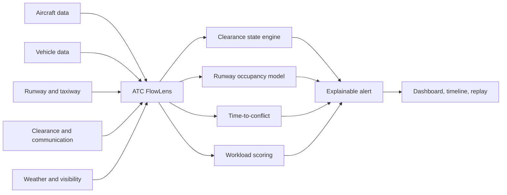

# Knowledge Review: ATC FlowLens

> Review ini disusun dari seluruh artefak yang tersedia di folder `BOEING BUILD`, dengan fokus pada produk yang dikembangkan untuk BOEING BUILD Hackathon.

**Tanggal review:** 14 Agustus 2026  
**Produk:** ATC FlowLens  
**Tema:** Aerospace & Defense  
**Fokus utama:** Advanced Technology and Innovation  
**Tim pada artefak pitch:** Agentic Vibing

## 1. Ringkasan Eksekutif

ATC FlowLens adalah konsep **explainable decision-support dashboard** untuk keselamatan runway dan operasi Air Traffic Control. Produk ini dirancang untuk menggabungkan informasi yang biasanya tersebar—pergerakan pesawat, kendaraan bandara, status runway, clearance, komunikasi, cuaca, dan indikator workload—ke dalam satu tampilan operasional dan timeline yang mudah dipahami.

Masalah yang dituju adalah meningkatnya **controller workload** dan risiko runway conflict ketika pesawat, kendaraan ground, komunikasi radio, low visibility, cuaca, dan koordinasi lintas unit terjadi secara bersamaan. Fokus paling konkret adalah konflik antara pesawat yang akan landing/takeoff dan kendaraan yang masuk atau menyeberangi runway aktif.

Nilai pembeda FlowLens adalah **explainability**. Sistem tidak hanya memberi alarm, tetapi menjelaskan objek yang terlibat, clearance yang aktif, estimasi waktu, alasan konflik, tingkat keparahan, dan urutan kejadian. Controller tetap menjadi pengambil keputusan; FlowLens diposisikan sebagai alat bantu human-in-the-loop untuk awareness, training, dan review keselamatan.

Berdasarkan isi folder, produk saat ini paling tepat dikategorikan sebagai **konsep produk dan paket pitch/prototipe demonstrasi**, bukan sistem ATC operasional yang telah diimplementasikan atau disertifikasi. Folder berisi riset, proposal, HTML/PDF/PPTX pitch deck, aset visual, serta script pembuat deck. Tidak ditemukan source code frontend/backend, integrasi data ATC, atau aplikasi runtime.

## 2. Artefak yang Tersedia di Folder

| Kategori | Artefak utama | Peran terhadap produk |
|---|---|---|
| Riset domain | `docs/General-Information/atc-atm-master-research-and-solution.md` | Basis pengetahuan ATC/ATM, workload, teknologi, kasus, dan rancangan FlowLens. |
| Riset workload | `docs/General-Information/atc-workload-research.md` | Merumuskan faktor workload, runway conflict, arsitektur MVP, risiko, dan contoh rule. |
| Riset workflow | `docs/General-Information/atc-atm-workflow-communication-visualization.md` | Menjelaskan alur flight plan sampai landing, logging komunikasi, dan peluang AI transcription/sequence. |
| Riset teknologi | `docs/General-Information/atc-technology-visualization.md` | Memetakan surveillance, safety net, surface safety, dan posisi FlowLens terhadap sistem yang sudah ada. |
| Proposal | `docs/Proposal/proposal-umum-atc-flowlens-id.md` | Proposal umum berbahasa Indonesia: masalah, solusi, target pengguna, dampak, dan MVP. |
| Proposal | `docs/Proposal/atc-flowlens-general-proposal.md` | Versi proposal berbahasa Inggris. |
| Pitch deck | `docs/Proposal/BUILD_TeamAgenticVibing_AdvancedTechnologyAndInnovation.html` dan `.pdf` | Artefak pitch paling lengkap/final yang tersedia. |
| Pitch deck | `docs/Proposal/ATC_FlowLens_PitchDeck_CommandDesign.html`, `.pdf`, `.pptx` | Versi visual dengan pendekatan command-center design. |
| Aset visual | `docs/Proposal/assets/` | Referensi/gambar runway dan prompt visual untuk slide. |
| Tooling | `scripts/generate_atc_flowlens_pitchdeck.py`, `scripts/export_command_design_pptx.py` | Script untuk menghasilkan atau mengekspor deck; bukan implementasi produk ATC. |
| QA visual | `outputs/slide_audit*`, `outputs/*check.png` | Hasil pemeriksaan visual pitch deck. |

### Batasan artefak

Hal-hal berikut belum terbukti tersedia di folder:

- aplikasi web atau dashboard yang dapat dijalankan;
- backend, database, API, atau model data operasional;
- simulator pergerakan pesawat/kendaraan yang benar-benar berjalan;
- koneksi ke radar, ADS-B, MLAT, A-SMGCS, RIMCAS, voice recorder, atau CPDLC;
- model AI speech-to-text atau readback mismatch yang terimplementasi;
- hasil validasi dengan controller, trainer, ANSP, atau data operasional;
- sertifikasi atau persetujuan untuk penggunaan ATC live.

## 3. Identitas dan Posisi Produk

### Definisi produk

**ATC FlowLens** adalah dashboard keselamatan runway dan pendukung keputusan ATC yang membantu tim penerbangan:

1. melihat hubungan antara aircraft, vehicle, runway, clearance, dan waktu;
2. mendeteksi potensi konflik sebelum margin waktu menjadi terlalu kecil;
3. memahami alasan sebuah alert muncul;
4. menilai peningkatan workload secara terstruktur;
5. memutar ulang skenario untuk training atau after-action review.

### Positioning yang konsisten

FlowLens **bukan**:

- autonomous air traffic controller;
- pengganti controller atau sistem ATC tersertifikasi;
- klaim bahwa semua runway incident dapat dicegah;
- sistem operasional real-time yang sudah siap dipasang di bandara.

FlowLens **adalah**:

- human-in-the-loop decision support;
- simulation-first training tool;
- runway safety awareness layer;
- explainable event and replay system;
- konsep yang dapat berkembang menjadi platform analitik keselamatan.

### Alignment dengan BOEING BUILD

| Area | Relevansi |
|---|---|
| Aerospace & Defense | Menangani runway safety, ATC workload, airport operational readiness, dan infrastruktur kritis. |
| Advanced Technology and Innovation | Menggunakan data fusion simulasi, time-to-conflict, workload scoring, rule engine, dan explainable alerting. |
| Social Impact | Keselamatan penumpang, kru, controller, ground staff, serta unit rescue and firefighting. |
| Sustainability | Potensi jangka panjang untuk mengurangi go-around, holding, taxi delay, dan fuel burn yang dapat dihindari. |
| Education and Skill Development | Skenario replay dapat digunakan dalam pelatihan ATC, ground control, dan safety team. |

## 4. Pengetahuan Domain yang Menjadi Dasar Produk

### ATC dan ATM

**ATC (Air Traffic Control)** adalah layanan operasional yang memberikan instruksi dan menjaga pergerakan pesawat serta kendaraan tetap aman dan teratur. **ATM (Air Traffic Management)** memiliki cakupan lebih luas: flight planning, airspace management, traffic flow management, surveillance, komunikasi, runway operation, dan koordinasi lintas unit.

Area kerja yang paling relevan untuk FlowLens adalah:

- **Tower control:** takeoff, landing, runway occupancy, dan runway crossing.
- **Ground/surface control:** taxiway, pushback, kendaraan, dan pergerakan di permukaan.
- **Approach control:** sequencing pesawat inbound dan handoff ke tower.
- **Airport operations dan ARFF:** kondisi runway, emergency response, dan aktivitas kendaraan khusus.

### Controller workload

Workload controller bukan hanya jumlah pesawat. Workload merupakan gabungan beban:

| Jenis workload | Contoh |
|---|---|
| Cognitive | Memahami situasi dan memprediksi pergerakan. |
| Communication | Radio calls, readback, dan koordinasi. |
| Visual | Radar, surface map, flight strip, weather, dan observasi runway. |
| Coordination | Tower-ground-approach-apron-emergency. |
| Decision | Memilih clearance atau tindakan dalam waktu singkat. |

Workload meningkat ketika traffic padat, visibility rendah, cuaca berubah, radio congestion terjadi, runway crossing aktif, kendaraan emergency bergerak, atau sistem pendukung tidak lengkap. Dampaknya dapat berupa hilangnya situational awareness, clearance yang tidak tepat waktu, readback error, delayed response, task saturation, dan alert fatigue.

### Teknologi yang sudah ada

Riset di folder menempatkan FlowLens di atas ekosistem teknologi yang sudah tersedia, antara lain:

- radar, ADS-B, Mode S, dan MLAT untuk surveillance;
- surface surveillance untuk pesawat dan kendaraan di runway/taxiway;
- electronic flight strips dan flight data processing;
- ASDE-X/ASSC, A-SMGCS, RIMCAS/RMCA, dan runway status lights untuk surface safety;
- STCA/MTCD untuk conflict detection di udara;
- AMAN, DMAN, TFDM, dan TBFM untuk flow/sequencing;
- CPDLC/Data Comm dan SWIM untuk modernisasi komunikasi dan pertukaran data.

### Celah yang dituju FlowLens

FlowLens tidak mencoba menggantikan sistem tersebut. Celah yang dituju adalah lapisan pemahaman dan integrasi:

- informasi berasal dari banyak display dan log;
- voice communication masih penting dan tidak selalu berbentuk data terstruktur;
- clearance state, posisi kendaraan, dan estimasi waktu harus dibaca sebagai satu konteks;
- alert konvensional belum tentu menjelaskan alasan operasionalnya;
- tidak semua bandara memiliki kemampuan surface surveillance yang sama;
- training dan investigasi membutuhkan timeline yang menghubungkan track, komunikasi, clearance, dan alert.

## 5. Masalah Utama dan Use Case

### Problem statement

Controller harus menjaga keselamatan runway dalam kondisi kompleks dan berubah cepat, sementara informasi tentang pesawat, kendaraan, clearance, cuaca, dan status runway tersebar di banyak sumber. Dibutuhkan sistem pendukung yang dapat mengidentifikasi potensi konflik lebih awal, menjelaskan penyebabnya, dan membantu proses training tanpa mengambil alih otoritas controller.

### Use case utama: aircraft versus ground vehicle

Skenario yang konsisten di proposal dan pitch deck:

1. Pesawat **BAW123** berada di final 1,8 NM, kecepatan 145 kt, dan cleared to land di RWY 27.
2. Kendaraan **ARFF-2** cleared to cross atau mulai menyeberangi RWY 27.
3. Sistem memperkirakan touchdown pesawat dalam **42 detik**.
4. Sistem memperkirakan kendaraan clear dari runway dalam **58 detik**.
5. Terdapat prediksi runway occupancy overlap selama **16 detik**.
6. FlowLens memicu alert high/critical, menampilkan alasan, objek terkait, workload state, dan replay timeline.

Contoh ini adalah **data simulasi untuk demonstrasi**, bukan data ATC live.

## 6. Cara Kerja Produk yang Direncanakan



### Input

- posisi, kecepatan, phase, callsign, dan runway pesawat;
- posisi, kecepatan, status, route, dan runway kendaraan;
- geometri runway/taxiway;
- clearance status;
- communication log atau transcript simulasi;
- weather, wind, dan visibility;
- airport operation/emergency status.

### Processing

1. **Runway occupancy model** — menentukan clear, occupied, crossing, takeoff, atau landing state.
2. **Clearance state engine** — menyimpan state seperti cleared to land, cleared for takeoff, hold short, line up and wait, cleared to cross, dan go around.
3. **Time-to-conflict calculator** — membandingkan waktu touchdown/runway entry dengan waktu kendaraan clear.
4. **Conflict detection** — menerapkan rule berbasis runway yang sama, clearance aktif, dan overlap waktu.
5. **Workload scoring** — menggabungkan traffic, radio calls, clearance aktif, kendaraan, cuaca, runway changes, dan alert.
6. **Severity and explanation** — mengubah hasil menjadi alert dengan alasan yang singkat dan dapat ditelusuri.

### Output

- runway map;
- aircraft/vehicle tracking;
- runway occupancy state;
- conflict alert dengan severity;
- alasan alert dan objek terkait;
- workload indicator;
- communication/event timeline;
- replay untuk training atau review.

## 7. Fitur Produk

| Fitur | Fungsi dan nilai |
|---|---|
| Runway occupancy monitoring | Menunjukkan apakah runway clear, occupied, crossing, digunakan untuk takeoff, atau menerima landing. |
| Aircraft and vehicle tracking | Memvisualisasikan objek yang bergerak pada peta bandara simulasi. |
| Clearance state engine | Mengubah instruksi operasional menjadi state yang bisa dipantau dan dibandingkan. |
| Time-to-conflict | Mengukur margin waktu antara runway entry/touchdown dan runway clear. |
| Explainable conflict alert | Menjelaskan siapa yang berkonflik, kapan, di runway mana, dan mengapa. |
| Communication timeline | Mengurutkan pesan tower, pilot, dan vehicle. |
| Controller workload indicator | Memberi sinyal Low/Medium/High/Critical berdasarkan faktor operasional. |
| Replay mode | Mengubah insiden atau near-miss simulasi menjadi objek pembelajaran. |
| Future communication intelligence | Speech-to-text, callsign detection, clearance parsing, dan readback mismatch detection; masih berupa arah pengembangan. |
| Future arrival sequence | Urutan landing, estimated touchdown, spacing risk, dan go-around risk; masih berupa arah pengembangan. |

## 8. Target Pengguna dan Nilai

| Pengguna | Kebutuhan yang dijawab FlowLens |
|---|---|
| Tower controller | Awareness terhadap runway occupancy, landing, takeoff, dan conflict window. |
| Ground controller | Koordinasi taxi, vehicle movement, dan runway crossing. |
| Approach controller | Konteks sequencing inbound dan handoff ke tower. |
| Airport operation center | Monitoring kondisi runway, disruption, dan emergency activity. |
| ARFF/emergency unit | Memahami dampak pergerakan kendaraan terhadap runway aktif. |
| ATC training center/aviation academy | Skenario latihan, replay, workload awareness, dan evaluasi kejadian. |
| Aviation safety investigator | Review timeline komunikasi, clearance, track, dan alert. |

### Pasar awal yang paling realistis

Jalur adopsi yang didukung dokumen adalah:

1. training dan simulation tool;
2. safety briefing dan scenario replay product;
3. airport operation support prototype;
4. riset bersama ANSP, bandara, atau aviation school;
5. eksplorasi menuju decision-support tersertifikasi.

Positioning simulation-first lebih realistis daripada langsung menjual FlowLens sebagai sistem ATC live, karena sistem operasional membutuhkan validasi, cybersecurity review, human factors assessment, sertifikasi, dan persetujuan regulator.

## 9. MVP yang Direncanakan

MVP dalam proposal dan pitch deck mencakup:

- satu layout bandara simulasi dengan runway dan taxiway;
- tiga sampai lima pesawat simulasi;
- satu sampai dua kendaraan bandara/fire truck;
- clearance dan communication logs;
- status cuaca atau visibility;
- rule-based conflict detection;
- time-to-conflict alerting;
- workload scoring;
- replay mode.

Stack yang diusulkan dalam riset adalah React/Next.js untuk frontend, SVG/Canvas/Mapbox/Leaflet untuk visualisasi, Node.js/FastAPI untuk backend, dan JSON simulation sebagai data. Namun stack ini masih berupa rekomendasi arsitektur; belum ada implementasi aplikasi yang ditemukan di folder.

### Contoh rule MVP

```text
IF aircraft.status = "cleared_to_land"
AND aircraft.distance_to_threshold < 2 NM
AND vehicle.status = "cleared_to_cross"
AND vehicle.runway = aircraft.runway
AND estimated_vehicle_clear_time > estimated_aircraft_touchdown_time
THEN trigger HIGH runway conflict alert
```

Contoh alert:

```text
HIGH RUNWAY CONFLICT RISK

Aircraft: BAW123, cleared to land RWY 27
Vehicle: ARFF-2, cleared to cross RWY 27
Estimated touchdown: 42 seconds
Estimated vehicle clear time: 58 seconds

Reason: vehicle clear time is later than aircraft touchdown time.
Predicted runway occupancy overlap: 16 seconds.
```

## 10. Roadmap Produk

### Phase 1 — Hackathon MVP

Simulated runway map, aircraft/vehicle movement, clearance log, rule-based time-to-conflict alert, workload indicator, dan replay timeline.

### Phase 2 — Enhanced prototype

ATC-style speech-to-text, readback mismatch detection, scenario generator, multi-runway support, serta workload model yang lebih kaya.

### Phase 3 — Training analytics dan riset operasional

Integrasi dataset airport operation, tower-ground training simulator, safety analytics dashboard, dan riset menuju decision-support yang dapat divalidasi secara formal.

## 11. Kekuatan Produk

1. **Problem spesifik dan safety-critical.** Fokus aircraft-vehicle runway conflict mudah dipahami dan memiliki dampak keselamatan langsung.
2. **Solusi explainable.** Sistem menjawab “apa yang terjadi”, “kapan”, dan “mengapa”, bukan hanya menyalakan alarm.
3. **Human-centered.** Dokumen konsisten menegaskan controller tetap memegang keputusan.
4. **Simulation-first dan feasible.** MVP tidak bergantung pada data ATC live yang sensitif.
5. **Multi-purpose.** Satu core event model dapat digunakan untuk monitoring simulasi, training, safety review, dan roadmap analytics.
6. **Narasi pitch cukup konsisten.** Riset → gap → FlowLens → contoh konflik → MVP → adoption path tersusun jelas di proposal dan deck final.

## 12. Gap dan Hal yang Perlu Dibuktikan

| Gap | Dampak | Prioritas tindak lanjut |
|---|---|---|
| Belum ada aplikasi runtime yang terlihat | Klaim MVP masih berada pada level proposal dan visualisasi. | Bangun simulator sederhana yang dapat didemokan end-to-end. |
| Rule masih sederhana | Belum cukup merepresentasikan taxiway, runway protection area, speed/heading, uncertainty, dan multiple runway. | Definisikan data model serta rule library yang dapat diuji. |
| Workload score belum tervalidasi | Skor berisiko dianggap angka arbitrer. | Nyatakan sebagai indikator simulasi; dokumentasikan bobot dan lakukan expert review. |
| Belum ada metrik performa | Belum diketahui lead time alert, false alarm, atau pemahaman pengguna. | Tetapkan metrik: detection lead time, false-alert rate, explanation completeness, dan replay comprehension. |
| AI communication masih roadmap | Jangan mengklaim speech-to-text/readback detection sudah tersedia. | Pisahkan jelas fitur MVP rule-based dari Phase 2 AI. |
| Belum ada user validation | Kesesuaian UI dengan kerja controller belum terbukti. | Uji skenario dengan ATC trainer/safety professional bila memungkinkan. |
| Data dan regulasi belum dibahas secara implementatif | Integrasi live akan memiliki risiko keamanan dan sertifikasi tinggi. | Tetap simulation-first; susun data governance dan safety case bertahap. |
| Klaim insiden tertentu perlu verifikasi eksternal | Detail insiden, terutama kasus yang masih preliminary, dapat berubah. | Gunakan wording “berdasarkan laporan awal” dan re-verifikasi sumber sebelum publikasi. |

## 13. Risiko dan Batasan Produk

- **Safety-critical domain:** FlowLens tidak boleh diposisikan sebagai pengganti controller.
- **False alarm dan alert fatigue:** Alert harus memiliki severity, alasan, dan prioritas yang jelas.
- **Human factors:** UI harus ringkas dan tidak menambah beban kognitif saat kondisi kritis.
- **Data sensitif:** Clearance, voice, track, dan operation data nyata membutuhkan kontrol akses serta perlindungan yang kuat.
- **Ketidakpastian prediksi:** ETA touchdown dan vehicle clear time memiliki error; produk perlu menampilkan confidence/uncertainty pada versi lanjutan.
- **Variasi prosedur bandara:** Layout, phraseology, clearance workflow, dan equipment dapat berbeda antar bandara.
- **Regulasi dan sertifikasi:** Penggunaan operasional membutuhkan validasi keselamatan, human-in-the-loop testing, cybersecurity, dan regulator approval.

## 14. Catatan Konsistensi Pengetahuan

Beberapa dokumen riset awal menyebut nama alternatif seperti **RunwayShield AI** dan **ATC Guardian**. Proposal dan pitch deck yang lebih baru menetapkan **ATC FlowLens** sebagai nama produk utama. Untuk dokumentasi lanjutan, sebaiknya gunakan hanya ATC FlowLens agar brand tidak terfragmentasi.

Riset awal juga mencakup AI communication layer—speech-to-text, callsign detection, clearance parsing, dan readback mismatch detection. Pitch deck terbaru mempersempit MVP menjadi simulasi, rule-based conflict detection, workload scoring, dan replay. Karena itu, fitur AI komunikasi sebaiknya ditulis sebagai **roadmap/Phase 2**, bukan kemampuan yang sudah tersedia.

Deskripsi kasus LaGuardia pada beberapa artefak menggunakan tingkat detail yang berbeda. Karena investigasi disebut masih berjalan, materi publik sebaiknya memakai bahasa hati-hati dan tidak menyatakan sebab final atau klaim bahwa FlowLens pasti akan mencegah kasus tersebut.

## 15. Kesimpulan Review

ATC FlowLens memiliki fondasi konsep yang kuat sebagai produk digital aviation untuk runway safety, workload awareness, dan training. Produk berhasil memilih masalah yang konkret, menghubungkannya dengan kebutuhan operasional ATC, menawarkan arsitektur MVP yang dapat dibuat dengan data simulasi, serta mempertahankan batas keselamatan bahwa manusia tetap memegang keputusan.

Status paling akurat berdasarkan folder adalah:

> **ATC FlowLens merupakan konsep dan paket pitch/prototipe demonstrasi yang siap diturunkan menjadi MVP simulator runway; belum terbukti sebagai aplikasi ATC yang berjalan atau sistem operasional tersertifikasi.**

Langkah produk paling penting berikutnya adalah membuat satu demo end-to-end yang menjalankan skenario BAW123–ARFF-2, menampilkan peta runway, menghitung konflik 42-versus-58 detik, mengeluarkan alert explainable, memperbarui workload indicator, dan memutar ulang timeline. Demo tersebut akan mengubah FlowLens dari narasi pitch menjadi bukti produk yang dapat diuji.

## 16. Referensi Internal

- [Master Research ATC/ATM Workload dan Solusi Hackathon](../General-Information/atc-atm-master-research-and-solution.md)
- [ATC Controller Workload Research](../General-Information/atc-workload-research.md)
- [Visualisasi Cara Kerja ATC/ATM, Komunikasi, dan Teknologi Pendukung](../General-Information/atc-atm-workflow-communication-visualization.md)
- [Visualisasi Teknologi ATC Saat Ini](../General-Information/atc-technology-visualization.md)
- [Proposal Umum ATC FlowLens](../Proposal/proposal-umum-atc-flowlens-id.md)
- [ATC FlowLens General Proposal](../Proposal/atc-flowlens-general-proposal.md)
- [Pitch Deck Final HTML](../Proposal/BUILD_TeamAgenticVibing_AdvancedTechnologyAndInnovation.html)
- [Pitch Deck Command Design HTML](../Proposal/ATC_FlowLens_PitchDeck_CommandDesign.html)
- [Script Generator Pitch Deck](../../scripts/generate_atc_flowlens_pitchdeck.py)

