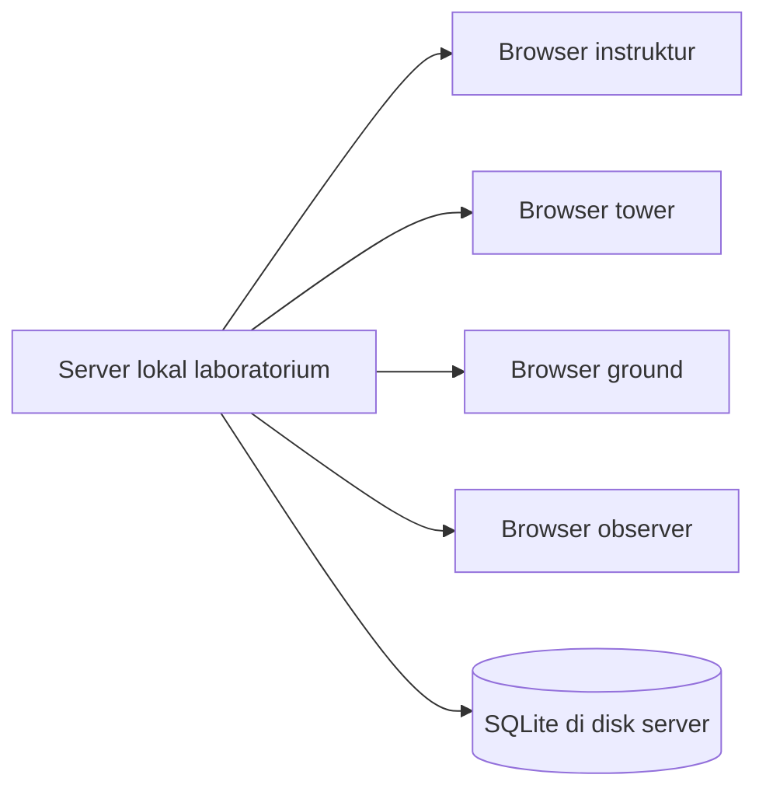
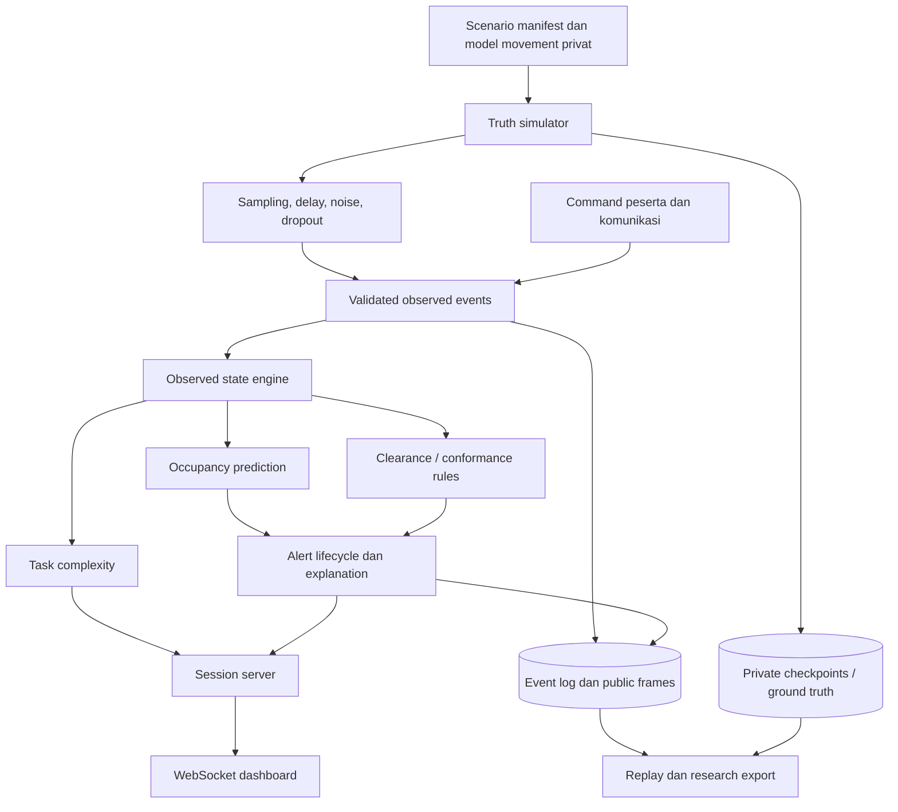
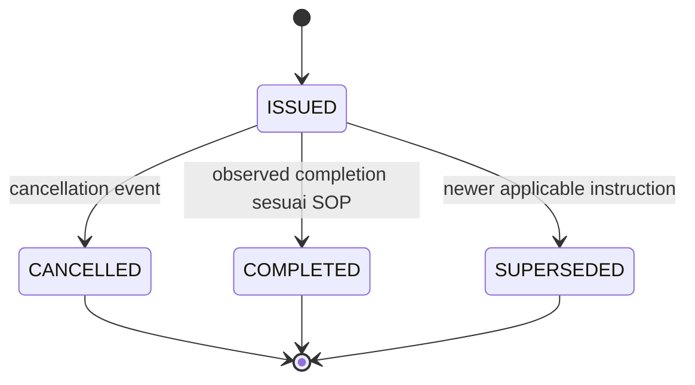
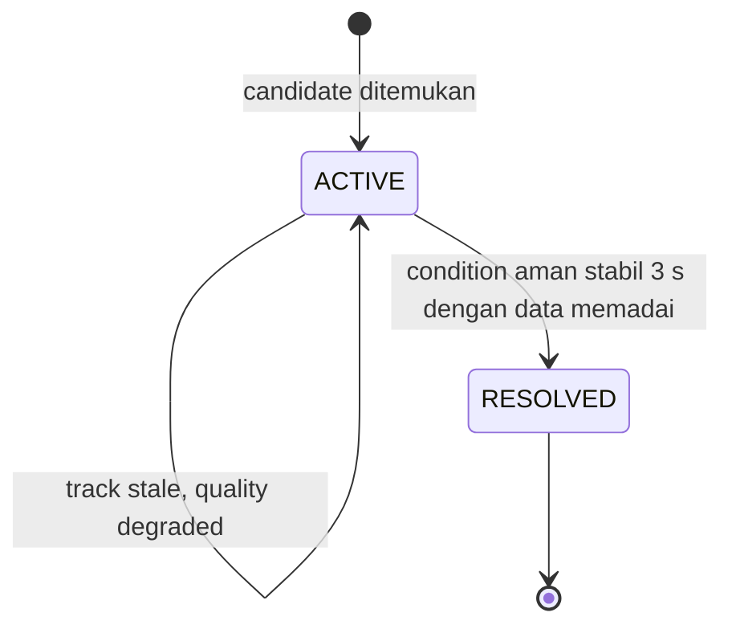

# ATC FlowLens — Rencana Sistem, Riset, dan Pembangunan hingga MVP

- **Tanggal penyusunan:** 15 September 2026
- **Versi dokumen:** 1.0
- **Status:** spesifikasi normatif untuk target MVP; bukan laporan hasil implementasi
- **Bahasa:** Indonesia
- **Konteks:** BOEING BUILD — Aerospace & Defense / Advanced Technology and Innovation
- **Target awal:** MVP simulasi keselamatan runway dan training ATC, kemudian pilot riset
- **Pemilik keputusan domain yang direncanakan:** product/domain lead dengan review trainer ATC

> Dokumen ini menjelaskan tujuan, rancangan, dan kriteria penerimaan yang ditargetkan. Pernyataan fitur di sini adalah kebutuhan/rencana, bukan bukti implementasi. Untuk kondisi repository terkini lihat [Status Implementasi](../IMPLEMENTATION_STATUS.md); untuk peta otoritas seluruh dokumen lihat [docs README](../README.md). Dokumen ini tidak menyatakan fitur telah dibangun, diuji, disertifikasi, atau divalidasi dengan controller.

> **Addendum requirement 3 Oktober 2026:** gunakan [AI Assist Buddy MVP Addendum](ATC_FlowLens_AI_Assist_Buddy_MVP_Prompt.md) untuk target AI advisory. Baseline produk kini bertahap: scenario sintetik berbasis bukti, MVP replay offline dari simulator mitra dengan kandidat opsi AI untuk evaluasi, lalu tujuan jangka panjang advisory Tower/Ground yang dikaji terpisah. Belum ada mitra/replay yang dikonfirmasi; baseline sintetik bukan bukti fidelity atau validasi operasional. Rencana ini tetap menjadi spesifikasi core simulator, runway dan session.

## Daftar isi

1. [Tujuan, keputusan awal, dan cara membaca dokumen](#1-tujuan-keputusan-awal-dan-cara-membaca-dokumen)
2. [Dasar internal dan penjelasan sistem](#2-dasar-internal-dan-penjelasan-sistem)
3. [Evidence eksternal dan kebutuhan riset](#3-evidence-eksternal-dan-kebutuhan-riset)
4. [Pengguna, penerapan, dan alur latihan](#4-pengguna-penerapan-dan-alur-latihan)
5. [Ruang lingkup dan prioritas MVP](#5-ruang-lingkup-dan-prioritas-mvp)
6. [Arsitektur teknis dan keputusan teknologi](#6-arsitektur-teknis-dan-keputusan-teknologi)
7. [Data, waktu, geometri, dan simulator](#7-data-waktu-geometri-dan-simulator)
8. [Clearance, komunikasi, dan kewenangan](#8-clearance-komunikasi-dan-kewenangan)
9. [Prediksi occupancy dan perhitungan risiko](#9-prediksi-occupancy-dan-perhitungan-risiko)
10. [Rule, severity, dan evidence alert](#10-rule-severity-dan-evidence-alert)
11. [Indikator kompleksitas tugas dan workload](#11-indikator-kompleksitas-tugas-dan-workload)
12. [Dashboard dan interaksi pengguna](#12-dashboard-dan-interaksi-pengguna)
13. [API, sinkronisasi, dan akses](#13-api-sinkronisasi-dan-akses)
14. [Penyimpanan, replay, branching, dan laporan](#14-penyimpanan-replay-branching-dan-laporan)
15. [Paket skenario dan desain benchmark](#15-paket-skenario-dan-desain-benchmark)
16. [Pengujian dan kriteria penerimaan](#16-pengujian-dan-kriteria-penerimaan)
17. [Evaluasi training dan protokol studi](#17-evaluasi-training-dan-protokol-studi)
18. [Backlog, tim, jadwal, dan dependensi](#18-backlog-tim-jadwal-dan-dependensi)
19. [Risiko, batasan, dan jalur setelah MVP](#19-risiko-batasan-dan-jalur-setelah-mvp)
20. [Deliverables, definition of done, dan referensi](#20-deliverables-definition-of-done-dan-referensi)

## 1. Tujuan, keputusan awal, dan cara membaca dokumen

### 1.1 Tujuan

Mengubah konsep ATC FlowLens dalam docs menjadi spesifikasi yang cukup terperinci untuk memandu pembangunan MVP Tower/Ground runway. MVP harus mereproduksi hubungan antara pergerakan, instruksi, komunikasi, waktu, dan kualitas sumber melalui replay offline simulator mitra. Sampai mitra tersedia, baseline sintetik berbasis sumber resmi dipakai untuk menguji alur teknis dan diberi status belum tervalidasi terhadap workflow lapangan.

Hasil bertahap yang ditargetkan adalah replay yang dapat membantu evaluator/controller menelaah:

1. Apa yang sedang teramati pada runway?
2. Apa yang mungkin terjadi berdasarkan informasi yang tersedia sekarang?
3. Objek dan instruksi mana yang membuat penggunaan runway berpotensi bertumpang tindih?
4. Seberapa kecil margin waktunya, dengan asumsi apa?
5. Mengapa alert muncul atau berubah?
6. Bagaimana peserta mengenali dan merespons keadaan tersebut?
7. Bagaimana urutan kejadian dapat dipahami kembali setelah latihan?
8. Opsi tindak lanjut apa yang layak dipertimbangkan berdasarkan evidence yang tersedia, dan apa yang masih unknown? Kandidat opsi ini hanya diuji offline dalam replay; ia bukan instruksi clearance.

### 1.2 Keputusan yang dipakai sebagai baseline

| Aspek | Keputusan | Konsekuensi |
|---|---|---|
| Produk awal | Evidence-grounded Tower/Ground runway advisory, dikembangkan bertahap melalui simulator dan replay offline | Tujuan live adalah arah jangka panjang; bukan klaim kemampuan MVP |
| MVP | Replay offline simulator mitra dengan kandidat opsi AI untuk evaluasi; baseline sintetik berbasis bukti bila akses belum tersedia | Tidak ada audio/feed produksi atau advisory di posisi live |
| Pengguna prioritas | Controller Tower/Ground sebagai intended user; ATCO/instruktur/evaluator sebagai reviewer | Review domain dan workflow site-specific belum tersedia |
| Tahap lanjutan | Validasi replay dengan mitra → studi shadow-mode terpisah → penilaian formal sebelum proposal operational use | Hasil teknis, domain, human factors, dan safety dinilai terpisah |
| Tim/waktu | 3–4 orang, 6–8 minggu | Satu runway; feature creep dibatasi |
| Pendekatan deteksi | Rule engine deterministik + geometri + interval waktu | Semua keputusan alert dapat ditelusuri |
| AI komunikasi/advisory | Transcript dan evidence-linked candidate options dari replay offline | Unknown/uncertainty wajib terlihat; output tidak menjadi clearance atau severity safety |
| Deployment | Pemrosesan replay lokal/offline; LAN hanya untuk lingkungan riset yang disetujui | Tidak ada koneksi ke posisi kontrol aktif dalam MVP |
| Data | Replay simulator mitra yang diizinkan; synthetic baseline ber-seed sampai data mitra tersedia | Replay mitra dan review ATCO menjadi gate untuk klaim fidelity; synthetic ground truth hanya menilai perilaku pada scenario itu |
| Geometri | Satu runway fisik dengan dua arah operasi | 09/27 merupakan resource fisik yang sama |
| Model workload | Indikator kompleksitas tugas eksperimen | Tidak menilai kesehatan, fatigue, atau kemampuan individu |

### 1.3 Tingkat kepastian

| Label | Makna | Contoh |
|---|---|---|
| Fakta internal | Isi yang ditemukan pada dokumen proyek | Proposal memprioritaskan aircraft–vehicle conflict |
| Evidence eksternal | Pernyataan yang didukung sumber primer | A-SMGCS memiliki CATC dan conformance monitoring |
| Keputusan rancangan | Pilihan untuk MVP ini | Backend FastAPI, geometry Shapely |
| Asumsi eksperimen | Parameter yang dipilih untuk diuji | Buffer 10 detik dan stale threshold 3 detik |
| Target penerimaan | Nilai yang ingin dicapai | p95 evaluasi engine kurang dari 50 ms |
| Belum terbukti | Membutuhkan implementasi/studi/review | Peningkatan pemahaman peserta dan pengurangan workload |

Target dalam dokumen tidak boleh dipindahkan ke pitch sebagai hasil aktual sebelum ada laporan pengukuran. Review kode awal atau file yang mungkin sedang dikembangkan merupakan pekerjaan terpisah; status runtime saat ini tidak disimpulkan dari spesifikasi ini.

## 2. Dasar internal dan penjelasan sistem

### 2.1 Dokumen acuan

| Dokumen | Peran |
|---|---|
| [Proposal Umum ATC FlowLens](../Proposal/proposal-umum-atc-flowlens-id.md) | Problem, fitur, target users, positioning, MVP |
| [ATC FlowLens General Proposal](../Proposal/atc-flowlens-general-proposal.md) | Padanan proposal berbahasa Inggris |
| [Knowledge Review](ATC_FlowLens_Knowledge_Review.md) | Konsolidasi pengetahuan, batas artefak, gap pembuktian |
| [Master Research ATC/ATM](../General-Information/atc-atm-master-research-and-solution.md) | Domain, workflow, teknologi, kasus, arsitektur konseptual |
| [ATC Workload Research](../General-Information/atc-workload-research.md) | Faktor workload, hazard runway, risiko dan rule awal |
| [Workflow dan Komunikasi](../General-Information/atc-atm-workflow-communication-visualization.md) | Handoff, log, clearance, peluang AI komunikasi |
| [Teknologi ATC](../General-Information/atc-technology-visualization.md) | Surveillance, safety nets, posisi FlowLens |
| [Pitch BUILD](../Proposal/BUILD_TeamAgenticVibing_AdvancedTechnologyAndInnovation.html) | Narasi produk, evidence deck, scope demo |

Knowledge Review bertanggal 14 Agustus 2026 menyatakan artefak yang direview masih berupa konsep, riset, pitch, dan tooling deck; belum memiliki pembuktian runtime atau validasi operasional. Pernyataan historis tersebut menjadi dasar kebutuhan pembuktian, bukan audit keadaan kode terbaru.

### 2.2 Penjelasan domain yang diperlukan

ATC adalah layanan yang memberi instruksi dan membantu menjaga pergerakan penerbangan aman dan teratur. ATM memiliki cakupan lebih luas, termasuk pengelolaan aliran traffic, airspace, flight planning, dan koordinasi. FlowLens tidak akan mengimplementasikan seluruh ATM.

Area yang direpresentasikan:

- **Tower:** arrival/departure, izin menggunakan runway, dan keputusan crossing dalam SOP latihan.
- **Ground:** taxi/pergerakan permukaan, hold, dan koordinasi crossing.
- **Approach:** hanya konteks inbound yang sudah masuk skenario; bukan simulasi sektor approach lengkap.
- **ARFF/airport operations:** kendaraan dan aktivitas yang memengaruhi penggunaan runway.

Workload tidak identik dengan jumlah pesawat. Komunikasi, tugas tertunda, visibility, koordinasi, dan perubahan situasi dapat menambah kompleksitas. Karena itu, FlowLens akan menghubungkan konteks tersebut, tetapi tidak mengklaim dapat membaca keadaan mental controller dari traffic count.

### 2.3 Definisi produk

ATC FlowLens akan menjadi aplikasi web lokal yang:

1. menerima observasi pergerakan serta event komunikasi/clearance simulasi;
2. membentuk state objek, instruksi, runway, dan tugas;
3. memperkirakan interval pemakaian runway;
4. memeriksa rules yang relevan;
5. menghasilkan alert dengan alasan dan referensi bukti;
6. mengirim state yang sama ke posisi kerja peserta;
7. menyimpan urutan kejadian untuk replay dan evaluasi.

### 2.4 Masalah konkret yang dituju

Dalam skenario aircraft–vehicle, peserta harus memahami posisi arrival, status landing, lokasi kendaraan, izin crossing, dan waktu kendaraan keluar. Jika informasi tersebut dibaca sendiri-sendiri, hubungan waktunya dapat terlambat disadari.

FlowLens akan menampilkan hubungan tersebut secara eksplisit: pesawat diprediksi masuk pada interval tertentu dan kendaraan diprediksi belum keluar. Alert juga menunjukkan apabila asumsi prediksi tidak lagi kuat karena kendaraan berhenti atau track hilang.

### 2.5 Pembeda yang akan diuji

| Pembeda yang direncanakan | Bentuk di produk | Cara membuktikannya |
|---|---|---|
| Penjelasan berbasis evidence | Rule, objek, runway, angka, kualitas data, referensi event | Audit kelengkapan dan pertanyaan pemahaman |
| Replay terhubung | Track, clearance, komunikasi, alert pada waktu yang sama | Uji kesamaan state dan debriefing |
| Authoring eksperimen | Scenario/version/seed dan perubahan kondisi | Reproduksi run dan paired experiment |
| Training terukur | Recognition marker, bookmark, assessment | Studi dengan trainer dan peserta |

Deteksi konflik, tracking, dan clearance integration sudah memiliki preseden. Pembeda tidak boleh dipresentasikan sebagai penemuan pertama fungsi tersebut.

## 3. Evidence eksternal dan kebutuhan riset

### 3.1 Register evidence awal

Tanggal pemeriksaan sumber pada penyusunan ini adalah **15 September 2026**. Tanggal kejadian, periode statistik, dan tanggal publikasi dibedakan. Halaman web yang tidak memberi tanggal publikasi jelas ditandai demikian; tanggal akses tidak dijadikan tanggal penelitian.

| ID | Sumber dan waktu | Temuan ringkas | Relevansi | Batas penggunaan |
|---|---|---|---|---|
| E01 | FAA, Air Traffic by the Numbers FY2024; edisi Juni 2025; halaman tercetak 31 | Core 30 mencatat 345 incursions FY2024, 362 FY2023, dan rata-rata 391 FY2017–2019; 12 bandara melewati tingkat pra-pandemi | Memverifikasi angka di deck | Kelompok Core 30 AS; bukan total nasional atau data Indonesia |
| E02 | FAA Safety Briefing, Maret–April 2025; halaman tercetak 12 | Publikasi menyebut 1.757 incursions FY2024, termasuk sembilan A/B | Konteks masalah lebih luas | Incursion tidak sama dengan collision; angka mengikuti cakupan/periode publikasi |
| E03 | NTSB DCA23FA149; kejadian 4 Februari 2023; temuan final | Asumsi departure selesai sebelum arrival, fog, awareness, dan pelatihan low visibility terkait dalam temuan Austin | Mendesain timing/visibility/training cases | Kasus dua pesawat; tidak membuktikan efektivitas FlowLens |
| E04 | NTSB DCA26MA161; kejadian 22 Maret 2026; laman diperbarui 23 April 2026 | CRJ-900 bertabrakan dengan ARFF ketika landing di LaGuardia | Konteks aircraft–vehicle | Informasi preliminary; investigasi ongoing saat diperiksa |
| E05 | EUROCONTROL A-SMGCS service dan specification edisi 2.0, 22 April 2020 | Surveillance, RMCA, CATC, conformance monitoring sudah tercakup | Acuan dan pembanding fungsi | Implementasi lokal berbeda; bukan hasil uji produk ini |
| E06 | Route-Based Detection of Conflicting ATC Clearances, 2013 | Ground route menjadi lapisan perantara dalam cross-check clearance | Mendukung route-based modeling | Preseden riset; detail implementasi harus diuji |
| E07 | DOT OIG AV2025026, 12 Maret 2025 | Audit mengidentifikasi keterbatasan pendekatan analisis runway incursion yang terintegrasi | Provenance dan analitik terhubung | Temuan FAA pada waktu audit; bukan bukti semua bandara memiliki gap sama |
| E08 | FAA VMAT guide; tanggal publikasi laman tidak ditetapkan pada register ini | Kendaraan bertransponder menyediakan identitas dan lokasi bagi surface surveillance | Ground vehicle tracking sebagai input tersendiri | Tidak semua kendaraan atau sumber data tercakup |
| E09 | NASA-TLX official resource | Enam dimensi digunakan untuk workload subjektif | Metode studi pengguna | Bukan model otomatis real-time atau diagnosis fatigue |
| E10 | OpenSky terms; ketentuan aktif saat diperiksa | Penggunaan komersial dan operational REST API memerlukan kesepakatan tertulis sesuai ketentuannya | Menentukan batas adapter data | Akses publik tidak otomatis memberi izin produk komersial |
| E11 | ATCO2 official data description | Tersedia training/test corpus; subset satu jam untuk riset ASR | Corpus opsional untuk studi berlisensi; bukan data default demo | Akses dan lisensi setiap subset berbeda |
| E12 | AviationWeather Data API | METAR/TAF tersedia; CORS tidak diizinkan saat diperiksa | Pengayaan konteks cuaca melalui backend | Laporan cuaca bukan state runway berfrekuensi tinggi |
| E13 | FAA RIM FY2025, dipublikasikan 1 Agustus 2026; DOT/FAA/TC-26/27 | Kajian hotspot dan geometri mendukung mitigasi incursion | Pengembangan scenario geometry | Tidak memberi package lengkap track–clearance–audio |
| E14 | NASA ASRS database | Narasi laporan keselamatan dapat ditelusuri | Inspirasi hazard/komunikasi | Data laporan tidak menjadi denominator kejadian atau trajectory lengkap |
| E15 | Kemenhub JDIH, PM 65/2017 Part 170, diubah PM 10/2022; status diperiksa 3 Okt 2026 | Rujukan Indonesia untuk air traffic rules | Modelkan istilah/peristiwa sesuai aturan yang berlaku | Bukan pengganti SOP/LOA site; cek amendemen dengan otoritas sebelum pilot |
| E16 | PR 5 DJPU/2024, MOS CASR 170-01; JDIH menyatakan berlaku saat diperiksa 3 Okt 2026 | Rujukan prosedur operasional ATS Indonesia | Review scenario dan event communication | Versi/efektivitas tetap diverifikasi; tidak memuat semua SOP lokal |
| E17 | AirNav, New JATSC/New ATMAS, 11 Sep 2026 | First-party description capability di JATSC | Konteks sistem nasional pada fasilitas yang disebut | Tidak membuktikan deployment menyeluruh, interface publik, atau hak akses FlowLens |
| E18 | KNKT, Adisutjipto runway incursion; occurrence 20 Nov 2013/report 2014 | Kasus lokal untuk identifikasi urutan komunikasi/handoff | Inspirasi hazard scenario | Satu kasus; bukan prevalensi atau SOP kini |
| E19 | EASA AI Concept Paper Issue 2, 6 Mar 2024 | Guidance konseptual Level 1/2, human-AI interaction, learning assurance | Prinsip human oversight/evaluation | Bukan regulasi Indonesia atau approval FlowLens |
| E20 | EASA AI Concept Paper Proposed Issue 3, 3 Jun 2026 | Status daftar EASA masih “Proposed” saat diperiksa 3 Okt 2026 | Pantau perkembangan panduan | Draft/usulan, bukan persyaratan final atau approval |
| E21 | FAA Roadmap for AI Safety Assurance | Prinsip incremental assurance dan peran AI sebagai tool | Pembanding pendekatan assurance | Yurisdiksi AS; bukan otorisasi ATC Indonesia |
| E22 | ICAO CNS SG/13-WP/20, 2024 | Contoh usulan penerapan AI di ATM termasuk speech/readback | Research context | Working paper/meeting contribution, bukan ICAO standard atau authorization |

Sumber untuk klaim E01–E04: [FAA FY2024](https://www.faa.gov/air_traffic/by_the_numbers/air-traffic-by-the-numbers-FY2024.pdf), [FAA Safety Briefing](https://www.faa.gov/sites/faa.gov/files/MarApr2025.pdf), [NTSB Austin](https://www.ntsb.gov/investigations/Pages/DCA23FA149.aspx), [NTSB LaGuardia](https://www.ntsb.gov/investigations/Pages/DCA26MA161.aspx).

Sumber untuk E05–E09: [A-SMGCS service](https://www.eurocontrol.int/service/advanced-surface-movement-guidance-and-control-system), [A-SMGCS specification](https://www.eurocontrol.int/publication/eurocontrol-specification-smgcs-services), [Route-Based Detection](https://arxiv.org/abs/1304.6494), [DOT OIG audit](https://www.oig.dot.gov/library-item/46745?page=1), [FAA VMAT](https://www.faa.gov/airports/runway_safety/airfield_drivers/enhancing-surface-safety-guide-vehicle-movement-area), [NASA-TLX](https://www.nasa.gov/human-systems-integration-division/nasa-task-load-index-tlx/).

Sumber untuk E10–E14: [OpenSky terms](https://opensky-network.org/about/terms-of-use), [ATCO2 data](https://atco2.org/data), [AviationWeather API](https://aviationweather.gov/data/api/), [RIM FY2025](https://rosap.ntl.bts.gov/view/dot/92844), [ASRS database](https://asrs.arc.nasa.gov/search/database.html).

Sumber tambahan E15–E22 diperiksa pada **3 Oktober 2026**: [PM 65/2017 Part 170 dan status perubahan PM 10/2022](https://jdih.dephub.go.id/peraturan/detail?data=6GcuOvUrW6426aSdKT754z4a8bhQfAjxb4DsAYg4Z63e8mxq8ahNg4U4EqUfeEGx7Z8LOPTqFLas48gj5jeeo7MI4uPmZ0bPm8w4ZBIeSwfUOKHLkmCCVSTPT9kH3qiFwd7H1AMrDni5eoD36bepdytQmW), [PR 5 DJPU/2024 Part 170-01](https://jdih.dephub.go.id/peraturan-terjemahan/detail?data=LgllyaaumOsGHjhwAeLvgs8bT9Q2T34r38n0dQ9S0cWz8m0XPG44td58LOPTuyHJH04uTQM7nEotA4Ob9ZScczUG4jn24lpG3EZ4jn1og82BO6CjJ5HjhQGjLELEFy9LlGwY84ERx3ab4tKGGpQsQB4Dhw), [AirNav New JATSC/New ATMAS](https://www.airnavindonesia.co.id/berita-dan-siaran-pers/kunjungi-airnavindonesia-presiden-icao-tinjau-langsung-fasilitas-new-jatsc/), [KNKT Adisutjipto report](https://knkt.go.id/Repo/Files/Laporan/Penerbangan/2013/PK-AXG%20%26%20PK-LBH%20Final%20Report.pdf), [EASA Issue 2](https://www.easa.europa.eu/en/newsroom-and-events/news/easa-publishes-artificial-intelligence-concept-paper-issue-2-guidance), [EASA AI publication status](https://www.easa.europa.eu/en/publication-types/artificial-intelligence), [FAA AI Safety Assurance Roadmap](https://www.faa.gov/media/82891), and [ICAO CNS SG/13-WP/20](https://www.icao.int/MID/Documents/2024/CNS%20SG13/CNS%20SG13-WP20.pdf).

### 3.2 Yang sudah dan belum didukung evidence

| Pernyataan | Status |
|---|---|
| Runway incursion merupakan masalah keselamatan nyata | Didukung E01–E04 |
| Hubungan clearance, route, dan surveillance relevan untuk safety support | Didukung E05–E06 |
| Vehicle awareness membutuhkan coverage data yang sesuai | Didukung E08 |
| Penggabungan data dan analitik memiliki kebutuhan yang terdokumentasi | Didukung pada konteks E07 |
| FlowLens memberikan alert lebih baik daripada sistem lain | Belum terbukti |
| FlowLens mengurangi workload peserta | Belum terbukti |
| FlowLens dapat mencegah kecelakaan tertentu | Tidak dapat disimpulkan |
| Pengurangan go-around otomatis menghasilkan penghematan fuel | Memerlukan model, baseline, dan data tambahan |
| Model skor dalam dokumen merupakan model workload tervalidasi | Tidak; bobot merupakan asumsi eksperimen |

### 3.3 Matriks pembanding awal

| Kategori | Kemampuan yang relevan | Hubungan dengan FlowLens | Penelitian lanjutan |
|---|---|---|---|
| A-SMGCS / RMCA / CATC | Surveillance, conflict, clearance, conformance | Acuan domain dan pembanding | Pelajari explainability/replay dari implementasi yang dipublikasikan |
| ASDE-X / ASSC / surface awareness | Surface tracking dan safety context | Kandidat sumber/konsep pembanding | Bedakan surveillance capability dan training capability |
| Simulator ATC | Latihan posisi kerja dan prosedur | FlowLens menargetkan subset runway training | Bandingkan scenario authoring, realism, assessment, dan biaya berdasarkan sumber yang dapat diakses |
| Replay / safety analytics | Penyusunan timeline dan event review | Fokus output debriefing | Uji keterhubungan evidence dan kemudahan merekonstruksi kejadian |
| AI ATC communication/advisory research | ASR, callsign, command entities, candidate options | MVP memakai replay simulator mitra offline; synthetic baseline jika akses belum tersedia | Audit corpus, domain shift, critical-slot error, evidence support, reviewer relevance, dan lisensi |

Kolom yang belum memiliki sumber atau evaluasi tetap ditandai **belum diverifikasi**. Harga, klaim vendor, atau kelengkapan implementasi bandara tidak diisi dengan perkiraan yang dipresentasikan sebagai fakta.

### 3.4 Paket riset tambahan yang harus dikerjakan sebelum pilot

1. Meninjau hazard relevan dari minimal tiga sumber primer, dengan satu pemilik evidence register.
2. Membekukan 12 skenario kanonis beserta tujuan pembelajaran dan hasil yang diharapkan.
3. Meminta review trainer atas SOP simulasi, phraseology, kewenangan, dan rubrik. Jika belum tersedia, statusnya belum direview.
4. Memverifikasi ketentuan dataset sebelum mengunduh atau memasukkan data ke demo.
5. Menyusun protokol eksperimen dan baseline sebelum melihat hasil studi utama.
6. Mengidentifikasi calon mitra Indonesia secara riset; tidak menganggap akses data, dukungan organisasi, atau approval sudah tersedia.

Output riset adalah register klaim, daftar hazard, comparison matrix, protokol studi, dan review log. Rekrutmen atau komunikasi mitra bukan hasil yang sudah dilakukan melalui dokumen ini.

## 4. Pengguna, penerapan, dan alur latihan

### 4.1 Persona dan kebutuhan

| Pengguna | Tujuan | Interaksi prioritas | Keberhasilan |
|---|---|---|---|
| Instruktur | Menjalankan latihan dan membahas keputusan | Scenario, control, role-play, bookmark, replay | Latihan dapat diulang dan dijelaskan tanpa menebak urutan event |
| Peserta tower | Memahami pemakaian runway | Map, arrival, clearance, alert | Mengidentifikasi resource dan risiko tepat waktu |
| Peserta ground | Mengelola pergerakan/koordinasi | Vehicle, hold, crossing request | Request dan permission tidak tertukar |
| Observer | Mencatat perilaku dan kejadian | Read-only view, recognition, note | Catatan memiliki timestamp yang sama dengan sesi |
| Research evaluator | Menilai detector dan studi | Ground truth terbatas, exports | Hasil memiliki denominator dan versi yang jelas |

Evaluator adalah fungsi berhak akses terbatas, bukan peran yang memberi instruksi simulasi tambahan.

### 4.2 Bentuk penerapan MVP



Satu laptop dapat menjalankan scenario/replay baseline. MVP menargetkan impor offline dari simulator training mitra bila aksesnya disetujui; pemrosesan dapat dijalankan lokal atau dalam lingkungan mitra yang terisolasi. Tidak ada koneksi live ke radar, radio operasional, posisi kontrol, atau vehicle hardware dalam MVP.

Yang dibuat mendekati situasi lapangan adalah pembagian tanggung jawab, sinkronisasi waktu, koordinasi, perubahan state, delayed response, dan keterbatasan data. Realisme tersebut tidak setara dengan simulasi ATC tersertifikasi.

### 4.3 Alur sebelum latihan

1. Instruktur memilih scenario/version, seed, dan kondisi flowlens atau baseline.
2. Sistem memvalidasi layout, mobile definitions, timeline, dan parameter sensor.
3. Instruktur menerbitkan akses posisi kerja dengan expiry sesi.
4. Peserta menerima briefing tujuan dan batas simulator, tanpa diberi future hazard schedule.
5. Semua browser menampilkan status READY serta identitas sesi yang sama.
6. Start hanya dilakukan instruktur; clock server menjadi waktu utama.

### 4.4 Alur selama latihan

1. Simulator memperbarui keadaan sebenarnya pada fixed step.
2. Observasi disampling, diberi delay/noise/dropout sesuai konfigurasi.
3. State engine menerima hanya event yang sudah tiba.
4. Peserta menerima track serta event relevan.
5. Ground mengajukan koordinasi crossing; tower memberikan izin runway dalam SOP latihan.
6. Instruksi diterapkan ke state clearance, sementara movement response dapat tertunda.
7. Detector menghitung occupancy dan memeriksa rules.
8. Alert ditampilkan bersama evidence, sesuai kondisi eksperimen.
9. Acknowledgement dan tindakan peserta dicatat terpisah.
10. Instruktur dapat menghentikan, mempause, atau memberi gangguan yang telah didefinisikan.

### 4.5 Alur setelah latihan

Sesi sumber dibekukan. Review menampilkan state menurut waktu yang dipilih. Instruktur dapat menghubungkan clearance, posisi, alert, dan tindakan, lalu meminta peserta menjelaskan penyebab serta alternatif.

Ground truth boleh dibuka pada debriefing instruktur/evaluator, dengan label yang membedakannya dari informasi yang sebelumnya tersedia bagi peserta. Alternatif dijalankan sebagai sesi cabang, bukan mengubah rekaman sumber.

## 5. Ruang lingkup dan prioritas MVP

### 5.1 Kebutuhan fungsional

| ID | Kebutuhan | Prioritas | Bukti penerimaan minimum |
|---|---|---|---|
| FR01 | Membuat sesi dari scenario/version/seed | P0 | Sesi valid dapat dibuat; config invalid ditolak |
| FR02 | Fixed-step movement dan observation channel | P0 | Delay, noise, dropout dapat direproduksi |
| FR03 | Surface/approach map dan track freshness | P0 | Objek dapat dipilih; stale dibedakan |
| FR04 | Clearance dan coordination state | P0 | Request, permission, readback, physical state terpisah |
| FR05 | Observed footprint occupancy | P0 | Ukuran objek dan boundary diperiksa |
| FR06 | Route/time prediction | P0 | Hasil sesuai analytic reference |
| FR07 | Rule-based alert dan evidence | P0 | Setiap alert memiliki source dan version |
| FR08 | Role authority serta command idempotency | P0 | Forged role/duplicate command ditangani |
| FR09 | Sinkronisasi LAN dan reconnect | P0 | Semua posisi mengikuti clock/state server |
| FR10 | Persistence dan replay | P0 | Review tidak menampilkan final state pada semua waktu |
| FR11 | Bookmark, recognition, assessment | P1 | Timestamp dapat diekspor |
| FR12 | Indikator task complexity per posisi | P1 | Bobot/komponen tersimpan |
| FR13 | Alternative branch | P1 | Source tidak berubah; provenance tercatat |
| FR14 | JSON, CSV, printable HTML report | P1 | Export membuka dan memiliki manifest |
| FR15 | Baseline experiment mode | P1 | Data/timing sama; tambahan explanation dibatasi |
| FR16 | Offline install/run package | P0 untuk rilis lab | Runtime tidak bergantung internet |
| FR17 | Replay-only AI candidate options dengan evidence, uncertainty, dan reviewer status | P0 | Hanya tampil dalam replay/evaluator review; tanpa command/clearance field; evidence yang kurang menghasilkan unknown |

P0 wajib sebelum menyebut produk MVP teknis. P1 termasuk target rilis delapan minggu. Jika harus mencapai enam minggu, branching ditunda, sementara replay/evidence/data-quality handling tetap wajib.

### 5.2 Batas yang disengaja

| Termasuk | Di luar MVP |
|---|---|
| Satu layout sintetik, satu runway, dua arah | Multi-runway, intersecting runway, airspace lengkap |
| 3–5 aircraft, 1–2 vehicle | Airport-scale load atau semua jenis kendaraan |
| Route-following sederhana | Full aerodynamics, braking, wake turbulence minima |
| Replay offline, transcript/evidence, dan kandidat opsi AI yang hanya untuk evaluasi | Live VHF/production feed, AI-issued clearance, rekomendasi di posisi kontrol aktif, official transcript, operational risk verdict |
| Occupancy/conflict awareness | Jaminan collision avoidance |
| Training SOP yang direview | Implementasi lengkap semua prosedur negara/bandara |
| LAN lab dengan token posisi | Public SaaS/multi-tenant |
| Debriefing dan research record | Rekaman investigasi resmi dengan assurance khusus |

### 5.3 Kebutuhan nonfungsional

- **Repeatable:** scenario, seed, config, dan version harus menentukan run tanpa intervensi secara konsisten.
- **Explainable:** perhitungan dan sumber dapat ditelusuri ke waktu evaluasi.
- **Observable:** error clock, storage, koneksi, dan data terlihat oleh instruktur.
- **Offline-capable:** aset, package runtime, dan skenario lokal; tidak ada font/map/CDN wajib saat latihan.
- **Access-controlled:** peserta tidak mendapat truth/future schedule atau control instruktur.
- **Responsive:** layout bisa dipakai pada laptop 1366×768; mobile hanya sebagai akses tambahan, bukan workstation utama.
- **Versioned:** perubahan model/rule tidak menulis ulang hasil sesi lama.

## 6. Arsitektur teknis dan keputusan teknologi

### 6.1 Diagram pemrosesan



### 6.2 Batas subsistem

| Subsistem | Input yang boleh dipakai | Output | Tidak boleh |
|---|---|---|---|
| Truth simulator | Private scenario, commands, seed | Physical truth dan sampled packets | Mengirim future schedule ke UI peserta |
| Observation adapter | Truth saat sampling dan sensor config | Timestamped observations | Menghilangkan delay tanpa dicatat |
| State engine | Delivered observations/events | State terbaru dan previous observations | Membaca kejadian masa depan |
| Detector | Observed track, declared route, clearance, runway config | Candidates dan prediction evidence | Menggunakan labels benchmark/truth trajectory |
| Alert lifecycle | Candidates dan kualitas data | Active/updated/resolved alert | Resolusi karena acknowledgement saja |
| Dashboard | Authorized snapshot/stream | Render dan user commands | Menentukan ulang severity sendiri |
| Evaluator | Private trajectory + public output | Metrics/labels | Membocorkan ground truth ke detector |

### 6.3 Stack yang dipilih

| Komponen | Pilihan | Alasan | Batas |
|---|---|---|---|
| UI | React + TypeScript | Interactive state dan komponen dashboard | TypeScript bukan validasi data backend |
| Frontend build | Vite | Static bundle untuk distribusi lokal | Dev server tidak dijadikan server rilis |
| Map | SVG dalam koordinat meter | Hit-testing, label, overlay geometri pada skala kecil | Tidak menargetkan ribuan objek |
| API/server | Python + FastAPI + Pydantic | Kontrak typed, WebSocket, akses dekat evaluator/geometri | Satu pemilik session state |
| Geometri | Shapely | Polygon, line, intersection, transform | Error numeric dan asumsi footprint tetap diuji |
| Database | SQLite di disk lokal server | Setup lab sederhana dan atomic transactions | Tidak di-shared lewat network drive |
| Transport | REST + WebSocket | Command/archive lewat REST, updates lewat stream | Reconnect harus resync snapshot |
| Pengujian | pytest + native Python Playwright | Numerical/unit/API/browser checks | Studi manusia tetap berbeda |

Referensi pemilihan: [React](https://react.dev/learn), [Vite deployment](https://vite.dev/guide/static-deploy.html), [FastAPI WebSocket](https://fastapi.tiangolo.com/advanced/websockets/), [Shapely manual](https://shapely.readthedocs.io/en/stable/manual.html), [SQLite WAL](https://sqlite.org/wal.html).

### 6.4 Keputusan arsitektur yang dibekukan

| ADR | Keputusan | Pertimbangan |
|---|---|---|
| ADR01 | Deterministic rules pada jalur alert | Audit dan numerik lebih jelas untuk MVP |
| ADR02 | Truth dan observation terpisah | Menghindari detector yang mengetahui skenario masa depan |
| ADR03 | Backend single process/single writer | State LAN konsisten tanpa distributed coordination |
| ADR04 | Same-origin static UI/API/stream | Distribusi lokal dan akses browser lebih sederhana |
| ADR05 | SQLite archive lokal | Tidak membutuhkan server database eksternal |
| ADR06 | Footprint dan interval occupancy | Jarak antar pusat objek saja tidak cukup |
| ADR07 | Replay archive dan branch source immutable | Review tidak mengubah kejadian asli |
| ADR08 | Public dataset adapter opsional | MVP tidak tertahan akses atau lisensi data |

Default satu sesi RUNNING pada MVP; beberapa posisi mengikuti sesi yang sama. Beberapa archive/review dapat dibuka. Dukungan banyak sesi RUNNING bersamaan memerlukan benchmark terpisah dan bukan target utama.

### 6.5 Struktur paket yang direncanakan

Paket pembangunan akan memisahkan frontend, backend/domain, data skenario, tests, launch/install tooling, dan docs. Nama modul final boleh mengikuti repository convention, tetapi batas dependency harus tetap: detector hanya bergantung pada observed contracts dan geometry/config; tidak pada private scenario timeline.

Dependency Python/npm dikunci saat scaffold. Release manifest menyertakan runtime version, dependency lock, schema, engine, rule, layout, dan scenario versions. Dokumen tidak mengunci nomor patch yang belum dipasang atau diuji.

## 7. Data, waktu, geometri, dan simulator

### 7.1 Sumber data dan provenance

| Kebutuhan | Sumber MVP | Metadata wajib | Pengayaan berikutnya |
|---|---|---|---|
| Layout | Synthetic evidence-based layout; site layout hanya dari mitra berizin | coordinate system, version, dimensions, source/permission | Geometri simulator/site mitra yang disetujui |
| Aircraft | Replay simulator mitra offline; synthetic baseline sampai tersedia | ID, kind, sample/receive time, unit, source, timebase | Authorized trajectory/event export |
| Vehicle | Replay simulator mitra atau synthetic fixture | ID, footprint, route, timestamps, source/coverage | Authorized vehicle/surface event export |
| Clearance | Event simulator yang terekam; pisahkan dari inferred transcript | issuer, authority, target, issued/received time, source | Export log mitra dengan provenance |
| Communication | Audio/event simulator mitra offline; synthetic fixture sementara | channel, speaker/source, target, duration, timebase, permission | Replay audio yang secara khusus diizinkan |
| Weather | Preset | effective time dan simulation flag | Backend METAR/TAF adapter |
| Assessment | Participant/instructor inputs | session, position, time, protocol version | Studi mitra |
| Ground truth | Private simulator archive | seed, physical state, intervention log | Tidak tersedia untuk detector |

Belum ada mitra atau replay berizin yang dikonfirmasi per 3 Oktober 2026. Jangan menganggap data operasional Indonesia tersedia. Sebelum replay mitra dipakai, catat pemilik, izin/purpose, cakupan, timebase/drift, missingness, quality, retensi, lokasi pemrosesan, dan label data. Synthetic baseline tetap diberi label `SYNTHETIC / NOT OPERATIONALLY VALIDATED`.

### 7.2 Kontrak data minimum

| Model | Field minimum dan makna |
|---|---|
| AirportLayout | layout_id, version, coordinate_system, physical_runways, directions, runway/protection polygons, taxi routes, hold lines |
| MobileTrack | stable_id, display_callsign, kind, x/y, groundspeed, heading, phase, length/width, runway direction, known remaining route, observed/received time, source, event_id |
| Clearance | clearance_id, target, instruction, physical runway/direction, issuer/position, issued/received time, lifecycle, readback status, source_event_id |
| CommunicationEvent | event_id, speaker, target, position/channel, text, simulated duration, issued/received time, related_clearance_id |
| RunwayState | physical_id, configuration/open state, observed occupants, predicted use, data_quality, unavailable coverage |
| OccupancyPrediction | object_id, resource_id, interval entry/exit, exit_known, assumed range, calculated_at, model/version, source_event_ids |
| Alert | alert_id, rule/version, involved objects, resource, level, lifecycle, metrics, evidence IDs, quality, created/updated/resolved times |
| TrainingSession | session_id, scenario/version, seed, config/version, engine/version, positions, condition, state, clock, parent provenance |
| Assessment | participant pseudonym, position, assessment type, timestamp, answer/rating, protocol/rubric version |

Private scenario plans dan checkpoints adalah model tersendiri. Public serializer memakai allowlist field; tidak mengirim seluruh internal object lalu menyembunyikannya dengan CSS.

### 7.3 Ketentuan unit dan koordinat

- Posisi/rute/geometri: meter dalam local Cartesian plane.
- Groundspeed: meter/detik; UI dapat menampilkan knot.
- Heading internal: derajat terhadap sumbu x positif local plane, counterclockwise. Label geographic bearing hanya ditambahkan bila transform/axis telah didefinisikan.
- Waktu simulasi: integer milidetik sejak session start.
- Audit time: UTC, terpisah dari clock simulasi.
- 1 NM = 1.852 meter; 1 knot = 1.852/3.600 meter/detik.
- Airport local geometry tidak diberi label GeoJSON WGS84.
- ID stabil menjadi identitas utama. Callsign tidak menjadi primary key.
- Kedua arah runway dipetakan ke physical_runway_id yang sama.

### 7.4 Geometri baseline sintetik

| Elemen | Default rancangan |
|---|---|
| Physical runway | Panjang 3.000 m; lebar 45 m |
| Local bounds runway | x = 0 sampai 3.000; y = −22,5 sampai +22,5 |
| Protection area eksperimen | x = 0 sampai 3.000; y = −75 sampai +75 |
| Vehicle crossing | Route di x = 1.500, dari sisi y negatif ke positif |
| Hold lines latihan | Pada y = −95 dan +95 di crossing route |
| Parallel taxi route | Pada y sekitar −160 |
| Airport name | Synthetic Research Airfield; tidak mengatasnamakan bandara nyata |

Ukuran protection/hold line tersebut merupakan geometri latihan, bukan penetapan standar bandara. Mapping local direction label harus tertulis dalam layout manifest; ilustrasi boleh dirotasi untuk tampilan.

Footprint vehicle berupa rectangular body oriented terhadap heading. Footprint aircraft merupakan proyeksi ukuran eksperimen pada model 2D. Phase final/downwind/go-around membatasi bagaimana proyeksi digunakan; simulator tidak memiliki model 3D tersertifikasi.

### 7.5 Model waktu

| Parameter | Default | Penjelasan |
|---|---|---|
| Truth tick | 100 ms | Fixed-step integration |
| Observation sample | 1.000 ms | Setiap objek nominal 1 Hz |
| Observation delay | 500 ms | Delivered packet tiba setelah sample |
| Detector evaluation | 200 ms atau event penting | 5 Hz |
| Dashboard updates | Maksimum 5 Hz | Gambar boleh diinterpolasi |
| Prediction horizon | 120 detik | Batas proyeksi, bukan waktu monitoring |
| Stale threshold | Usia >3.000 ms | Menggunakan simulation time |
| Coarse checkpoint | 5.000 ms | Anchor rekonstruksi/private branch |
| Public replay frame | Setiap update evaluasi | Resolusi playback nominal 200 ms |
| Speed | 0,5×, 1×, 2×, 4× | Control instruktur |

Pause menghentikan simulation clock dan aging data dalam simulasi. Koneksi tetap dipantau dengan wall time. Sensor delay, engine runtime, LAN delivery latency, dan browser render latency diukur sebagai empat komponen berbeda.

### 7.6 Model pergerakan

Mobile mengikuti polyline route. Integrator mengonsumsi jarak sepanjang segmen pada setiap tick dan berpindah segmen ketika waypoint tercapai. Kecepatan nominal mengikuti phase; perubahan planned speed privat hanya muncul ke detector melalui observasi berikutnya.

Pada MVP:

- Arrival bergerak sepanjang approach route, kemudian landing-roll dan keluar melalui route yang ditetapkan.
- Departure memakai takeoff-roll sederhana dan kemudian phase departed.
- Vehicle crossing mengikuti route dengan ukuran body yang diperiksa hingga seluruh footprint keluar.
- Hold membuat speed nol, tetapi tidak menghapus physical occupancy.
- Go-around baru mengubah physical phase setelah response delay yang ditentukan dalam scenario.
- Route yang berakhir di dalam protection tidak dianggap otomatis clear.

Movement model tidak menentukan kemampuan manuver aktual pesawat. Response delay adalah parameter latihan dan dicatat di private manifest.

### 7.7 Observation channel

Pipeline: sample state saat ini → noise yang ber-seed → stamped packet → delay queue → delivered event.

Noise default nol. Variasi eksperimen boleh menggunakan bounded position noise 0–30 m dan delay 0–10 detik. Dropout menghentikan sample baru pada objek target untuk periode yang ditetapkan; paket yang sudah disampling tidak hilang diam-diam kecuali scenario secara eksplisit menguji packet loss.

Observation adapter mempertahankan timestamp. Packet terlambat/out-of-order tidak menimpa track lebih baru tanpa aturan yang jelas: log packet tetap disimpan, tetapi latest observed state menggunakan observation sequence/time terbaru per sumber.

Low visibility tidak otomatis membuat surveillance hilang. Visibility adalah konteks visual; source dropout dimodelkan sebagai gangguan terpisah.

### 7.8 Validasi data

Scenario invalid ditolak sebelum READY: missing IDs, invalid polygons, unknown targets, negative dimensions, non-finite numbers, unit mismatch, duplicate physical ID, dan timeline di luar durasi.

Observasi invalid dicatat sebagai rejected input dan memengaruhi kualitas data. NaN/infinity tidak masuk prediction atau JSON export. Nilai yang hilang tidak diganti nol apabila nol bermakna fisik.

## 8. Clearance, komunikasi, dan kewenangan

### 8.1 Perbedaan konseptual

| Informasi | Menjelaskan | Tidak menjelaskan |
|---|---|---|
| Request | Keinginan melakukan aktivitas | Bahwa izin sudah diberikan |
| Clearance | Instruksi/izin yang tercatat | Bahwa target sudah mematuhinya |
| Readback | Acknowledgement isi instruksi | Physical movement aktual |
| Track | Pergerakan yang teramati | Semua komunikasi/izin yang mungkin terjadi |
| Prediction | Perkiraan dengan asumsi saat ini | Kepastian aktivitas masa depan |

Sistem harus mampu mempertahankan discrepancy: vehicle memiliki crossing clearance tetapi tetap diam; vehicle tanpa clearance masuk runway; crossing cancelled tetapi vehicle masih berada di area.

### 8.2 Instruction dan lifecycle

Instruction MVP: `HOLD_SHORT`, `CROSS_RUNWAY`, `LAND`, `LINE_UP_AND_WAIT`, `TAKEOFF`, `GO_AROUND`.

Lifecycle clearance: `ISSUED`, `CANCELLED`, `COMPLETED`, `SUPERSEDED`.

Readback status terpisah: `PENDING`, `ACKNOWLEDGED`, `MISMATCH_RECORDED`.



Clearance tidak dianggap completed karena timer habis. Completion memerlukan observed phase/exit atau event completion yang dinyatakan dalam SOP latihan.

Issued time dan received time boleh berbeda dalam scenario. Jika instruksi belum diterima oleh observed state engine, detector tidak mengetahui instruksi tersebut. Ini tidak menghalangi deteksi occupancy dari track yang tersedia.

### 8.3 Kewenangan SOP simulasi

| Aktivitas | Instruktur | Tower | Ground | Observer |
|---|---|---|---|---|
| Start/pause/end/speed/gangguan | Ya | Tidak | Tidak | Tidak |
| Runway LAND/TAKEOFF/CROSS/GO_AROUND | Ya sebagai role-play | Ya | Tidak | Tidak |
| Hold surface mobile | Ya | Ya | Ya sesuai responsibility | Tidak |
| Crossing request/coordination | Ya | Ya | Ya | Tidak |
| Input readback simulasi | Ya sebagai pilot/vehicle | Tidak sebagai target | Tidak sebagai target | Tidak |
| Alert acknowledgement | Ya | Ya | Ya | Catatan observation saja |
| Recognition/note | Ya | Ya | Ya | Ya |
| Trainer scoring/truth reveal | Ya | Tidak | Tidak | Hanya evaluator berizin |

Ini merupakan SOP simulator awal, bukan klaim bahwa kewenangan universal semua bandara sama. Trainer akan memvalidasinya sebelum pilot.

Kandidat opsi AI hanya ditampilkan pada replay offline untuk review evaluator. Teks kandidat tidak boleh menjadi command payload, mengubah state sesi, atau menyamarkan sumber/ketidakpastian. Alokasi tanggung jawab dan prosedur lokal baru dapat dimodelkan setelah reviewer mitra menyediakan SOP/LOA yang boleh digunakan.

### 8.4 Instruksi berisiko dan instruksi tidak valid

Instruction yang syntactically valid tetapi berpotensi berbahaya tetap dapat diterima dalam latihan agar kesalahan peserta dapat dipelajari. Detector akan menghasilkan alert yang relevan.

Instruction yang melanggar contract atau role authority ditolak: actor spoofing, target tidak ada, vehicle diberi LAND, Ground mencoba memberi TAKEOFF, dan revision conflict.

### 8.5 Communication timeline

Setiap pesan memuat waktu, speaker/target, channel, text, simulated duration, relation ke clearance, dan source. Structured readback mismatch dimainkan sebagai event instruktur. UI melabeli channel/message sebagai simulasi; tidak menyatakan hasil speech-to-text.

Intervention dicatat dengan issued time dan actual observed response time agar peserta dapat membahas jarak antara instruksi dan efek fisiknya.

## 9. Prediksi occupancy dan perhitungan risiko

### 9.1 Observed occupancy

Occupancy ditentukan dari intersection footprint terhadap runway/protection polygon. Titik tengah yang telah keluar tidak cukup jika bagian belakang body masih berada di area.

Status informasi dibedakan:

- `OCCUPIED`: objek dengan observasi valid berada di area.
- `OCCUPIED_LAST_KNOWN`: posisi terakhir masih occupied tetapi track stale.
- `NO_OCCUPANCY_OBSERVED`: coverage/track nominal, tidak ada footprint teramati di area.
- `UNKNOWN`: informasi tidak cukup untuk menetapkan kondisi.

Tidak ada label “runway clear” yang menyamakan ketiadaan deteksi dengan clearance operasional. Open/closed runway merupakan field terpisah dari occupancy.

### 9.2 Predicted occupancy

Untuk mobile bergerak, prediksi menggunakan posisi observasi, usia track, current groundspeed, phase, declared remaining route, dan geometry. Perhitungan mengikuti jarak sepanjang rute; bukan sekadar Euclidean distance ke endpoint.

Setiap interval memiliki entry time dan exit time relatif terhadap waktu evaluasi. Route bisa menghasilkan lebih dari satu interval; interval disjoint tidak digabungkan menjadi satu interval panjang yang membuat false overlap.

Pada fresh track, proyeksi mengoreksi observation age menggunakan model gerak yang sama. Stale track tidak menghasilkan prediksi nominal baru yang dianggap terpercaya; state terakhir dan ancaman aktif dipertahankan sebagai informasi terbatas.

### 9.3 Kendaraan bergerak atau berhenti

```text
ETA full exit = remaining route distance until the whole footprint exits / observed speed
```

Kecepatan di bawah 0,05 m/s dianggap stopped untuk menghindari pembagian hampir nol. Jika stopped di dalam area, exit time **unknown**; occupancy dipertahankan sepanjang horizon 120 detik. Horizon bukan ETA keluar kendaraan.

Jika stopped di luar area, crossing permission tidak membuat model menganggap vehicle sudah bergerak. Route/permission inconsistency boleh memicu advisory clearance terpisah.

Jika vehicle sedang bergerak tetapi route tidak diketahui, prediction quality menjadi degraded. Heading-only extrapolation tidak diam-diam dijadikan ground route yang pasti.

### 9.4 ETA aircraft

```text
ETA threshold = remaining distance along approach path to threshold / groundspeed
ETA touchdown = threshold ETA + modelled distance to touchdown / applicable groundspeed
```

MVP mengutamakan ETA threshold dan interval protection occupancy. ETA touchdown hanya ditampilkan jika touchdown model/point tersedia pada scenario. Kecepatan udara tidak dipakai sebagai pengganti groundspeed tanpa model yang eksplisit.

### 9.5 Koreksi contoh 42 vs 58 detik

Contoh di docs menggunakan 1,8 NM, 145 knot, touchdown 42 detik, vehicle clear 58 detik, dan overlap 16 detik. Dengan groundspeed konstan:

```text
distance = 1,8 × 1.852 = 3.333,6 m
groundspeed = 145 × 1.852 / 3.600 ≈ 74,5944 m/s
ETA threshold = 3.333,6 / 74,5944 ≈ 44,6897 s
nominal threshold-versus-clear margin = 44,6897 − 58 ≈ −13,3103 s
```

42 detik tidak menjadi constant engine. Apabila dipakai sebagai ilustrasi lama, harus dinyatakan model/asumsinya belum lengkap.

Angka 44,69 detik merupakan ETA reference point menuju threshold. Footprint depan aircraft dapat memasuki protection sebelum reference point tersebut. Karena itu, dashboard membedakan **threshold ETA**, **predicted protection entry**, **vehicle full exit**, dan **actual interval overlap**.

### 9.6 Interval overlap

Untuk dua interval A dan B:

```text
overlap = max(0, min(A.exit, B.exit) − max(A.entry, B.entry))
predicted_overlap_start = max(A.entry, B.entry), jika overlap > 0
signed_interval_margin = max(A.entry, B.entry) − min(A.exit, B.exit)
```

Margin positif berarti interval terpisah; negatif berarti overlap dengan definisi tersebut. Perbandingan threshold ETA vs vehicle clear adalah metrik tambahan yang berbeda.

Contoh ilustratif, bukan output benchmark:

| Aircraft occupancy | Vehicle occupancy | Overlap | Interpretasi |
|---|---|---|---|
| [44,69; 100] s | [0; 58] s | 13,31 s | Vehicle belum clear saat aircraft menggunakan area |
| [44,69; 100] s | [0; 30] s | 0 s | Nominal intervals tidak overlap |
| [44,69; 100] s | [70; 80] s | 10 s | Vehicle masuk setelah threshold tetapi saat aircraft masih memakai area |

Selisih `58 − 42` tidak membuktikan durasi overlap tanpa interval lengkap. Occupancy bersamaan di runway fisik yang sama juga tidak membuktikan collision: posisi sepanjang runway dan footprint per waktu diperlukan untuk prediksi pertemuan fisik.

### 9.7 Ketidakpastian eksperimen

Nominal prediction disertai assumed range menggunakan bounded position error default ±5 m dan speed fraction ±10%. Untuk route bergerak, interval dihitung ulang pada parameter bounds yang dinyatakan, bukan diberi label probabilitas terkalibrasi.

Buffer tambahan 10 detik digunakan untuk advisory experiment. Buffer tidak mengubah nilai nominal overlap dan bukan separation minimum ICAO/FAA.

Jika posisi/speed bounds menghasilkan exit yang tidak dapat ditentukan, quality dinyatakan unknown/degraded. Tidak ada confidence percentage tanpa kalibrasi data.

## 10. Rule, severity, dan evidence alert

### 10.1 Rule library awal

| Rule | Input dan kondisi | Output |
|---|---|---|
| R01 Arrival occupancy | Aircraft final/landing-use dan vehicle/aircraft lain memiliki intervals overlap pada physical runway yang sama | Arrival occupancy risk |
| R02 Departure occupancy | Observed/predicted takeoff roll berbagi physical runway dengan mobile lain | Departure occupancy risk |
| R03 Hold violation | Active HOLD_SHORT dan footprint/observed swept transit melewati hold/protection | Conformance warning |
| R04 Clearance inconsistency | Applicable runway permissions/config bertentangan dengan SOP simulasi | Clearance advisory/warning sesuai rule |
| R05 Closed runway use | Runway closed dan instruction/prediction/occupancy mengarah ke resource tersebut | Configuration alert |
| R06 Tracking degraded | Required object missing/stale atau moving tanpa known route | Data quality alert |

Occupancy rules tidak mensyaratkan CROSS_RUNWAY clearance. Unauthorized presence tetap dinilai dari track. Rule jarak `<2 NM` dari dokumen awal tidak menjadi gate tunggal: seluruh horizon diperiksa.

Tidak semua concurrent permission otomatis menjadi physical conflict. Clearance advisory dan nominal occupancy warning disimpan sebagai rule berbeda dengan alasan berbeda.

### 10.2 Severity baseline

| Level | Kondisi eksperimen | Tampilan |
|---|---|---|
| ADVISORY | Hanya assumed range/buffer overlap, atau clearance memerlukan pemeriksaan | Amber/label teks |
| WARNING | Nominal intervals overlap dalam horizon 120 detik | Amber tegas/label warning |
| CRITICAL | Nominal overlap dimulai ≤30 detik, atau occupancy bersama teramati | Red/label critical |
| DATA_DEGRADED | Informasi prediksi tidak cukup | Gray/amber quality badge, terpisah dari level risiko |

Level risiko dan data quality adalah dua dimensi. Ancaman critical yang track-nya stale tetap critical dengan quality degraded sampai ada bukti untuk reassessment. Level ini tidak dipetakan ke kategori FAA A–D.

### 10.3 Alert lifecycle



Dedup key terdiri dari session, rule, physical runway, dan sorted object IDs. Alert yang sama diperbarui setiap tick; history menyimpan transition penting, bukan membuat alarm baru pada setiap evaluasi.

Level naik segera. Level turun/resolution hanya setelah kondisi tersebut stabil tiga detik simulasi. Jika threat tidak dapat dievaluasi karena track hilang, safe timer dihentikan dan status tidak resolved.

Apabila ancaman muncul kembali setelah resolved, incident alert baru dibuat dengan provenance yang menghubungkan rule/object set sebelumnya.

### 10.4 Penjelasan minimum

Setiap alert aktif harus memiliki:

1. Rule dan version.
2. Objek serta physical runway/direction.
3. Observed state dan usia track.
4. Relevant clearance dan waktu issued/received.
5. Predicted intervals dan metrik yang sesuai.
6. Source event IDs dan calculation time.
7. Asumsi movement/geometry/error dan batas prediksi.
8. Lifecycle serta acknowledgement yang terpisah.

Contoh penjelasan tampilan:

```text
WARNING — Predicted runway occupancy overlap

Aircraft: BAW123
Vehicle: ARFF-2
Resource: physical runway 09/27; arrival direction 27

Threshold ETA: dihitung dari distance dan observed groundspeed
Protection entry: dihitung dari footprint dan approach route
Vehicle full exit: dihitung sepanjang crossing route
Overlap: dihitung dari dua interval occupancy

Reason:
The current route/speed model predicts simultaneous runway-area use.

Evidence:
Track event IDs, observed/received times, active instruction IDs, rule version.

Limit:
Current movement is assumed to continue. This is not a collision-time estimate.
```

Penjelasan berasal dari deterministic template. LLM tidak menentukan level alert atau mengganti evidence dengan narasi yang tidak tersimpan.

### 10.5 Failure handling rule engine

Invalid input, unavailable route, numeric failure, atau incompatible config menghasilkan data-quality/error event. Sistem tidak memberikan label aman sebagai fallback. Error persistent mempause latihan dan memberi instruktur diagnosis operasional yang singkat, sementara detail teknis masuk log lokal.

## 11. Indikator kompleksitas tugas dan workload

### 11.1 Tujuan dan batas interpretasi

MVP akan menampilkan indikator kompleksitas tugas berdasarkan kondisi latihan. Skor menyediakan konteks untuk debriefing dan hipotesis riset; tidak mengukur kondisi mental secara langsung. Semua bobot/normalisasi adalah keputusan eksperimen yang perlu direview.

Indikator tidak dipakai untuk memberikan clearance, menurunkan severity, menilai fitness for duty, atau menentukan staffing. Istilah “controller workload score tervalidasi” tidak dipakai pada output MVP.

### 11.2 Formula baseline per posisi

```text
score = 100 × (
  0,25 × traffic
+ 0,25 × communication
+ 0,20 × pending_tasks
+ 0,15 × crossing_activity
+ 0,10 × low_visibility_context
+ 0,05 × emergency_context
)
```

| Komponen | Normalisasi awal | Definisi |
|---|---|---|
| traffic | relevant mobile count / 7, capped 1 | Objek yang menjadi tanggung jawab posisi, bukan semua objek airport |
| communication | occupied channel time / 60 s, capped 1 | Union durasi pesan pada rolling window; overlap tidak dihitung dua kali |
| pending_tasks | unresolved tasks / 5, capped 1 | Pending readback dan coordination tasks yang relevan |
| crossing_activity | unfinished requests/activity / 2, capped 1 | Koordinasi atau crossing yang belum completed |
| low_visibility_context | 0 atau 1 | Flag kondisi latihan |
| emergency_context | 0 atau 1 | Flag kegiatan emergency latihan |

Level: LOW `<25`, MEDIUM `25–<50`, HIGH `50–<75`, VERY_HIGH `≥75`.

Active alert severity tidak dimasukkan agar hubungan “konflik tinggi → workload tinggi” tidak didefinisikan sendiri secara melingkar. Score juga tidak menjadi syarat detector memberi peringatan.

### 11.3 Data yang disimpan

Setiap evaluasi yang dipakai penelitian menyimpan score, komponen, raw counts/durations, position, calculated_at, dan complexity_model_version. Bobot yang berubah mendapat version baru; data dasar tidak dibuang.

Assessment manusia menyimpan NASA-TLX secara terpisah. Jika memakai raw unweighted TLX, metode harus dilabeli demikian; tidak disebut weighted NASA-TLX. Performance scale dijelaskan konsisten, misalnya perceived performance difficulty dengan angka tinggi berarti lebih sulit, agar arah skor tidak terbalik.

Referensi metode subjektif: [NASA-TLX resmi](https://www.nasa.gov/human-systems-integration-division/nasa-task-load-index-tlx/). Hubungan score otomatis dengan rating subjektif masih membutuhkan eksperimen pada konteks latihan ini.

### 11.4 Evaluasi model

Model diperiksa melalui monotonicity tests, audit task ownership, dan sensitivity analysis sederhana terhadap bobot. Pada studi formatif, score dibandingkan dengan NASA-TLX, waktu respons, dan catatan trainer secara eksploratif. Korelasi yang terlihat tidak membuktikan diagnosis workload per individu.

## 12. Dashboard dan interaksi pengguna

### 12.1 Struktur halaman

| Area | Isi | Perilaku |
|---|---|---|
| Header sesi | Session/scenario, position, clock, mode, connection | Status LIVE/TRAINING/REVIEW jelas; label simulation selalu terlihat |
| Map utama | Geometry, track, route, hold, protection | Pilih objek membuka detail; stale ditandai; tidak menutup geometry kritis |
| Runway board | Open/closed, observed occupancy, quality, predicted intervals | Observation dan prediction ditempatkan pada kolom/label berbeda |
| Alert panel | Active threats menurut level dan waktu | Critical prioritas; acknowledgement bukan dismiss kondisi |
| Detail/evidence | Source events, ages, clearance, perhitungan | Dibuka sesuai alert/objek; fokus tidak meloncat setiap update |
| Communication timeline | Event menurut received/issued time dan position | Filter tersedia; history lama dapat diambil dari archive |
| Complexity indicator | Score, level, components | Secondary visual; label experimental |
| Instructor controls | Scenario state, speed, disturbances, role-play | Tidak dikirim/diberi hak server ke peserta |
| Review controls | Play/pause, seek, bookmarks, branch | Tidak memberikan clearance ke source session |

### 12.2 Interaksi prioritas

Peserta harus dapat memilih mobile, melihat applicable clearance, meminta/menyetujui crossing sesuai posisi, mengakui alert, dan menandai saat mengenali masalah. Instruktur harus dapat memainkan readback/vehicle/pilot tanpa berpura-pura sistem memiliki ASR.

Command pending menampilkan status diterima/diproses/ditolak. Revision conflict meminta refresh state dan resubmission eksplisit dengan ID baru; UI tidak otomatis mengulang instruksi yang mungkin sudah tidak sesuai situasi.

### 12.3 Hierarki informasi dan aksesibilitas

- Warna disertai label teks/icon; critical tidak hanya dibedakan dari warning lewat warna.
- Timestamp dan unit selalu terlihat pada angka yang mendasari keputusan.
- Layout laptop 1366×768 diuji; scrolling di panel history tidak menggeser map/control penting.
- Keyboard focus terlihat dan tetap stabil pada update stream.
- Label mobile tidak menutupi hold/protection geometry; collision antarlabel ditangani pada scale demo.
- Peta bukan satu-satunya cara mengetahui alert; daftar tekstual menyediakan ringkasan yang dapat dibaca.
- Tidak ada decorative animation yang bersaing dengan gerak mobile atau urgency.
- Jika audio alarm ditambahkan, ada status mute dan kontrol sesuai sesi; default demo tetap dapat berjalan tanpa audio.
- Error/toast tidak menutupi alert; detail implementation tidak masuk alur pengguna kecuali diperlukan untuk memulihkan sesi.

### 12.4 Empty, loading, dan degraded states

| Keadaan | UI yang diharapkan |
|---|---|
| Belum ada sesi | Briefing dan pilihan/join yang sesuai peran |
| READY sebelum paket pertama | Map tersedia; track quality waiting/unknown |
| Track stale | Last-known marker, usia observasi, quality label |
| Tidak ada threat | “Tidak ada alert aktif”; bukan “operasi pasti aman” |
| WebSocket putus | Connection lost; last-known state frozen; commands dibatasi |
| Reconnecting | Progress singkat lalu snapshot terbaru |
| Storage gagal | Instructor sees PAUSED/error; data baru tidak diklaim tersimpan |
| Review di waktu awal | Hanya event/state yang sudah tersedia pada waktu tersebut |

### 12.5 Baseline dan FlowLens

Baseline memiliki input observasi, clearance, komunikasi, dan alert sederhana yang sama. Kondisi FlowLens menambahkan explanation detail, occupancy timeline, dan keterhubungan replay.

Baseline tidak diberi sensor latency/coverage lebih buruk. Jika studi menguji workload/awareness live, instrument assessment tetap sama di kedua kondisi. Penjelasan yang disembunyikan dalam baseline tidak tersedia melalui public participant API agar kondisi tidak dapat dilompati lewat browser tooling.

## 13. API, sinkronisasi, dan akses

### 13.1 Gaya interface

REST `/api/v1` dipakai untuk resources, commands, archive, dan assessment. WebSocket dipakai untuk state updates. OpenAPI mendokumentasikan REST; JSON schema/version stream dicatat terpisah.

API tidak mengekspor database row mentah. Public model menjaga agar private checkpoints, future actions, dan evaluation labels tidak masuk participant payload.

### 13.2 Endpoint minimum

| Endpoint | Konsumen | Fungsi |
|---|---|---|
| `POST /api/v1/operator-sessions` | Operator lokal | Menukar bootstrap credential dengan operator access |
| `GET /api/v1/scenarios` | Operator/instructor | Catalogue metadata, objectives, version |
| `GET /api/v1/scenarios/{id}` | Instructor; participant redacted view | Authorized scenario detail |
| `GET /api/v1/sessions` | Operator/instructor | Daftar sesi yang diizinkan |
| `POST /api/v1/sessions` | Instructor | Membuat sesi dari scenario/version/seed/config |
| `GET /api/v1/sessions/{id}` | Authorized seats | Session metadata/status |
| `POST /api/v1/sessions/{id}/seats` | Instructor | Menerbitkan seat access dengan scope/expiry |
| `POST /api/v1/sessions/{id}/commands` | Instructor/tower/ground | Instruksi simulasi dan control yang diizinkan |
| `GET /api/v1/sessions/{id}/snapshot` | Authorized seats | State terkini menurut role/condition |
| `GET /api/v1/sessions/{id}/events` | Authorized seats | Cursor-paginated history menurut scope/time |
| `POST /api/v1/sessions/{id}/acknowledgements` | Active participants/instructor | Acknowledge alert tanpa resolution |
| `POST /api/v1/sessions/{id}/assessments` | Authorized seats | Recognition, note, response, rating |
| `POST /api/v1/sessions/{id}/reviews` | Instructor | Membuat review dari source yang dibekukan |
| `POST /api/v1/sessions/{id}/branches` | Instructor | Alternative session pada frame yang dipilih |
| `GET /api/v1/sessions/{id}/report` | Instructor/evaluator | HTML/JSON/CSV sesuai authorization |
| `WS /api/v1/sessions/{id}/stream` | Authorized seats | State, alerts, revision/sequence, status |
| `GET /health` | Operator/monitor lokal | Liveness dan runtime status tanpa secrets |

Review session menggunakan command resource untuk PLAY/PAUSE/SPEED/SEEK dengan izin instructor. TRAINING source tidak menerima SEEK. Assessment untuk debriefing terhubung ke source time melalui explicit reference, bukan membingungkan review wall time dengan training time.

### 13.3 Contoh command contract

Contoh wire shape rancangan, bukan permintaan yang sedang dieksekusi:

```json
{
  "command_id": "client-generated-unique-id",
  "expected_revision": 12,
  "type": "CLEARANCE",
  "target_id": "ARFF-2",
  "instruction": "CROSS_RUNWAY",
  "runway_direction": "27"
}
```

Actor dan posisi berasal dari token server; tidak diambil dari field bebas client. Response memuat command_id, session_id, command_revision, accepted_at_sim_ms, status, dan relevant resulting event ID.

`command_revision` berubah hanya untuk authoritative command/control state. Observation updates memiliki `stream_sequence` dan `state_time_ms` tersendiri agar nominal track 1 Hz tidak membuat semua command peserta selalu conflict. Validation tetap memeriksa keadaan aktual di server saat command diterima.

### 13.4 Idempotency dan concurrency

1. Authenticate seat dan check scope.
2. Validasi payload sebelum mutation.
3. Ambil single-writer lock sesi.
4. Jika command_id sudah dipakai actor yang sama untuk payload identik, kembalikan response semula tanpa menerapkan ulang.
5. Jika ID dipakai untuk actor/payload lain, return `409`.
6. Bandingkan expected command revision; mismatch return `409`.
7. Validasi target, kind, role authority, dan command state.
8. Terapkan state/instruction event, evaluasi detector, lalu persist event dan command receipt secara atomic.
9. Kirim result/stream update setelah persistence berhasil.

Payload invalid, authority error, dan revision mismatch tidak menaikkan revision. Retry network memakai ID yang sama untuk memastikan status; keputusan baru memakai ID baru.

### 13.5 Error contract

| Status | Keadaan |
|---|---|
| 400 | Request malformed |
| 401 | Missing/invalid/expired access |
| 403 | Wrong role atau session scope |
| 404 | Resource tidak tersedia/diizinkan |
| 409 | Revision, idempotency collision, atau frozen source conflict |
| 422 | Valid JSON tetapi invalid domain/payload |
| 429 | Rate limit control requests |
| 503 | Persistence/runtime gagal; latihan dipause |

Error response memuat code, message, request_id, dan recovery instruction yang relevan. Tidak memuat stack trace atau bootstrap credential.

### 13.6 Stream contract dan reconnect

Envelope memuat schema_version, session_id, kind TRAINING/REVIEW, stream_sequence, simulation time, command_revision, status, dan authorized snapshot/delta.

MVP mengutamakan full compact snapshot pada 5 Hz untuk mengurangi kompleksitas merge. History lengkap tidak dikirim pada setiap frame; UI mengambil cursor events sesuai kebutuhan.

Saat initial connect/reconnect, client mengautentikasi dan meminta snapshot. Sequence gap menyebabkan resync; client tidak menyatukan deltas yang hilang atau menampilkan extrapolation sebagai observed truth. Ping/heartbeat menggunakan wall time, dengan token expiry tetap dinilai meskipun sesi pause.

### 13.7 Akses dan batas jaringan

Bootstrap credential dibuat lokal oleh operator dan tidak ditanam pada frontend bundle. Operator menerbitkan instructor/session seats; peserta tidak mendapat privilege hanya dengan memilih dropdown role.

Seat access scoped ke session dan role, expires paling lama delapan jam atau saat revoked. Operator dapat menonaktifkan token. Token tidak ditulis ke URL/query log; authentication stream menggunakan pesan awal atau mekanisme cookie yang terdokumentasi.

MVP dengan data sintetik dijalankan pada LAN lab terisolasi. Exposure internet tidak termasuk deployment. HTTPS, identity policy organisasi, data-use agreement, dan retention policy mitra menjadi syarat sebelum memasukkan data/personnel nyata ke pilot lanjutan.

## 14. Penyimpanan, replay, branching, dan laporan

### 14.1 Storage model

| Resource | Isi | Akses |
|---|---|---|
| Session metadata | Versions, seed, config, participants pseudonyms, condition/status | Authorized seats dengan redaction |
| Public event log | Delivered tracks, issued/received commands, communication, alert transitions | Sesuai peran/condition |
| Command receipts | ID, normalized payload, actor, resulting response/revision | Operator/instructor dan actor scoped |
| Public frames | Observed state/alert pada calculation time | Replay authorized |
| Private checkpoints | Truth, queued samples, RNG state, pending physical responses | Simulator/evaluator only |
| Assessment | Recognition, answers, TLX, rubrik, notes | Participant own view/instructor/evaluator |

SQLite file berada di disk server lokal, dengan migrations/version table. Atomic transaction memelihara keterkaitan command/event/frame. WAL hanya digunakan pada local filesystem sesuai [batas SQLite](https://sqlite.org/wal.html).

### 14.2 Replay fidelity

Nominal public frame disimpan pada update 200 ms dan event penting. Coarse private checkpoint setiap lima detik menjadi anchor simulator. Checkpoint menyertakan RNG state, queued observations, physical response timers, route progress, config, dan event cursor.

UI memperlihatkan waktu frame yang benar-benar dirender. Seek ke waktu antara dua recorded frames memakai frame terakhir yang tidak melewati target, atau interpolation visual berlabel; tidak membangun event masa depan sebelum waktunya.

Replay memakai archived predictions/alerts dan historical rules/version, bukan menghitung ulang dengan model terbaru lalu menyebutnya rekaman asli. Re-analysis dengan rule baru menjadi output analisis terpisah.

Replay simulator mitra mempertahankan source timestamps, event order, clock offset, coverage dan missingness yang diserahkan pemilik data. Kandidat AI disimpan sebagai analisis replay terpisah, dengan source/model/version dan evidence IDs; ia tidak mengubah replay source atau event asli. Validasi fidelity memerlukan review ATCO terhadap scenario dan prosedur yang dicakup.

Event yang memiliki simulation time sama diurutkan dengan ordinal. Review filter mengacu pada time dan cursor supaya event setelah titik yang dipilih tidak muncul lebih awal.

### 14.3 Source freezing dan branching

Source training yang ENDED/INTERRUPTED dibekukan. PAUSED training dapat diakhiri oleh instruktur untuk review; review tidak mengedit source data.

Branch dibuat dari recorded frame yang dipilih. Jika frame tidak memiliki full private state, simulator dipulihkan dari checkpoint terakhir dan direkonstruksi sampai frame menggunakan inputs/commands yang sudah terjadi. Detector tetap tidak menerima future schedule; future scenario actions hanya tetap berada di private simulator.

Branch memiliki session ID, command namespace, revision, condition/config yang tercatat, serta parent_session_id, parent frame time/ordinal, dan perubahan intervensi. Evidence yang diwarisi tetap dapat ditelusuri ke parent; event baru menunjuk child.

Jika versi runtime/checkpoint tidak kompatibel, branching ditolak dengan informasi yang jelas. Archived review publik tetap bisa dibuka.

### 14.4 Storage failure dan restart

- Persistence error mempause latihan dan menghentikan acknowledgement “tersimpan”.
- Command gagal commit tidak dianggap berhasil; setelah disk pulih operator memilih recovery dari checkpoint committed terakhir.
- Pending command dengan ID yang sama dapat diperiksa melalui durable receipt; tidak diterapkan otomatis dua kali.
- Startup menandai sesi yang sebelumnya RUNNING/PAUSED sebagai INTERRUPTED; tidak auto-resume.
- Review tetap mengakses committed records.
- Resume/branch dari checkpoint harus merupakan tindakan instructor/operator yang eksplisit.
- Backup menggunakan SQLite backup/snapshot mechanism yang konsisten; tidak menyalin hanya file utama saat WAL aktif.

### 14.5 Report dan exports

| Format | Isi | Tujuan |
|---|---|---|
| JSON manifest + events | Versions, seed/config, authorized event data, assessments | Reproduksi dan evaluasi |
| CSV metrics | Run ID, scenario/stratum, labels, predictions, lead time, latency, outcomes | Analisis statistik |
| Printable HTML | Briefing, timeline, major alerts, evidence, response, limits, review status | Debriefing dan laporan demo |

Truth exports hanya diberikan evaluator/instructor yang diizinkan dan diberi label restricted. Reports tidak menyertakan token, secret, future scenario schedule untuk peserta, atau klaim manusia yang belum diuji.

Trainer note dan textual assessments di-escape dalam HTML. Exports menyertakan label SYNTHETIC/TRAINING, known limitations, serta status domain/human validation.

### 14.6 Retention baseline

Default pengembangan menyimpan data sintetik lokal hingga dihapus operator melalui mekanisme terdokumentasi. Studi peserta memakai pseudonym dan retention policy yang dibekukan sebelum perekrutan. Tidak menganggap penghapusan otomatis hasil riset aman untuk reproducibility; keputusan retention harus mengikuti protokol/mitra.

## 15. Paket skenario dan desain benchmark

### 15.1 Format paket scenario

Manifest memuat scenario_id/version, title, objective, duration, layout/version, initial mobile definitions, declared routes, private future actions, sensor config, seed, rule/config version, dan domain_review_status.

Public scenario view hanya memuat tujuan, durasi/counts, version, serta briefing yang sesuai. Hidden hazard schedule, ground-truth trajectory, dan benchmark label tidak diberikan ke participant/detector.

Setiap skenario memiliki expected observations/outcomes dan independent numerical references. Review trainer tidak diisi otomatis oleh keberhasilan tests.

### 15.2 Dua belas skenario kanonis

| ID | Skenario | Variasi utama | Hasil yang harus diperiksa |
|---|---|---|---|
| S01 | Crossing selesai jauh sebelum arrival | Speed/time margin cukup | Tidak ada nominal occupancy warning; advisory clearance dilabeli terpisah |
| S02 | Crossing clear setelah arrival entry | Arrival–ARFF interval overlap | Warning/critical sesuai start time; evidence lengkap |
| S03 | Vehicle berhenti di protection | Speed menjadi nol | Exit unknown; occupancy dipertahankan |
| S04 | Vehicle tetap di hold line | Permission/request belum diikuti movement | Tidak membuat physical occupancy dari izin |
| S05 | Crossing tanpa clearance | Track ada; izin tidak ada | Occupancy alert tidak bergantung permission |
| S06 | HOLD_SHORT violation | Mobile melintasi hold line | Conformance warning dan source track/clearance |
| S07 | Crossing cancelled saat masih di area | Cancel tidak diikuti physical exit | Clearance cancelled; occupancy tetap aktif |
| S08 | Go-around issued dengan delayed response | Instruksi sebelum phase berubah | Risiko tidak langsung resolved karena command |
| S09 | Arrival/departure dua arah | 09 dan 27 memakai resource sama | Physical runway conflict tetap terdeteksi |
| S10 | Track dropout pada threat aktif | Latest state stale | Quality degraded; threat tidak hilang sebagai aman |
| S11 | Duplicate/concurrent commands | Dua posisi dan retries | Idempotency dan revision consistency |
| S12 | Replay seek dan multi-browser reconnect | Review time/stream gaps | State/evidence sesuai source frame; tidak ada event masa depan |

S11/S12 adalah workflow tests dengan movement setup yang dapat dipakai ulang. Keduanya tidak dihitung sebagai jenis hazard fisik baru pada benchmark recall.

### 15.3 Parameter variasi

Variasi mencakup arrival distance/speed, crossing location/vehicle speed, body size, response delay, position noise, observation delay/dropout, runway open/closed, direction, dan intervention.

Benchmark tidak hanya menggunakan nilai yang cocok dengan hardcoded demo. Fixtures tuning dan benchmark dipisah berdasarkan seed dan scenario parameters sebelum evaluasi.

### 15.4 Desain 100 run tambahan

| Stratum | Run | Tujuan |
|---|---:|---|
| Adequate observations; nominal conflict | 40 | Recall dan lead time |
| Adequate observations; safe nominal intervals | 40 | False warning per safe run |
| Delay/noise stress | 10 | Robustness dan quality behavior |
| Dropout/unknown route | 10 | Degraded handling dan unresolved threat behavior |

Seed benchmark dibekukan dalam manifest; tuning tidak memakai run tersebut. Results stress/degraded dilaporkan terpisah, tidak dikeluarkan tanpa denominator atau dicampur dengan nominal score.

### 15.5 Ground truth dan independent oracle

Evaluator menggunakan true footprint/trajectory fixed-step dan configuration untuk memberi label actual occupancy intervals serta violations. Detector menerima observed stream saja.

Independent oracle menguji waktu/geometry dengan analytic fixtures atau trajectory intersection yang tidak memanggil prediction function detector. Dengan demikian, test tidak hanya membandingkan implementasi dengan dirinya sendiri.

Ground truth dibedakan menjadi occupancy bersama, hold violation, clearance inconsistency, buffer-only risk, dan degraded input. Tidak semua alert memiliki label collision.

### 15.6 Intervensi dan false positives

Benchmark detector primer dijalankan tanpa intervention. Studi respons peserta memakai intervention-aware labels atau paired no-intervention run yang dapat direproduksi.

Alert yang diikuti hold/go-around dan mencegah overlap tidak otomatis false positive. Counterfactual branch bukan bukti bahwa kecelakaan nyata akan dicegah; hasilnya hanya berlaku dalam model tersebut.

### 15.7 Metrik dan denominator

- Recall = conflict run yang diberi relevant occupancy alert / nominal-conflict run dengan adequate observations.
- False warning rate = safe run dengan nominal WARNING/CRITICAL occupancy alert / adequate-observation safe run.
- Clearance advisory tidak dihitung sebagai false occupancy warning tanpa menjelaskan rule category.
- Lead time = waktu true overlap onset − waktu alert relevant pertama.
- Late detection dilaporkan bila lead time negatif; tidak diubah menjadi nol.
- Degraded-handling success = degraded run dengan kualitas terdeteksi dan threat state benar / degraded run.
- Report menyertakan per-run result, strata, raw counts, duration, configs, dan confidence intervals untuk proporsi bila dihitung.

Dataset kecil berarti interval ketidakpastian masih lebar. Target persentase tidak menggantikan audit skenario kanonis.

## 16. Pengujian dan kriteria penerimaan

### 16.1 Strategi pengujian

Pengujian disusun menurut risiko salah keputusan dan kehilangan provenance. Numerical/domain unit tests dan API integration tests mendahului studi pengguna. Browser tests memeriksa alur nyata, bukan hanya komponen berhasil dirender.

Hasil pengujian aktual belum ada dalam dokumen ini. Semua nilai berikut merupakan target rilis.

### 16.2 Matriks pengujian teknis

| Area | Test cases minimum | Oracle/hasil |
|---|---|---|
| Unit dan waktu | NM/knot conversion, ETA, aging, pause, speed | Formula analitik dan fixed-step timestamps |
| Footprint | Front/rear exit, rotated body, edge/tangent, route ends inside | Geometry fixtures yang dihitung terpisah |
| Route prediction | Multi-segment, turning, disjoint intervals, missing route | Route-distance analytic references |
| Stationary/mobile phase | Speed zero/near-zero, stop inside/outside, final/go-around/departed | Unknown exit tidak menjadi ETA; phase sesuai model |
| Sampling | Delay, seeded noise, dropout, packet ordering, transit antar-sample | Known sampling/delivery schedule |
| Clearance | Request vs issued, cancellation, superseding, readback, completion | Defined lifecycle/SOP |
| Roles | Forged actor/role, cross-session token, expired/revoked token | Server menolak bukan sekadar UI menyembunyikan |
| Commands | Same ID same payload, same ID different actor/payload, concurrent revisions | Exactly-once effect dan durable receipt |
| Rules | R01–R06, buffer-only, 09/27 mapping, missing clearance | Expected canonical outcomes |
| Lifecycle | Escalation, three-second downgrade, acknowledgement, dropout during threat | Tidak resolve tanpa bukti memadai |
| Explanation | Source event lookup, ages, model/version, calculated time | Evidence sesuai archived observed input |
| Complexity | Channel union, rolling window, task ownership, monotonicity | Formula independent dan no alert-severity term |
| Replay | Seek start/middle/end, same-time ordinals, source freezing | Archived frame dan event cursor |
| Branch | Parent unchanged, RNG/queue/response restored, evidence ancestry | Paired reproducible run |
| Failures | Storage exception, interrupted startup, browser reconnect | Explicit PAUSED/INTERRUPTED dan committed archive |
| Exports | JSON parsing, CSV columns, HTML escaping, privacy redaction | Valid artifact dan manifest |

### 16.3 Pengujian browser/LAN

Gunakan native Python Playwright untuk membuka empat browser contexts: instruktur, tower, ground, dan observer. Contexts mewakili posisi, tetapi tidak menggantikan pengujian LAN dengan mesin terpisah.

Alur E2E:

1. Operator/instructor membuat sesi dan seats.
2. Semua contexts bergabung dan mengikuti session ID/clock yang sama.
3. Instructor start; latest tracks muncul setelah delay yang tepat.
4. Ground mengajukan request; tower memberi crossing.
5. Alert/acknowledgement muncul pada semua authorized views.
6. Ground mencoba command tower: server menolak.
7. Context terputus lalu reconnect: snapshot baru diterima tanpa duplicate event.
8. Instructor end dan membuka review.
9. Seek ke waktu awal/mid: map, clearance, alert, history konsisten.
10. Branch alternatif dibuat; source tetap sama.

Periksa console/network errors, keyboard focus, label/stale state, responsiveness, dan printable report. Screenshot dibandingkan secara visual untuk menemukan clipping/overlap; screenshot bukan oracle perhitungan domain.

### 16.4 Target numerik dan perilaku

| Metrik | Target | Pengukuran |
|---|---|---|
| Canonical scenarios | Semua hasil FR/rule yang ditetapkan lulus | Fixtures dan E2E report |
| Analytic ETA calculation | Error float ≤1e−6 s untuk fixture sederhana | Direct analytic comparison |
| Discrete movement/interval timing | Selisih maksimum satu truth tick 100 ms | Trajectory oracle |
| Evidence completeness | 100% relevant alerts mempunyai source/version/objects/time/assumptions | Schema dan event lookup audit |
| Replay fidelity | Public state sesuai source frame/config | State comparison dengan same cursor |
| Duplicate commands | Tidak ada dua efek untuk satu accepted command ID | Revision/event counts |
| Authority | Semua negative authority fixtures ditolak | API tests |
| Dropout | Semua canonical dropout terdeteksi, tidak false-resolve | Lifecycle assertions |
| Benchmark recall nominal | ≥95% pada adequate-observation conflict stratum | Per-run denominator, minimal 38/40 jika 40 valid |
| False warning safe runs | ≤5% pada adequate-observation safe stratum | Maksimum 2/40 jika 40 valid |

Jika run tidak memenuhi adequate-observation definition, tetap dilaporkan di stratum yang sesuai. Tidak boleh menghapus run hanya untuk mencapai target.

### 16.5 Target performance

| Metrik | Target awal | Catatan |
|---|---|---|
| Detector runtime | p95 <50 ms | 5 aircraft +2 vehicle; geometry/rule work diukur tersendiri |
| Server-update → browser delivery/render | p95 <500 ms | Tidak termasuk deliberate sensor delay |
| Clock antarbrowser | Perbedaan <500 ms | Real LAN normal, bukan hanya satu browser |
| Reconnect recovery | Snapshot terbaru ≤3 s setelah jaringan pulih | Latency saat disconnect tidak dinyatakan normal |
| Durasi endurance | 30 menit tanpa crash/lost accepted command atau important event | Satu session, empat posisi |
| Memory/CPU/storage | Dicatat sebagai hasil aktual | Tidak menetapkan angka resource tanpa baseline |

Endurance fixture 30 menit memakai max target 5 aircraft/2 vehicles dengan traffic schedule yang terdokumentasi. Demo tiga menit tidak dianggap menggantikan test endurance.

### 16.6 Benchmark environment manifest

Report performance menyertakan CPU, RAM, OS/runtime versions, network topology, browser versions, session/scenario/config, data volume, sensor parameters, duration, warm-up, dan sample count.

Percentile engine, persistence, delivery, dan rendering tidak dicampur. Local-host results dan LAN results diberi label berbeda. Jika LAN multi-machine belum diuji, target delivery/sync dinyatakan belum tervalidasi untuk LAN.

### 16.7 Release gates

| Gate | Wajib lulus | Jika gagal |
|---|---|---|
| G1 Spec/scenario | Contracts dan canonical objectives dibekukan | Perbaiki spec sebelum implementasi melebar |
| G2 Numerical/core | Footprint, route/time, lifecycle, observed-only boundary | Tidak masuk studi pengguna |
| G3 Access/durability | Roles, idempotency, archive, failure pause | Tidak dipakai sebagai sesi training bersama |
| G4 Browser/LAN | Main flows, reconnect, 30-minute test | Rilis tetap development candidate |
| G5 Research readiness | Protocol, trainer review, participants tersedia | Studi ditunda dan status eksplisit |
| G6 MVP technical release | Mandatory FR/tests/manifest/docs lengkap | Tidak menyebut target sebagai hasil |

G5 manusia boleh belum tersedia ketika G6 teknis tercapai. Produk kemudian dilabeli **MVP teknis, belum divalidasi trainer/peserta**, bukan “pilot tervalidasi”.

## 17. Evaluasi training dan protokol studi

### 17.1 Hipotesis

| ID | Hipotesis | Evidence yang dibutuhkan |
|---|---|---|
| H1 | Explanation mempermudah identifikasi objek, runway, dan sumber risiko | Jawaban/rubrik pada paired scenarios |
| H2 | FlowLens mempercepat pengenalan risiko tanpa menambah kesalahan | Recognition timestamps dan error counts |
| H3 | Replay terhubung memperbaiki rekonstruksi timeline | Debriefing questions/time |
| H4 | Additional UI tidak menambah subjective task load secara merugikan | Raw NASA-TLX dan observasi |
| H5 | Complexity score berkaitan dengan konteks tugas yang dirasakan | Exploratory relationship; bukan diagnosis |

Hasil buruk atau netral tetap dilaporkan. Tidak menganggap UI tambahan pasti mengurangi workload.

### 17.2 Peserta dan batas generalisasi

Target formatif: 2–3 trainer dan 6–10 peserta ATC. Sampling berdasarkan availability/expertise yang dicatat. Peserta pemula dan controller berpengalaman tidak digabung tanpa subgroup label.

Trainer menilai procedure realism, explanation, dan rubrik sebelum study utama. Jika hanya anggota tim/software engineers yang tersedia, hasilnya disebut usability/internal check; bukan validasi domain ATC.

Sebelum studi, tetapkan consent, pseudonym, data yang direkam, akses, dan retention sesuai kebijakan institusi/mitra. Dokumen ini tidak menyatakan peserta telah direkrut atau review institusi sudah tersedia.

### 17.3 Desain kondisi

Gunakan within-participant paired scenario dengan counterbalanced order. Dua scenario set A/B dibuat setara secara hazard, timing, dan sensor quality tanpa mengulang persis kejadian sehingga peserta tidak sekadar menghafal.

| Kelompok urutan | Blok pertama | Blok kedua |
|---|---|---|
| Urutan 1 | A dengan baseline | B dengan FlowLens |
| Urutan 2 | A dengan FlowLens | B dengan baseline |

Observed inputs, command options, timing, basic alerts, dan assessment tools sama. Perbedaan yang diuji adalah tambahan explanation/occupancy timeline/replay linkage. Bila hypothesis tertentu hanya menguji replay, live UI tidak sekaligus diubah tanpa dicatat.

### 17.4 Prosedur sesi studi

1. Briefing scope dan consent.
2. Familiarization dengan latihan non-benchmark, durasi sekitar 5–10 menit.
3. Blok scenario pertama; participant recognition marker dan decisions dicatat.
4. Raw NASA-TLX serta pertanyaan pemahaman.
5. Jeda singkat yang konsisten.
6. Blok kedua dan assessment yang sama.
7. Replay/debriefing questions.
8. Interview ringkas: informasi membingungkan, alert overload, dan useful evidence.
9. Trainer scoring dengan rubric version yang dibekukan.

Durasi/urutan final dicatat sebelum studi. Penyesuaian protokol setelah formatif mendapat version baru dan tidak dicampur dengan data utama tanpa label.

### 17.5 Instrumen dan rubrik

| Variabel | Operasionalisasi |
|---|---|
| Recognition time | Peserta menandai risiko; dibandingkan hazard pertama dapat diketahui dari observed inputs |
| Object/runway identification | Nilai benar/salah untuk aircraft, vehicle, physical runway, direction |
| Reason comprehension | Lima item: occupancy vs permission, timing, uncertainty, source, effect of cancellation/response |
| Decision quality | Trainer menilai urutan keputusan menurut SOP latihan, bukan auto-label semua go-around sebagai benar |
| Timeline reconstruction | Urutkan event dan jelaskan saat risiko berubah |
| Subjective load | Enam rating 0–100; raw unweighted TLX dilabeli eksplisit |
| Interaction errors | Wrong target, wrong role/control, missed ack, focus/label problems |
| Qualitative feedback | Theme-coded trainer/participant notes |

Raw unweighted TLX dipilih untuk studi awal. Weighted TLX dengan pairwise weighting merupakan protocol extension, bukan diterapkan diam-diam pada data awal.

### 17.6 Analisis dan target manfaat

Report menampilkan raw per-participant results dan paired differences, median/range, subgroup expertise, serta qualitative themes. Dengan sampel formatif kecil, fokus pada feasibility dan masalah penggunaan; significance claim tidak dijadikan satu-satunya dasar keputusan.

Target awal: ≥80% ketepatan comprehension, arah perbaikan recognition time tanpa kenaikan decision errors, dan tidak ada usability problem berat yang membuat latihan tidak dapat diselesaikan.

Target tersebut belum hasil. Jika subjective load naik, cari apakah UI memberi informasi berlebihan, training belum memadai, atau scenario/order memengaruhi hasil. Model complexity dianalisis eksploratif tanpa klaim individu/fatigue.

### 17.7 Jika peserta/trainer belum tersedia

Selesaikan technical MVP, fixtures, exports, protocol, dan instruments. Status report: trainer review **NOT_DONE**, participant study **NOT_DONE**, human benefit **UNPROVEN**. Tidak membuat rating, kutipan trainer, atau hasil study sintetik yang dipresentasikan sebagai manusia.

## 18. Backlog, tim, jadwal, dan dependensi

### 18.1 Peran tim

| Peran | Kepemilikan | Review silang |
|---|---|---|
| Frontend/interaction engineer | Map, role views, timeline, evidence, replay controls | Backend memeriksa contract; domain lead memeriksa label/workflow |
| Backend/simulation engineer | Clock, movement, observation, commands, storage, API/stream | Detection engineer memeriksa observed-only boundary |
| Detection/evaluation engineer | Geometry, prediction, rules, lifecycle, oracle, benchmark | Domain lead/trainer memeriksa interpretasi |
| Product/domain researcher | Evidence, scenario objectives, SOP, protocol, documentation | Engineers memeriksa feasibility |

Tim tiga orang menggabungkan product/research ke anggota yang ditunjuk, dengan satu pemilik keputusan domain. Trainer adalah reviewer domain yang diupayakan; ketersediaannya tidak diasumsikan.

### 18.2 Kapasitas dan perencanaan biaya

Baseline 20 jam per anggota per minggu: tim 3–4 orang selama delapan minggu menyediakan sekitar 480–640 jam; enam minggu sekitar 360–480 jam. Ini perencanaan kapasitas, bukan guarantee completion atau biaya pasar.

Komponen anggaran yang perlu dihitung saat tim dibentuk: waktu engineering/research, reviewer/trainer, laptop/LAN yang tersedia, penyimpanan/backup, serta eventual data licensing. Cloud/GPU/hardware bandara tidak dibutuhkan baseline MVP. Harga tidak ditetapkan tanpa kebutuhan dan quotation yang nyata.

### 18.3 Work packages

| Paket | Pekerjaan | Pemilik | Dependensi | Output |
|---|---|---|---|---|
| WP01 | Spec, assumptions, hazard/evidence register, ADR | Product/domain | Docs/sumber primer | Baseline spec dan scope |
| WP02 | Contracts/schema, units/clock, layout/manifest validation | Backend + detection | WP01 | Validated data contract |
| WP03 | Truth movement dan seeded observation adapter | Backend | WP02 | Reproducible observed stream |
| WP04 | State, clearance, coordination, structured readback | Backend + domain | WP02 | Authoritative instruction/state model |
| WP05 | Footprint dan route interval predictions | Detection | WP02–03 | Numerical core dan analytic fixtures |
| WP06 | Rule/lifecycle/evidence | Detection | WP04–05 | Explainable alert engine |
| WP07 | Same-origin API/stream, seats, revisions/receipts | Backend | WP02–04 | LAN synchronized session |
| WP08 | Map, runway board, alerts, event timeline | Frontend | WP02, WP05–07 | Live training UI |
| WP09 | Archive/checkpoint/error recovery | Backend | WP03–07 | Durable session data |
| WP10 | Replay, bookmark, branching, exports | Backend + frontend | WP08–09 | Debriefing capability |
| WP11 | Complexity model, baseline, assessment instruments | Detection + product | WP04, WP08 | Research-ready metrics/views |
| WP12 | Canonical fixtures dan 100-run benchmark | Detection | WP03–06, WP09 | Benchmark manifest/report |
| WP13 | Browser/LAN/endurance/package QA | Frontend + backend | WP07–12 | Technical release candidate |
| WP14 | Trainer review dan formative study | Product/domain | WP11–13; reviewer access | Review/study atau explicit pending status |
| WP15 | Docs, demo script, release/limitations | Semua, satu doc owner | WP01–14 | MVP handoff package |

### 18.4 Backlog pekerjaan konkret

| ID | Pekerjaan | Prioritas | Selesai ketika |
|---|---|---|---|
| B01 | Freeze scenario objectives dan scope | P0 | Semua FR memiliki owner/test |
| B02 | Register sources dan evidence limits | P0 | Setiap claim memiliki ID/source/status |
| B03 | Define/validate local layout | P0 | Polygons/routes/hold valid dan versioned |
| B04 | Create public/private contracts | P0 | Participant payload tidak memiliki future/truth |
| B05 | Fixed-step route integration | P0 | Waypoint/zero-speed fixtures pass |
| B06 | Delay/noise/dropout queue | P0 | Seeded output dan timestamps benar |
| B07 | Observed state dan packet order | P0 | Older observation tidak mengganti newer track |
| B08 | Clearance/readback lifecycle | P0 | Request/cancel/complete tidak tertukar physical state |
| B09 | Footprint/swept transit checks | P0 | Body exit dan inter-sample transit diuji |
| B10 | Route/threshold/interval calculations | P0 | Independent references pass |
| B11 | R01–R06 candidates | P0 | Canonical outcomes sesuai rule category |
| B12 | Severity/dedup/hysteresis | P0 | Tidak duplicate alarm/false-resolve |
| B13 | Evidence lookup/template | P0 | Alert metrics berasal dari calculation snapshot |
| B14 | Session roles/seat expiry | P0 | Authority negative tests pass |
| B15 | Command lock/revision/idempotency | P0 | Concurrent/retry tests pass |
| B16 | Clock/stream/reconnect | P0 | Browser state resync benar |
| B17 | Map dan selected-object detail | P0 | Laptop layout dan stale state dapat dipakai |
| B18 | Runway board/alert panel | P0 | Observed vs predicted vs unknown jelas |
| B19 | Communication/request controls | P0 | Tower-ground workflow dapat dijalankan |
| B20 | Atomic archive/restart handling | P0 | Committed source tetap readable |
| B21 | Frame/checkpoint replay | P0 | Seek sesuai source frame/cursor |
| B22 | Bookmark/recognition/notes | P1 | Timestamp dan actor dapat diekspor |
| B23 | Branch reconstruction/provenance | P1 | Parent tidak berubah, repeatable branch |
| B24 | Complexity dan raw components | P1 | Formula/ownership/channel union pass |
| B25 | Baseline/redaction/instruments | P1 | Study conditions mempunyai input sama |
| B26 | JSON/CSV/HTML reports | P1 | Exports valid, escaped, privacy scoped |
| B27 | Canonical dan 100-run benchmark | P0 untuk release evidence | Results/raw denominators tersimpan |
| B28 | Browser/LAN/endurance QA | P0 | Target diuji; unsupported claims marked |
| B29 | Offline package/install guide | P0 | Runtime berjalan tanpa external services |
| B30 | Trainer/protocol review | P1 external dependency | Review completed atau pending explicit |
| B31 | Formative study/report | P1 external dependency | Actual results atau NOT_DONE status |
| B32 | Demo/handoff/limitations | P0 | Tim lain dapat memahami setup dan limits |

### 18.5 Jadwal delapan minggu

| Minggu | Fokus | Pekerjaan utama | Hasil review / gate |
|---|---|---|---|
| 1 | Grounding dan freeze spec | WP01–02; evidence/ADR/manifest/contracts/test definitions | Spec, example data, canonical objectives; G1 |
| 2 | Vertical slice | WP03 + bagian WP05–08: satu movement→observation→prediction→alert→map | Demo S02 yang benar-benar menghitung angka |
| 3 | Domain core | WP04–06; footprint, cancellation, stop, go-around, reciprocal | Numerical/core fixtures; G2 |
| 4 | Multi-position dan robustness | WP07–09; authority/receipts/reconnect/delay/dropout | Tower-ground session dan durable events; G3 awal |
| 5 | Review dan riset tools | WP10–11; replay/notes/exports/complexity/baseline | Sesi dapat didebrief dan diulang |
| 6 | Verification dan packaging | WP12–13; canonical/100-run/E2E/endurance/offline | Technical release candidate; G3–G4 |
| 7 | Domain/formative review | WP14; trainer feedback, protocol check, usability corrections | Actual review log atau pending dependency |
| 8 | Final evaluation dan release | Rerun checks yang terpengaruh, WP15, reports/demo/limits | G6 technical MVP; human status dinyatakan terpisah |

Validation diprioritaskan pada core behavior sejak minggu 2, bukan menunggu seluruh UI selesai. Setelah required checks pass, pengujian tidak diulang tanpa perubahan/failure yang membenarkannya.

### 18.6 Minimum jalur enam minggu

Dalam jalur enam minggu, WP14 manusia dapat menjadi milestone berikutnya; branching dan public-data adapters ditunda. Mandatory scope tetap movement/observed separation, footprint/time rules, evidence, authority/idempotency, data quality, LAN sync, persistence/replay, exports dasar, canonical tests, dan install guide.

Tidak memotong unknown/stale handling agar UI terlihat selesai. Rilis enam minggu diberi daftar deferred items, bukan dianggap identik dengan rilis delapan minggu.

### 18.7 Paket instalasi yang akan disiapkan

Target host adalah laptop/PC lab dengan Python supported version, browser modern, local disk, dan LAN. Node diperlukan saat build; bundle frontend hasil build tersedia pada paket runtime.

Initial setup dapat memerlukan internet untuk dependency acquisition. Paket offline berikutnya akan membawa locks, frontend assets, scenario files, dan wheels sesuai OS/Python/architecture, atau runtime environment terkemas yang telah diuji. “Runtime offline” dibedakan dari “fresh install offline”.

Guide menjelaskan operator bootstrap, launch/stop, LAN access, token issuance, archive location, backup, recovery, troubleshooting, dan port/firewall requirements. Startup tidak menampilkan secrets dalam URL/log publik. Tidak ada installer yang mengubah konfigurasi sistem tanpa kebutuhan yang dijelaskan.

### 18.8 Demo kompetisi sekitar lima menit

| Urutan | Demo | Nilai yang diperlihatkan |
|---|---|---|
| 1 | READY/normal traffic dan briefing synthetic | Batas produk dan posisi kerja |
| 2 | Arrival, crossing request, runway permission | Hubungan request/clearance/movement |
| 3 | Prediction intervals dan warning | Perhitungan route/footprint/time |
| 4 | Vehicle stop atau delayed response | Model merespons observasi baru, bukan future script |
| 5 | Acknowledgement dan action | Human-in-the-loop; ack bukan resolusi |
| 6 | End, replay, event evidence | Kejadian dapat dijelaskan ulang |
| 7 | Hasil tests dan validation status | Membedakan bukti produk dari statistik eksternal |

Angka demo dihitung dari state yang sedang berjalan. Tidak menghidupkan alert hanya berdasarkan timer slide atau hardcoded 42/58.

## 19. Risiko, batasan, dan jalur setelah MVP

### 19.1 Risk register

| Risiko | Dampak | Mitigasi rancangan | Owner dan evidence |
|---|---|---|---|
| Truth leakage | Benchmark tampak baik karena detector tahu future | Module boundary, allowlist serializer, negative API tests | Backend/detection; contract tests |
| Time/unit mismatch | ETA salah dan false level | Internal SI/time units, conversion fixtures | Detection; analytic tests |
| Simplified movement | Prediction tidak cocok perilaku lapangan | Label assumptions; delay/stop/noise scenarios | Domain/detection; review log |
| Vehicle coverage tidak lengkap | Presence tidak diketahui | Quality/coverage label; unknown bukan clear | Backend/UI; dropout tests |
| Alert fatigue | Informasi mengganggu awareness | Dedup, hierarchy, hysteresis, concise evidence | UI/domain; formative observations |
| Unsafe interpretation | User menyangka prototype memberi clearance operasional | Training label, no autonomous issuing, SOP rubric | Product; briefing/report |
| Clearance vs physical conflation | Cancel/GO_AROUND dianggap langsung menghilangkan occupancy | Separate states dan response observation | Backend/detection; S07–S08 |
| Arbitrary complexity score | Skor disangka ilmiah | Publish weights, raw components, independent subjective assessment | Research; model/version/report |
| Replay version drift | History berubah saat model berubah | Archive outputs/versions; re-analysis label | Backend; replay tests |
| Storage/command failure | Lost/duplicate action | Atomic receipts, pause, committed recovery | Backend; failure tests |
| Browser/LAN interruption | Stale screen dianggap live | Connection label/freeze/resync | Backend/UI; E2E/LAN tests |
| Dataset licensing | Data tidak dapat dipakai pada pitch/produk | Synthetic baseline, manifest/licenses | Product; data review |
| No trainer access | Realism/manfaat belum tervalidasi | Explicit pending status, protocol ready | Product; release limitations |
| Schedule pressure | Scope besar dan core verification tertunda | P0 first, six-week reduction path | Team lead; gates |
| Public claims terlalu luas | Klaim accident/fuel yang tidak didukung | Evidence register dan release claim review | Product; report audit |

### 19.2 Batas teknis utama

MVP belum menyertakan radar/MLAT sensor fusion, certified surface surveillance, full airport procedures, aircraft braking dynamics, separation/wake minima, visibility out-the-window simulation, atau radio transkripsi live.

2D occupancy dipakai untuk awareness/training, bukan collision geometry tersertifikasi. Jika location berbeda sepanjang runway, simultaneous resource use tetap bisa warning, tetapi tidak dilabeli time-to-collision.

Unknown coverage tidak dapat diatasi oleh dashboard saja. Model prediction tidak mengetahui objek yang tidak teramati atau perubahan speed yang belum diterima.

### 19.3 Batas riset dan bisnis

Sampel kecil tidak menghasilkan estimasi accident-rate reduction. Statistik AS tidak digeneralisasikan menjadi besarnya masalah Indonesia. Source kasus digunakan untuk hazard context, bukan klaim FlowLens akan mencegah kecelakaan tersebut.

Pasar awal yang ingin diuji adalah training center/aviation academy dan safety briefing/research. Willingness to use/pay, comparative cost, dan procurement feasibility masih memerlukan wawancara/mitra. Tidak menetapkan revenue projection atau menyatakan dukungan Boeing/ANSP tanpa evidence.

### 19.4 Sustainability

MVP boleh mencatat go-around, delay, dan duration dalam scenario. Penghematan bahan bakar membutuhkan baseline serta aircraft performance/fuel model yang sesuai, intervention effects, dan validation terpisah.

Go-around yang tepat dapat menjadi tindakan keselamatan yang diperlukan; tujuan sistem bukan mengurangi semua go-around. Safety benefit dan fuel benefit tidak diasumsikan selalu searah.

### 19.5 Jalur setelah MVP

| Tahap | Pekerjaan | Gate masuk | Output yang sah |
|---|---|---|---|
| Synthetic baseline | Skenario satu runway, event/audio buatan, AI evidence candidates/offline options | Sumber resmi dipetakan; label synthetic dan non-validated; fixture repeatable | Technical workflow dan metrik pada fixture saja |
| MVP partner replay | Import offline dari simulator training mitra; candidate options untuk evaluator | Data permission/retention, provenance/timebase, coverage/quality manifest | Hasil khusus dataset/simulator; bukan bukti live performance |
| ATCO replay evaluation | Review scenario fidelity, candidate relevance/errors, UI/workflow dan uncertainty | Reviewer berwenang, protocol, access/retention, source ground truth | Temuan penelitian berbatas sample, site, dan conditions |
| Shadow-mode research | Analisis paralel terisolasi untuk data lebih dekat ke operasi; tidak tampil sebagai saran ke controller | Sponsor ANSP, intended-use/regulatory assessment, safety/human factors, cybersecurity, data approval | Research findings; tidak memengaruhi layanan ATC |
| Operational advisory development | Persyaratan site-specific dan assurance untuk penggunaan live | Persetujuan/approval/validation/change process oleh pihak berwenang dan pemilik layanan | Fase proyek tersendiri; bukan capaian atau komitmen MVP |

Public dataset bukan gateway otomatis ke live operations. ASTERIX CAT011 dapat dipelajari sebagai format pertukaran A-SMGCS pada fase integrasi, bukan berarti MVP sudah kompatibel atau mendapat akses feed. [Referensi EUROCONTROL CAT011](https://www.eurocontrol.int/publication/cat011-eurocontrol-specification-surveillance-data-exchange-part-8-category-011).

### 19.6 Batas AI komunikasi dan jalur lanjutan

Addendum 3 Oktober 2026 menjadikan transcript, rekonsiliasi evidence, dan kandidat opsi sebagai target MVP replay offline dari simulator mitra yang berizin; baseline sintetik dipakai sampai ada akses dan tidak membuktikan fidelity lapangan. Intended end-state adalah advisory berbukti untuk Tower/Ground runway dengan controller sebagai pemegang keputusan/clearance. Integrasi live tetap merupakan tahap terpisah yang memerlukan intended-use determination, persetujuan ANSP/pemilik data, safety/human-factors dan cybersecurity review, serta keputusan regulator. Untuk batas dan prompt implementasi lihat [AI Assist Buddy MVP Addendum](ATC_FlowLens_AI_Assist_Buddy_MVP_Prompt.md). Prinsip berikut berlaku:

- ASR dievaluasi pada corpus yang hak pakainya jelas, dengan split per airport/speaker untuk memeriksa domain shift.
- Critical entities seperti callsign, runway, command, dan numeric value mendapat metric tersendiri; WER rendah tidak otomatis berarti clearance aman.
- Parsed instruction menjadi candidate yang dapat ditinjau, bukan langsung authoritative clearance.
- Low-confidence/mismatch menghasilkan review requirement; deterministic conflict engine tetap terpisah.
- Offline option candidate hanya boleh menyatakan opsi sebagai bahan review, menyertakan evidence/unknown, dan tidak membuat command atau clearance.
- Post-session LLM summary harus menunjuk event evidence; narrative tidak menulis ulang source log.

ATCO2 one-hour subset memiliki status research-purpose pada laman sumber; bagian corpus lain mengikuti akses/lisensi masing-masing. [ATCO2 data/licensing](https://atco2.org/data).

## 20. Deliverables, definition of done, dan referensi

### 20.1 Deliverables yang direncanakan

| ID | Artefak | Isi wajib | Status saat dokumen disusun |
|---|---|---|---|
| D01 | Detailed system plan | Dokumen ini: system, evidence, design, work, gates | Dokumen rencana |
| D02 | Technical specification/schema | Public/private boundaries, units, API/stream versions | Target pembangunan |
| D03 | Runtime application package | Frontend assets, backend, launch/install, locks | Belum dinyatakan selesai melalui dokumen |
| D04 | Scenario package | 12 canonical manifests, objectives, expected outcomes, versions | Target pembangunan |
| D05 | Detector/evidence engine | Footprint/route/time rules, lifecycle, source links | Target pembangunan |
| D06 | Training/debriefing UI | Role views, controls, timeline, replay, bookmarks | Target pembangunan |
| D07 | Branch/export package | Source-preserving alternative run dan JSON/CSV/HTML | Target rilis delapan minggu |
| D08 | Benchmark package/report | Canonical tests, 100-run manifest/raw results, denominators | Belum ada hasil aktual dalam dokumen |
| D09 | Browser/LAN/endurance report | Environment, samples, timings, failure/recovery | Target verifikasi |
| D10 | Evidence/comparison register | Sources, limitations, unsupported claims | Register awal tersedia; pengayaan direncanakan |
| D11 | Research protocol/instruments | Baseline, order, TLX, rubric, privacy/retention | Spesifikasi awal dalam dokumen |
| D12 | Trainer/human report | Actual participants/reviews/results atau NOT_DONE | Belum dinyatakan dilakukan |
| D13 | Handoff/known limitations | Setup, troubleshooting, deferred scope, claims | Target rilis |

### 20.2 Definition of done MVP teknis

- [ ] Sesi valid dapat dibuat dari manifest/version/seed dan mengikuti clock server.
- [ ] Truth dan observed data terpisah; detector/UI peserta tidak mendapat future state.
- [ ] 3–5 aircraft dan 1–2 vehicle bergerak menurut routes/phases yang terdokumentasi.
- [ ] Delay, noise, dropout, stationary, dan response delay dapat diuji ulang.
- [ ] Footprint serta intervals diperiksa; 09/27 dipetakan ke resource sama.
- [ ] Clearance/request/readback/physical state/lifecycle dipisahkan.
- [ ] Rules R01–R06 dan severity/lifecycle sesuai canonical fixtures.
- [ ] Alert memiliki source/version/timestamp/asumsi; acknowledgement tidak resolve ancaman.
- [ ] Stale/missing/unknown route tidak menjadi klaim clear.
- [ ] Replay offline membedakan sumber simulator mitra berizin dari baseline sintetik dan mencatat provenance, timebase, coverage, quality, serta batas akses.
- [ ] Kandidat opsi AI hanya tersedia pada replay review, menunjuk evidence/unknown, dan tidak dapat membuat command atau mengubah clearance/state.
- [ ] Role authority, command revision, idempotency, dan durable receipts diuji.
- [ ] Tower/ground/instructor/observer mengikuti state yang sama melalui LAN.
- [ ] Archive, interruption recovery, replay seek, dan source freezing berfungsi.
- [ ] Reports/export sesuai schema dan tidak membocorkan secrets/truth ke peserta.
- [ ] Rilis delapan minggu mencakup branch, complexity, assessment, dan baseline mode; item deferred diberi label jika jalur enam minggu.
- [ ] Canonical, benchmark, browser, LAN, dan endurance checks mempunyai hasil aktual atau status belum diuji yang menghalangi klaim terkait.
- [ ] Paket instalasi/run/backup/recovery dapat digunakan tim lain.
- [ ] Known limitations dan human validation status terlihat dalam handoff/report.

Checklist kosong bukan failure report; checklist ini merupakan acceptance template untuk pekerjaan pembangunan berikutnya.

### 20.3 Definition of done pilot riset

- [ ] Trainer yang relevan telah meninjau SOP/scenarios/rubric dan perubahan tercatat.
- [ ] Reviewer ATCO menilai fidelity workflow dan candidate options pada replay yang izinnya tercatat; bila belum tersedia, partner replay/ATCO review berstatus NOT_DONE dan baseline sintetik tidak disebut tervalidasi.
- [ ] Protocol/version, conditions, order, sampling, instruments, dan retention dibekukan.
- [ ] Peserta yang benar-benar direkrut dan expertise mereka dicatat dengan pseudonym.
- [ ] Baseline/FlowLens mempunyai inputs/timing yang setara.
- [ ] Recognition, answers, decisions, raw TLX, dan debriefing outcomes dikumpulkan.
- [ ] Actual results, limitations, dan negative findings dilaporkan.
- [ ] Perubahan UI/core setelah studi diuji ulang sesuai dampaknya.

MVP teknis dan pilot riset merupakan milestone berbeda. Tidak tersedianya peserta tidak menjadi izin untuk mengisi hasil manusia secara fiktif.

### 20.4 Aturan klaim publik

| Klaim | Syarat |
|---|---|
| “FlowLens menjalankan skenario runway terkontrol” | Runtime demo dan reproducibility checks selesai |
| “Mendeteksi risiko yang didefinisikan” | Canonical/benchmark results dengan definitions dan denominator |
| “Menjelaskan bukti pemicu dan mendukung replay” | Evidence/replay tests dan usable flow |
| “Menghasilkan kandidat opsi AI berbasis evidence” | Evaluasi offline pada replay/ground truth yang diizinkan, reference integrity, uncertainty, dan review ATCO dinyatakan; bukan klaim manfaat safety |
| “Memperbaiki pemahaman/waktu identifikasi peserta” | Actual human study sesuai protocol dan batas sampel |
| “Mengurangi workload” | Evidence subjective/behavioral yang relevan; label konteks dan metode |
| “Siap ATC live”, “certified”, atau membantu keputusan operasional dengan aman | Tidak didukung oleh hasil MVP; perlu intended-use/regulatory determination dan assurance tersendiri |
| “Menghemat bahan bakar” | Memerlukan model/data/validation tambahan; bukan klaim MVP |

### 20.5 Asumsi yang harus dibawa ke implementasi

1. Produk jangka panjang dimaksudkan sebagai human-supervised advisory Tower/Ground; MVP terbatas pada replay offline dan kandidat opsi untuk evaluator, bukan posisi kontrol aktif.
2. Simulator partner dan reviewer ATCO belum dikonfirmasi; synthetic baseline hanya sementara dan berlabel belum tervalidasi.
3. Default satu training session RUNNING dengan beberapa posisi; archive/review tetap terpisah.
4. Rules/geometry/buffer/complexity weights adalah versioned experiment assumptions.
5. ETA threshold, protection entry, full exit, overlap, dan collision time adalah konsep berbeda.
6. Node dipakai saat build; runtime membawa frontend bundle lokal.
7. Current-source licensing, access, dan participant availability harus diperiksa sebelum fase yang bergantung padanya.
8. Technical results dan human results tidak digabung menjadi satu status “validated”.
9. Jika keputusan domain baru diperlukan, pemilik spec/trainer memperbarui version; implementer tidak diam-diam mengubah semantics.

### 20.6 Referensi sumber primer

| ID | Referensi |
|---|---|
| E01 | [FAA — Air Traffic by the Numbers FY2024](https://www.faa.gov/air_traffic/by_the_numbers/air-traffic-by-the-numbers-FY2024.pdf) |
| E02 | [FAA — Safety Briefing March/April 2025](https://www.faa.gov/sites/faa.gov/files/MarApr2025.pdf) |
| E03 | [NTSB — Austin DCA23FA149](https://www.ntsb.gov/investigations/Pages/DCA23FA149.aspx) |
| E04 | [NTSB — LaGuardia DCA26MA161](https://www.ntsb.gov/investigations/Pages/DCA26MA161.aspx) |
| E05 | [EUROCONTROL — A-SMGCS](https://www.eurocontrol.int/service/advanced-surface-movement-guidance-and-control-system); [Specification 2.0](https://www.eurocontrol.int/publication/eurocontrol-specification-smgcs-services) |
| E06 | [Route-Based Detection of Conflicting ATC Clearances on Airports](https://arxiv.org/abs/1304.6494) |
| E07 | [DOT OIG — AV2025026 audit](https://www.oig.dot.gov/library-item/46745?page=1) |
| E08 | [FAA — VMAT surface safety guide](https://www.faa.gov/airports/runway_safety/airfield_drivers/enhancing-surface-safety-guide-vehicle-movement-area) |
| E09 | [NASA — Task Load Index](https://www.nasa.gov/human-systems-integration-division/nasa-task-load-index-tlx/) |
| E10 | [OpenSky — Terms](https://opensky-network.org/about/terms-of-use) |
| E11 | [ATCO2 — Data](https://atco2.org/data) |
| E12 | [AviationWeather — Data API](https://aviationweather.gov/data/api/) |
| E13 | [FAA — RIM FY2025 report, DOT/FAA/TC-26/27](https://rosap.ntl.bts.gov/view/dot/92844) |
| E14 | [NASA — ASRS Database](https://asrs.arc.nasa.gov/search/database.html) |
| E15 | [Kemenhub JDIH — PM 65/2017 Part 170, diubah PM 10/2022](https://jdih.dephub.go.id/peraturan/detail?data=6GcuOvUrW6426aSdKT754z4a8bhQfAjxb4DsAYg4Z63e8mxq8ahNg4U4EqUfeEGx7Z8LOPTqFLas48gj5jeeo7MI4uPmZ0bPm8w4ZBIeSwfUOKHLkmCCVSTPT9kH3qiFwd7H1AMrDni5eoD36bepdytQmW) |
| E16 | [Kemenhub JDIH — PR 5 DJPU/2024, MOS CASR Part 170-01](https://jdih.dephub.go.id/peraturan-terjemahan/detail?data=LgllyaaumOsGHjhwAeLvgs8bT9Q2T34r38n0dQ9S0cWz8m0XPG44td58LOPTuyHJH04uTQM7nEotA4Ob9ZScczUG4jn24lpG3EZ4jn1og82BO6CjJ5HjhQGjLELEFy9LlGwY84ERx3ab4tKGGpQsQB4Dhw) |
| E17 | [AirNav — New JATSC/New ATMAS](https://www.airnavindonesia.co.id/berita-dan-siaran-pers/kunjungi-airnavindonesia-presiden-icao-tinjau-langsung-fasilitas-new-jatsc/) |
| E18 | [KNKT — Adisutjipto runway incursion report](https://knkt.go.id/Repo/Files/Laporan/Penerbangan/2013/PK-AXG%20%26%20PK-LBH%20Final%20Report.pdf) |
| E19 | [EASA — AI Concept Paper Issue 2](https://www.easa.europa.eu/en/newsroom-and-events/news/easa-publishes-artificial-intelligence-concept-paper-issue-2-guidance) |
| E20 | [EASA — AI publication register (Proposed Issue 3 status)](https://www.easa.europa.eu/en/publication-types/artificial-intelligence) |
| E21 | [FAA — Roadmap for AI Safety Assurance](https://www.faa.gov/media/82891) |
| E22 | [ICAO — CNS SG/13-WP/20](https://www.icao.int/MID/Documents/2024/CNS%20SG13/CNS%20SG13-WP20.pdf) |

Referensi engineering: [React](https://react.dev/learn), [Vite](https://vite.dev/guide/static-deploy.html), [FastAPI](https://fastapi.tiangolo.com/advanced/websockets/), [Shapely](https://shapely.readthedocs.io/en/stable/manual.html), [SQLite WAL](https://sqlite.org/wal.html), [EUROCONTROL CAT011](https://www.eurocontrol.int/publication/cat011-eurocontrol-specification-surveillance-data-exchange-part-8-category-011).

### 20.7 Glosarium ringkas

| Istilah | Makna dalam dokumen |
|---|---|
| ANSP | Air Navigation Service Provider |
| ARFF | Aircraft Rescue and Firefighting |
| A-SMGCS | Advanced Surface Movement Guidance and Control System |
| CATC | Conflicting ATC Clearances |
| Conformance | Kesesuaian observed behavior dengan applicable instruction/SOP |
| Ground truth | Keadaan simulator sebenarnya untuk evaluator, bukan detector |
| Observed state | Informasi yang sudah diterima setelah sampling/delay |
| Declared route | Intent route yang memang tersedia bagi model; bukan future trajectory rahasia |
| Footprint | Bentuk/proyeksi ukuran body objek dalam model geometri |
| Occupancy | Kehadiran/penggunaan resource area dalam model yang dinyatakan |
| Stale | Observasi terlalu lama menurut simulation time |
| Idempotency | Retry command sama tidak menghasilkan efek tambahan |
| Hysteresis | Penundaan penurunan/resolution agar level tidak berosilasi |
| Shadow mode | Analisis paralel read-only yang tidak memberi instruksi operasi |
| Raw TLX | Metode rating workload subjektif tanpa pairwise weights, berlabel jelas |

**Status dokumen akhir:** rencana terperinci tersedia. Pembangunan MVP, hasil benchmark, serta validasi trainer/peserta merupakan pekerjaan berikutnya dengan gate dan deliverables sebagaimana ditetapkan di atas.
