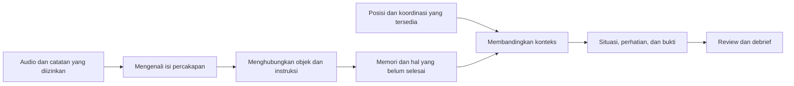

# ATC FlowLens — Usulan Solusi Menyeluruh

**Memori operasional dan pendamping pemahaman situasi untuk controller Tower/Ground**

- **Tanggal:** 7 Oktober 2026.
- **Tujuan dokumen:** menjelaskan solusi yang diusulkan secara utuh, dengan bahasa yang dapat dipahami anggota tim produk, desain, engineering, dan calon mitra.
- **Status:** usulan untuk pembahasan. Seluruh fitur dan pengalaman di bawah menjelaskan rancangan yang ingin dibangun; keberadaan penjelasan ini tidak berarti fiturnya sudah tersedia atau tervalidasi.
- **Dasar:** [review produk](ATC_FlowLens_Ground_Up_Product_Review.md) dan [review engineering](../Technical-Implementation/ATC_FlowLens_Ground_Up_Engineering_Review.md). Dokumen ini menyatukan penjelasan solusi, sementara argumentasi riset dan rincian engineering tersedia pada kedua dokumen tersebut.
- **Batas penerapan:** MVP yang masih berlaku adalah analisis replay offline dari simulator berizin, dengan baseline sintetik selama mitra belum tersedia. Pengalaman ambient dalam simulasi merupakan usulan tahap berikutnya. Penggunaan pada operasi ATC aktif memerlukan penilaian dan persetujuan tersendiri; keputusan serta clearance tetap pada controller.

## Ringkasan solusi

ATC FlowLens diusulkan sebagai pendamping yang **membantu controller mempertahankan konteks operasi**. Ia menyatukan informasi dari percakapan, instruksi yang tercatat, koordinasi, dan pergerakan yang dapat diamati. Informasi itu disusun menjadi memori per pesawat, kendaraan, dan runway, sehingga pengguna dapat memahami apa yang sudah terjadi dan apa yang masih perlu diperhatikan.

Contoh pertanyaan yang ingin dijawab FlowLens adalah: “Apa instruksi terakhir untuk kendaraan ini?”, “Apakah nomor runway dalam readback sama?”, “Laporan apa yang masih ditunggu?”, dan “Apakah data posisi cukup untuk membandingkan gerakan dengan instruksi?”. Setiap jawaban dapat ditelusuri kembali ke potongan audio atau kejadian yang menjadi dasarnya.

Pengalaman yang dituju bersifat **ambient**: informasi diperbarui di latar belakang, mudah dilihat sekilas, dan menarik perhatian secara selektif ketika ada perbedaan yang relevan. Pengguna tidak harus mengetik ulang setiap percakapan. Ketika hasilnya meragukan, FlowLens menunjukkan bagian yang belum dapat dipastikan dan menyediakan cara untuk memeriksanya.

Dukungan keputusan dibangun secara bertahap. Pertama, sistem membantu pengguna memahami konteks dan batasan. Berikutnya, evaluator dapat membandingkan alternatif dalam simulasi offline. Setelah kualitas data, aturan, dan modelnya dapat dinilai, AI dapat mengusulkan kandidat opsi untuk direview. Ketiga lapisan tersebut mempunyai persyaratan pengujian yang berbeda.

Manfaat yang ingin diuji adalah lebih mudah menemukan informasi penting, mempertahankan hal yang belum selesai, memahami ketidaksesuaian, dan meninjau keputusan setelah sesi. Manfaat tersebut belum merupakan hasil studi FlowLens.

## 1. Kebutuhan yang ingin dilayani

Dalam konteks Tower/Ground yang dituju, sebuah keputusan dapat berkaitan dengan beberapa informasi sekaligus: posisi pesawat, instruksi terakhir, jawaban pilot, permintaan kendaraan, laporan yang belum masuk, serta koordinasi antarposisi. Informasi yang saling berkaitan itu dapat muncul pada waktu dan sumber yang berbeda.

Kebutuhan yang hendak dilayani FlowLens adalah **menjaga hubungan antarinformasi tersebut tetap mudah dipahami**. Sebagai contoh, posisi kendaraan di dekat runway menjadi lebih bermakna jika pengguna juga mengetahui instruksi yang terkait, jawaban pengemudi, dan apakah ada laporan yang masih ditunggu.

Produk perlu sesuai dengan alat dan prosedur setempat. Sistem ATC dan surface monitoring sudah ada; FlowLens dirancang sebagai lapisan pendamping yang dapat memanfaatkan informasi yang tersedia. Kebutuhan detail serta manfaat tambahannya harus diperiksa bersama controller dan instruktur pada fasilitas yang menjadi sasaran.

| Kebutuhan pengguna | Bantuan yang diusulkan |
|---|---|
| Mengingat kembali percakapan penting | Riwayat ringkas per objek dengan akses ke audio |
| Mengetahui instruksi dan pembatasan terakhir | Memori instruksi yang mempertahankan sumber serta perubahan |
| Menemukan bagian readback yang berbeda | Perbandingan bagian penting secara berdampingan |
| Menjaga hal yang belum selesai | Daftar laporan, permintaan, dan koordinasi yang masih terbuka |
| Menghubungkan komunikasi dengan gerakan | Perbandingan jika identitas, posisi, dan waktu cukup jelas |
| Memahami dasar sebuah temuan | Panel bukti yang memperlihatkan sumber dan batas kesimpulan |
| Meninjau sesi atau serah-terima konteks latihan | Ringkasan dan replay yang dapat diperiksa evaluator |

## 2. Siapa yang menggunakan FlowLens

Pengguna yang dituju adalah controller Tower/Ground. Pada tahap awal, instruktur dan evaluator menjadi pengguna yang membantu membuktikan apakah informasi serta interaksi FlowLens sesuai dengan pekerjaan tersebut.

| Pengguna | Cara menggunakan rancangan solusi | Kebutuhan utama |
|---|---|---|
| Controller Tower | Melihat konteks runway, instruksi terkait, dan hal yang belum selesai dalam lingkungan penelitian yang disetujui | Informasi ringkas yang mengikuti perhatian terhadap runway |
| Controller Ground | Meninjau konteks pergerakan permukaan dan koordinasi yang relevan | Hubungan request, jawaban, pembatasan, dan koordinasi |
| Instruktur | Menyiapkan sesi latihan, memeriksa temuan, dan membahas kejadian | Replay dan penjelasan yang mudah ditelusuri |
| Evaluator | Mengoreksi hasil bahasa, menilai temuan/opsi, dan mengukur kualitas produk | Bukti lengkap serta akses evaluasi yang terkontrol |

Peran Tower dan Ground tetap mengikuti pembagian kewenangan yang berlaku pada fasilitas atau skenario latihan. FlowLens tidak menentukan kewenangan berdasarkan nama layar. Informasi yang belum memiliki sumber penanggung jawab yang jelas ditampilkan sebagai “belum diketahui”.

## 3. Gagasan inti: satu memori yang menghubungkan konteks

FlowLens menyusun informasi dengan tiga sudut pandang yang saling melengkapi.

**Per objek:** pengguna memilih pesawat atau kendaraan untuk melihat instruksi, readback, laporan, dan gerakan yang berkaitan dengannya.

**Per runway:** pengguna melihat objek, instruksi penggunaan, gerakan teramati, dan hal terbuka yang berkaitan dengan runway tersebut. Dua nomor arah pada runway fisik yang sama tetap dihubungkan ke satu runway.

**Per hal yang belum selesai:** pengguna melihat permintaan yang belum mendapat jawaban yang dapat dikenali, laporan yang masih ditunggu, atau koordinasi yang belum memiliki bukti penyelesaian.

Ketiga sudut pandang memakai catatan yang sama. Jika suatu readback diperbaiki, perubahan dapat dilihat dari objek maupun runway yang terkait. Jika temuan dibuka, pengguna dapat langsung melihat kejadian yang mendasarinya.

### 3.1 Instruksi, readback, dan gerakan mempunyai arti berbeda

| Jenis informasi | Arti yang dapat ditampilkan | Contoh sederhana |
|---|---|---|
| Instruksi | Apa yang tercatat diucapkan atau dicatat oleh sumber berwenang | Instruksi terkait runway 27 |
| Readback | Bagian yang dibacakan kembali oleh pilot/pengemudi | Nomor runway yang dikenali dalam jawaban |
| Gerakan teramati | Posisi atau pergerakan yang diterima dari sumber | Kendaraan terlihat melewati batas tertentu |
| Hal terbuka | Sesuatu yang masih menunggu jawaban, laporan, atau bukti lain | Laporan keluar dari runway belum teramati |
| Koordinasi | Permintaan, kesepakatan, atau penyelesaian antarposisi yang mempunyai sumber | Permintaan crossing menunggu hasil koordinasi |

Readback yang cocok menunjukkan kecocokan bagian yang dibandingkan. Ia belum membuktikan bahwa instruksi dipahami sepenuhnya atau sudah dilaksanakan. Demikian pula, posisi objek tidak selalu cukup untuk menyimpulkan seluruh proses telah selesai.

### 3.2 Satu objek dapat memiliki beberapa hal aktif

Pesawat atau kendaraan mungkin mempunyai instruksi, pembatasan, dan kewajiban laporan secara bersamaan. Karena itu, FlowLens tidak cukup menyimpan satu teks “instruksi terakhir” lalu menghapus semua konteks sebelumnya.

Rancangannya menyimpan hubungan perubahan: apa yang diganti, apa yang dibatalkan, apa yang masih berlaku, dan apa yang belum dapat dipastikan. Instruksi baru hanya menggantikan bagian yang memang terkait menurut aturan yang telah ditentukan untuk skenario atau fasilitas tersebut.

## 4. Cara kerja FlowLens dalam bahasa sederhana

Alur dasarnya adalah **menerima informasi → memahami bagian penting → menghubungkan konteks → memeriksa perbedaan → menyajikan bukti**.



Diagram ini menggambarkan rancangan solusi, bukan komponen yang seluruhnya sudah berjalan.

### 4.1 Menerima informasi

FlowLens menerima audio atau catatan percakapan, kejadian instruksi/koordinasi, dan posisi objek sesuai sumber yang diizinkan. Setiap informasi disertai keterangan asal, waktu, dan cakupannya.

Jika hanya audio yang tersedia, kemampuan produk berpusat pada komunikasi. Jika data posisi dan geometri yang memadai juga tersedia, sistem dapat menambahkan konteks gerakan. Kemampuannya mengikuti sumber yang benar-benar ada.

### 4.2 Mengenali bagian penting

Pengenalan suara mengubah audio menjadi calon transkrip. Pemrosesan bahasa kemudian mencari bagian yang relevan, misalnya callsign, nomor runway, jenis instruksi, permintaan, pembatalan, atau laporan.

Sistem juga perlu membedakan permintaan, instruksi, dan kata seperti “standby”. Jika belum mampu mengenalinya, hasil tersebut tetap ditandai belum jelas. Tulisan yang rapi dari AI tidak dianggap otomatis benar.

### 4.3 Menghubungkan percakapan

FlowLens mencoba menghubungkan readback dengan instruksi yang tepat. Ia mempertimbangkan identitas, isi, waktu, dan informasi sumber yang tersedia. Jawaban tidak selalu berasal dari pesawat yang berbicara sebelumnya.

Jika dua callsign mirip atau pembicara belum dapat dibedakan, sistem mempertahankan keraguan tersebut. Kanal radio bersama tidak otomatis memberi tahu pesawat mana yang berbicara.

### 4.4 Memperbarui memori

Informasi yang cukup jelas ditambahkan ke memori objek dan runway. Sistem menandai hal yang menunggu jawaban atau laporan serta menyimpan hubungan koreksi, penggantian, dan pembatalan.

Penyelesaian memerlukan bukti yang sesuai. Menutup kartu di layar berarti pengguna telah meninjau tampilan; tindakan itu tidak otomatis membuktikan kendaraan sudah keluar dari runway atau koordinasi sudah selesai.

### 4.5 Membandingkan dan menampilkan

Aturan yang dapat diperiksa membandingkan bagian readback atau menghubungkan instruksi dengan observasi gerakan. Temuan ditampilkan bersama alasannya. Jika data kurang, FlowLens menyebutkan apa yang belum dapat dievaluasi.

## 5. Fitur inti yang diusulkan

### 5.1 Memori komunikasi per pesawat dan kendaraan

Pengguna dapat memilih callsign untuk melihat konteks ringkas: instruksi yang terkait, pembatasan, readback, laporan, serta perubahan terakhir. Riwayat lengkap tersedia ketika diperlukan.

Setiap catatan mempunyai waktu dan akses ke sumber. Label membedakan hasil pengenalan suara, catatan dari sumber berwenang, dan hasil yang sudah dikoreksi evaluator.

**Contoh manfaat yang ingin diuji:** pengguna menemukan kembali instruksi tanpa menelusuri seluruh transkrip sesi. Jika identitas belum jelas, catatan tidak dipaksakan masuk ke pesawat tertentu.

### 5.2 Perbandingan instruksi dan readback

FlowLens menampilkan bagian penting dari instruksi dan readback berdampingan. Bagian yang dibandingkan dapat meliputi callsign, runway, tindakan, pembatasan, atau kondisi yang masuk cakupan pengujian.

Contoh tampilan konseptual, seluruhnya sintetik:

```text
FLN214 · pasangan percakapan kandidat

Instruksi : runway 27
Readback  : runway 09
Temuan    : nomor runway berbeda pada pasangan yang dikenali

[Lihat bukti]
```

FLN214 adalah callsign fiktif untuk ilustrasi. Teks ini tidak mewakili hasil pengenalan suara atau kejadian operasi.

Jika kata pada audio kurang jelas, FlowLens menampilkan “bagian runway belum dapat dikenali”. Sistem tidak menyamakan kata yang tidak terbaca oleh AI dengan kata yang benar-benar tidak diucapkan.

### 5.3 Daftar hal yang masih terbuka

Fitur ini menyimpan permintaan, laporan, dan koordinasi yang belum mempunyai bukti penyelesaian. Setiap item menjelaskan apa yang ditunggu, objek terkait, waktu mulai, dan penanggung jawab jika diketahui.

| Contoh item | Informasi yang ditampilkan |
|---|---|
| Permintaan crossing | Permintaan tercatat; jawaban terkait belum dikenali |
| Laporan keluar dari runway | Laporan yang diminta belum teramati pada sumber yang tersedia |
| Koordinasi antarposisi | Permintaan tercatat; hasil koordinasi belum tersedia |
| Permintaan dengan jawaban standby | Ditunda dengan sengaja; konteks tetap tersimpan |

Umur item membantu pengguna memahami konteks, tetapi tidak otomatis membuat item berbahaya. Cara menarik perhatian harus mempertimbangkan jenis item, alasan menunggu, aturan skenario/fasilitas, dan cakupan data.

### 5.4 Hubungan instruksi dengan gerakan

Jika sumber posisi, identitas, waktu, dan geometri memadai, FlowLens dapat membandingkan gerakan dengan instruksi yang terkait.

Contoh yang ingin diuji adalah kendaraan yang mempunyai instruksi hold short, sementara pengamatan menunjukkan tubuh kendaraan melintasi batas hold position pada layout latihan. Temuan menghubungkan kedua bukti tersebut, sehingga pengguna bisa memahami dasar perbandingannya.

Sistem perlu mempertimbangkan ukuran objek, usia posisi, dan ketidakpastian lokasi. Titik tengah kendaraan saja belum cukup untuk memastikan seluruh kendaraan berada di luar area. Jika posisi terlalu lama atau identitasnya tidak pasti, evaluasi gerakan ditandai belum dapat dilakukan.

### 5.5 Konteks koordinasi Tower/Ground

FlowLens menghubungkan permintaan dan hasil koordinasi yang benar-benar tersedia. Tujuannya membantu pengguna mempertahankan konteks lintas posisi tanpa membuat catatan terpisah yang saling bertentangan.

Fitur ini dapat menunjukkan bahwa permintaan telah dibuat, ada jawaban yang tercatat, atau penyelesaiannya belum diketahui. Arti setiap tahap mengikuti prosedur fasilitas atau aturan latihan yang diberi label.

Audio radio belum tentu mencakup intercom atau komunikasi internal. Jika sumber koordinasi tidak tersedia, sistem menyatakannya secara terbuka. Perpindahan frekuensi juga tidak otomatis dianggap bukti bahwa transfer kewenangan selesai.

### 5.6 Papan konteks runway

Papan ini menyatukan informasi yang berkaitan dengan satu runway: objek teramati, instruksi penggunaan yang terkait, hal terbuka, dan prediksi bersyarat jika datanya cukup.

Tampilan membedakan tiga lapisan:

| Lapisan | Pertanyaan |
|---|---|
| Instruksi dan maksud penggunaan | Penggunaan apa yang disebut atau tercatat? |
| Keadaan teramati | Apa yang terlihat dari sumber posisi saat ini? |
| Perkiraan bersyarat | Apa yang mungkin terjadi jika asumsi pergerakan berlanjut? |

Instruksi penggunaan tidak otomatis menjadi jadwal reservasi runway. Perkiraan waktu hanya ditampilkan jika model dan input mendukungnya, beserta asumsi serta keterbatasan. Penggunaan runway dinilai menurut aturan yang sesuai, bukan sekadar menghitung dua instruksi aktif sebagai konflik.

### 5.7 Bukti yang dapat diperiksa

Setiap temuan dapat dibuka untuk melihat potongan transkrip/audio, instruksi atau kejadian terkait, pengamatan posisi, waktu, dan bagian yang belum diketahui.

Pengguna dapat mengetahui alasan sistem menghubungkan informasi tersebut. Bila sumber hilang atau akses tidak tersedia, panel menyebutkannya; sistem tidak mengisi kekosongan dengan cerita buatan.

Pemutaran audio dilakukan atas tindakan pengguna. Audio tidak otomatis dimainkan ketika temuan muncul, sehingga tidak menambah gangguan terhadap komunikasi yang sedang didengarkan dalam pengujian.

### 5.8 Ringkasan sesi dan debrief

Setelah sesi, FlowLens menyusun ringkasan perubahan penting, hal yang masih terbuka, temuan yang telah diperiksa, dan keterbatasan sumber. Setiap item dapat membuka bukti terkait.

Ringkasan membedakan hasil awal AI dari koreksi evaluator. Pengguna dapat melihat apa yang tersedia saat kejadian serta pemahaman tambahan setelah review.

Pada tahap penelitian, ringkasan ini membantu latihan dan pembahasan konteks. Penggunaannya sebagai serah-terima resmi atau catatan resmi operasi memerlukan persyaratan tersendiri.

## 6. Bentuk pengalaman pengguna

### 6.1 Workspace dengan tiga area utama

FlowLens diusulkan memiliki satu ruang kerja dengan area **situasi**, **memori**, dan **perhatian**. Susunannya perlu diuji bersama pengguna; gambar berikut hanya menunjukkan hubungan informasi.

```text
┌───────────────────────────────────────────────────────────┐
│ Sumber · waktu data · cakupan · status pemrosesan           │
├─────────────────────────────┬─────────────────────────────┤
│ SITUASI                     │ MEMORI                      │
│ Runway dan objek teramati   │ Objek yang dipilih           │
│ Konteks penggunaan          │ Instruksi, readback, laporan │
│ Cakupan yang belum tersedia │ Hal yang masih terbuka       │
├─────────────────────────────┴─────────────────────────────┤
│ PERHATIAN                                                  │
│ Perbedaan yang relevan · item yang perlu ditinjau            │
└───────────────────────────────────────────────────────────┘

Pilih satu item → panel bukti terbuka pada workspace yang sama.
```

**Area situasi** memberi konteks posisi dan penggunaan runway. Peta muncul jika posisi tersedia. Jika tidak, pengguna tetap mendapat papan konteks runway tanpa objek yang posisinya direka.

**Area memori** menjawab pertanyaan tentang objek yang dipilih. Pengguna melihat ringkasan dahulu, lalu membuka riwayat lebih dalam jika perlu.

**Area perhatian** menampilkan perubahan yang relevan dengan alasan singkat. Satu kejadian mempunyai satu rangkaian temuan yang diperbarui, sehingga tidak muncul kartu baru pada setiap sampel posisi.

### 6.2 Tingkatan perhatian

| Tingkat | Perilaku tampilan | Contoh |
|---|---|---|
| Informasi latar | Mudah dibaca tanpa memaksa interaksi | Instruksi terbaru dan waktu data |
| Perlu ditinjau | Penanda ringan dengan alasan | Callsign belum jelas atau laporan masih ditunggu |
| Perbedaan teramati | Penekanan yang terarah serta akses ke bukti | Nomor runway berbeda pada pasangan kandidat |

Kategori ini adalah rancangan perhatian produk. Prioritas tampilan kandidat AI tidak disamakan dengan severity keselamatan dari sistem berwenang.

Urutan item dijaga stabil agar mudah ditemukan. Warna disertai teks/bentuk. Hasil yang belum diketahui tetap terlihat sebagai status, bukan dipaksa menjadi kondisi baik atau buruk.

### 6.3 Sedikit input rutin, kontrol tetap tersedia

Pengguna tidak diwajibkan menyetujui setiap hasil transkrip. Interaksi utama adalah memilih objek, membuka bukti, dan meninjau hal yang relevan. Koreksi lengkap tersedia pada mode evaluator/review.

Pada mode tersebut, evaluator dapat mengoreksi transkrip, mengonfirmasi atau menolak temuan, serta menandai bahwa bukti belum cukup. Perubahan disimpan sebagai revisi baru agar hasil awal tetap dapat diperiksa.

## 7. Bagaimana FlowLens membantu keputusan

### 7.1 Lapisan pertama: memperjelas pertimbangan

FlowLens membantu pengguna melihat batasan, hal terbuka, dan informasi yang belum tersedia untuk objek atau runway yang dipilih.

Misalnya, evaluator ingin menilai konteks permintaan crossing kendaraan ketika ada pesawat arrival. FlowLens dapat menunjukkan instruksi terkait, readback kandidat, laporan yang masih ditunggu, serta kondisi posisi kendaraan. Jika posisi kendaraan terlambat, sistem menyatakan bahwa konteks gerakan belum cukup untuk dievaluasi.

Nilainya adalah membuat dasar pertimbangan lebih mudah ditemukan dan diperiksa. Ukuran keberhasilan bukan banyaknya teks yang dihasilkan, tetapi ketepatan konteks dan kemudahan pengguna memahaminya.

### 7.2 Lapisan kedua: membandingkan alternatif secara offline

Dalam pengembangan berikutnya, evaluator dapat memasukkan alternatif pada salinan simulasi. FlowLens membandingkan apa yang berubah, asumsi yang dipakai, dan batasan yang masih belum dapat dinilai.

Perbandingan menggunakan model gerakan yang sesuai dengan cakupan latihan. Hasilnya tidak dianggap prediksi pasti terhadap dunia nyata. Jika suatu faktor penting belum dimodelkan, hal tersebut tetap dicantumkan.

Tampilan perbandingan mencakup alternatif, sumber keadaan awal, asumsi respons, perkiraan perubahan, dan bagian yang belum dievaluasi. Sesi asal tetap dapat diputar ulang tanpa perubahan.

### 7.3 Lapisan ketiga: kandidat opsi dari AI untuk evaluator

AI dapat dikembangkan untuk mengusulkan opsi hipotetis pada replay offline. Setiap opsi mempunyai alasan, bukti pendukung, syarat yang harus terpenuhi, informasi yang belum diketahui, dan status review.

Opsi berada dalam proses review evaluator dan dipisahkan dari jalur perintah. Hasilnya tidak otomatis dikirim ke pilot, kendaraan, atau pengendali simulator.

Kualitasnya dinilai terhadap opsi yang diberikan manusia dan terhadap bantuan konteks saja. Opsi generatif perlu menunjukkan manfaat tambahan, bukan sekadar kemampuan menghasilkan saran yang terdengar masuk akal.

Penempatan opsi pada fase berikutnya adalah usulan prioritas solusi ini. Requirement kandidat opsi pada MVP kanonis masih berlaku sampai ada keputusan perubahan scope.

## 8. Contoh perjalanan penggunaan

Semua cerita di bagian ini adalah skenario sintetik untuk menjelaskan rancangan. Callsign, kejadian, dan tampilan bukan data operasi atau hasil uji FlowLens. Isi instruksi latihan lengkap perlu direview oleh pakar domain.

### 8.1 Percakapan normal

Instruktur membuka replay yang berisi komunikasi pesawat FLN214. FlowLens mengenali bagian instruksi dan readback yang berkaitan, lalu menampilkan kecocokan bagian yang masuk cakupan pengujian pada memori pesawat.

Tidak ada kartu perbedaan baru. Pengguna tetap dapat membuka audio dan melihat riwayat. Bila ada sumber gerakan, konteks posisi ditampilkan sebagai lapisan terpisah.

Cerita ini menguji apakah produk memberi nilai pada sesi normal melalui kemudahan recall, tanpa terus-menerus mengganggu perhatian.

### 8.2 Readback berbeda lalu dikoreksi

FlowLens mengenali nomor runway 27 pada instruksi dan nomor 09 pada readback kandidat FLN214. Ia menampilkan bagian berbeda berdampingan dan memberi akses ke potongan audio.

Pada percakapan berikutnya terdapat koreksi. Sistem perlu menghubungkannya ke instruksi serta readback yang tepat. Jika koreksi cukup jelas, temuan diperbarui sebagai telah memiliki bukti perbaikan. Riwayat perbedaan awal tetap tersedia dalam debrief.

Jika pasangan percakapan atau koreksinya belum dapat dipastikan, statusnya tetap membutuhkan review. Sistem tidak menutup temuan hanya karena mendengar nomor runway yang cocok pada percakapan lain.

### 8.3 Readback cocok, gerakan berbeda

Kendaraan ARFF-2 memiliki instruksi hold short pada skenario latihan dan readback yang cocok. Pada sumber posisi, tubuh kendaraan kemudian terlihat melintasi batas yang telah didefinisikan pada layout lab.

FlowLens menghubungkan instruksi, readback, dan pengamatan itu pada satu temuan. Pengguna melihat bahwa kecocokan readback dan kesesuaian gerakan adalah dua hal berbeda.

Bila ketidakpastian lokasi terlalu besar, sistem menampilkan bahwa crossing belum dapat dipastikan. Aturan deterministik tidak menghilangkan ketidakpastian input.

### 8.4 Permintaan ditunda dengan sengaja

Kendaraan mengajukan permintaan, lalu ada jawaban standby. FlowLens menyimpan item tersebut sebagai tertunda dengan alasan yang dikenali.

Item tetap mudah ditemukan, tetapi umur yang bertambah tidak otomatis menghasilkan temuan bahaya. Ketika ada jawaban atau perubahan berikutnya, sistem menghubungkannya dengan item yang tepat.

Cerita ini menguji apakah memori membantu pengguna mempertahankan hal yang perlu dilakukan nanti, tanpa menjadikan semua penundaan sebagai masalah.

### 8.5 Identitas atau posisi tidak jelas

Audio mengandung callsign yang mirip atau posisi ARFF-2 tidak diperbarui. FlowLens mempertahankan informasi terakhir beserta waktunya, lalu menyatakan bagian evaluasi yang belum tersedia.

Pengguna dapat meninjau audio atau sumber terkait. Sistem tidak memasukkan catatan ke objek yang salah atau menyatakan runway kosong karena track kendaraan hilang.

Cerita ini penting untuk menunjukkan bahwa perilaku saat data kurang merupakan bagian inti solusi.

## 9. Data yang dibutuhkan

### 9.1 Kebutuhan minimum per kemampuan

FlowLens berkembang sesuai sumber yang tersedia. Informasi yang lebih lengkap memungkinkan bantuan yang lebih luas, tetapi setiap kemampuan harus mempunyai prasyarat yang jelas.

| Kemampuan | Data minimum yang dibutuhkan | Jika data belum tersedia |
|---|---|---|
| Memori komunikasi | Audio/transkrip, waktu, dan informasi sumber | Catatan komunikasi belum dapat dibentuk |
| Perbandingan readback | Instruksi dan jawaban yang cukup jelas serta dapat dihubungkan | Pasangan atau bagian yang meragukan ditandai |
| Hal terbuka | Permintaan/instruksi pemicu, aturan laporan/jawaban, serta cakupan sumber | Status menunggu dibatasi pada informasi yang diketahui |
| Konteks runway | Hubungan objek/instruksi dengan runway | Identitas runway belum dapat dipastikan |
| Perbandingan gerakan | Posisi, identitas objek, ukuran, geometri, serta waktu yang selaras | Evaluasi gerakan tidak tersedia |
| Koordinasi antarposisi | Catatan komunikasi/kejadian koordinasi dan aturan peran | Hasil koordinasi dinyatakan belum diketahui |
| Perbandingan alternatif | Keadaan awal serta model dan batasan simulasi yang memadai | Alternatif belum dapat dibandingkan secara bermakna |

### 9.2 Profil sumber sebelum sesi dimulai

Operator atau instruktur menyiapkan profil sumber: dari mana data berasal, siapa pemiliknya, penggunaan apa yang diizinkan, kanal yang tersedia, periode yang tercakup, dan bagaimana waktunya dihubungkan.

Untuk data posisi, profil juga menjelaskan objek/area yang tercakup, satuan, geometri, dan batas kualitas. Informasi ini membantu sistem membedakan “tidak ada kejadian pada sumber yang tersedia” dari “sumber tidak mencakup kejadian tersebut”.

Metadata lengkap berada pada pengaturan/review. Workspace pengguna menampilkan bagian yang langsung memengaruhi pemahaman, misalnya “posisi kendaraan tidak tersedia” atau “audio Ground tidak tercakup”.

### 9.3 Strategi memperoleh data

Urutan yang diusulkan adalah membangun paket sintetik, menambahkan role-play manusia yang diizinkan, memeriksa corpus eksternal yang cocok, lalu mengevaluasi replay simulator mitra ketika akses disepakati.

Paket sintetik memberi kendali terhadap kasus normal, perbedaan, koreksi, dan kegagalan sumber. Role-play membantu menguji variasi pengucapan serta percakapan yang tidak sepenuhnya mengikuti template. Corpus eksternal dapat memberi pengujian terhadap suara atau kondisi yang tidak dibuat tim. Simulator mitra diperlukan untuk menilai kesesuaian dengan workflow yang lebih dekat ke lingkungan sasaran.

ATCO2 dan TartanAviation merupakan kandidat data riset yang dibahas dalam review sebelumnya. Kesesuaian, hak penggunaan, label, serta cakupannya harus diperiksa sebelum dipakai. Data publik dari luar Indonesia tidak otomatis membuktikan kualitas produk pada radio atau prosedur Indonesia. Rincian sumber tersedia pada [strategi data dalam review produk](ATC_FlowLens_Ground_Up_Product_Review.md#8-data-availability-dan-strategi-pembuktian).

## 10. Peran AI dalam solusi

AI memberi kemampuan untuk mengolah bahasa yang tidak sepenuhnya terstruktur. Namun, bagian sistem yang menyimpan status, menghubungkan bukti, dan menerapkan aturan tetap perlu didefinisikan secara jelas.

| Bagian pekerjaan | Peran AI yang diusulkan | Bagian yang harus tetap dapat diperiksa |
|---|---|---|
| Pengenalan suara | Menghasilkan calon transkrip | Audio asal, waktu, versi model, dan bagian yang kurang jelas |
| Pemahaman bahasa | Mengambil callsign, tindakan, runway, kondisi, dan jenis percakapan | Potongan teks/audio yang mendukung hasil |
| Pencarian konteks | Membantu menjawab pertanyaan atas memori sesi | Sumber tiap jawaban dan batas cakupannya |
| Ringkasan | Membantu menyusun konteks sesi yang mudah dibaca | Bukti per item serta perbedaan fakta/dugaan/unknown |
| Kandidat opsi offline | Mengusulkan alternatif untuk evaluator pada tahap yang sesuai | Preconditions, alasan, bukti, dan penilaian manusia |

### 10.1 Bahasa menjadi kandidat, bukan catatan otoritatif otomatis

Transkrip AI dapat salah pada nomor, negasi, atau callsign. Karena itu, hasil AI disebut kandidat sampai tingkat bukti yang diperlukan terpenuhi. Jika ada catatan instruksi dari sumber berwenang, sumber tersebut ditampilkan dengan asal yang jelas dan dibedakan dari interpretasi audio.

Sistem tidak memperbaiki catatan sumber secara diam-diam agar cocok dengan hasil model. Perbedaan antarsumber justru dapat menjadi konteks penting untuk review.

### 10.2 Aturan yang eksplisit untuk temuan

Perbandingan bagian readback, penutupan laporan, atau evaluasi batas posisi menggunakan aturan yang dapat dijelaskan. Aturan tersebut mempunyai versi dan cakupan: aturan lab sintetik atau aturan fasilitas yang telah direview.

Untuk bahasa yang masuk pola terbatas, sistem dapat memakai aturan untuk membaca pola kalimat. Model bahasa dapat menjadi pelengkap ketika pola tidak cukup. Keduanya tetap perlu diuji terhadap makna sebenarnya, termasuk kapan sebaiknya menyatakan tidak tahu.

### 10.3 Model dipilih melalui pengujian

Solusi tidak bergantung pada nama satu model tertentu. Pemilihan mempertimbangkan ketepatan bagian penting, kemampuan mengenali keraguan, kecepatan pada perangkat sasaran, kebutuhan penyimpanan, serta ketersediaan saat sesi.

Provider lokal dapat mendukung replay tanpa internet. Provider cloud dapat dipertimbangkan sesuai jenis data dan izin pemrosesan yang berlaku. Pergantian provider dicatat dan tidak dilakukan secara tersembunyi saat terjadi kegagalan.

## 11. Perilaku saat data atau pemrosesan bermasalah

FlowLens perlu tetap mudah dipahami ketika informasinya terbatas. Pengguna harus dapat melihat mana konteks terakhir, mana hasil baru, dan mana bagian yang belum bisa dievaluasi.

| Kondisi | Respons solusi yang diusulkan |
|---|---|
| Audio terpotong atau tumpang tindih | Bagian yang tidak jelas ditandai; kesimpulan yang bergantung padanya ditahan |
| Callsign belum dapat dibedakan | Kandidat identitas tetap ditampilkan; catatan tidak dipaksakan ke satu objek |
| Posisi sudah terlalu lama | Posisi terakhir disertai waktu; evaluasi gerakan terbaru tidak dibuat |
| Audio/posisi mempunyai waktu yang belum selaras | Bukti tetap dapat dibaca, tetapi urutan lintas sumber belum disimpulkan |
| Pemrosesan AI tertinggal | Waktu hasil dan status ketertinggalan terlihat |
| AI tidak tersedia | Replay dan bukti sumber yang tersimpan tetap dapat dibaca; fungsi AI ditandai tidak tersedia |
| Sumber koordinasi tidak tercakup | Sistem tidak menganggap tidak ada koordinasi |
| Koneksi tampilan terputus | Tampilan terakhir diberi status dan waktu; keadaan diselaraskan setelah tersambung |
| Bukti tidak dapat dibuka | Temuan menunjukkan keterbatasan akses/sumber, bukan membuat bukti pengganti |

Ketidakpastian pada hasil bahasa tidak menyembunyikan informasi independen yang valid. Misalnya, slot runway pada transkrip yang kurang jelas tidak menghapus alert dari sumber berwenang yang memang tersedia.

### 11.1 Waktu kejadian dan waktu diketahui

Dalam contoh sintetik, sebuah readback selesai pada 00:45 tetapi analisis baru tersedia pada 00:47. FlowLens menyimpan kedua waktu itu. Saat mereview keadaan pada 00:46, pengguna belum seharusnya melihat hasil analisis yang baru tersedia setelahnya.

Mode debrief dapat menampilkan analisis tambahan atau koreksi yang dilakukan belakangan. Mode tersebut diberi label agar pengguna memahami perbedaannya dengan informasi yang tersedia saat sesi berlangsung.

Prinsip ini mencegah replay terlihat lebih mengetahui keadaan daripada sistem pada saat kejadian.

## 12. Bentuk sistem di balik pengalaman pengguna

Arsitektur dibagi menurut tanggung jawab agar kualitas serta kegagalannya dapat diuji dengan jelas. Pengguna tidak perlu memahami pembagian ini untuk memakai aplikasi, tetapi tim engineering membutuhkannya untuk membangun solusi yang konsisten.

| Bagian sistem | Tanggung jawab |
|---|---|
| Penerima sumber | Mengambil data yang diizinkan beserta asal, waktu, dan cakupannya |
| Penyimpanan bukti | Menjaga audio serta catatan asli agar dapat diperiksa kembali |
| Pemrosesan bahasa | Membentuk transkrip dan kandidat makna |
| Penghubung percakapan | Menghubungkan kandidat ke objek, instruksi, dan jawaban yang tepat |
| Memori sesi | Menyimpan instruksi, pembatasan, perubahan, dan hal terbuka |
| Pemeriksa konteks | Membandingkan bahasa, waktu, posisi, dan aturan yang berlaku |
| Penyaji pengalaman | Menampilkan situasi, memori, perhatian, dan bukti |
| Review dan evaluasi | Menyimpan koreksi serta menilai kualitas hasil |

Pemrosesan AI berjalan terpisah dari penggerak waktu sesi, sehingga proses yang lambat tidak menghentikan replay. Penyimpanan mempunyai satu pengelola penulisan yang terkontrol; koreksi disimpan sebagai versi baru.

Untuk prototype penelitian, pilihan teknologi lokal yang diusulkan mencakup server Python, penyimpanan SQLite, pengolahan geometri Shapely, dan antarmuka React/TypeScript. Pilihan tersebut dapat dikembangkan dari fondasi proyek. Rincian kontrak, waktu, dan pemisahan komponen tersedia pada [review engineering](../Technical-Implementation/ATC_FlowLens_Ground_Up_Engineering_Review.md).

## 13. Lingkungan simulasi dan demonstrasi

Simulator merupakan alat untuk membuktikan perilaku FlowLens. Ia menyediakan dunia yang dapat dikendalikan: posisi objek, instruksi latihan, percakapan, gangguan sumber, dan kebenaran yang dipakai evaluator sebagai pembanding.

### 13.1 Dunia simulasi dan pengamatan harus dipisahkan

Evaluator mengetahui apa yang sebenarnya terjadi di dunia simulasi. FlowLens hanya menerima sumber pengamatan yang ditentukan untuk percobaan, misalnya audio yang sudah diberi gangguan dan posisi yang sudah diberi delay.

Jika kendaraan akan bergerak pada waktu tertentu menurut skenario terprogram, jadwal masa depan itu tidak boleh menjadi input FlowLens. Jika rute belum tersedia bagi pengguna, pemeriksa gerakan juga tidak mendapatkannya secara tersembunyi dari simulator.

Pemisahan tersebut membuat pengujian menilai kemampuan produk menghadapi informasi yang tersedia, bukan kemampuannya membaca jawaban dari simulator.

### 13.2 Watch dan Play

| Mode demonstrasi yang diusulkan | Pengalaman | Kegunaan |
|---|---|---|
| Watch | Pengguna mengikuti skenario dengan percakapan dan gerakan yang telah disiapkan | Demo yang repeatable dan perbandingan hasil |
| Play | Peserta memainkan peran dalam simulasi lab yang disetujui | Menguji interaksi terhadap variasi percakapan manusia |

Mode Watch dapat memakai audio yang dibekukan agar kejadian dapat diulang. Mode Play dapat memakai mikrofon peserta lab setelah perubahan scope disepakati. Jalur yang menggerakkan simulator tetap terpisah dari analisis FlowLens; hasil kandidat AI tidak otomatis menjadi perintah simulator.

Agent generatif dapat menambah variasi dialog pada tahap berikutnya. Namun, script harus mencatat gangguan yang direncanakan, dan evaluator tetap memeriksa ujaran serta gerakan yang benar-benar terjadi. Label dari rencana agent belum tentu sama dengan hasil aktualnya.

## 14. Ruang lingkup solusi pertama yang dibuktikan

Ruang lingkup pertama dipilih agar seluruh hubungan penting dapat diuji secara utuh. Pengguna tidak memberikan batas deadline atau jumlah developer; pembatasan berikut ditujukan untuk memperjelas apa yang dinilai.

| Area | Scope pembuktian yang diusulkan |
|---|---|
| Lingkungan | Replay sintetik atau replay simulator yang diizinkan |
| Layout | Satu runway fisik dengan geometri fiktif yang mempunyai versi |
| Objek | Sejumlah kecil pesawat dan satu kendaraan latihan |
| Bahasa | Phrase set English yang terbatas dan jelas cakupannya |
| Komunikasi | Instruksi, readback, permintaan, standby, koreksi, dan laporan terpilih |
| Nilai inti | Memori objek, perbedaan readback, hal terbuka, dan bukti |
| Gerakan | Perbandingan instruksi–posisi ketika syarat datanya terpenuhi |
| Evaluasi | Kasus normal, perbedaan, perbaikan, serta sumber yang tidak lengkap |

Pada pembuktian ini, setiap jenis percakapan mempunyai daftar kasus yang didukung dan kasus yang belum didukung. Conditional instruction yang belum masuk cakupan dikenali sebagai belum dapat dievaluasi, bukan disederhanakan menjadi instruksi tanpa kondisi.

Perluasan ke multi-runway, seluruh variasi fraseologi, code-switching Indonesia/English, atau optimasi urutan dilakukan setelah ada bukti bahwa fondasi memori dan hubungan informasi bekerja dengan baik.

**Hubungan dengan scope kanonis:** tabel ini merupakan usulan urutan pembuktian produk, bukan penggantian daftar requirement MVP. Replay offline serta kandidat opsi evaluator tetap menjadi target kanonis. Perubahan prioritas opsi dan penambahan ambient simulation perlu diputuskan secara eksplisit sebelum menjadi spesifikasi implementasi.

## 15. Nilai inovasi yang ingin dibuktikan

Inovasi yang diusulkan berada pada cara FlowLens menjaga konteks keputusan secara berkelanjutan. Pengenalan suara menghasilkan informasi yang dapat dipakai untuk menghubungkan instruksi, jawaban, gerakan, dan hal yang masih tertunda.

| Unsur solusi | Nilai yang ingin dibuktikan |
|---|---|
| Memori per objek dan runway | Pengguna lebih mudah menemukan konteks yang relevan |
| Hubungan antarpercakapan | Instruksi dan jawaban tidak perlu dirangkai ulang secara manual |
| Hal terbuka dengan alasan | Pengguna dapat mempertahankan tugas tertunda tanpa semua item menjadi alarm |
| Bukti pada setiap temuan | Pengguna memahami dan dapat menilai alasan keluaran sistem |
| Kemampuan sesuai sumber | Informasi yang kurang tetap terlihat dan tidak disamarkan sebagai kepastian |
| Mesin yang sama untuk replay dan simulasi | Perilaku yang dipelajari pada review dapat diuji dalam pengalaman ambient |

Ada penelitian dan sistem pendahulu untuk voice understanding, clearance monitoring, dan multimodal procedure monitoring. Karena itu, kombinasi ini diposisikan sebagai arah inovasi yang perlu diuji. Keunggulan terhadap produk tertentu, keunikan global, atau penurunan insiden belum dapat diklaim.

## 16. Cara menilai keberhasilan solusi

Keberhasilan dinilai pada tiga tingkat: informasi yang benar, pengalaman yang membantu, dan manfaat yang bertahan pada lingkungan yang lebih dekat ke sasaran.

### 16.1 Ketepatan informasi

Evaluasi memeriksa callsign, runway, tindakan, kondisi, dan negasi; ketepatan memasangkan instruksi–readback; serta ketepatan menutup laporan atau kewajiban. Posisi yang tidak pasti dan sumber yang hilang harus menghasilkan status yang sesuai.

Sistem yang sering berani menyimpulkan perlu dinilai bersama jumlah kesimpulan yang salah. Sistem yang selalu menyatakan unknown juga perlu dinilai berdasarkan bantuan yang benar-benar dapat diberikannya.

### 16.2 Pengalaman pengguna

| Pertanyaan evaluasi | Ukuran yang dapat diuji |
|---|---|
| Apakah konteks lebih mudah ditemukan? | Waktu mencari bukti dan ketepatan jawaban |
| Apakah hal tertunda lebih mudah diingat? | Item yang terlewat dan reminder yang tidak relevan |
| Apakah temuan mudah dipahami? | Ketepatan pengguna menjelaskan alasan serta keterbatasannya |
| Apakah perhatian tetap pada tugas utama? | Gangguan, usaha membaca, dan performa tugas latihan |
| Apakah pengguna mengenali kesalahan sistem? | Respons terhadap interpretasi bahasa yang salah, identitas ambigu, dan sumber tidak lengkap |

Pengujian memakai sesi normal serta sesi dengan perbedaan. Demo yang hanya berisi masalah tidak cukup untuk mengukur seberapa sering perhatian tambahan menjadi gangguan.

### 16.3 Kualitas teknis dan transfer ke lingkungan sasaran

Tim mengukur keterlambatan dari sumber hingga tampilan, antrean pemrosesan, ketahanan terhadap kegagalan, serta kemampuan membuka kembali bukti setelah sesi. Hasil dicatat bersama perangkat, model, versi, dan kondisi data.

Pengujian berikutnya menggunakan corpus atau simulator mitra yang diizinkan dan reviewer domain. Lulus pada skenario sintetik membuktikan perilaku pada skenario tersebut; manfaat bagi controller serta kesesuaian operasi harus dinilai secara terpisah.

## 17. Tahapan pengembangan yang diusulkan

| Tahap | Fokus | Hasil yang harus tersedia sebelum melangkah |
|---|---|---|
| 1. Memastikan kebutuhan | Walkthrough workflow dan percakapan dengan ATCO/instruktur | Kebutuhan memori/koordinasi yang spesifik dan alat pembanding yang dipahami |
| 2. Membuktikan replay inti | Audio → memori → perbedaan/hal terbuka → bukti | Alur yang dapat diulang dan dinilai terhadap pembanding independen |
| 3. Menguji pengalaman ambient di lab | Watch/Play dalam simulasi setelah scope disepakati | Data tentang atensi, kualitas hasil, dan perilaku saat sumber bermasalah |
| 4. Mengevaluasi bersama simulator mitra | Paired audio/event berizin dan review domain | Bukti kesesuaian workflow, kualitas, serta keterbatasan |
| 5. Memperluas bantuan keputusan offline | Perbandingan alternatif dan kandidat opsi | Penilaian makna, prasyarat, bukti, dan manfaat tambahan opsi |
| 6. Mengkaji penggunaan lebih dekat ke operasi | Penelitian pasca-kejadian atau shadow sesuai persetujuan | Penilaian intended use, hak data, keamanan, human factors, dan safety yang diperlukan |

Tahapan ini tidak menetapkan jadwal kalender. Keputusan untuk melangkah bergantung pada bukti yang diperoleh. Evaluasi opsi yang sudah menjadi requirement kanonis tetap dapat dikerjakan pada replay; tabel menyatakan urutan pembuktian yang diusulkan untuk arah solusi baru.

Penggunaan pada posisi ATC aktif merupakan tahap formal tersendiri. Sebutan ambient atau memori kedua tidak menghapus pengaruhnya terhadap perhatian dan keputusan manusia. Izin data, SOP, integrasi, keamanan, penilaian keselamatan, serta kewajiban pihak berwenang tetap harus ditentukan.

## 18. Prinsip yang menjaga konsistensi solusi

1. **Informasi punya asal.** Catatan dan temuan mempunyai sumber serta waktu yang dapat diperiksa.
2. **Keraguan tetap terlihat.** Identitas, bahasa, posisi, atau koordinasi yang belum jelas tidak dipaksa menjadi kepastian.
3. **Perhatian diberikan dengan alasan.** Tampilan tambahan berhubungan dengan kebutuhan pengguna yang dapat dijelaskan.
4. **Penyelesaian memerlukan bukti.** Meninjau kartu tidak otomatis menyelesaikan kewajiban atau kondisi fisik.
5. **Perubahan mempunyai jejak.** Koreksi disimpan sebagai revisi; sumber dan hasil awal tetap dapat ditelusuri.
6. **Kemampuan mengikuti data.** Produk tidak menampilkan evaluasi yang prasyaratnya belum terpenuhi.
7. **Peran manusia tetap jelas.** Controller memegang keputusan dan clearance; evaluator menilai kandidat dalam konteks penelitian.
8. **Manfaat dibuktikan bertahap.** Kualitas teknis, kecocokan domain, dampak pengguna, dan kesiapan operasi dinilai terpisah.

## 19. Istilah penting

| Istilah | Penjelasan sederhana |
|---|---|
| ATC/controller | Petugas yang menjalankan layanan pengendalian lalu lintas udara dalam kewenangannya |
| Tower/Ground | Posisi layanan dengan tugas dan pembagian kewenangan sesuai fasilitas |
| Clearance | Izin/instruksi ATC dalam kewenangan dan prosedur yang berlaku |
| Callsign | Identitas yang dipakai untuk menyebut pesawat atau kendaraan dalam komunikasi |
| Readback | Bagian instruksi yang dibacakan kembali oleh penerima |
| Hold short | Instruksi untuk tetap sebelum batas/titik yang ditentukan |
| Track | Catatan posisi/pergerakan objek dari sumber pengamatan |
| Hal terbuka/obligation | Permintaan, laporan, atau kebutuhan lain yang masih menunggu bukti terkait |
| Evidence/bukti | Audio, catatan kejadian, atau pengamatan yang mendasari informasi |
| Kandidat | Hasil interpretasi atau opsi yang masih perlu dinilai |
| Ambient | Informasi diperbarui di latar belakang dengan interaksi rutin yang ringan |
| Replay | Memutar ulang sesi yang sudah direkam |
| Debrief | Membahas kembali kejadian dan pemahaman setelah sesi |
| Ground truth | Catatan pembanding tentang kejadian sebenarnya pada eksperimen; aksesnya terpisah dari produk yang dinilai |
| Unknown | Informasi atau kesimpulan yang belum dapat diketahui dari sumber yang tersedia |

## 20. Status dokumen dan bacaan lanjutan

Dokumen ini menjelaskan solusi yang diusulkan. Ia tidak mengubah requirement kanonis, tidak menyatakan seluruh fitur telah diimplementasikan, dan tidak memberikan izin penggunaan operasional. Penulisan dilakukan dari konteks review yang sudah tersedia; tidak ada eksperimen model, build aplikasi, atau studi pengguna baru dalam tugas ini.

Untuk mendalami dasar dan pelaksanaannya:

- [Review produk dari dasar](ATC_FlowLens_Ground_Up_Product_Review.md): argumentasi arah, pembanding, sumber riset, serta evaluasi feasibility.
- [Review engineering](../Technical-Implementation/ATC_FlowLens_Ground_Up_Engineering_Review.md): kontrak, waktu kausal, pemisahan simulator, persistence, dan eksperimen teknis.
- [Rencana Teknis MVP](ATC_FlowLens_Rencana_Teknis_MVP.md): spesifikasi target yang masih berlaku.
- [AI Assist Buddy Addendum](ATC_FlowLens_AI_Assist_Buddy_MVP_Prompt.md): requirement AI, replay evaluator, dan batas penerapan.
- [Operational Reality Research](ATC_FlowLens_Operational_Reality_Research.md): evidence domain dan batas kepastian klaim.
- [Implementation Status](../IMPLEMENTATION_STATUS.md): inventaris implementasi bertanggal, yang harus dibaca bersama source dan hasil verifikasi sebenarnya.
