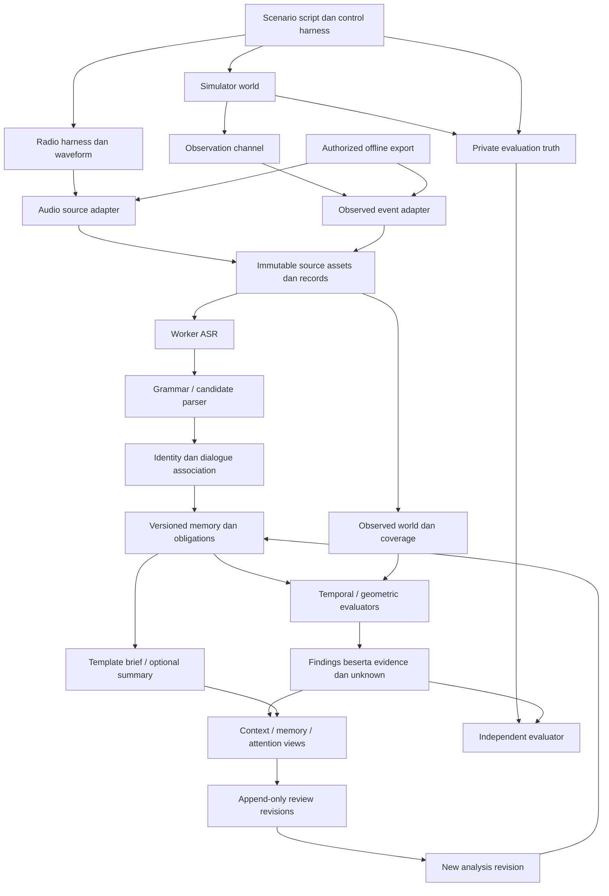

# ATC FlowLens — Feasibility dan Rancangan Engineering dari Dasar

- **Tanggal:** 7 Oktober 2026.
- **Status:** companion analysis / usulan arsitektur, belum disepakati sebagai blueprint implementasi.
- **Acuan keputusan produk:** [Ground-Up Product Review](../Knowledge-Review/ATC_FlowLens_Ground_Up_Product_Review.md).
- **Boundary yang masih berlaku:** [master blueprint](README.md), [shared contracts](shared-contracts.md), Rencana Teknis, Addendum, dan AGENTS.md. MVP kanonis tetap offline replay/evaluator; stream ambient dan microphone lab dalam dokumen ini adalah proposal scope.
- **Verifikasi:** inspeksi statis; tidak ada build/runtime/test/benchmark atau domain validation. Semua interface baru di bawah adalah `PROPOSED`, bukan source yang tersedia.

## 1. Arsitektur yang mengikuti nilai produk

**USULAN:** satu mesin evidence/ledger dapat mengolah replay dan, setelah scope disepakati, simulated stream. Perbedaan berada pada sumber dan clock driver. Inferensi berjalan di worker terpisah; state serta persistence dimiliki session server. Jalur simulator control terpisah dari jalur analisis FlowLens.



Truth tidak menjadi input ASR, association, ledger, atau rules. Evaluator dapat membaca kedua sisi sesuai role. Diagram tidak memberi izin untuk menghubungkan feed atau radio produksi.

### 1.1 Pilihan stack

**USULAN:** FastAPI/Pydantic, SQLite, Shapely, serta React/TypeScript tetap layak untuk research prototype. Alasannya adalah kedekatan dengan kebutuhan state, schema, geometri, dan distribusi lokal—bukan kewajiban mempertahankan seluruh implementasi. Tidak ada kebutuhan yang dibuktikan untuk microservices, vector database, Redis, Kubernetes, atau fine-tuning LLM sebagai fondasi pertama.

ASR/LLM adalah provider ports dengan input/output versioned. CPU/GPU/Apple Silicon dipilih setelah task benchmark pada perangkat yang akan dipakai. Cloud tidak otomatis menjadi default akibat pengguna tidak membatasi feasibility analysis: hak transfer data dan batas produk tetap berlaku untuk sumber nyata. Simulated data provider pun harus diberi label dan dicatat versinya.

## 2. Kontrak domain yang dibutuhkan

Tabel ini adalah sketsa semantik, bukan JSON Schema final. Referensi evidence harus typed, resolvable, dan terikat source/session/version; ID string yang ada saja belum membuktikan isi klaim benar.

| Proposed object | Field penting | Invariant |
|---|---|---|
| `SourceProfile` | source ID/kind, channels, covered interval/entities/regions, permission, time mapping, quality version | Missing coverage tidak disamakan dengan silent channel atau zero objects |
| `EvidenceRecord` | ID, source/hash, occurrence time/range, receive time, ordinal, schema version | Source immutable; waktu yang hilang unknown, bukan clock saat ingest |
| `UtteranceHypothesis` | audio reference/range, channel, speaker/role candidates, text alternatives, status, model version, available time | Finalized ASR tetap hypothesis; confidence boleh null |
| `SpeechActCandidate` | type, recipient candidates, action/resource/condition/negation slots, evidence spans, uncertainty | Request/expect/standby/clearance/cancel/report/repair terpisah |
| `DialogueLink` | instruction/readback references, entity alternatives, match reasons, unresolved slots, analysis version | Ambiguous links tidak auto-merge menjadi satu object clearance |
| `InstructionRecord` | candidate/source authority, entity, scope, restrictions, effective interval, source refs, supersession links | Tidak masuk `Command`; authoritative hanya jika sumber memang berwenang |
| `Obligation` | trigger, type, subject, responsible role bila diketahui, expected evidence, condition, timing basis, state | Closure mengharuskan evidence relevan; dismiss UI bukan closure |
| `ObservedState` | track ID, identity binding, pose/footprint/uncertainty, observed/received time, source, coverage | Identity/route/phase punya provenance sendiri, bukan field truth gratis |
| `Finding` | category, entities/resource, evidence IDs/spans, rule/profile version, applicable/pending/divergent/indeterminate state, calculated/available time, unknowns | Prioritas perhatian kandidat berbeda dari external safety alert severity |
| `ReviewRevision` | target, prior revision, reviewer/action/reason, correction, written time | Tidak menimpa source/raw ASR; analysis baru punya run ID |
| `BriefItem` | fact/open loop/unknown type, evidence refs, cutoff, analysis revision | Setiap klaim didukung isi evidence; unsupported/missing tidak disintesis |

Read models dapat menggabungkan informasi untuk display, tetapi tidak menghilangkan provenance. Instruksi recorded dari sumber berwenang dan interpretasi audio yang berbeda dapat ditampilkan berdampingan sebagai source disagreement.

### 2.1 Multiple obligations

`Session.active_clearance(target)` sekarang memilih satu clearance terakhir berstatus ISSUED. `issue()` menandai yang lama SUPERSEDED; `complete_requests()` menyelesaikan seluruh request untuk target. Ini cukup untuk beberapa skenario lab, tetapi **tidak cukup** untuk instruksi komposit dan beberapa kewajiban serentak.

**USULAN:** indexing berdasarkan entity + resource/scope + obligation type. Supersession dilakukan menurut makna, bukan hanya target yang sama. Misalnya instruction taxi baru tidak otomatis menghapus obligation report atau hold restriction lain. Rule profile harus menentukan jenis yang bisa supersede, tetap aktif, atau belum dapat disimpulkan.

### 2.2 Confidence dan authority

Confidence ASR/token/LLM bukan satu skala probabilitas yang dapat dipertukarkan. Produk membutuhkan slot-level quality serta evaluation calibration, terutama callsign/runway/action/negation. Self-reported confidence LLM tidak dijadikan threshold safety.

Attribution mempunyai komponen berbeda: sumber transmit, speaker role, recipient callsign, dan track binding. PTT metadata dalam harness dapat memberi transmitter ground truth; penilaian produk harus melaporkan jika metadata itu disediakan. Dalam corpus radio campuran, kanal bersama tidak memberi identitas pilot. Condition/negation yang belum jelas membatasi evaluator terkait.

## 3. Waktu, kausalitas, dan replay

### 3.1 Dua perspektif historis

**USULAN:** simpan setidaknya:

- `occurred_at` atau time range: kapan evidence berasal, dalam timebase sumber;
- `received_at`: kapan server mendapatkan record;
- `available_at`: kapan hipotesis/hasil selesai dan dapat ditampilkan;
- `written_at`: waktu revision manusia/analysis dicatat;
- source-to-session mapping beserta uncertainty/version dan stable ordinal.

Timestamp tersebut boleh berbeda. Dua mode replay harus jelas:

| Mode | Yang tampil pada cursor `t` | Tujuan |
|---|---|---|
| **As available** | Evidence/hasil yang sudah diterima dan tersedia pada `t` | Memahami apa yang saat itu dapat diketahui pengguna |
| **Retrospective analysis** | Analisis ulang/koreksi yang terjadi setelahnya, ditempatkan pada waktu sumber | Memahami kejadian dengan evidence tambahan; tidak menghitung lead time seolah tersedia saat itu |

Readback yang selesai pada 00:45 dan baru diproses pada 00:47 tidak boleh membuat highlight tersedia pada 00:43. Koreksi evaluator esok hari juga tidak boleh mengubah causal display sesi lama tanpa label mode/revision.

### 3.2 Out-of-order dan partial results

Record lama yang baru diterima disimpan dengan received time sebenarnya. Reducer tidak membiarkannya membuat track terbaru mundur. Late ASR dapat memperbarui historical association dalam analysis revision baru; temuan diberi waktu availability sesungguhnya.

Partial transcript dapat memuat “cross runway” sebelum kata “negative” atau repair selesai. Preview yang belum stabil tidak boleh mengganti instruksi aktif secara otoritatif. Gunakan hypothesis status dan reconciliation, lalu publikasikan state setelah syarat semantik/evidence tercapai.

Clock drift dan alignment error harus menjadi input evaluasi. Jika rentang ketidakpastian membuat urutan ujaran dan hold crossing tak dapat ditentukan, hasilnya indeterminate. Jangan menampilkan selisih waktu desimal yang melampaui ketelitian sumber.

### 3.3 Coverage saat monitor berjalan

“Readback tidak ditemukan” memerlukan coverage audio setelah instruksi dan batas waktu/profile yang relevan. Traces yang masih terbuka atau source gagal tidak dipaksa menjadi violation saat replay berakhir. Deadline notification menggunakan profile eksperimen/site yang diberi label, bukan angka 10 detik dari lampiran sebagai standar.

Replay evaluator harus dapat melihat **data completeness**, **backlog**, serta **end-of-recording truncation**. Session ended tidak sama dengan seluruh obligation sudah selesai.

## 4. Evaluasi temporal dan geometrik

### 4.1 Rule profiles

**USULAN:** mulai dengan evaluator sempit yang dikonfigurasi melalui versioned profile. Formal temporal logic dapat dipelajari untuk perluasan, tetapi tidak perlu membangun bahasa aturan umum sebelum satu slice benar.

| Evaluator | Preconditions | Output yang diizinkan | Bila syarat tidak terpenuhi |
|---|---|---|---|
| Critical-slot readback | Pairing/entity dan slot instruksi/readback cukup jelas | Slot berbeda/parsial pada pasangan kandidat | Attribution/slot unresolved; tahan verdict yang bergantung padanya |
| Waiting report | Trigger/report obligation dikenali; coverage interval diketahui | Evidence belum ditemukan, deferred, atau satisfied | Unknown bila kanal/interval tidak tercakup |
| Hold-position conformance | Active applicable restriction, identity binding, geometri, footprint/track/time quality | Observed divergence dari restriction kandidat/recorded sesuai source | Indeterminate; last-known tetap tersedia |
| Clearance compatibility | Structured source authority atau kandidat yang diberi label; applicable rule profile | Lab/site-profile inconsistency dengan preconditions | Tidak menyatakan illegal clearance dari heuristic global |
| Predicted occupancy | Current track, supported route/horizon/uncertainty model | Conditional overlap/range beserta assumptions | Unknown exit/route; bukan estimated collision time |
| Coordination loop | Sumber coordination, role/ownership rules, event semantics | Pending agreement/report sesuai profile | Tidak menganggap frequency transfer = transfer control selesai |

Nama/label temuan harus membedakan mismatch komunikasi, discrepancy antar sumber, geometric observation, serta authoritative external alert. Jika linked incident yang sama sudah ada, tambahkan evidence; jangan salin severity dari candidate AI ke alert resmi.

### 4.2 Geometri dan uncertainty

`detection.py` mengimpor `LAYOUT` global; hold checks memakai posisi/batas sintetik tertentu. Ekstrak profile geometri eksplisit sebelum mengklaim dukungan layout lain. Physical runway 09/27 harus tetap satu resource, dengan direction dan hold points terpisah.

Intersection center point tidak cukup untuk memastikan seluruh aircraft/vehicle sudah clear. Gunakan footprint, heading, spatial uncertainty, track age, serta area yang didefinisikan profile. Bila uncertainty footprint melintasi kedua sisi boundary, tampilkan indeterminate/possible crossing sesuai rule semantics yang disepakati.

Sampel yang berpindah dari satu sisi ke sisi lain dapat menunjukkan crossing di antara sampel, tetapi swept path tidak membuktikan waktu posisi tepat atau simultanitas dengan objek lain. Collision claim juga memerlukan lebih banyak daripada overlap seluruh protected runway area.

Route harus mempunyai sumber yang jelas: authorized route, speech-derived candidate, observed estimate, atau synthetic declared route. Perubahan future route/speed privat dari simulator tidak boleh menjadi input produk. `Simulator.sample()` sekarang menyalin remaining route; jika eksperimen voice-derived intent tidak mempunyai route source itu, jangan tetap memberikannya kepada detector secara tersembunyi.

## 5. Worker, latency, dan degradasi

### 5.1 Pipeline yang bisa gagal secara terpisah

ASR/parsing tidak dijalankan di simulation clock lock atau FastAPI event loop. Worker menerima asset/event slice minimum dan mengembalikan typed result. Server memvalidasi attempt/model/source/revision, kemudian commit satu kali. Timeout, duplicate result, cancelled attempt, dan late result mempunyai policy eksplisit.

Queue dibatasi berdasarkan audio duration/backlog, bukan hanya jumlah jobs. Backlog yang melewati experiment budget membuat assist tertinggal yang terlihat; source stream/replay tetap berlangsung. Tidak beralih ke cloud atau data demo lain diam-diam saat provider gagal.

LLM tidak memiliki tool untuk simulator command, mengubah SQLite, atau menjalankan isi transcript. Teks radio dan file import adalah data. Summary/brief sebaiknya dimulai dengan template ledger; optional LLM wajib menjaga referential dan semantic support.

### 5.2 Latency yang harus diukur

```text
end-to-end availability delay =
  acquisition/chunk completion + ingest/queue wait + ASR + parse/association
  + ledger/rules + durable commit + transport/render
```

P95 setiap komponen tidak dijumlahkan sebagai p95 total. Ukur distribusi end-to-end pada arrival pattern nyata eksperimen, juga burst lintas kanal, cold start, short clips, retries, dan ASR/LLM berbagi GPU. Fast processing dibanding durasi audio panjang belum menjamin short-utterance response.

**USULAN:** latency budget ditetapkan per task setelah kebutuhan notice timing dan perangkat diketahui. Readback check, conformance track, serta brief pasca-sesi tidak memerlukan SLA yang sama. Tidak mengunci target p95 1,5 detik sebagai fakta feasibility sebelum benchmark.

Manifest eksperimen menyimpan model/engine/hash, precision/quantization, hardware/OS, concurrency, phrase/language set, source quality, clock mapping, warm/cold state, dan analysis/rule versions. Accuracy dan latency dinilai bersama, termasuk kemampuan abstain.

### 5.3 Failure policies

| Kegagalan | Perilaku produk/engineering |
|---|---|
| ASR tidak tersedia | Source evidence dan replay tetap dapat dibaca; assist unavailable eksplisit |
| Speech hypothesis berubah | Version hypothesis dan derived findings; jangan bolak-balik membuat incident baru |
| Slot kritis tidak jelas | Simpan alternatif/unknown dan batasi rule; sumber independen tetap dapat dievaluasi |
| Audio/track time mapping tidak diketahui | Hindari cross-source timing verdict; tampilkan evidence terpisah |
| Track coverage hilang | Last-known dengan waktu; physical clearance tidak disimpulkan |
| Evidence reference tidak resolvable | Finding invalid/unresolved; tidak dianggap citation valid |
| Disk penuh/commit gagal | Jangan tampilkan persistence/review sukses; fail mode terlihat dan recovery terencana |
| Browser disconnect | Freeze last committed state dengan timestamp; reconnect full resync |
| Model/version berubah | Analysis run baru; jangan campur hasil lama/baru tanpa provenance |

## 6. Simulator sebagai harness evaluasi

**USULAN:** pertahankan tubuh world deterministik dan pilih language variability melalui scenario script, template/TTS, role-play, atau bounded agent. Agent generatif tidak memegang physics truth. Injeksi error didefinisikan sebelum run, lalu output aktual divalidasi.

Pemisahan tiga namespace:

1. `control/truth`: instruksi harness, simulator schedules, actual response, intended error label, dan oracle privat;
2. `observed`: waveform/channel metadata yang diizinkan, delivered tracks, serta event sumber yang memang tersedia untuk produk;
3. `derived`: transcript/association/ledger/findings/reviews dengan analysis version.

Experiment variant menentukan metadata yang tersedia. Variant “known transmitter” dan “mixed radio unknown speaker” dilaporkan terpisah. Keduanya berguna, tetapi hasil variant mudah tidak boleh diklaim sebagai keberhasilan diarization/attribution radio nyata.

PTT memudahkan batas ujaran lokal; receive side tetap dapat mengalami clipping/overlap. Controlled audio channel model harus menerapkan impairment ke waveform yang dikonsumsi produk dan mencatat truth di evaluator. Simultaneous speech yang dihasilkan dan benar-benar masuk audio berbeda dari dua event yang sekadar bertimestamp sama.

Untuk repeatability, bekukan waveform, actual agent text, control output, model/provider version, script version, dan seed. Seed saja tidak menjamin respons cloud LLM dapat diulang. Untuk UX study, hindari synthetic audio satu suara/template yang memberi jawaban terlalu mudah.

## 7. Reuse dan perubahan source

| Komponen saat ini | Keputusan usulan | Perubahan diperlukan sebelum sesuai arah baru |
|---|---|---|
| FastAPI/session orchestration | Reuse konsep, isolasi source/simulation orchestration | Ports read-only observation, worker dispatch, scoped views |
| Pydantic contracts | Reuse strict validation | Pisahkan SpeechCandidate/InstructionRecord/Obligation dari simulator Command |
| Fixed-step simulator | Reuse untuk test harness | Waveform/radio dan independent oracle; public coverage/source contracts |
| Shapely footprint/prediction | Reuse matematika setelah test | Explicit geometry, authority/quality gating, route provenance |
| Clearance lifecycle | Refactor | Multiple restrictions/obligations dan semantic supersession |
| SQLite archive | Reuse penyimpanan lokal, evaluasi durability | Asset/source hash, multiversion analysis, durable append-only reviews |
| Review frame playback | Reuse pola historical reads | As-available vs retrospective, cutoff availability, persistent review state |
| Role/token boundaries | Reuse setelah pemeriksaan implementasi/test | Truth/evaluator isolation, source capabilities, narrow revision writes |
| React/Vite scaffold | Reuse stack; UI dibuat dari task model | Context/memory/attention views, evidence drawer, causal review |
| Task complexity score | Jadikan eksperimen sekunder | Objective components dan coverage; tidak tampil sebagai diagnosis |
| Candidate option pipeline | Target saat ini, bukan source yang sudah ada | Jika scope dipilih, fase lanjutan di backlog baru; requirement kanonis belum diubah |

Arsip sekarang memakai `INSERT OR IGNORE` untuk events dan `INSERT OR REPLACE` untuk frames pada `(session_id, sim_ms)`. Ini tidak menyediakan immutable source store multiversion secara otomatis. Review annotations berada di list in-memory. Reuse berarti fondasi yang dapat dikembangkan, bukan bukti compliance/durability.

### 7.1 Pemetaan terhadap blueprint existing

| Workstream existing | Yang tetap relevan | Delta usulan setelah keputusan scope |
|---|---|---|
| BE/session/replay/storage | Provenance, import, roles, source/review separation, single writer | Knowledge-time projections, ledger persistence, durable revisions/closure |
| SD/simulation/detection | Geometry/coverage ports, numerical oracles, quality handling | Hold conformance terhadap instruction evidence; controlled radio harness |
| AI harness | Isolated provider, transcript/entity extraction, reconciliation | Dialogue association, multi-hypothesis semantics, slot quality; options dipisah fase |
| FE/replay/review | Typed adapter, source label, evidence, correction | Monitoring read models, stable attention, object memory, capability-specific view |
| QA/integration | Independent fixtures/oracle, integration/failure tests | End-to-end waveform, association, no-future-leakage, nuisance episodes, user-task study |

Ini pemetaan desain, bukan instruksi untuk menjalankan task lama secara otomatis. Shared contracts lama serta owner boundaries perlu di-rebaseline bersama requirement setelah arah disepakati; jangan menambahkan API proposal yang membuat dokumen seolah sudah diimplementasikan.

## 8. Eksperimen engineering yang diprioritaskan

Untuk perluasan decision support offline pada [product review §6.3](../Knowledge-Review/ATC_FlowLens_Ground_Up_Product_Review.md#63-arah-lengkap-dukungan-keputusan), branch membutuhkan contract terpisah: analysis/source cutoff, alternatif yang diberikan evaluator, simulator model/version, assumptions respons, constraints yang dimodelkan/tidak dimodelkan, dan evidence hasil. Branch tidak mengubah source dan tidak menerima private future schedule sebagai pengetahuan controller. Comparison harus menampilkan sensitivitas terhadap latency/kecepatan/exit yang belum pasti; ranking keselamatan menyeluruh ditahan bila constraint penting tidak tercakup. Ini pekerjaan lanjutan setelah baseline memory/association terbukti, bukan fitur yang sudah tersedia.

| Eksperimen | Pertanyaan | Bukti minimum yang harus dihasilkan |
|---|---|---|
| Semantic fixture slice | State/association benar bila transcript sempurna? | Kasus normal, omitted/similar callsign, repair, deferred, cancel, multiple obligations; oracle independen |
| Actual waveform slice | ASR/parse/association benar bila hanya audio input? | Ground truth kata/slots aktual; critical error/abstention dan wrong-pair metrics |
| Time/failure slice | Apakah hasil kausal dan jujur terhadap coverage? | Delayed/late events, partial revisions, truncation, time drift, reconnect, provider outage |
| Geometric slice | Bisakah conformance dibedakan dari unknown? | Full footprint, boundary uncertainty, sample crossing, stale/unknown identity, route absent |
| Normal-session slice | Seberapa banyak notice mengganggu? | Episode-level precision/recall, findings per covered hour, duplicate/reopen behavior |
| Resource/latency slice | Apakah processing mengikuti sumber pada hardware terpilih? | End-to-end p50/p95/p99, backlog burst, cold start, inference contention |
| User-task slice | Apakah representasi membantu pekerjaan primer? | Retrieval/understanding accuracy dan waktu; attention/trust serta expert feedback |

Semua adalah rencana verifikasi, belum dijalankan. Lulus kontrak bukan lulus ASR; lulus ASR bukan lulus domain; lulus simulasi bukan validasi operasi.

## 9. Invariants untuk acceptance yang direkomendasikan

Tidak ada target keselamatan operasional numerik baru yang ditetapkan oleh review ini. Invariants engineering berikut dapat ditetapkan sebagai gates saat implementasi disetujui:

1. Source assets/records tidak berubah akibat review; setiap correction/rerun mempunyai revision/version tersendiri.
2. Temuan dapat ditelusuri ke evidence yang benar isi, sumber, dan waktunya; references hilang gagal secara eksplisit.
3. Replay as-available tidak memperlihatkan transcript/result/correction sebelum availability time.
4. Candidate language output tidak dapat menjadi simulator/ATC Command melalui UI maupun server.
5. Coverage gap, identity ambiguity, dan critical-slot uncertainty tidak menjadi confident contradiction atau clear-state verdict.
6. Item pending yang sengaja deferred tidak otomatis dinyatakan hazard; acknowledgement/dismiss bukan closure.
7. Independent oracle dan private future world tidak masuk context parser, ledger, detector, atau controller projection.
8. Worker outage/backlog tidak menghentikan source replay; kualitas dan umur hasil terlihat.
9. Temuan episode yang sama tidak menggandakan alert pada setiap frame; source alert dan candidate tetap punya provenance terpisah.
10. Perubahan metadata yang tidak tersedia bagi controller pada saat itu tidak meningkatkan hasil benchmark secara tersembunyi.

## 10. Hasil review engineering

**INFERENSI:** arah operational memory/discrepancy layak dikembangkan sebagai research prototype, dengan jalur pembuktian yang tidak bergantung pada akses feed operasional sejak awal. Hambatan terbesarnya adalah evidence quality, attribution/association, temporal semantics, capability limits, dan nilai UX—bukan pemilihan framework.

**UNKNOWN:** kemampuan nyata source sekarang saat build/runtime, performa ASR pada target corpus, suitability site/SOP, manfaat untuk ATCO, persetujuan intended use/data, dan kesiapan operasi. Tidak ada perubahan source atau verification result aplikasi dari tugas dokumentasi ini.
