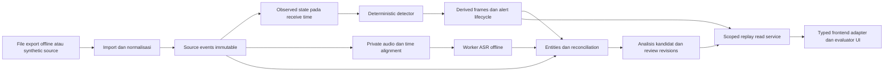
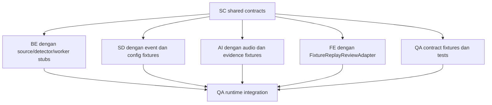

# Technical Implementation Blueprint ATC FlowLens

Inspeksi arsitektur awal: **3 Oktober 2026**. Progress frontend terpisah: **5 Oktober 2026**. Mulai dari [shared contracts](shared-contracts.md), kemudian packet workstream masing-masing. FE-01 typecheck dan build lulus; hasil itu belum membuktikan runtime, API integration, atau test.

Pecahan pekerjaan implementasi tersedia pada [indeks task BE/SD/AI/FE/QA](tasks/README.md), disusun dari packet dengan inspeksi statis 4 Oktober 2026. Setiap task memuat target, output, ownership, pendekatan implementasi, serta test dan kriteria lulus pada bagian terakhir; belum merupakan implementasi fitur.

## Boundary dan otoritas

Target MVP adalah replay offline event/audio simulator mitra yang berizin, dengan kandidat opsi AI hanya untuk evaluator. Selama mitra belum tersedia, gunakan baseline `SYNTHETIC / NOT OPERATIONALLY VALIDATED`. Controller tetap memutuskan dan menerbitkan clearance. Live VHF/microphone, production feed, jaringan operasional, dan rekomendasi pada posisi kontrol aktif berada di luar paket ini.

Acuan target: [Rencana Teknis MVP](../Knowledge-Review/ATC_FlowLens_Rencana_Teknis_MVP.md) §6–10, §12–16 dan [AI Assist Buddy](../Knowledge-Review/ATC_FlowLens_AI_Assist_Buddy_MVP_Prompt.md) §1, §3–5. Untuk batas evidence gunakan [Operational Reality Research](../Knowledge-Review/ATC_FlowLens_Operational_Reality_Research.md) §6 dan §11; kebijakan kualitas di sana berlabel INFERENSI/ASUMSI, bukan kontrak vendor atau threshold operasional. Ikuti [AGENTS.md](../../AGENTS.md) dan [peta dokumen](../README.md).

| Label | Makna di seluruh paket |
|---|---|
| `CURRENT_SOURCE` | Struktur/perilaku terlihat di source yang diperiksa; tidak membuktikan build/runtime/test |
| `TARGET` | Kebutuhan pada dokumen kanonis |
| `PROPOSED_CONTRACT` | Bentuk interface tambahan yang dipilih blueprint untuk memenuhi TARGET; belum ada di source |
| `ASSUMPTION` | Pilihan kerja sementara yang eksplisit; bukan fakta domain |
| `UNKNOWN` | Informasi belum tersedia; consumer harus bisa menampilkan unavailable/unknown |

## CURRENT versus TARGET

| Subsistem | CURRENT_SOURCE dan bukti | TARGET / gap |
|---|---|---|
| Core/session | [session.py](../../backend/session.py), [app.py](../../backend/app.py): single-writer lock, clock, commands, role checks, snapshots | Pisahkan source import offline dari session orchestration; source provenance/coverage dan alignment belum lengkap |
| Simulator | [simulator.py](../../backend/simulator.py), [scenarios.py](../../backend/scenarios.py), [catalogue](../../backend/data/scenarios.json): seeded truth, sample/delay queue, 12 scenario IDs | Fixture beroracle independen dan boundary event source; bukan bukti fidelity mitra |
| Detector | [detection.py](../../backend/detection.py): footprint, occupancy interval, rules, task complexity; lifecycle di session | Port observed-only, explicit layout/coverage dan hasil bertipe; tidak memakai future plans/benchmark labels |
| Replay/archive | [storage.py](../../backend/storage.py), [review.py](../../backend/review.py), [reporting.py](../../backend/reporting.py): SQLite frames/checkpoints/receipts, review, branch, exports | Import replay vendor, source versions, kompatibilitas checkpoint, persistensi assist/reviewer terpisah belum ada |
| AI | Tidak ditemukan modul ASR, assist entities/options, atau audio asset store di `backend/` | Worker offline terisolasi, reconciliation, evidence-linked options, append-only corrections |
| Frontend | FE-01 scaffold, typed contracts, fixture adapter, dan dashboard adapter tersedia. FE-02 menambah API replay adapter, runtime decoders, scoped credentials, review controls, dan source/assist subscription handling | Typecheck/build lulus; runtime belum diverifikasi. Historical frame-at-time dan replay/assist routes masih belum tersedia pada backend source; map/timeline/evidence review tetap FE-03–05 |
| Verifikasi | FE-02 `npm run typecheck` dan `npm run build` lulus 5 Oktober, menghasilkan `frontend/dist/index.html` locally | Contract/adapter/browser tests, frontend runtime, dan backend/API integration belum dijalankan; hasil build ignored dan tidak di-commit |

[Implementation Status](../IMPLEMENTATION_STATUS.md) tetap inventaris bertanggal. FE-01/FE-02 source melewati `npm run typecheck` dan `npm run build` pada 5 Oktober; startup, API runtime, automated test, review ATCO, dan validasi operasional belum dilakukan. Mitra, replay berizin, format vendor, dan ground truth mitra tetap `UNKNOWN`/belum dikonfirmasi per 3 Oktober 2026.

## Peta paket dan deliverables

| ID / packet | Owner-role | Output untuk consumer | Interface utama |
|---|---|---|---|
| SC — [Shared contracts](shared-contracts.md) | Backend/Replay sebagai pemilik tipe transport lintas paket; tiap port domain mengikuti ownership di bawah | Konvensi versi/waktu, fixture semantics, ports, API additive | SC-01 sampai SC-07 |
| BE — [Backend/session/replay/storage](packages/backend-session-replay-storage.md) | Backend/Replay | Import service, immutable source/archive, scoped REST/streams, assist result/review persistence | SC-01 source, SC-02 state, SC-04 jobs, SC-05 assist, SC-06 API |
| SD — [Simulation/detection](packages/simulation-detection.md) | Simulation/Detection | Synthetic source adapter, explicit layout, deterministic detector dan lifecycle policy | SC-01 observations, SC-03 detector |
| AI — [AI harness](packages/ai-harness.md) | AI Harness | ASR/summary providers, worker result, candidate entities/highlights/options | SC-04 worker, SC-05 evidence/assist |
| FE — [Frontend/replay/review](packages/frontend-replay-review.md) | Frontend | Typed fixture/API adapter, replay UI, evidence/reviewer flow | SC-02 snapshot, SC-05 assist, SC-06 API, SC-07 UI port |
| QA — [Integration/QA](packages/integration-qa.md) | Integration/QA | Canonical fixtures, contract tests, mock stack, integrated/offline checks | Semua SC; oracle privat tetap evaluator-only |

Output di tabel adalah deliverable implementasi berikutnya, bukan file source yang dibuat sekarang. Pola objective/context/contract/output/verification diadaptasi selektif dari contoh packet proyek Intern_ProjectWebPTPI yang tersedia; domain, approval, dan proses proyek tersebut tidak diadopsi.

## Alur replay end-to-end target

1. Import memvalidasi manifest, hak penggunaan yang dicatat, hash, unit/koordinat, timebase, cakupan, order, dan missingness. Data mitra yang tidak lengkap tidak dipalsukan sebagai sintetik.
2. Event asal dibekukan; authoritative structured simulator event, detector result, dan AI candidate berada dalam namespace/layer berbeda. Source identity dan source timestamp dipertahankan saat normalisasi.
3. State menggunakan event yang sudah diterima pada replay clock. Detector membaca track/clearance/known route yang tersedia, tanpa private truth atau future schedule. Derived analysis baru mempunyai run/version sendiri.
4. Review historical memilih frame terakhir yang tidak melewati waktu target; `playback_ms` dan `sim_ms` frame berbeda bila seek berada di antara frames. Re-analysis tidak menimpa historical alert.
5. Audio diproses worker terpisah; hasil dikembalikan ke server untuk validasi dan persistence. AI outage tidak menghentikan pembacaan source replay/deterministic frames.
6. Frontend menampilkan observed, predicted, raw ASR, corrected transcript, dan candidate sebagai kategori berbeda. Options hanya tersedia pada replay/evaluator; tidak mempunyai jalur ke commands.

## Dependensi desain, runtime, dan integrasi

Shared contract adalah satu-satunya prasyarat desain bersama. Dependency pengembangan berikut acyclic:

`QA0` dan `QA1` adalah dua jenis output satu workstream QA, bukan dua tim. Tidak ada edge BE→SD→AI→FE sebagai urutan pengerjaan.

| Hubungan | Contract dependency | Runtime dependency | Pengganti untuk mulai mandiri | Integration check dengan runtime riil |
|---|---|---|---|---|
| Source→BE | SC-01, SC-02 | BE memanggil event source | FixtureEventSource dari event records | Order/receipt time/dedup dan import atomik |
| BE→SD | SC-03 | BE orchestrator memanggil detector; SD tidak mengimpor Session/Archive | StubDetector untuk BE; fixture state untuk SD | Evidence/lifecycle dan frame persistence |
| BE→AI | SC-04, SC-05 | BE dispatch worker, menerima hasil; AI hanya membaca evidence input | StubWorker dan InMemoryEvidenceReader | Respons timeout/retry dan exactly-once result storage |
| BE→FE | SC-02, SC-05–07 | FE adapter membaca REST/WS | FixtureReplayReviewAdapter dengan auth/degraded states | Redaction, seek, reconnect, correction |
| Semua→QA | Semua SC | QA menjalankan komponen ketika tersedia | Contract fixtures/mock transport sejak awal | E2E, restart/failure, packaging offline |

Runtime request/result dapat dua arah; hal itu tidak membuat dependency implementasi dua arah. Port membawa DTO saja. Implementasi SD/AI tidak bergantung pada BE service; composition root BE menyuntikkan port/adapter. FE tidak mengimpor persistence Python. QA tidak menjadi dependency source produksi.

## Ownership file dan boundary

| Owner-role tunggal | Existing files yang boleh diubah saat implementasi | File/module baru yang diusulkan, belum ada |
|---|---|---|
| Backend/Replay | `backend/app.py`, `backend/session.py`, `backend/storage.py`, `backend/review.py`, `backend/reporting.py`, `backend/models.py`, `backend/__init__.py`, `pyproject.toml` | `backend/replay_contracts.py`, `backend/ports.py`, `backend/replay_import.py`, `backend/replay_source.py`, `backend/assist_service.py`, `backend/assist_storage.py` |
| Simulation/Detection | `backend/simulator.py`, `backend/scenarios.py`, `backend/detection.py`, `backend/data/scenarios.json` | `backend/detection_contracts.py`, `backend/geometry.py`, `backend/synthetic_source.py`, `backend/alert_lifecycle.py` |
| AI Harness | Tidak ada modul AI existing | `backend/assist_contracts.py`, `backend/ai_harness/` dengan providers/worker/entities/reconcile/options |
| Frontend | `frontend/src/`, `frontend/package.json`, `frontend/package-lock.json`, `frontend/tsconfig.json`, `frontend/vite.config.ts`, `frontend/index.html` | Adapters/read models/features/styles di dalam `frontend/src/` |
| Integration/QA | Tidak ada tests/launch tooling relevan existing | `tests/fixtures/`, `tests/contracts/`, `tests/unit/`, `tests/integration/`, `tests/browser/`, `scripts/run_mock_stack.py`, `scripts/package_offline.py` |

Kepemilikan ini tidak memerintahkan perubahan semua file. `backend/models.py` tetap milik BE; kebutuhan SD atas `SimulationConfig` disampaikan sebagai perubahan kontrak kepada BE. SD menyiapkan lifecycle baru; hanya BE mengganti blok lifecycle di `session.py` dan menyuntikkannya. AI mendefinisikan DTO assist; BE mengimplementasikan persistence/HTTP terhadap DTO itu. QA menulis tests lintas modul tanpa mengedit source milik paket lain. Dependency/package config Python dimodifikasi hanya oleh BE berdasarkan kebutuhan paket, npm oleh FE. Tipe wire baru dimiliki BE; domain detector SD; domain assist AI; frontend projection FE, dengan contract parity checks QA.

## Perbedaan teknis yang ditemukan

| CURRENT_SOURCE | TARGET / penanganan blueprint |
|---|---|
| Login `POST /api/v1/auth/operator` | Plan §13 mencontohkan `/operator-sessions`; gunakan route existing pada adapter, jangan rename sebagai bagian tambahan replay |
| Command `target`, `runway`; response `revision` | Contoh plan memakai `target_id`, `runway_direction`, `command_revision`. SC-06 mempertahankan wire existing; semantic mapping eksplisit |
| Full snapshot langsung tanpa `schema_version`, dengan `sequence`, `sim_ms`, `revision`, kind lowercase | Envelope target plan belum ada. Gunakan endpoint tambahan/profil versioned; jangan bungkus stream existing diam-diam |
| `Review`/annotations/command receipts review in-memory | TARGET koreksi/audit persisten append-only memerlukan tambahan BE; bukan bukti persistence review saat ini |
| `detect` mengimpor `LAYOUT` dari `scenarios.py`, membaca global `PROTECTED`; Session mengirim roster dari simulator | SD memisahkan explicit geometry/coverage input. Jangan mengklaim observed-only module isolation sudah penuh |
| `Track` Python lebih lengkap dari tipe FE; `Snapshot` FE tidak memuat `layout` | FE adapter/types perlu parity; cast `api<T>` bukan validasi payload |
| Frame menyimpan private checkpoint pada tiap save dan mengganti row jika `sim_ms` sama | Jangan mengasumsikan implementasi checkpoint hanya tiap 5 s atau banyak versi frame waktu sama; event ordinal mempertahankan riwayat |
| Manager membolehkan hingga delapan sesi RUNNING pada guard create | Target utama tetap satu RUNNING; dukungan source tidak mengubah scope/benchmark |
| Contoh highlight addendum mempunyai `control_action: null`; requirement melarang command/action field | Proposed DTO assist menghilangkan field itu seluruhnya dan menolak extra fields |

Ini catatan gap teknis, bukan perubahan scope atau spesifikasi kanonis. Format vendor/time transform final, role evaluator khusus, hardware/model ASR, retensi mitra, serta kualitas advisory tetap `UNKNOWN` dalam packet terkait.

## Verifikasi dokumentasi

Setiap packet menyatakan objective/output, ownership, interfaces, mocks, failure cases, dan readiness-to-integrate. Semua path source yang ditautkan harus ada; path usulan ditulis sebagai code literal dan berlabel belum ada. Pemeriksaan tautan/anchor lokal, coverage template/ownership/dependency, dan `git diff --check` dilakukan atas artefak dokumentasi. Perintah aplikasi pada QA merupakan instruksi target yang belum dijalankan dalam tugas ini.
