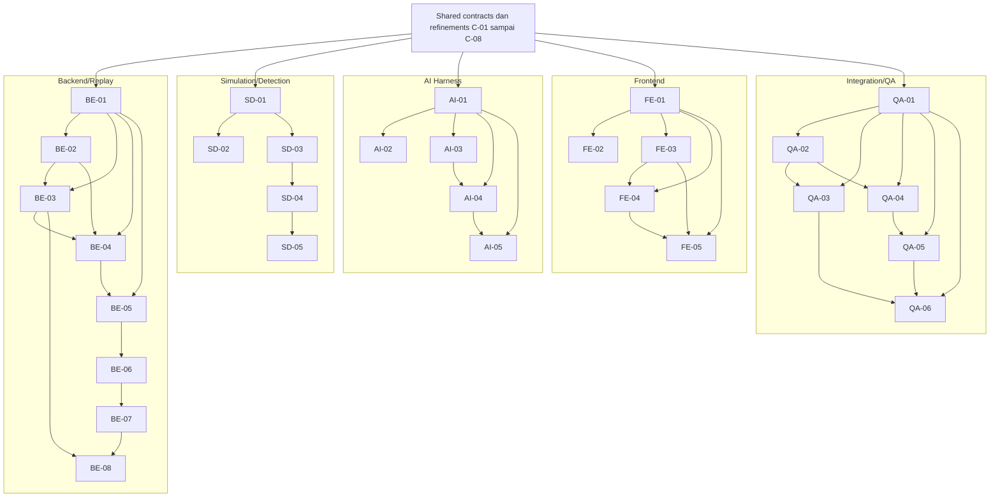

# Task implementation index — ATC FlowLens

Tanggal inspeksi statis: **4 Oktober 2026**. Ada **29 task TARGET**: BE 8, SD 5, AI 5, FE 5, QA 6. Task belum diimplementasikan sebagai deliverable; source existing yang disebut CURRENT_SOURCE bukan bukti build/runtime/test berhasil.

[Master blueprint](../README.md) · [Shared contracts](../shared-contracts.md) · [Peta dokumen](../../README.md) · [Panduan repo](../../../AGENTS.md).

## Cara memakai task

Baca packet induk, shared contracts, refinements C-01–C-08 di sini, lalu satu task sesuai output yang dikerjakan. Tiap task berakhir dengan **§8 Test dan kriteria lulus**; output, behavior, dan tests adalah target implementasi berikutnya.

Tidak ada approval workflow, sign-off, atau kewajiban meminta persetujuan tambahan untuk pekerjaan sintetik/offline. Kebutuhan izin data nyata tetap merupakan batas penggunaan sumber, bukan prasyarat untuk memakai mocks. Live audio/feed dan rekomendasi pada posisi kontrol aktif di luar task. Opsi AI hanya untuk evaluator replay dan tidak memiliki command path.

Nomor task bukan urutan seluruh tim. Contract dependency menyatakan interface yang sama; implementation dependency menyatakan artefak/file di workstream yang sama yang dibutuhkan; integration dependency menyatakan implementation riil untuk checks gabungan. Ketika dependency service belum tersedia, task dapat membangun modulnya terhadap port/stub dan menjalankan tests mandiri. Integrasi dilaporkan terpisah, tanpa memalsukan keberhasilan dari stub.

## CURRENT_SOURCE yang dipakai

Inspeksi membaca source/config yang dirujuk tiap task dan kelima packet. Backend current mempunyai FastAPI/session/simulator/detector/SQLite/review/report, dengan hard-wired simulator pada constructor Session dan geometry global pada detector. Source belum mempunyai import mitra/assist assets/jobs/options/transcript revisions.

Frontend current mempunyai `main.tsx/types.ts/api.ts`; App/styles yang diimpor dan `frontend/dist/index.html` tidak ditemukan. Scripts memakai Vite/TypeScript, sementara tooling itu belum dideklarasikan lengkap dalam package.json. Direktori tests dan launcher mock/package belum ditemukan. Ini alasan task TARGET mencakup scaffold dan verifikasi, tanpa mengklaim startup/build/test gagal atau berhasil dari inspeksi saja.

Dokumen mitra/data masih mencatat belum dikonfirmasi per 3 Oktober 2026; tidak ditemukan konfirmasi baru dalam artefak yang diperiksa. Format vendor, actual provider/hardware/quality dan fidelity operasi tetap UNKNOWN. Dokumentasi kanonis dan implementation status tidak diubah oleh penyusunan task.

## Indeks seluruh task

Kolom dependency di bawah memuat **implementation/edit dependency**. Contract, mock, consumer dan runtime integration dependency rinci berada pada §4 setiap task. Tests pada tabel belum dijalankan.

| ID / task | Packet induk | Owner-role | Target | Output | Dependency implementation | Test utama / hasil target |
|---|---|---|---|---|---|---|
| [BE-01](backend/BE-01-contracts-ports-composition.md) — Contracts, ports, dan composition boundary | [BE](../packages/backend-session-replay-storage.md) | Backend/Replay | Menyediakan DTO replay dan port injection agar session, detector, source, archive reader, dan worker dapat dirangkai tanpa cyclic imports. | Replay DTO/ports yang dapat diimpor tanpa startup side effects; composition harness menggunakan fake ports untuk seluruh consumer. Existing synthetic callers tetap kompatibel. | Ports/DTO literals sesuai SC; tanpa output paket lain | Contract: Round-trip mempertahankan source ID, time/unit dan quality; unknown profile ditolak. |
| [BE-02](backend/BE-02-replay-source-state-reducer.md) — Replay source reader dan observed-state reducer | [BE](../packages/backend-session-replay-storage.md) | Backend/Replay | Membangun observed state pada receive time replay dengan urutan stabil dan tanpa menyuntikkan initial synthetic objects ke imported source. | Reducer/source reader dan builder analysis frames untuk BE-03/04, SD integration, serta public EvidenceReader input AI. | [BE-01](backend/BE-01-contracts-ports-composition.md) | Unit: State sama untuk record order yang dinormalisasi; ordinal menentukan ties. |
| [BE-03](backend/BE-03-atomic-replay-import-archive.md) — Import replay atomik dan archive immutable | [BE](../packages/backend-session-replay-storage.md) | Backend/Replay | Menerima normalized offline export dan menyimpan manifest/source records serta derived frame versions secara atomik dan dapat dibaca ulang. | Immutable import/archive service, schema-version compatibility reader, dan public frame/event APIs internal untuk BE-04; perubahan schema tetap target implementasi. | [BE-01](backend/BE-01-contracts-ports-composition.md), [BE-02](backend/BE-02-replay-source-state-reducer.md) | Persistence: Reopen mempertahankan manifest/hash/events/frame versions. |
| [BE-04](backend/BE-04-scoped-replay-api-stream.md) — API replay, read service, dan stream terotorisasi | [BE](../packages/backend-session-replay-storage.md) | Backend/Replay | Melayani import, historical frames/events/evidence dan review controls sesuai token scope, mempertahankan API/stream synthetic existing. | Scoped REST/review reads dan main stream compatibility untuk FE adapter; unresolved evidence response eksplisit, bukan fabricated event. | [BE-01](backend/BE-01-contracts-ports-composition.md), [BE-02](backend/BE-02-replay-source-state-reducer.md), [BE-03](backend/BE-03-atomic-replay-import-archive.md) | API: Frame <= requested time; metadata/source/review IDs benar; cursor tidak kehilangan same-time event. |
| [BE-05](backend/BE-05-private-audio-job-dispatch.md) — Private audio assets dan job dispatch | [BE](../packages/backend-session-replay-storage.md) | Backend/Replay | Mendaftarkan audio replay privat dan mengantrekan typed worker job/attempt tanpa memblokir simulation clock atau membuat writer kedua. | Private audio/job service dan storage, typed dispatch port, scoped playback dan job status untuk AI/FE; replay reader tetap mandiri saat job gagal. | [BE-01](backend/BE-01-contracts-ports-composition.md), [BE-04](backend/BE-04-scoped-replay-api-stream.md) | Job: Queued asset/job committed sebelum dispatch; playback hanya asset pada source yang diizinkan. |
| [BE-06](backend/BE-06-assist-result-evidence-stream.md) — Assist result commit, evidence reads, dan stream | [BE](../packages/backend-session-replay-storage.md) | Backend/Replay | Menyimpan hasil worker valid tepat satu kali dan menyajikan transcript/highlight/option sesuai source, analysis window, role dan replay time. | Durable analysis results, scoped EvidenceReader dan assist REST/WS untuk FE; tidak ada option execute endpoint. | [BE-05](backend/BE-05-private-audio-job-dispatch.md) | Commit: Satu batch/receipt; source/model/input versions dan refs utuh setelah reopen. |
| [BE-07](backend/BE-07-append-only-review-debrief.md) — Append-only transcript review dan debrief exports | [BE](../packages/backend-session-replay-storage.md) | Backend/Replay | Menyimpan koreksi/decision reviewer sebagai revision terpisah yang durable dan menghasilkan debrief dengan source/result/uncertainty yang dapat ditelusuri. | Durable review/correction service dan debrief exports untuk FE; restart mempertahankan raw result serta history annotations. | [BE-06](backend/BE-06-assist-result-evidence-stream.md) | Review: Raw text tidak berubah; corrected version/reviewer/reason survive restart. |
| [BE-08](backend/BE-08-recovery-branch-runtime-provision.md) — Committed-state recovery, branch compatibility, dan runtime provision | [BE](../packages/backend-session-replay-storage.md) | Backend/Replay | Memastikan persistence failure/restart tidak memberi success palsu atau duplicate command effect, dan branching hanya memakai checkpoint compatible. | Recovery/branch behavior dan versioned runtime/config/dependency manifest untuk QA-06; committed archive tetap dapat direview. | [BE-03](backend/BE-03-atomic-replay-import-archive.md), [BE-07](backend/BE-07-append-only-review-debrief.md) | Recovery: Tidak ada accepted success sebelum commit; retry menghasilkan paling banyak satu effect. |
| [SD-01](simulation-detection/SD-01-explicit-geometry-detector-contract.md) — Explicit geometry dan detector domain contract | [SD](../packages/simulation-detection.md) | Simulation/Detection | Menghilangkan dependency detector pada private catalogue melalui public geometry input dan DTO observed-only. | Domain DTO dan explicit geometry helpers untuk SD-03/04 serta BE composition; geometry error dapat diteruskan sebagai degraded state. | Ports/DTO literals sesuai SC; tanpa output paket lain | Contract: Fields/unit/direction mapping utuh; baseline footprint coordinates sama. |
| [SD-02](simulation-detection/SD-02-synthetic-clock-observation-source.md) — Synthetic clock dan observation source adapter | [SD](../packages/simulation-detection.md) | Simulation/Detection | Menghasilkan canonical source records repeatable dari sampling/delivery simulator, dengan clock, coverage dan checkpoints yang terpisah dari public observations. | Synthetic source adapter, validated scenario/channel behavior dan private checkpoint round-trip untuk BE; benchmark memakai seeds fixed. | [SD-01](simulation-detection/SD-01-explicit-geometry-detector-contract.md) | Unit: Observed values/order/delivery times sama setelah normalization identity/audit. |
| [SD-03](simulation-detection/SD-03-footprint-occupancy-prediction.md) — Footprint dan occupancy interval prediction | [SD](../packages/simulation-detection.md) | Simulation/Detection | Menghasilkan occupancy/ETA deterministic dengan full footprint, route segments, aging dan unknown exit yang dapat dibandingkan oracle analitik. | Prediction helpers/result intervals untuk rules/frames/evidence dengan explicit geometry dan quantitative oracle assertions. | [SD-01](simulation-detection/SD-01-explicit-geometry-detector-contract.md) | Numerical: ETA sederhana error ≤1e−6 s; discrete timing beda ≤100 ms sesuai plan. |
| [SD-04](simulation-detection/SD-04-deterministic-rules-quality-evidence.md) — Deterministic rules, data quality, dan evidence | [SD](../packages/simulation-detection.md) | Simulation/Detection | Menghasilkan rule candidates dan runway quality yang membedakan nominal occupancy, buffer-only, permission inconsistency dan unknown coverage. | Observed-only deterministic candidates/runway quality dengan evidence completeness untuk lifecycle/replay/reconciliation. | [SD-03](simulation-detection/SD-03-footprint-occupancy-prediction.md) | Rules: Rule/category/severity sesuai baseline; permission advisory tidak dihitung collision. |
| [SD-05](simulation-detection/SD-05-alert-lifecycle-task-complexity.md) — Alert lifecycle dan experimental task complexity | [SD](../packages/simulation-detection.md) | Simulation/Detection | Menyediakan pure lifecycle policy dan complexity function yang dapat dipersist BE tanpa ack/dropout false-resolution. | AlertLifecyclePort implementation dan role complexity outputs untuk BE persistence/FE display; evidence version/transition causal references utuh. | [SD-04](simulation-detection/SD-04-deterministic-rules-quality-evidence.md) | Lifecycle: Ack tidak resolve; severity naik segera, turun/resolve sesudah stable 3 s yang memadai. |
| [AI-01](ai-harness/AI-01-assist-dto-provider-ports.md) — Assist DTOs dan provider ports | [AI](../packages/ai-harness.md) | AI Harness | Menyediakan schema transcript/entities/highlights/options/annotations dan provider ports yang menolak action fields serta evidence references ambigu. | Assist schemas/provider interfaces dan stubs, termasuk package marker `backend/ai_harness/__init__.py` usulan, untuk semua assist consumers. | Ports/DTO literals sesuai SC; tanpa output paket lain | Contract: Round-trip fields/model/time/uncertainty utuh; null confidence tetap null. |
| [AI-02](ai-harness/AI-02-isolated-offline-worker.md) — Process-isolated offline worker | [AI](../packages/ai-harness.md) | AI Harness | Menjalankan pipeline worker di proses terpisah dengan typed queues dan explicit attempts sehingga inference tidak memblokir session server. | Isolated worker runtime entrypoint/lifecycle dan protocol-compatible stub pipeline untuk BE integration. | [AI-01](ai-harness/AI-01-assist-dto-provider-ports.md) | Worker: Result mempunyai matching IDs/versions; no writer or command side effect. |
| [AI-03](ai-harness/AI-03-local-asr-transcript-entities.md) — Local ASR adapter, transcript, dan candidate entities | [AI](../packages/ai-harness.md) | AI Harness | Menghasilkan transcript hypothesis bertimestamp serta critical-slot candidates dari audio offline, dengan provenance/alternatives dan explicit model availability. | ASRProvider local adapter dan entity extractor yang menghasilkan SC-05 typed candidates untuk reconciliation/options; explicit stub vs real flags. | [AI-01](ai-harness/AI-01-assist-dto-provider-ports.md) | Unit: Alternatives/raw value/negation/revision preserved; no automatic Clearance creation. |
| [AI-04](ai-harness/AI-04-deterministic-evidence-reconciliation.md) — Deterministic evidence reconciliation | [AI](../packages/ai-harness.md) | AI Harness | Menghubungkan transcript/entity candidates dengan public event/alert evidence secara repeatable, dengan possible_link dan coverage uncertainty yang eksplisit. | Deterministic highlights/link evidence untuk BE commit/FE alert evidence panel dan read-only option generator. | [AI-01](ai-harness/AI-01-assist-dto-provider-ports.md), [AI-03](ai-harness/AI-03-local-asr-transcript-entities.md) | Unit: Same inputs same highlights; link refs valid, detector incident tetap satu. |
| [AI-05](ai-harness/AI-05-evaluator-options-summary-validation.md) — Evaluator-only options dan structured summary validation | [AI](../packages/ai-harness.md) | AI Harness | Menghasilkan notes/opsi hipotetis offline yang menunjuk evidence, rationale, preconditions dan unknowns, tanpa executable action. | Option/summary pipeline dengan traceable input/output versions dan failure states untuk offline evaluator review. | [AI-01](ai-harness/AI-01-assist-dto-provider-ports.md), [AI-04](ai-harness/AI-04-deterministic-evidence-reconciliation.md) | Unit: Option tetap unresolved/candidate, supporting refs/preconditions/unknowns tersedia. |
| [FE-01](frontend/FE-01-typed-fixture-adapter-scaffold.md) — Typed replay port, fixture adapter, dan frontend scaffold | [FE](../packages/frontend-replay-review.md) | Frontend | Menyediakan frontend yang dapat dibuild dengan typed port dan fixture mode eksplisit, tanpa backend/model sebagai prasyarat UI. | Buildable frontend shell, typed port dan mock adapter untuk UI tasks/tests; fixture output selalu labeled. | Ports/DTO literals sesuai SC; tanpa output paket lain | Build/type: No missing imports/type errors; dist bundle terbangun dari declared tooling. |
| [FE-02](frontend/FE-02-api-adapter-auth-reconnect.md) — API adapter, scoped credentials, dan reconnect | [FE](../packages/frontend-replay-review.md) | Frontend | Menghubungkan ReplayReviewAdapter ke existing/additive REST/WS tanpa page fetch, scope escalation atau silent fixture fallback. | API adapter/mockable transport and decoder for all UI tasks; auth/time/version behavior centralized. | [FE-01](frontend/FE-01-typed-fixture-adapter-scaffold.md) | Contract: Fields decoded, frame/analysis/source IDs correct, SEEK unit conversion once. |
| [FE-03](frontend/FE-03-source-context-runway-map.md) — Source context, runway map, dan deterministic evidence | [FE](../packages/frontend-replay-review.md) | Frontend | Menampilkan public runway geometry, observed/last-known tracks dan predicted occupancy dengan label waktu/kualitas serta evidence yang jelas. | Runway/map/source context components usable via fixture port, wired App and styles; data semantics ready for replay timeline. | [FE-01](frontend/FE-01-typed-fixture-adapter-scaffold.md) | Browser: Rendered body/time/resource/labels match fixture; evidence links resolve exact refs. |
| [FE-04](frontend/FE-04-replay-timeline-audio-controls.md) — Replay timeline, audio alignment, dan controls | [FE](../packages/frontend-replay-review.md) | Frontend | Menyelaraskan map/event/clearance/transcript lanes pada selected replay time dan menyediakan playback/seek yang menunjukkan actual frame time. | Timeline/controller/audio components and consistent selected-time/evidence context for FE-05 and QA browser. | [FE-01](frontend/FE-01-typed-fixture-adapter-scaffold.md), [FE-03](frontend/FE-03-source-context-runway-map.md) | Timeline: Frame 200 displayed as actual time; no events after cutoff; lane/order correct. |
| [FE-05](frontend/FE-05-assist-evidence-review-debrief.md) — Transcript, candidate evidence review, dan debrief | [FE](../packages/frontend-replay-review.md) | Frontend | Memberi evaluator UI untuk inspeksi transcript/highlights/options, koreksi/decision dan debrief dengan provenance serta uncertainty. | Assist/reviewer/debrief components wired to typed port and eventual API, with append-only revision/history presentation. | [FE-01](frontend/FE-01-typed-fixture-adapter-scaffold.md), [FE-03](frontend/FE-03-source-context-runway-map.md), [FE-04](frontend/FE-04-replay-timeline-audio-controls.md) | Browser: Refs open exact evidence, raw/corrected traceable; options only evaluator replay. |
| [QA-01](integration-qa/QA-01-canonical-fixtures-independent-oracles.md) — Canonical fixtures dan independent oracles | [QA](../packages/integration-qa.md) | Integration/QA | Menyediakan versioned public replay/assist bundles dan private evaluator labels yang dapat dipakai semua workstream tanpa menunggu runtime. | Canonical public/private fixture bundle+independent expected values untuk all contracts/unit/browser/benchmark checks. | Ports/DTO literals sesuai SC; tanpa output paket lain | Fixture validation: Public refs valid, hash bytes match, invalid fixtures explicitly separated. |
| [QA-02](integration-qa/QA-02-contract-unit-test-suites.md) — Contract dan independent unit test suites | [QA](../packages/integration-qa.md) | Integration/QA | Menguji seluruh ports/DTOs/pure behavior dengan canonical fixtures dan stubs sebelum full runtime digabung. | Meaningful contract/unit suites dan fake ports for semua producer; unsupported/unknown conditions tested without dependency on real model. | [QA-01](integration-qa/QA-01-canonical-fixtures-independent-oracles.md) | Contract: Expected accept/reject/ref isolation identical among producers/consumers. |
| [QA-03](integration-qa/QA-03-backend-worker-integration-failures.md) — Backend, detector, dan worker integration failures | [QA](../packages/integration-qa.md) | Integration/QA | Memverifikasi atomic import, scopes, replay/source immutability, detector/worker integration dan recovery melalui temp SQLite/FastAPI/WS. | Integration suites dan hasil pemeriksaan persisted evidence/compatibility yang tepat untuk seluruh paket server. | [QA-01](integration-qa/QA-01-canonical-fixtures-independent-oracles.md), [QA-02](integration-qa/QA-02-contract-unit-test-suites.md) | API/persistence: Commit before success, scope/private boundaries, stable source/hash/versions and current wire compatibility. |
| [QA-04](integration-qa/QA-04-mock-stack-launcher.md) — Mock stack launcher | [QA](../packages/integration-qa.md) | Integration/QA | Menyediakan satu launcher yang menjalankan replay/assist mock transport dan frontend explicit mode dengan cleanup serta private fixture isolation. | Launcher mock stack untuk frontend scaffold, tanpa dependency pada provider inference atau backend feature riil. | [QA-01](integration-qa/QA-01-canonical-fixtures-independent-oracles.md), [QA-02](integration-qa/QA-02-contract-unit-test-suites.md) | Launcher contract: Routes/frames/evidence/job/candidate payloads follow proposed profile; private fixture unreadable. |
| [QA-05](integration-qa/QA-05-browser-replay-review-flows.md) — Native browser replay/review flows | [QA](../packages/integration-qa.md) | Integration/QA | Memverifikasi UI mock dan real-API workflows melalui native Python Playwright, termasuk time/evidence/scope/outage/non-execution behavior. | Browser workflow/assertion suites dan screenshots/result manifest dari pelaksanaan aktual setelah UI tersedia. | [QA-01](integration-qa/QA-01-canonical-fixtures-independent-oracles.md), [QA-04](integration-qa/QA-04-mock-stack-launcher.md) | Mock browser: User interactions update correct refs/revisions/frame times and mode/source labels. |
| [QA-06](integration-qa/QA-06-offline-package-benchmark-evidence.md) — Offline package dan benchmark evidence | [QA](../packages/integration-qa.md) | Integration/QA | Menghasilkan paket lokal yang cold-run tanpa download dan laporan technical benchmark yang memisahkan compute/delivery/replay/AI measurements. | Paket offline sintetik dan laporan technical evidence aktual beserta batas klaim; tanpa deployment live atau klaim validasi domain/operasional. | [QA-01](integration-qa/QA-01-canonical-fixtures-independent-oracles.md), [QA-03](integration-qa/QA-03-backend-worker-integration-failures.md), [QA-05](integration-qa/QA-05-browser-replay-review-flows.md) | Package inputs: Artifact manifest precise, credentials/private exports excluded; missing required artifact explicit failure. |

## Dependency map tanpa siklus

Diagram ini menunjukkan urutan artefak/edit di dalam workstream. Setiap workstream mulai dari kontrak bersama; tidak ada edge yang mewajibkan SD/AI/FE menunggu implementasi BE.

Task-tasks dapat dikembangkan dengan ports/stubs sebelum dependency implementation dihubungkan. File yang sama mempunyai urutan edit eksplisit di ownership; gunakan modul baru/fixture inline untuk mengerjakan bagian yang tidak berbagi file.

| Kelompok awal | Yang dapat dimulai mandiri | Stub/fixture |
|---|---|---|
| BE-01, BE-02 | DTO/ports dan observed-state reducer | Literal SC, FakeSource/Writer/Detector |
| SD-01, SD-02 | Public geometry/domain DTO dan synthetic source | Geometry/source contracts dan local collector |
| AI-01, AI-02 | Assist schemas/provider ports dan isolated worker | Stub ASR/Summary, read-only fixture inputs |
| FE-01, FE-02 | Scaffold/read models/mock port dan API transport adapter | Explicit fixture mode/mock HTTP/WS |
| QA-01, QA-02 | Canonical independent fixture/oracles dan contract/unit suites | F-* bundles + fake ports, implementation checks pending sampai callable tersedia |

Task berikutnya juga dapat mulai terhadap kontrak/mock; kelompok di atas adalah titik masuk praktis, bukan gerbang persetujuan atau jadwal serial.

| Runtime integration check | Komponen riil yang diperlukan | Yang boleh stub |
|---|---|---|
| Import/archive/review | BE-01–04 | SD detector/lifecycle |
| Observed detector/lifecycle | BE-01–04, SD-01–05 | Worker AI |
| Audio/job/result | BE-05–06, AI-01–02 | ASR/summary providers dan reconciliation payload awal |
| Correction/debrief/restart | BE-03/06–08 | Model output canonical |
| Browser full workflow | FE-01–05, BE-04–07 | Local ASR/summary jika unavailable, label explicit |
| Offline/performance | Required runtime/build/package outputs sesuai QA-06 | Provider opsional, tanpa menyebut stub sebagai inferensi nyata |

## Ownership dan urutan edit

Ownership master tetap berlaku. Scope tugas mencantumkan existing source dan file baru yang belum ada; path usulan tidak menjadi klaim file tersedia. Tidak ada workstream yang mengambil alih file milik tetangga.

| File/namespace yang berbagi pekerjaan | Owner-role | Task/urutan edit dan batas |
|---|---|---|
| `backend/app.py` | Backend/Replay | BE-01 → BE-04 → BE-05 → BE-06 → BE-07 → BE-08; BE-02/03 membangun services tanpa mengedit app |
| `backend/session.py` | Backend/Replay | BE-01 injection boundary → BE-08 recovery/compatible glue; SD hanya menyiapkan policy murni |
| `backend/models.py` | Backend/Replay | BE-01 saja; permintaan config domain melalui kontrak, bukan edit SD/AI |
| `backend/storage.py` | Backend/Replay | BE-03 replay archive → BE-08 recovery/backup; assist persistence berada pada file terpisah |
| `backend/review.py` | Backend/Replay | BE-04 source/review read control → BE-07 durable annotations → BE-08 recovery |
| `backend/assist_service.py`, `backend/assist_storage.py` (baru) | Backend/Replay | BE-05 assets/jobs → BE-06 result queries/stream → BE-07 revisions/review |
| `backend/reporting.py` | Backend/Replay | BE-07; public debrief tidak mengambil alih restricted truth report |
| `pyproject.toml` | Backend/Replay | BE-01 kontrak/config seam → BE-08 actual runtime/dev/optional-provider provision; AI/QA tidak mengeditnya |
| `backend/detection.py` | Simulation/Detection | SD-01 explicit geometry → SD-03 prediction → SD-04 rules → SD-05 complexity |
| `backend/simulator.py`, `backend/scenarios.py`, `backend/data/scenarios.json` | Simulation/Detection | SD-02; fixtures/oracle bukan private schedule yang diekspor |
| `backend/geometry.py`, `backend/detection_contracts.py` (baru) | Simulation/Detection | SD-01; SD-03/04 mengonsumsi tanpa duplicate schema |
| `backend/synthetic_source.py` (baru), `backend/alert_lifecycle.py` (baru) | Simulation/Detection | SD-02 source adapter; SD-05 lifecycle; BE memasang glue |
| `backend/assist_contracts.py` dan `backend/ai_harness/__init__.py` (baru) | AI Harness | AI-01; BE mengimpor domain DTO tanpa mengubahnya |
| `backend/ai_harness/providers.py` (baru) | AI Harness | AI-01 ports/stubs → AI-03 ASR → AI-05 SummaryProvider |
| `backend/ai_harness/worker.py/entities.py/reconcile.py/options.py` (baru, masing-masing file) | AI Harness | AI-02 worker, AI-03 entities, AI-04 reconcile, AI-05 options |
| `frontend/src/App.tsx`, `frontend/src/styles.css` (baru) | Frontend | FE-01 shell → FE-03 map/context → FE-04 timeline/player → FE-05 assist/debrief |
| FE configs/package/lock/main/types dan `contracts/replayReview.ts`, `adapters/fixtureReplayReview.ts` (baru) | Frontend | FE-01; request extension ports lewat definisi C agar FE-02–05 tidak duplicate |
| `frontend/src/api.ts`, `adapters/apiReplayReview.ts` (baru) | Frontend | FE-02; component hanya menggunakan port |
| `frontend/src/features/` (baru) | Frontend | File terpisah FE-03 runway/setup, FE-04 timeline/control/audio, FE-05 transcript/candidate/review/debrief sesuai packet |
| `tests/fixtures/replay/`, `assist/`, `private/` (baru) | Integration/QA | QA-01 canonical data; pengecualian `tests/fixtures/replay/benchmark-manifest.json` khusus QA-06 |
| `tests/contracts/`, `tests/unit/` (baru) | Integration/QA | QA-02 semua suites pure/producer; pengecualian `tests/contracts/test_mock_stack.py` khusus QA-04 |
| `tests/integration/` (baru) | Integration/QA | QA-03 semua backend/domain/process checks; `test_offline_package.py` dan `test_performance.py` khusus QA-06 |
| `tests/browser/` (baru) | Integration/QA | QA-05 semua FE/shared browser modules |
| `scripts/run_mock_stack.py`, `scripts/package_offline.py` (baru) | Integration/QA | QA-04 launcher; QA-06 package; presentation scripts existing tidak diubah |

Folder adalah namespace, bukan izin mengedit semua child milik task lain. File baru per task terdaftar di §3. Producer fitur tidak membuat tests dalam namespace QA; ia menyampaikan assertions §8. QA dapat membuat executable test/stub lebih awal; producer dapat memakai input/assertion harness inline untuk pengembangan tanpa menunggu paket runtime lain.

## Coverage packet → task/output/verification

Mapping ini mencakup seluruh included scope packet. Semua cross-package checks berada pada QA task yang ditunjuk; task fitur menyatakan mechanical acceptance sendiri pada §8.

| Packet / requirement-output | Task implementasi | Task verifikasi / output checks |
|---|---|---|
| BE: contracts, ports, single writer/composition | [BE-01](backend/BE-01-contracts-ports-composition.md) | [QA-02](integration-qa/QA-02-contract-unit-test-suites.md), [QA-03](integration-qa/QA-03-backend-worker-integration-failures.md); no cyclic domain/server imports, current wire parity |
| BE: source order/time/provenance/quality, reducer | [BE-02](backend/BE-02-replay-source-state-reducer.md), [BE-03](backend/BE-03-atomic-replay-import-archive.md) | QA-01/02/03; late packet/dedup/missing timestamps/source immutability |
| BE: import/persistence/schema/history/analysis namespace | [BE-03](backend/BE-03-atomic-replay-import-archive.md) | QA-03; atomic commit/reopen/no half source/no overwritten analysis |
| BE: API/auth/redaction/stream/review/time paging | [BE-04](backend/BE-04-scoped-replay-api-stream.md) | QA-03/05; scopes, current routes, source/read token, seek/gap/cursor |
| BE: private audio/job/dispatch/cancel/timeout | [BE-05](backend/BE-05-private-audio-job-dispatch.md) | QA-03; validated private asset, one writer/no clock block |
| BE: worker result/ref integrity/assist queries/options/WS | [BE-06](backend/BE-06-assist-result-evidence-stream.md) | QA-02/03/05; attempts/window/evaluator-only boundary |
| BE: durable correction/reviewer/export/HTML/CSV/privacy | [BE-07](backend/BE-07-append-only-review-debrief.md) | QA-03/05; raw immutable/revisions restart/escaping |
| BE: disk failure/retry/startup/branch/checkpoint/backup/provision | [BE-08](backend/BE-08-recovery-branch-runtime-provision.md) | QA-03/06; committed receipts/compatible restore/no auto-resume/cold-run |
| SD: geometry/public config/domain DTO isolation | [SD-01](simulation-detection/SD-01-explicit-geometry-detector-contract.md) | QA-01/02/03; finite polygons, local axes, no private catalogue import |
| SD: scenario/sim clock/sampling/noise/delay/dropout/response/RNG | [SD-02](simulation-detection/SD-02-synthetic-clock-observation-source.md) | QA-01/02/03; fixed-step/seed/checkpoint/order/12 scenario mapping |
| SD: footprint/route/ETA/horizon/unknown exit/uncertainty | [SD-03](simulation-detection/SD-03-footprint-occupancy-prediction.md) | QA-01/02; analytic oracle/rotation/body exit/route intervals |
| SD: occupancy/conformance/config/quality rules/evidence | [SD-04](simulation-detection/SD-04-deterministic-rules-quality-evidence.md) | QA-01/02/03; physical direction mapping/buffer-only/swept/source refs |
| SD: lifecycle/ack/dropout/complexity/role channels | [SD-05](simulation-detection/SD-05-alert-lifecycle-task-complexity.md) | QA-02/03/05; stable 3 s, no ack resolution, complexity independent formula |
| SD: canonical/performance/benchmark targets | SD-01–05 outputs | [QA-06](integration-qa/QA-06-offline-package-benchmark-evidence.md); plan strata/denominators/performance manifest |
| AI: typed contracts/provider stubs/provenance/failure | [AI-01](ai-harness/AI-01-assist-dto-provider-ports.md) | QA-02/03; extra fields/no action/ref/version validation |
| AI: process boundary/progress/cancel/timeout/attempt | [AI-02](ai-harness/AI-02-isolated-offline-worker.md) | QA-02/03; no SQLite/command ability, worker outage isolation |
| AI: audio/ASR/channel/speaker/raw/corrected/critical slots | [AI-03](ai-harness/AI-03-local-asr-transcript-entities.md) | QA-01/02/03/06; stubs vs actual metrics, null confidence/no-speech/alternatives |
| AI: deterministic evidence reconciliation/link/missing coverage | [AI-04](ai-harness/AI-04-deterministic-evidence-reconciliation.md) | QA-01/02/03/05; possible_link, no duplicate incident or severity mutation |
| AI: summaries/options/preconditions/uncertainty/result validation | [AI-05](ai-harness/AI-05-evaluator-options-summary-validation.md) | QA-02/03/05; no command path, factual support not inferred from JSON |
| AI: reviewer raw preservation/analysis revision linkage | AI-04/05 + BE-06/07 | QA-03/05; correction append-only, analysis retains input revision |
| FE: scaffold/typed UI port/mock adapter/source+role states | [FE-01](frontend/FE-01-typed-fixture-adapter-scaffold.md) | QA-02/04/05; build/typecheck, fixture-mode labels and parity |
| FE: transport/auth/decoder/cursor/cancel/reconnect/error states | [FE-02](frontend/FE-02-api-adapter-auth-reconnect.md) | QA-03/04/05; source/review token, baseline redaction, unsupported version |
| FE: setup/map/runway/observed-vs-predicted/deterministic evidence | [FE-03](frontend/FE-03-source-context-runway-map.md) | QA-05; public geometry/actual values/quality/accessibility |
| FE: timeline/seek/playback/audio alignment/actual frame time | [FE-04](frontend/FE-04-replay-timeline-audio-controls.md) | QA-03/05; no future events/unknown alignment/pause/source continuity |
| FE: transcript/evidence/options/corrections/debrief/export | [FE-05](frontend/FE-05-assist-evidence-review-debrief.md) | QA-03/05; raw-corrected/refs/conflicts/evaluator-only/no execution |
| QA: canonical/public-private fixtures/oracle early | [QA-01](integration-qa/QA-01-canonical-fixtures-independent-oracles.md) | QA-02 fixtures validator; independent labels/no truth leakage |
| QA: contracts/numerical/pure tests early | [QA-02](integration-qa/QA-02-contract-unit-test-suites.md) | Producer acceptance examples run with stub first, real implementation separately |
| QA: integration scenarios I-01/02/03/04/06/07/08 | [QA-03](integration-qa/QA-03-backend-worker-integration-failures.md) | Temp DB/API/WS/domain/worker/recovery evidence |
| QA: how to run mock stack | [QA-04](integration-qa/QA-04-mock-stack-launcher.md) | test_mock_stack and explicit F-COMM-01 transport/cleanup |
| QA: browser I-04/05/06/07/time/evidence/accessibility | [QA-05](integration-qa/QA-05-browser-replay-review-flows.md) | Native Python Playwright mock and real API contexts separately |
| QA: offline package I-09/backup/endurance/metrics | [QA-06](integration-qa/QA-06-offline-package-benchmark-evidence.md) | Cold-run/network disabled/version locks/hardware and actual result manifest |

## Penyempurnaan kontrak bersama — PROPOSED_CONTRACT

C-01–C-08 memperjelas bagian shared contracts yang belum mempunyai bentuk executable lengkap. Ini satu lokasi definisi tambahan; task mereferensikan ID tersebut. Shared contracts tetap dasar otoritatif blueprint; refinement bukan perubahan API/source yang sudah terjadi, dan tidak menulis ulang spesifikasi kanonis.

### C-01 — Normalized import profile dan kualitas sumber

BE-01/03 memakai `replay-1`. Transport baseline `POST /api/v1/replay-imports` multipart memiliki part `manifest` (JSON UTF-8) dan `events` (JSONL UTF-8). Parser baseline tidak menerima vendor format mentah sebagai otomatis compatible. `content_hash` adalah SHA-256 bytes events yang diimpor; retry identity membandingkan source_id, exact content hash, dan canonical manifest metadata. Manifest berubah dengan source_id lama menjadi conflict, walaupun event bytes sama.

Field outer ReplaySourceManifest/ReplayEventRecord mengikuti SC-01. Struktur minimum nested untuk fixture/DTO:

| Field | Bentuk minimum / aturan |
|---|---|
| `source_time` | `{value: number\|null, unit: "ms"\|"s", clock: string}`; nilai asal tidak ditimpa normalization |
| `timebase` | `{source_clock, source_unit, mapping_id, offset_ms: int\|null, uncertainty_ms: int\|null, alignment_status: "aligned"\|"unknown"}`; mapping baseline offset konstan |
| `quality` | `{status, reasons: string[]}` dengan enum SC-01; computed freshness di state terpisah dari source-quality |
| `provenance` | `{owner: string\|null, version: string\|null, derivation: string\|null}`; unknown tetap null+quality/reason, synthetic authored eksplisit |
| `permission_profile` | `{reference, purpose, processing_scope}`; synthetic profile lokal; authorized simulator import membutuhkan recorded usage metadata, tanpa meminta approval baru dari agent |
| `coverage` | `{object_ids, channel_ids, intervals, missing_intervals}`; interval `{start_ms,end_ms}` pada session clock, known source roster bukan private truth |
| `layout` | Public layout current fields id/version/coordinate_system/physical_runway_id/runway/protected_area/taxiways/hold_lines/directions/note; baseline LOCAL_METRES, partner unsupported axes/unit ditolak |

Malformed JSON/envelope, conflicting identity/hash, unsupported schema/unit atau invalid layout adalah fatal import validation error. Observation payload yang tidak lengkap/unmapped dapat disimpan sebagai rejected/unresolved source record dengan quality reason, tanpa menghasilkan typed Track atau precise prediction. Missing timestamp tidak diisi dari receipt. Parser/reducer tidak mengasumsikan future data tersedia. Stable sample tie memakai ordinal sumber; internal IDs ber-namespace source/session.

### C-02 — Public frame dan evidence read capability

SC-07 loadFrame/resolveEvidence membutuhkan endpoint yang belum ada di SC-06 current:

- `GET /api/v1/sessions/{id}/replay-frame?at_ms=&analysis_id=`: source-read capability; `at_ms` nonnegative session ms, analysis optional untuk source/native frame dan wajib saat memilih derived frame. Response `{source_session_id, requested_ms, frame_ms, analysis_id, state}`; frame_ms terakhir <= requested_ms. Analysis absent/unavailable berarti predictions/alerts analysis **null** pada normalized UI model, bukan empty safe state.
- `POST /api/v1/sessions/{id}/evidence`: body `{refs, until_ms, analysis_id}` dengan typed refs SC-05; response `{items, unresolved}`, masing-masing mempertahankan ref identity. Unresolved karena missing/outside time/unsupported refs tidak diisi message buatan. Unauthorized request scope ditolak sebelum lookup.
- Replay-source projection mengembalikan manifest public dan available analysis IDs/kind/versions/window agar frontend memilih analysis eksplisit. Imported data tidak dipaksakan ke metadata synthetic scenario/seed. State public memuat layout/tracks/clearances/requests/runway/complexity dan historical predictions/alerts bila available; native source alerts tetap provenance evidence sendiri.

Existing Snapshot/WS synthetic tetap direct payload SC-02 dengan lowercase kind dan fields current. Frame projection baru dibuat hanya pada endpoint tambahan. EvidenceReader internal AI memakai source/analysis scope yang sama, tanpa private checkpoint/report truth.

### C-03 — Time causality dan executable SYN-COMM fixture

Contoh tabel addendum adalah ilustrasi, bukan fixture executable. Ia menyebut observed track 74.180 s, receive offset +0.350 s, tetapi detector alert 74.220 s; alert itu mendahului receipt 74.530 s. QA-01 memakai **usulan fixture sintetik** berikut tanpa mengubah addendum:

| Evidence | Timestamp fixture / semantik |
|---|---|
| SEG-TWR-006 | Audio-relative segment dengan mapping ke session time 72.400 s; confidence illustrative 0.61 diberi label authored fixture |
| EVT-CLR-021 | Recorded HOLD_SHORT tersedia pada 73.020 s |
| EVT-TRK-088 | observed_ms=74180, received_ms=74530, event.sim_ms=74530 |
| ALRT-009 | calculated_ms=74600, evaluation berikutnya setelah receipt; bukan claimed measured run |
| Assist link | Tidak sebelum evidence tersedia; evidence window mencakup timestamp receipt/calculation yang digunakan |

Mapping audio `session_ms=audio_ms+offset_ms`; source sample/receive/session/wall times berbeda. Unknown alignment tidak memberikan timestamp presisi. QA asserts alert cannot use unavailable observations. Timing baru adalah konsistensi fixture, bukan threshold keselamatan.

### C-04 — Scoped source-read, evaluator, dan private audio

Create review existing response `{id,source_id,token}` dipertahankan dan dapat ditambah `source_read_token`. Token tambahan hanya minted untuk actor yang sudah berhak atas source; `token` mengontrol Review ID dan tidak otomatis membaca source. Source-read credential mempunyai scope frozen source, role projection, expiry server dan capability read-only; tidak diterima pada commands/seats/import routes. Evaluator options/corrections/reviews memerlukan instructor plus evaluator replay capability server; role enum current tidak berubah.

Source-read token boleh hanya read endpoints; perubahan reviewer memakai original authorized instructor source/operator credential, bukan credential read-only. FE adapter membawa `review_control_token`, `source_read_token` dan optional `source_review_token` (authorized original credential), dipisahkan di memory. Server tidak mengirim credential operator global kepada participant. Baseline participant/stream redaction tetap current.

Private audio dibaca lewat `GET /api/v1/sessions/{id}/audio-assets/{asset_id}/content` menggunakan Authorization header dan source scope. UI fetch→object URL lokal untuk player, lalu revoke saat source switch/unmount; tanpa token di URL. Server menentukan MIME/duration/hash, path opaque asset_id; tidak menerima arbitrary client path. Asset registration endpoint multipart mempunyai file+metadata JSON fields AudioAsset input dari SC-04; server owns IDs/hash/private path. Synthetic WAV merupakan profile fixture, codec lain memerlukan validator/provider capability actual.

### C-05 — Analysis identity, model/input/revision provenance

Internal analysis metadata BE dimiliki server: `{id, source_session_id, kind: "detector"|"assist", input_hash, versions, window_start_ms, window_end_ms, status}`. Versions mencatat schema/engine/config/layout dan scenario jika available; assist menambah provider/model/rule/transcript-revision basis. Unknown partner scenario version tidak diisi versi synthetic.

Detector analysis dibangun BE-02 orchestration dari source records memakai injected SD port; assist analysis dibuat BE-05/06 saat fixed input job diproses. MVP tidak menambah public endpoint execute/re-analysis umum. Rerun internal membuat ID/version baru. Source events/native alerts, derived frames dan AI outputs disimpan terpisah. Input fingerprint mencakup source hash, config/rule/model dan selected transcript revisions; historical results tidak overwrite.

Assist schema memakai field names `source_version`, `model_version`, `rule_version`, `review_status` pada options; highlight `provider_version`, `rule_version`, `status`; segment `model_version`, `correction_status` sesuai SC. Confidence nullable dan no calibration claim. Array alternatives tidak mengganti raw candidate. Corrections retain source segment ID plus revision; analysis input memilih explicit revision. Worker completed tidak berarti candidate human-confirmed.

### C-06 — Local worker/launcher lifecycle

BE-05 dan AI-02 memakai typed request/result queues dari `multiprocessing.get_context("spawn")` untuk Windows. Request carries job_id/attempt_id/asset_id, read-only validated local reference/hash, model/provider config, fixed input versions dan public evidence slice jika dibutuhkan. Result carries matching IDs/versions/status/typed segments/entities/highlights/options atau safe error; no DB connection/credentials/private checkpoint.

Server job configuration menyatakan timeout dan optional chunk size; tidak diambil dari simulation time. Missing required provider/job configuration menghasilkan unavailable diagnostic, bukan inference dengan model random. Server memonitor deadline memakai monotonic wall clock, queue calls di thread/nonblocking transport; tidak menunggu inference sambil memegang clock lock. Result commit satu kali per active attempt. Timeout status failed; cancelled attempt terminal; retry memakai new attempt_id. Progress bukan persisted source event.

QA-04 CLI `python scripts/run_mock_stack.py --fixture F-COMM-01` default mock bind loopback:8000 sesuai Vite proxy, validates selected bundle, supports explicit fixture/mock profiles dan cleans subprocess/temp files. QA-06 CLI `python scripts/package_offline.py --output tmp/flowlens-offline` adalah target yang belum ada. Kedua launcher tidak membuat background service permanen.

### C-07 — Assist union, paging, UI mode dan temporal visibility

Typed `assist-1` union mengganti placeholder payload unknown pada implementation: type snapshot→authorized job/segment/highlight/option/annotation collections; job_progress→Job; segment→Segment; highlight→Highlight; option→Option; review_annotation→Annotation; error→safe diagnostic. Outer source_session_id/sequence/profile mengikuti SC; server-sent source sequence dan assist sequence tidak dicampur.

New transcript/highlight/option reads menerima cursor/limit dan until_ms bila diperlukan; cursor opak scoped source+analysis+view, stable ordinal storage, response `{items,next_cursor}`. Filter time/role terlebih dahulu sambil cursor advancing inspected rows; source event history existing tetap numeric ordinal cursor. Candidate replay-time visibility memerlukan **semua** referenced event/segment tersedia pada cutoff. Unknown alignment tidak masuk historical precision view; explicit full-analysis evaluator view boleh menampilkan unaligned evidence dengan window/unknown labels. Tidak membawa full-session future conclusion diam-diam ke earlier replay frame.

FE memilih `VITE_FLOWLENS_MODE=fixture|api`, default fixture; API mode unavailable tidak berganti fixture. Paket offline terintegrasi dibuild dengan mode API, sedangkan paket mock memakai fixture mode dengan label eksplisit. UI port menambah loadAudio(asset_id) scoped read capability untuk player dan source credentials/review receipts sesuai C-04/08. Full snapshot initial/reconnect menjadi acuan state; duplicate sequence boleh, outdated/gap memicu resync. Unsupported profile/type ditolak sebelum page rendering. Last frame saat disconnected terlihat dengan label, tanpa fresh extrapolation.

### C-08 — Revision/receipt dan result consistency

Training/review commands current menggunakan command_id/expected_revision dan wire target/runway/revision; SEEK value detik, branch at_ms ms. Additive correction/review request memakai request_id/expected_revision dan target relation. Identical request+actor retry returns same committed receipt; same ID changed body/actor→409; stale revision→409 tanpa append. Raw ASR immutable.

BE result/revision storage transaction menyertakan receipt/state/sequence. Memory mutation yang belum commit tidak diberi success; restore last committed state dan pause/diagnose apabila persistence error. Reviewer author/time from server; annotation timestamp UTC dalam additive profile diserialisasi ISO-8601, raw existing audit_utc detik/server_sent_utc_ms ms tetap semantik current. Typed result cannot execute commands or rewrite detector evidence/severity.

## Registry test dan command target

Semua path berikut **belum ada**. Task fitur hanya menentukan assertions; QA menulis executable files di namespace miliknya. Command dijalankan kelak dari root repo, kecuali npm dari frontend.

| Owner task | Path/suite target | Producer / kegunaan |
|---|---|---|
| QA-02 | `tests/contracts/test_fixtures.py`, `test_be_01.py`, `test_sd_01.py`, `test_ai_01.py` (di tests/contracts) | Fixture/schema/current-proposed parity |
| QA-02 | `tests/unit/test_be_02.py`, `test_sd_02.py`–`test_sd_05.py`, `test_ai_02.py`–`test_ai_05.py` (di tests/unit) | Pure reducer/clock/prediction/rules/lifecycle/worker/entities/reconcile/options |
| QA-03 | `tests/integration/test_be_03.py`–`test_be_08.py` | BE atomic import/API/audio/result/review/recovery dengan external stubs |
| QA-03 | `tests/integration/test_composition.py`, `test_replay_analysis.py`, `test_replay_import_api.py`, `test_detector_geometry.py`, `test_prediction_archive.py`, `test_rule_lifecycle.py`, `test_alert_archive.py`, `test_branch_restore.py`, `test_worker_lifecycle.py`, `test_assist_dto_parity.py`, `test_asr_provider.py` (di tests/integration) | Runtime crossed ports, private/public/evidence/recovery; actual ASR conditional model assets |
| QA-04 | `tests/contracts/test_mock_stack.py` | Launcher fixture/transport/cleanup |
| QA-05 | `tests/browser/test_fe_01.py`–`test_fe_05.py` | Producer FE typed/read/render/control/review behavior |
| QA-05 | `tests/browser/test_mock_stack.py`, `test_adapter_parity.py`, `test_api_reconnect.py`, `test_assist_stream.py`, `test_evidence_links.py`, `test_options_boundary.py`, `test_runway_evidence.py`, `test_replay_audio.py`, `test_review_debrief.py` (di tests/browser) | Shared browser integration |
| QA-06 | `tests/integration/test_offline_package.py`, `test_performance.py` (di tests/integration) | Offline cold-run/backup + measured benchmark/endurance |

File unit/contract suite dapat dibuat awal untuk ports/stubs. Missing implementation/module/model bukan bukti pass; laporan membedakan pending/unavailable versus executed pass/fail. Test yang memanggil provider riil melaporkan metrics per corpus/profile/hardware/version; tidak menetapkan ASR/advisory threshold baru.

Target numerik hanya dari plan §16: analytic ETA ≤1e−6 s, discrete movement satu tick 100 ms, nominal benchmark recall≥95% dan false warning≤5% sesuai strata/denominator; detector p95<50 ms, delivery/render p95<500 ms, reconnect≤3 s, real LAN clock diff<500 ms, endurance30 menit. Source delay tidak dicampur compute/render, localhost tidak menjadi LAN result. Semua angka tersebut target evaluasi, belum measured outcome.

## Verifikasi dokumentasi dan batas hasil

Pemeriksaan dokumen mencakup link/path existing, index coverage 29 task, urutan nomor/template dengan §8 terakhir, ownership plus reserved QA files, dependency DAG dan whitespace termasuk untracked files. Blueprint/packet induk/shared contracts/canonical docs/source/config/test runtime tidak ditulis ulang. Task index ditautkan dari master.

Tidak ada build/test aplikasi atau provider inference dijalankan dalam tugas authoring ini. Tidak ada feature implementation, review ATCO, partner fidelity, atau operational validation yang dinyatakan selesai.
